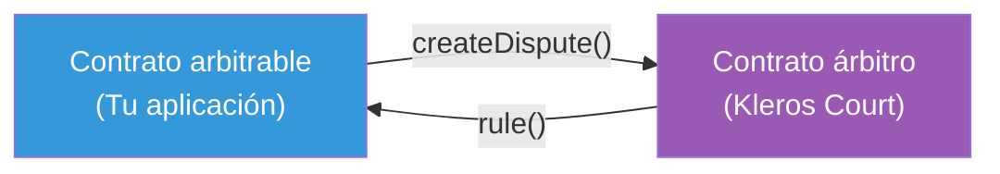
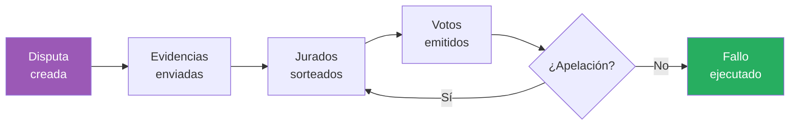

Kleros ofrece un protocolo de resolución de disputas de uso general. Cualquier contrato inteligente puede usarlo como árbitro: cuando surge un desacuerdo, el contrato envía una disputa a Kleros, los jurados votan sobre el resultado y el fallo se ejecuta automáticamente.

Esta página explica el mecanismo central y por qué produce resultados fiables.

---

## La idea central

Kleros se basa en un concepto de la teoría de juegos llamado **punto de Schelling** (o punto focal). Cuando se pide a las personas que se coordinen en una respuesta sin comunicarse, tienden a converger en la respuesta más obvia o "natural". Kleros aprovecha esto de la siguiente manera:

1. Sortea un conjunto aleatorio de jurados que **no pueden comunicarse** entre sí
2. Les pide que evalúen las evidencias de forma independiente y voten sobre el resultado
3. **Recompensa** a los jurados que votan con la mayoría y **penaliza** a los que no lo hacen

Como cada jurado sabe que los demás jurados intentan encontrar de forma independiente la respuesta veraz "obvia", la estrategia racional es votar con honestidad. Los jurados deshonestos se arriesgan a perder sus tokens PNK en stake, mientras que los jurados honestos ganan tarifas y PNK de los deshonestos.

---

## Árbitro y arbitrable

Kleros usa una arquitectura de dos contratos:

El **arbitrable** es cualquier contrato inteligente que pueda necesitar resolución de disputas: un escrow, un marketplace, un registro. Crea disputas e implementa una función de callback para recibir los fallos.

El **árbitro** es Kleros Court. Se encarga de la selección de jurados, la votación, las apelaciones y la entrega de fallos. El contrato arbitrable nunca necesita entender la mecánica interna de cómo se seleccionan los jurados o cómo se cuentan los votos.

Esta separación significa que cualquier aplicación existente puede conectarse a Kleros implementando una interfaz sencilla.

---

## Por qué funciona

Tres propiedades hacen viable la resolución descentralizada de disputas:

### 1. Alineación económica

Los jurados hacen stake de tokens PNK para participar. Los jurados incoherentes (los que votan en contra de la mayoría final) pierden una parte de su stake, que se redistribuye entre los jurados coherentes. Esto crea un incentivo financiero directo para buscar la verdad en lugar de votar al azar o de forma deshonesta.

### 2. Juicio independiente

Los jurados se sortean aleatoriamente y votan de forma independiente. En V2, los votos ocultos (commit-reveal) impiden que los jurados vean los votos de los demás antes de comprometer el suyo, lo que elimina el efecto arrastre.

### 3. Escalada mediante apelaciones

Si alguien cree que un fallo es incorrecto, puede financiar una apelación. Cada ronda de apelación sortea más jurados (aproximadamente el doble), lo que hace exponencialmente más costoso para un atacante mantener una mayoría deshonesta a lo largo de rondas sucesivas. El sistema de apelaciones es la garantía definitiva de Kleros: mientras haya participantes honestos dispuestos a financiar apelaciones, el sistema se autocorrige.

---

## ¿Qué disputas puede resolver Kleros?

Kleros funciona mejor con disputas que son **adjudicables**, es decir, aquellas en las que una persona razonable, con evidencias suficientes, puede determinar el resultado correcto. Ejemplos:

- **"¿Entregó el freelancer el trabajo descrito en el contrato?"**  Sí, con evidencias
- **"¿Cumple este logotipo de token las directrices de envío?"**  Sí, con criterios de política
- **"¿Es correcta esta etiqueta de dirección?"** Sí, con verificación on-chain

Kleros no está diseñado para disputas puramente subjetivas sin criterios de evaluación, ni para disputas que requieran ejecución física.

---

## El ciclo de vida de una disputa

Para un recorrido detallado de cada fase, consulta [Cómo funciona](/es/court/how-it-works). Este es el flujo general:

---

## Lecturas adicionales

<CardGroup cols={3}>
  <Card title="Teoría de juegos" icon="chess" href="/es/concepts/game-theory">
    La mecánica de incentivos detrás de la votación honesta
  </Card>
  <Card title="Sorteo" icon="dice" href="/es/concepts/sortition">
    Cómo se seleccionan aleatoriamente los jurados
  </Card>
  <Card title="Yellow Paper de Kleros" icon="file" href="https://kleros.io/yellowpaper.pdf">
    Tratamiento formal completo del protocolo
  </Card>
</CardGroup>