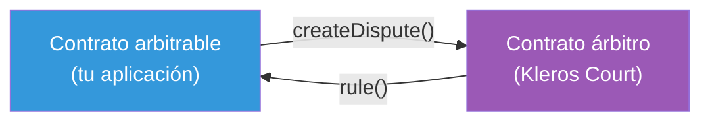
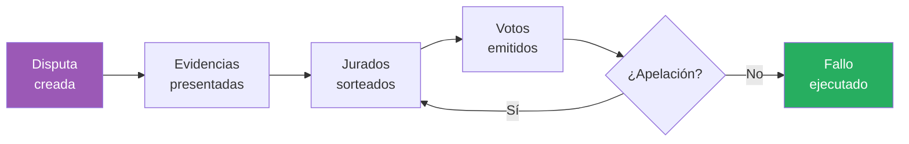

Kleros ofrece un protocolo de resolución de disputas de uso general. Cualquier contrato inteligente puede usarlo como árbitro: cuando surge un desacuerdo, el contrato envía una disputa a Kleros, los jurados votan sobre el resultado y el fallo se ejecuta automáticamente.

Esta página explica el mecanismo central y por qué produce resultados fiables.

---

## La idea central {#the-core-idea}

Kleros se basa en un concepto de la teoría de juegos llamado **punto de Schelling** (o punto focal). Cuando se pide a las personas que se coordinen en una respuesta sin comunicarse, tienden a converger en la respuesta más obvia o "natural". Kleros aprovecha esto:

1. Sorteando un conjunto aleatorio de jurados que **no pueden comunicarse** entre sí
2. Pidiéndoles que evalúen las evidencias de forma independiente y voten sobre el resultado
3. **Recompensando** a los jurados que votan con la mayoría y **penalizando** a los que no lo hacen

Como cada jurado sabe que los demás intentan, de forma independiente, encontrar la respuesta veraz "obvia", la estrategia racional es votar con honestidad. Los jurados deshonestos se arriesgan a perder sus tokens PNK en staking, mientras que los honestos ganan tasas y PNK de los deshonestos.

---

## Árbitro y arbitrable {#arbitrator-and-arbitrable}

Kleros utiliza una arquitectura de dos contratos:

El **arbitrable** es cualquier contrato inteligente que pueda necesitar resolución de disputas: un escrow, un marketplace, un registro. Crea disputas e implementa una función de retorno (callback) para recibir los fallos.

El **árbitro** es Kleros Court. Se encarga de la selección de jurados, la votación, las apelaciones y la entrega de los fallos. El contrato arbitrable nunca necesita entender la mecánica interna de cómo se seleccionan los jurados o cómo se cuentan los votos.

Esta separación significa que cualquier aplicación existente puede conectarse a Kleros implementando una interfaz sencilla.

---

## Por qué funciona {#why-it-works}

Tres propiedades hacen viable la resolución descentralizada de disputas:

### 1. Alineación económica {#1-economic-alignment}

Los jurados hacen staking de tokens PNK para participar. Los jurados incoherentes (los que votan en contra de la mayoría final) pierden una parte de su stake, que se redistribuye entre los jurados coherentes. Esto crea un incentivo económico directo para buscar la verdad en lugar de votar al azar o de forma deshonesta.

### 2. Juicio independiente {#2-independent-judgment}

Los jurados se sortean al azar y votan de forma independiente. En V2, los votos ocultos (commit-reveal) impiden que los jurados vean los votos de los demás antes de confirmar el suyo, lo que elimina el efecto arrastre.

### 3. Escalada mediante apelaciones {#3-escalation-through-appeals}

Si alguien cree que un fallo es erróneo, puede financiar una apelación. Cada ronda de apelación sortea más jurados (aproximadamente el doble), lo que hace exponencialmente más caro para un atacante mantener una mayoría deshonesta a lo largo de rondas sucesivas. El sistema de apelaciones es la garantía final de Kleros: mientras haya participantes honestos dispuestos a financiar apelaciones, el sistema se corrige a sí mismo.

---

## ¿Qué disputas puede resolver Kleros? {#what-disputes-can-kleros-resolve}

Kleros funciona mejor con disputas **adjudicables**, es decir, aquellas en las que una persona razonable, con evidencias suficientes, puede determinar el resultado correcto. Ejemplos:

- **"¿Entregó el freelancer el trabajo descrito en el contrato?"**  Sí, con evidencias
- **"¿Cumple el logotipo de este token las directrices de envío?"**  Sí, con criterios de política
- **"¿Es correcta esta etiqueta de dirección?"** Sí, con verificación en la cadena

Kleros no está diseñado para disputas puramente subjetivas sin criterios de evaluación, ni para disputas que requieran una ejecución física.

---

## El ciclo de vida de una disputa {#the-dispute-lifecycle}

Para un recorrido detallado de cada fase, consulta [Cómo funciona](/es/court/how-it-works). Este es el flujo general:

---

## Lecturas adicionales {#further-reading}

<CardGroup cols={3}>
  <Card title="Teoría de juegos" icon="chess" href="/es/concepts/game-theory">
    La mecánica de incentivos detrás del voto honesto
  </Card>
  <Card title="Sorteo (sortition)" icon="dice" href="/es/concepts/sortition">
    Cómo se seleccionan aleatoriamente los jurados
  </Card>
  <Card title="Yellow paper de Kleros" icon="file" href="https://kleros.io/yellowpaper.pdf">
    Tratamiento formal completo del protocolo
  </Card>
</CardGroup>
