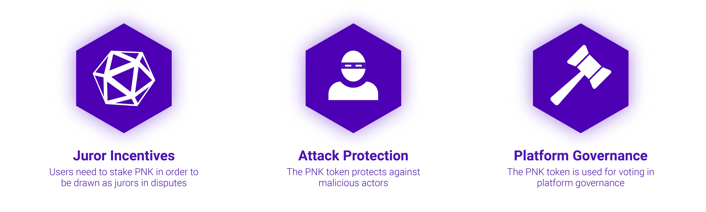

# Token PNK {#pnk-token}

**PNK** es el token nativo del protocolo Kleros. Cumple dos funciones principales: el **staking para ser elegible como jurado** y los **derechos de voto en la gobernanza**. Los poseedores del token hacen staking de PNK para participar en la resolución de disputas (un stake mayor aumenta la probabilidad de selección) y lo utilizan para votar propuestas de gobernanza, parámetros de los tribunales y cambios en la plataforma.

El nombre hace referencia a los **pinakia**, las placas de bronce que se usaban en la antigua Atenas para la selección aleatoria de jurados.

---

## Suministro del token {#token-supply}

El suministro máximo del token PNK es de **915.528.222,07931277**. Los cambios en el suministro se controlan exclusivamente mediante votaciones de gobernanza de la DAO de Kleros.

- Contrato en mainnet: [`0x93ED3FBe21207Ec2E8f2d3c3de6e058Cb73Bc04d`](https://etherscan.io/token/0x93ed3fbe21207ec2e8f2d3c3de6e058cb73bc04d)

---

## Para qué se usa PNK {#what-pnk-is-used-for}

| Función | Cómo funciona |
| --- | --- |
| **Staking de jurados** | Haz staking de PNK en un tribunal para ser elegible en la selección de jurados. La probabilidad de selección es proporcional al stake. |
| **Alineación de incentivos** | Los jurados coherentes ganan tasas de arbitraje y PNK redistribuido de los jurados incoherentes; los jurados incoherentes pierden parte de su stake. |
| **Gobernanza** | Los poseedores de PNK votan las propuestas de mejora de Kleros (KIP), los parámetros de los tribunales y las actualizaciones del protocolo. |

<Frame >
  
</Frame>

---

## [Por qué Kleros necesita un token nativo](https://medium.com/kleros/why-kleros-needs-a-native-token-5c6c6e39cdfe) {#why-kleros-needs-a-native-token}

El diseño de PNK ofrece tres capas de protección frente a un [ataque (Sybil)](https://en.wikipedia.org/wiki/Sybil_attack) del 51%:

1. **Defensa por escasez de mercado.** Adquirir el 51% del PNK resulta económicamente prohibitivo: las compras grandes agotan la liquidez disponible y hacen subir el precio, a diferencia de un ataque denominado en ETH u otro activo con mercados mucho más profundos.
2. **Riesgo de impacto en el precio.** Un ataque con éxito devaluaría considerablemente el propio PNK, lo que impondría al atacante un coste enorme que no existe cuando se ataca con un activo externo.
3. **Capacidad de bifurcación.** Como último recurso, la comunidad puede realizar una bifurcación (fork) de emergencia que elimine los tokens del atacante, una vía de recuperación que no existe con tokens externos.

---

## Cómo conseguir PNK {#how-to-get-pnk}

La forma más rápida es la [página Buy PNK de Court](https://court.kleros.io/tokens), que te dirige a los exchanges que aparecen en ella.

| Tipo de plataforma | Opciones |
| --- | --- |
| **Agregadores DEX** (operaciones grandes) | Paraswap, 1inch |
| **DEX** (operaciones medianas) | Uniswap, Sushiswap, Balancer |
| **Exchanges centralizados** | Bitfinex, Gate.io, OKX |
| **Rampa de entrada fiat** | Guardarian |

---

## ¿Qué sigue? {#what’s-next}

<CardGroup cols={3}>
  <Card title="Economía del token" icon="chart-pie" href="/es/concepts/tokenomics">
    El modelo económico completo de Kleros
  </Card>
  <Card title="Hazte jurado" icon="user-plus" href="/tutorials/juror-tutorial-v1">
    Haz staking de PNK y empieza a juzgar casos
  </Card>
  <Card title="Gobernanza" icon="landmark" href="/es/governance/overview">
    Vota con PNK las decisiones del protocolo
  </Card>
</CardGroup>
