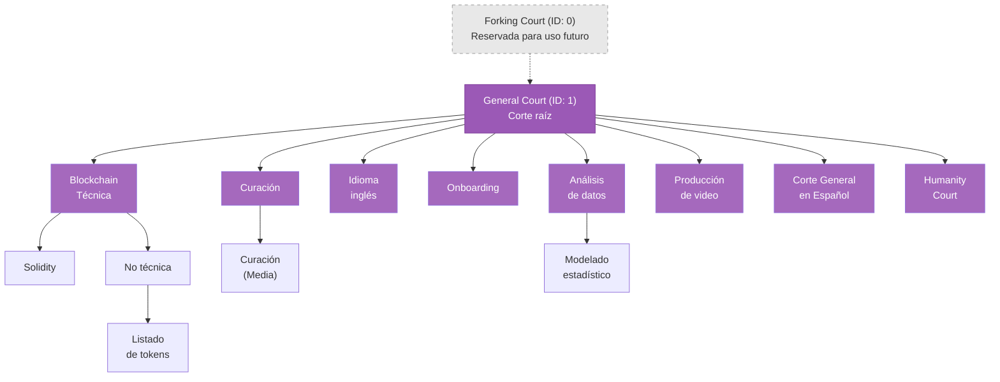

Las cortes de Kleros se organizan en una estructura de árbol jerárquica, lo que permite que las disputas sean atendidas por jurados con la experiencia adecuada y, al mismo tiempo, mantiene una vía de apelación clara.

<Note>
El modelo jerárquico es el mismo en ambas versiones del protocolo. V1 usa el término **subcortes** y su árbol de cortes se ejecuta en Ethereum Mainnet; V2 usa el término **cortes** y se ejecuta en Arbitrum. El árbol, los parámetros y los ejemplos siguientes corresponden a V2. La curación para los productos de Curate también se ejecuta en **Gnosis Chain** usando cortes de V1. La propuesta de gobernanza **KIP-87** creó una nueva Curation Court en Gnosis Chain con votación oculta, que entró en funcionamiento en junio de 2026.
</Note>

---

## Estructura de las cortes

El árbol de cortes forma una arborescencia con la General Court como raíz actual. La gobernanza puede añadir nuevas cortes a medida que Kleros se adopta para tipos de disputas adicionales.



<Info>Este diagrama refleja el árbol de cortes del yellow paper de Kleros (Figura 5). El árbol de cortes en vivo en [v2.kleros.builders](https://v2.kleros.builders) puede diferir a medida que se añaden o modifican cortes mediante la gobernanza.</Info>

---

## Tipos de cortes

<Tabs>
  <Tab title="General Court">
    **La corte raíz (ID: 1)**

    La General Court actúa actualmente como raíz de todo el sistema de cortes. Atiende las apelaciones de todas las cortes especializadas y tiene el mayor grupo de jurados, porque hacer staking en cualquier corte especializada te registra automáticamente en todas las cortes padre hasta la General Court.

    Todo jurado del sistema Kleros es, por definición, jurado de la General Court.
  </Tab>
  <Tab title="Cortes especializadas">
    **Experiencia específica por dominio**

    Las cortes especializadas se centran en dominios concretos y requieren que los jurados tengan la experiencia correspondiente. Cada una tiene su propio documento de política que define reglas y requisitos.

    Ejemplos del árbol de cortes en vivo:

    - **Blockchain Technical**: Disputas sobre smart contracts, cuestiones técnicas a nivel de protocolo
    - **Solidity**: Una subcorte de Blockchain Technical para disputas específicas de Solidity
    - **Curation**: Listas de tokens, etiquetas de direcciones, disputas de registros
    - **English Language**: Calidad de traducciones, disputas de contenido
    - **Data Analysis / Statistical Modeling**: Disputas relacionadas con datos
    - **Video Production**: Disputas sobre la calidad de contenido de video
    - **Humanity Court**: Impugnaciones de registros en Proof of Humanity
    - **Corte General en Español**: Disputas en idioma español
  </Tab>
  <Tab title="Forking Court">
    **Reservada para uso futuro (ID: 0)**

    El ID de corte 0 está reservado para la futura Forking Court, que atenderá disputas a nivel de protocolo y servirá como punto de escalada definitivo. Actualmente no puede usarse para disputas ordinarias.

    <Warning>El ID de corte 0 está reservado y no puede usarse. Los intentos de crear disputas en la Forking Court fallarán.</Warning>
    - Actualmente actúa como raíz del sistema de cortes
    - Atiende las apelaciones de todas las cortes especializadas
    - Tiene los requisitos de jurado más amplios
    - Incluye a todos los jurados del sistema (debido al staking automático en cortes padre)

    <Info>
    Cuando haces staking en cualquier corte especializada, quedas automáticamente registrado en todas las cortes padre hasta la General Court.
    </Info>
  </Tab>

  <Tab title="Automated Curation">
    **Resolución optimizada para IA** <Badge>Solo V2</Badge>

    - Nuevo tipo de corte diseñado para agentes de IA
    - Parámetros de resolución de disputas optimizados
    - Adecuada para tareas de curación de gran volumen y menor cuantía
  </Tab>
</Tabs>

---

## Parámetros de las cortes

Cada corte tiene parámetros que definen cómo funciona. Se establecen al crear la corte y **la gobernanza puede modificarlos**, así que consulta siempre [v2.kleros.builders](https://v2.kleros.builders/) para ver los valores vigentes.

| Parámetro | Descripción | Ejemplo de la especificación |
| --- | --- | --- |
| **Stake mínimo** (`minStake`) | PNK mínimo requerido para hacer staking en esta corte | 2,300 PNK |
| **Alpha** (`alpha`) | Puntos básicos que controlan cuánto PNK se bloquea por voto | 10000 (100%) |
| **Honorario por jurado** (`feeForJuror`) | Pago por jurado por ronda de disputa | 0.005 ETH |
| **Jurados para salto de corte** (`jurorsForCourtJump`) | Umbral de jurados que activa la escalada a la corte padre | 511 |
| **Votos ocultos** (`hiddenVotes`) | Si se usa votación commit-reveal | true / false |
| **Tiempos por periodo** (`timesPerPeriod`) | Duración de cada fase de la disputa en segundos | [280800, 583200, 583200, 388800] |

<Warning>Los parámetros de las cortes se ajustan mediante la gobernanza y pueden diferir de cualquier fuente estática. Verifica siempre los valores vigentes en [v2.kleros.builders](https://v2.kleros.builders/).</Warning>

### Parámetros de las cortes en mainnet (Arbitrum One)
 
La siguiente tabla muestra la configuración de cortes de producción tal como se desplegó. Los valores están controlados por la gobernanza y pueden haber cambiado desde que se redactó esto; contrástalos siempre con [v2.kleros.builders](https://v2.kleros.builders/).
 
| ID | Nombre | Padre | minStake (PNK) | feeForJuror (ETH) | jurorsForJump | hiddenVotes |
|---|---|---|---|---|---|---|
| 1 | General Court | 1 (raíz) | 2,300 | 0.005 | 511 | Sí |
| 2 | Blockchain | 1 | 7,000 | 0.0069 | 63 | No |
| 3 | Non-Technical | 2 | 7,000 | 0.003 | 31 | No |
| 4 | Token Listing | 3 | 70,000 | 0.064 | 47 | No |
| 5 | Technical | 2 | 33,000 | 0.033 | 31 | No |
| 6 | Marketing Services | 1 | 7,800 | 0.0062 | 15 | No |
| 7 | English Language | 1 | 9,000 | 0.0074 | 3 | No |
| 8 | Video Production | 1 | 7,500 | 0.0062 | 3 | No |
| 9 | Onboarding | 1 | 2,300 | 0.0007 | 255 | No |
| 10 | Curation | 1 | 2,600 | 0.0024 | 30 | No |
| 11 | Data Analysis | 1 | 15,000 | 0.018 | 64 | No |
| 12 | Statistical Modeling | 11 | 19,000 | 0.019 | 32 | No |
| 13 | Curation (Medium) | 10 | 2,900 | 0.0023 | 30 | No |
| 14 | Spanish-English Translation | 7 | 9,000 | 0.0031 | 128 | No |
| 15 | French-English Translation | 7 | 9,000 | 0.0031 | 128 | No |
| 16 | Portuguese-English Translation | 7 | 9,000 | 0.0031 | 128 | No |
| 17 | German-English Translation | 7 | 9,000 | 0.0039 | 128 | No |
| 18 | Russian-English Translation | 7 | 9,000 | 0.0039 | 128 | No |
| 19 | Korean-English Translation | 7 | 9,000 | 0.005 | 128 | No |
| 20 | Japanese-English Translation | 7 | 9,000 | 0.005 | 128 | No |
| 21 | Turkish-English Translation | 7 | 9,000 | 0.005 | 128 | No |
| 22 | Chinese-English Translation | 7 | 9,000 | 0.005 | 128 | No |
| 23 | Corte General en Español | 1 | 5,100 | 0.005 | 128 | No |
| 24 | Humanity Court | 1 | 5,300 | 0.0024 | 31 | No |
| 25 | Development Court | 1 | 9,500 | 0.011 | 63 | No |
| 26 | Solidity Court | 25 | 9,500 | 0.011 | 63 | No |
| 27 | Javascript Court | 25 | 9,500 | 0.011 | 63 | No |
| 28 | Corte de Curación en Español | 23 | 5,100 | 0.0024 | 30 | No |
| 29 | Corte de Disputas de Consumo y Vecindad | 23 | 8,400 | 0.0054 | 15 | No |
| 30 | Oracle Court | 1 | 5,000 | 0.0069 | 31 | No |
| 31 | Automated Curation | 10 | 2,600 | 0.00017 | 3 | No |
| 32 | Corte de Defensores del Cliente | 29 | 8,400 | 0.0054 | 15 | No |
| 33 | Commerce Court | 1 | 11,000 | 0.018 | 31 | Sí |
| 34 | Agentic Commerce Court | 33 | 11,000 | 0.00027 | 7 | Sí |
 
<Note>
Las cortes 29 y 32 (cortes de protección al consumidor de Argentina) usan `DisputeKitGated` y requieren tokens SBT de elegibilidad específicos. Consulta [Direcciones de despliegue V2](/es/reference/contracts/deployment-addresses) para ver las direcciones de los contratos SBT.
</Note>

<Note>
La **Agentic Commerce Court** (corte 34, creada en agosto de 2026) atiende disputas comerciales de pequeña escala, en particular las derivadas de interacciones comerciales entre agentes de IA. Consulta su [política en v2.kleros.builders](https://v2.kleros.builders/#/courts/34/purpose).
</Note>
 
### Parámetros de testnet (Arbitrum Sepolia)
 
Los parámetros de las cortes en testnet son deliberadamente distintos de los de mainnet para permitir pruebas más rápidas:
 
| Parámetro | Mainnet (General Court) | Testnet (General Court) |
|---|---|---|
| minStake | 2,300 PNK | 150 PNK |
| feeForJuror | 0.005 ETH | 0.00001 ETH |
| timesPerPeriod | ~3 días cada uno | 12 horas cada uno |
| Cortes disponibles | 34 | 6 |
 
No uses los valores de los parámetros de testnet para estimar costes o probabilidades de sorteo en mainnet.

### Comprender alpha

El parámetro `alpha` determina qué parte de tu stake se bloquea cuando eres sorteado como jurado:

```
pnkAtStakePerJuror = (minStake × alpha) / 10000
```

<Accordion title="Ejemplo de alpha">
**Con minStake = 2,300 PNK y alpha = 10000 (100%)**

Tu cantidad bloqueada por voto = 2,300 PNK

Si alpha fuera 5000 (50%), tu cantidad bloqueada sería de 1,150 PNK por voto. El parámetro `alpha` establece en la práctica el riesgo económico de participar como jurado: un alpha más alto implica más PNK en juego por voto.
</Accordion>

### Periodos de tiempo

Cada disputa avanza a través de cuatro periodos clave, cuyas duraciones se definen por corte:

1. **Periodo de evidencia**: Tiempo para que las partes presenten evidencia
2. **Periodo de commit**: Tiempo para que los jurados confirmen (commit) sus votos (cuando `hiddenVotes = true`)
3. **Periodo de votación / revelación**: Tiempo para votar o revelar los votos confirmados
4. **Periodo de apelación**: Tiempo para financiar apelaciones

---

## Staking automático en cortes padre

**Concepto fundamental**: Cuando haces staking en una corte especializada, quedas automáticamente registrado en todas las cortes padre hasta la General Court.

Lo que esto significa en la práctica:

- Hacer staking en la corte **Solidity** = también eres elegible para casos de **Blockchain Technical** y de la **General Court**
- Hacer staking en **Curation (Medium)** = también eres elegible para casos de **Curation** y de la **General Court**
- La General Court incluye a todos los jurados de todo el sistema

Esto garantiza suficiente disponibilidad de jurados en cada nivel y mantiene una vía de apelación adecuada, en la que las cortes padre siempre tienen un grupo de jurados más amplio que sus cortes hijas.

---

## Staking en múltiples cortes

Puedes hacer staking en varias cortes, pero existen restricciones importantes:

### Límite de cortes

Existe un límite `MAX_STAKE_PATHS` sobre en cuántas cortes puede hacer staking simultáneamente un mismo jurado. Existe por eficiencia de gas: muchas operaciones de sorteo escalan linealmente con el número de cortes en las que se tiene stake.

<Note>Verifica el valor actual de `MAX_STAKE_PATHS` on-chain o en el [contrato Sortition Module](https://github.com/kleros/kleros-v2). Si intentas hacer staking en más cortes de las permitidas, la transacción revertirá con `CannotStakeInMoreCourts`.</Note>

### Elegir cortes

Ten en cuenta estos factores al seleccionar cortes:

1. **Tu experiencia**: Elige cortes acordes a tus áreas de conocimiento y lee la política de cada corte antes de hacer staking
2. **Stake mínimo**: Asegúrate de cumplir el requisito de `minStake` de la corte (consulta los valores vigentes)
3. **Nivel de actividad**: Cortes más activas = más oportunidades de ganar
4. **Alineación con la política**: Comprende y acepta las reglas de la corte antes de comprometer PNK

---

## Políticas de las cortes

Cada corte tiene un documento de política que define:

| Sección | Descripción |
| --- | --- |
| **Propósito** | Qué tipos de disputas atiende la corte |
| **Reglas** | Directrices que los jurados deben seguir al evaluar la evidencia |
| **Habilidades requeridas** | Conocimientos o experiencia que deben poseer los jurados |
| **Procedimientos especiales** | Cualquier requisito específico de la corte |

Las políticas se gestionan mediante el contrato `PolicyRegistry` y la gobernanza puede actualizarlas. Las cortes hijas heredan las políticas de sus cortes padre, por lo que las políticas de la General Court se aplican en todas partes.

<Warning>**Fundamental para los jurados**: Lee siempre la política de la corte antes de hacer staking o votar. No seguir las políticas de la corte puede provocar votos incoherentes y la pérdida de PNK.</Warning>

<Card title="Explorar las políticas de las cortes" icon="building-columns" href="https://v2.kleros.builders/">
  Visita Kleros Court, haz clic en "Courts" y revisa la política de cualquier corte que te interese.
</Card>

---

## Funciones de transparencia de las cortes

La interfaz de V2 ofrece mayor transparencia para cada corte:

- **Principales jurados con stake**: Consulta quién tiene los mayores stakes en cada corte
- **Stakes más recientes**: Supervisa la actividad de staking en tiempo real
- **Estadísticas de la corte**: Consulta el historial de disputas y las tasas de resolución
- **Parámetros de la corte**: Todos los parámetros pueden consultarse on-chain y en la interfaz de la Court

---

## ¿Qué sigue?

<CardGroup cols={3}>
  <Card title="Apelaciones" icon="arrow-up-right-from-square" href="/es/court/appeals">
    Descubre cómo escalan los casos a través de la jerarquía
  </Card>
  <Card title="Cómo funciona" icon="gears" href="/es/court/how-it-works">
    Comprende el proceso completo de resolución de disputas
  </Card>
  <Card title="Guía de staking" icon="coins" href="https://kleros.notion.site/Complete-Beginner-s-Guide-to-Kleros-Court-V2-20e9a9db4f08803da1b2c372ed2f2c6e?pvs=74">
    Guía paso a paso para hacer staking en las cortes
  </Card>
</CardGroup>
