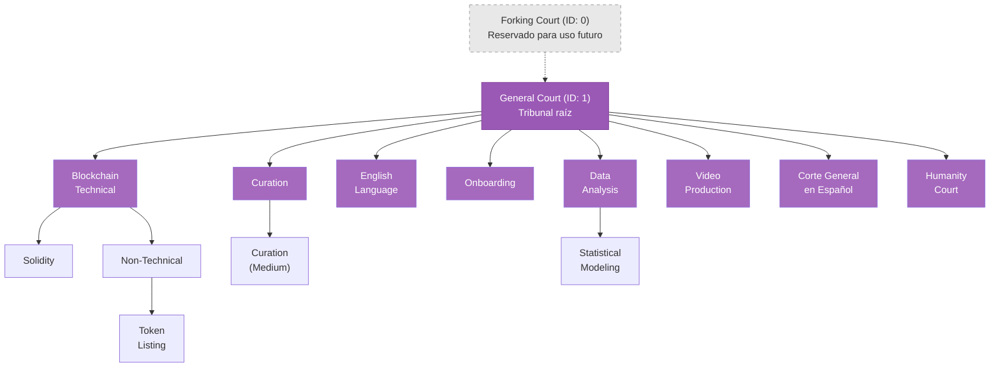

Los tribunales de Kleros se organizan en una estructura de árbol jerárquica, lo que permite que las disputas las resuelvan jurados con los conocimientos adecuados y, al mismo tiempo, mantiene una vía de apelación clara.

<Note>
El modelo jerárquico es el mismo en ambas versiones del protocolo. V1 utiliza el término **subcourts** (subtribunales) y su árbol de tribunales funciona en la red principal de Ethereum; V2 utiliza el término **courts** (tribunales) y funciona en Arbitrum. El árbol, los parámetros y los ejemplos que aparecen a continuación corresponden a V2. La curación de los productos Curate también funciona en **Gnosis Chain** con tribunales V1. La propuesta de gobernanza **KIP-87** creó un nuevo Curation Court en Gnosis Chain con votación oculta, que entró en funcionamiento en junio de 2026.
</Note>

---

## Estructura de tribunales {#court-structure}

El árbol de tribunales forma una arborescencia con el General Court como raíz actual. La gobernanza puede añadir nuevos tribunales a medida que Kleros se adopta para otros tipos de disputas.



<Info>Este diagrama refleja el árbol de tribunales del yellow paper de Kleros (figura 5). El árbol de tribunales en vivo en [v2.kleros.builders](https://v2.kleros.builders) puede diferir a medida que la gobernanza añade o modifica tribunales.</Info>

---

## Tipos de tribunales {#court-types}

<Tabs>
  <Tab title="General Court">
    **El tribunal raíz (ID: 1)**

    El General Court es actualmente la raíz de todo el sistema de tribunales. Resuelve las apelaciones de todos los tribunales especializados y tiene el grupo de jurados más amplio, porque hacer staking en cualquier tribunal especializado te pone automáticamente en staking en todos los tribunales padre hasta el General Court.

    Todo jurado del sistema Kleros es, por definición, jurado del General Court.
  </Tab>
  <Tab title="Tribunales especializados">
    **Conocimientos específicos del ámbito**

    Los tribunales especializados se centran en ámbitos concretos y requieren que los jurados tengan los conocimientos pertinentes. Cada uno tiene su propio documento de política que define sus reglas y requisitos.

    Ejemplos del árbol de tribunales en vivo:

    - **Blockchain Technical**: disputas sobre contratos inteligentes y cuestiones técnicas a nivel de protocolo
    - **Solidity**: un subtribunal de Blockchain Technical para disputas específicas de Solidity
    - **Curation**: listas de tokens, etiquetas de direcciones y disputas de registros
    - **English Language**: calidad de traducciones y disputas de contenido
    - **Data Analysis / Statistical Modeling**: disputas relacionadas con datos
    - **Video Production**: disputas sobre la calidad de contenidos de vídeo
    - **Humanity Court**: impugnaciones de registros en Proof of Humanity
    - **Corte General en Español**: disputas en español
  </Tab>
  <Tab title="Forking Court">
    **Reservado para uso futuro (ID: 0)**

    El ID de tribunal 0 está reservado para el futuro Forking Court, que resolverá disputas a nivel de protocolo y servirá como punto de escalada final. Actualmente no se puede usar para disputas ordinarias.

    <Warning>El ID de tribunal 0 está reservado y no se puede usar. Los intentos de crear disputas en el Forking Court fallarán.</Warning>
    - Actualmente es la raíz del sistema de tribunales
    - Resuelve las apelaciones de todos los tribunales especializados
    - Tiene los requisitos de jurado más amplios
    - Incluye a todos los jurados del sistema (debido al staking automático en los tribunales padre)

    <Info>
    Cuando haces staking en cualquier tribunal especializado, quedas automáticamente en staking en todos los tribunales padre hasta el General Court.
    </Info>
  </Tab>

  <Tab title="Automated Curation">
    **Resolución optimizada para IA** <Badge>Solo V2</Badge>

    - Nuevo tipo de tribunal diseñado para agentes de IA
    - Parámetros de resolución de disputas optimizados
    - Adecuado para tareas de curación de gran volumen y menor riesgo
  </Tab>
</Tabs>

---

## Parámetros de los tribunales {#court-parameters}

Cada tribunal tiene parámetros que definen su funcionamiento. Se establecen al crear el tribunal y **la gobernanza puede modificarlos**, así que consulta siempre [v2.kleros.builders](https://v2.kleros.builders/) para ver los valores vigentes.

| Parámetro | Descripción | Ejemplo de la especificación |
| --- | --- | --- |
| **Stake mínimo** (`minStake`) | PNK mínimo necesario para hacer staking en este tribunal | 2.300 PNK |
| **Alpha** (`alpha`) | Puntos básicos que controlan cuánto PNK se bloquea por voto | 10000 (100%) |
| **Tasa por jurado** (`feeForJuror`) | Pago por jurado y por ronda de disputa | 0,005 ETH |
| **Jurados para salto de tribunal** (`jurorsForCourtJump`) | Umbral de jurados que activa la escalada al tribunal padre | 511 |
| **Votos ocultos** (`hiddenVotes`) | Si se usa la votación commit-reveal | true / false |
| **Duración por periodo** (`timesPerPeriod`) | Duración de cada fase de la disputa en segundos | [280800, 583200, 583200, 388800] |

<Warning>Los parámetros de los tribunales se ajustan mediante la gobernanza y pueden diferir de cualquier fuente estática. Verifica siempre los valores vigentes en [v2.kleros.builders](https://v2.kleros.builders/).</Warning>

### Parámetros de los tribunales en mainnet (Arbitrum One) {#mainnet-court-parameters-arbitrum-one}
 
La siguiente tabla muestra la configuración de los tribunales en producción tal como se desplegó. Los valores los controla la gobernanza y pueden haber cambiado desde que se redactó esta página: compruébalos siempre en [v2.kleros.builders](https://v2.kleros.builders/).
 
| ID | Nombre | Padre | minStake (PNK) | feeForJuror (ETH) | jurorsForJump | hiddenVotes |
|---|---|---|---|---|---|---|
| 1 | General Court | 1 (raíz) | 2.300 | 0,005 | 511 | Sí |
| 2 | Blockchain | 1 | 7.000 | 0,0069 | 63 | No |
| 3 | Non-Technical | 2 | 7.000 | 0,003 | 31 | No |
| 4 | Token Listing | 3 | 70.000 | 0,064 | 47 | No |
| 5 | Technical | 2 | 33.000 | 0,033 | 31 | No |
| 6 | Marketing Services | 1 | 7.800 | 0,0062 | 15 | No |
| 7 | English Language | 1 | 9.000 | 0,0074 | 3 | No |
| 8 | Video Production | 1 | 7.500 | 0,0062 | 3 | No |
| 9 | Onboarding | 1 | 2.300 | 0,0007 | 255 | No |
| 10 | Curation | 1 | 2.600 | 0,0024 | 30 | No |
| 11 | Data Analysis | 1 | 15.000 | 0,018 | 64 | No |
| 12 | Statistical Modeling | 11 | 19.000 | 0,019 | 32 | No |
| 13 | Curation (Medium) | 10 | 2.900 | 0,0023 | 30 | No |
| 14 | Spanish-English Translation | 7 | 9.000 | 0,0031 | 128 | No |
| 15 | French-English Translation | 7 | 9.000 | 0,0031 | 128 | No |
| 16 | Portuguese-English Translation | 7 | 9.000 | 0,0031 | 128 | No |
| 17 | German-English Translation | 7 | 9.000 | 0,0039 | 128 | No |
| 18 | Russian-English Translation | 7 | 9.000 | 0,0039 | 128 | No |
| 19 | Korean-English Translation | 7 | 9.000 | 0,005 | 128 | No |
| 20 | Japanese-English Translation | 7 | 9.000 | 0,005 | 128 | No |
| 21 | Turkish-English Translation | 7 | 9.000 | 0,005 | 128 | No |
| 22 | Chinese-English Translation | 7 | 9.000 | 0,005 | 128 | No |
| 23 | Corte General en Español | 1 | 5.100 | 0,005 | 128 | No |
| 24 | Humanity Court | 1 | 5.300 | 0,0024 | 31 | No |
| 25 | Development Court | 1 | 9.500 | 0,011 | 63 | No |
| 26 | Solidity Court | 25 | 9.500 | 0,011 | 63 | No |
| 27 | Javascript Court | 25 | 9.500 | 0,011 | 63 | No |
| 28 | Corte de Curación en Español | 23 | 5.100 | 0,0024 | 30 | No |
| 29 | Corte de Disputas de Consumo y Vecindad | 23 | 8.400 | 0,0054 | 15 | No |
| 30 | Oracle Court | 1 | 5.000 | 0,0069 | 31 | No |
| 31 | Automated Curation | 10 | 2.600 | 0,00017 | 3 | No |
| 32 | Corte de Defensores del Cliente | 29 | 8.400 | 0,0054 | 15 | No |
| 33 | Commerce Court | 1 | 11.000 | 0,018 | 31 | Sí |
| 34 | Agentic Commerce Court | 33 | 11.000 | 0,00027 | 7 | Sí |
 
<Note>
Los tribunales 29 y 32 (tribunales de Protección al Consumidor de Argentina) utilizan `DisputeKitGated` y requieren tokens de elegibilidad SBT específicos. Consulta [Direcciones de despliegue V2](/reference/contracts/deployment-addresses) para ver las direcciones de los contratos SBT.
</Note>

<Note>
El **Agentic Commerce Court** (tribunal 34, creado en agosto de 2026) resuelve disputas comerciales de pequeña escala, en particular las derivadas de interacciones comerciales entre agentes de IA. Consulta su [política en v2.kleros.builders](https://v2.kleros.builders/#/courts/34/purpose).
</Note>
 
### Parámetros de testnet (Arbitrum Sepolia) {#testnet-parameters-arbitrum-sepolia}
 
Los parámetros de los tribunales en testnet son deliberadamente distintos de los de mainnet para permitir pruebas más rápidas:
 
| Parámetro | Mainnet (General Court) | Testnet (General Court) |
|---|---|---|
| minStake | 2.300 PNK | 150 PNK |
| feeForJuror | 0,005 ETH | 0,00001 ETH |
| timesPerPeriod | ~3 días cada uno | 12 horas cada uno |
| Tribunales disponibles | 34 | 6 |
 
No utilices los valores de los parámetros de testnet para estimar los costes de mainnet ni las probabilidades de sorteo.

### Entender alpha {#understanding-alpha}

El parámetro `alpha` determina qué parte de tu stake se bloquea cuando eres sorteado como jurado:

```
pnkAtStakePerJuror = (minStake × alpha) / 10000
```

<Accordion title="Ejemplo de alpha">
**Con minStake = 2.300 PNK y alpha = 10000 (100%)**

La cantidad bloqueada por voto = 2.300 PNK

Si alpha fuera 5000 (50%), la cantidad bloqueada sería de 1.150 PNK por voto. En la práctica, el parámetro `alpha` establece el riesgo económico de participar como jurado: un alpha más alto significa más PNK en juego por voto.
</Accordion>

### Periodos de tiempo {#time-periods}

Cada disputa avanza por cuatro periodos clave, cuya duración se define por tribunal:

1. **Periodo de evidencias**: tiempo para que las partes presenten evidencias
2. **Periodo de commit**: tiempo para que los jurados confirmen sus votos (cuando `hiddenVotes = true`)
3. **Periodo de votación / reveal**: tiempo para votar o revelar los votos confirmados
4. **Periodo de apelación**: tiempo para financiar apelaciones

---

## Staking automático en los tribunales padre {#automatic-parent-staking}

**Concepto clave**: cuando haces staking en un tribunal especializado, quedas automáticamente en staking en todos los tribunales padre hasta el General Court.

En la práctica, esto significa:

- Hacer staking en el tribunal **Solidity** = también eres elegible para casos de **Blockchain Technical** y del **General Court**
- Hacer staking en **Curation (Medium)** = también eres elegible para casos de **Curation** y del **General Court**
- El General Court incluye a todos los jurados del sistema

Esto garantiza que haya suficientes jurados disponibles en cada nivel y mantiene una vía de apelación adecuada en la que los tribunales padre siempre tienen un grupo de jurados más amplio que sus hijos.

---

## Staking en varios tribunales {#multi-court-staking}

Puedes hacer staking en varios tribunales, pero hay restricciones importantes:

### Límite de tribunales {#court-limit}

Existe un límite `MAX_STAKE_PATHS` para el número de tribunales en los que un mismo jurado puede hacer staking simultáneamente. Existe por eficiencia de gas: muchas operaciones de sorteo escalan linealmente con el número de tribunales en staking.

<Note>Verifica el valor actual de `MAX_STAKE_PATHS` en la cadena o en el [contrato del Sortition Module](https://github.com/kleros/kleros-v2). Si intentas hacer staking en más tribunales de los permitidos, la transacción se revertirá con `CannotStakeInMoreCourts`.</Note>

### Elegir tribunales {#choosing-courts}

Ten en cuenta estos factores al seleccionar tribunales:

1. **Tus conocimientos**: elige tribunales que coincidan con tus áreas de conocimiento y lee la política de cada tribunal antes de hacer staking
2. **Stake mínimo**: asegúrate de cumplir el requisito `minStake` del tribunal (consulta los valores vigentes)
3. **Nivel de actividad**: tribunales más activos = más oportunidades de ganar
4. **Alineación con la política**: comprende y acepta las reglas del tribunal antes de comprometer PNK

---

## Políticas de los tribunales {#court-policies}

Cada tribunal tiene un documento de política que define:

| Sección | Descripción |
| --- | --- |
| **Propósito** | Qué tipos de disputas resuelve el tribunal |
| **Reglas** | Directrices que los jurados deben seguir al evaluar las evidencias |
| **Habilidades requeridas** | Conocimientos o experiencia que deben tener los jurados |
| **Procedimientos especiales** | Cualquier requisito específico del tribunal |

Las políticas se gestionan mediante el contrato `PolicyRegistry` y la gobernanza puede actualizarlas. Los tribunales hijos heredan las políticas de sus tribunales padre, de modo que las políticas del General Court se aplican en todas partes.

<Warning>**Fundamental para los jurados**: lee siempre la política del tribunal antes de hacer staking o votar. No seguir las políticas del tribunal puede dar lugar a votos incoherentes y a la pérdida de PNK.</Warning>

<Card title="Explora las políticas de los tribunales" icon="building-columns" href="https://v2.kleros.builders/">
  Visita Kleros Court, haz clic en "Courts" y revisa la política de cualquier tribunal que te interese.
</Card>

---

## Funciones de transparencia de los tribunales {#court-transparency-features}

La interfaz de V2 ofrece una transparencia mejorada para cada tribunal:

- **Top Jurors Staked**: consulta quién tiene los mayores stakes en cada tribunal
- **Latest Stakes**: supervisa la actividad de staking en tiempo real
- **Estadísticas del tribunal**: consulta el historial de disputas y las tasas de resolución
- **Parámetros del tribunal**: todos los parámetros se pueden consultar en la cadena y en la interfaz de Court

---

## ¿Qué sigue? {#what’s-next}

<CardGroup cols={3}>
  <Card title="Apelaciones" icon="arrow-up-right-from-square" href="/es/court/appeals">
    Aprende cómo escalan los casos por la jerarquía
  </Card>
  <Card title="Cómo funciona" icon="gears" href="/es/court/how-it-works">
    Comprende el proceso completo de resolución de disputas
  </Card>
  <Card title="Guía de staking" icon="coins" href="https://kleros.notion.site/Complete-Beginner-s-Guide-to-Kleros-Court-V2-20e9a9db4f08803da1b2c372ed2f2c6e?pvs=74">
    Guía paso a paso para hacer staking en los tribunales
  </Card>
</CardGroup>
