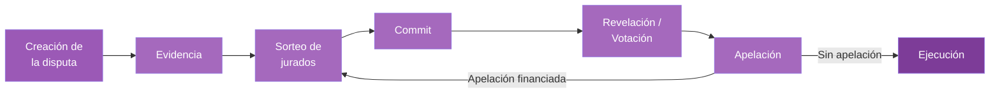
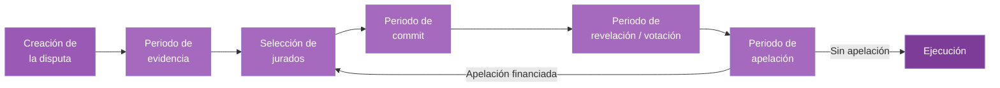
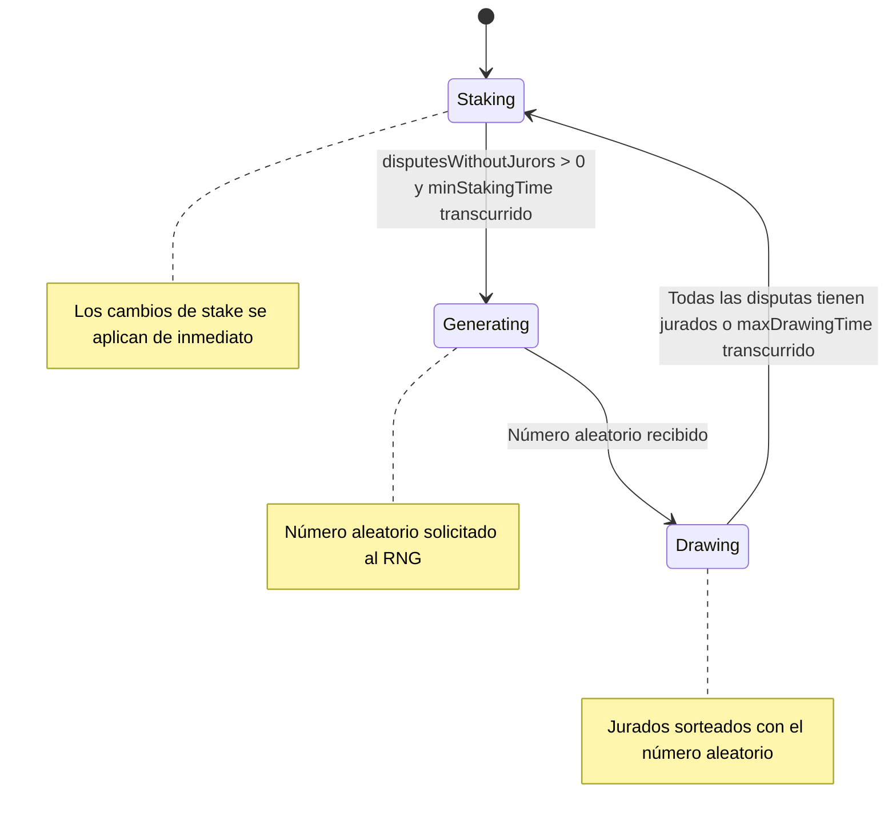

# Cómo funciona Kleros Court

Kleros Court resuelve disputas mediante un proceso estructurado que garantiza la imparcialidad, la transparencia y la alineación económica. Esta página recorre cada etapa, desde la creación de la disputa hasta la ejecución final.

El mismo modelo criptoeconómico impulsa ambas versiones del protocolo. V1 se ejecuta en Ethereum con el contrato KlerosLiquid; V2 se ejecuta en Arbitrum con una arquitectura modular. Primero se resume el proceso de V1 y después se detalla el proceso de V2.

---

## V1: protocolo en producción

En Court V1, todo el proceso de disputa lo gestiona un único contrato, **KlerosLiquid**, en Ethereum Mainnet (también desplegado en Gnosis Chain).




<Steps>
  <Step title="Creación de la disputa">
    Una aplicación arbitrable crea una disputa a través de la interfaz de árbitro ERC-792 y paga los honorarios de arbitraje. La subcorte de destino y el número de jurados se establecen en el parámetro `extraData`.
  </Step>
  <Step title="Evidencia">
    Las partes presentan evidencia siguiendo el estándar ERC-1497. La evidencia y las apelaciones las gestiona el propio contrato arbitrable, no la Court.
  </Step>
  <Step title="Selección de jurados">
    Los jurados se sortean al azar entre quienes han hecho staking de PNK en la subcorte, ponderados por su stake. El PNK permanece en la wallet del jurado mientras está en staking. La aleatoriedad proviene de un RNG basado en blockhash.
  </Step>
  <Step title="Votación commit-reveal">
    Los jurados confirman (commit) un voto cifrado mediante hash y luego lo revelan con una justificación. El resultado se decide por pluralidad: gana la opción con más votos.
  </Step>
  <Step title="Apelación y ejecución">
    Las partes pueden financiar una apelación para iniciar una nueva ronda con más jurados. Una vez agotadas las apelaciones, se ejecuta el fallo. Los jurados coherentes reciben recompensas; los jurados incoherentes pierden parte de su stake.
  </Step>
</Steps>

En V1, las cortes se organizan como un árbol jerárquico de **subcortes** con la General Court como raíz. Hacer staking en una subcorte hija incluye automáticamente al jurado en sus subcortes padre.

---

## V2: actualización de nueva generación

Las secciones siguientes describen el proceso de disputa de V2 en Arbitrum. V2 mantiene el mismo ciclo de vida, pero divide la lógica entre **KlerosCore**, el **SortitionModule** y **DisputeKits** intercambiables.

---

## El ciclo de vida de una disputa



<Steps>
  <Step title="Creación de la disputa">
    Una aplicación arbitrable se encuentra ante una situación conflictiva y necesita una resolución.

    - La aplicación llama a `createDispute()` en KlerosCore, proporcionando los detalles del caso
    - Se pagan honorarios de arbitraje para incentivar a los jurados (el protocolo no cobra comisión)
    - La selección de la corte y el número de jurados se especifican mediante el parámetro `extraData`
    - Una plantilla de disputa define la pregunta y las opciones que se presentan a los jurados
    - La disputa entra en el **periodo de evidencia**
  </Step>

  <Step title="Periodo de evidencia">
    Ambas partes presentan evidencia para respaldar su caso.

    - La evidencia puede incluir explicaciones de texto, documentos, imágenes u otros materiales
    - Los metadatos de la evidencia (nombre, descripción, URI del archivo) se emiten on-chain como un **evento `Evidence`**, y los archivos se almacenan en **IPFS** a través del proveedor Atlas
    - Cualquiera puede presentar evidencia durante este periodo, no solo las partes en disputa
    - La plantilla de disputa define qué información deben ver los jurados

    <Note>Las URIs de la evidencia se registran on-chain mediante eventos por transparencia, pero los archivos se almacenan off-chain en IPFS. Esto mantiene los costes de gas bajo control y, al mismo tiempo, conserva un registro permanente y verificable.</Note>
  </Step>

  <Step title="Selección de jurados">
    Los jurados se sortean al azar entre quienes han hecho staking de PNK en la corte correspondiente.

    - La probabilidad de selección es proporcional a la cantidad de PNK en staking
    - El Sortition Module usa un **sistema de tres fases** para evitar manipulaciones (ver más abajo)
    - Una parte del stake de cada jurado sorteado se bloquea como garantía (`pnkAtStakePerJuror`)
    - Todos los jurados requeridos deben ser sorteados antes de continuar
    - Un jurado puede ser sorteado varias veces para la misma disputa (su peso aumenta en consecuencia)
  </Step>

  <Step title="Periodo de votación">
    Los jurados revisan la evidencia y emiten sus votos.

    **Cuando `hiddenVotes = true` (commit-reveal):**

    - **Fase de commit**: Los jurados envían un hash de su voto + una sal secreta. Los votos permanecen ocultos.
    - **Fase de revelación**: Los jurados vuelven para revelar su voto real con una justificación. No revelar implica perder el PNK bloqueado.

    **Cuando `hiddenVotes = false`:**

    - Los jurados votan directamente en una sola transacción. Los votos son visibles de inmediato.

    La opción ganadora se determina por **pluralidad**: gana la opción con más votos.
  </Step>

  <Step title="Periodo de apelación">
    Las partes pueden impugnar el resultado si no están conformes.

    - Cualquiera puede financiar una apelación para apoyar a un lado concreto
    - El lado contrario puede financiar en sentido opuesto para defender el resultado original
    - Las apelaciones aumentan el número de jurados (el doble más uno: `n×2 + 1`)
    - Los casos grandes o controvertidos pueden saltar a una corte padre cuando el número de jurados supera el umbral `jurorsForCourtJump`

    Consulta [Apelaciones](/es/court/appeals) para conocer el mecanismo completo.
  </Step>

  <Step title="Ejecución">
    Una vez agotadas las apelaciones, el fallo se vuelve definitivo.

    - KlerosCore llama a `rule()` en la aplicación arbitrable original
    - Los jurados coherentes (que votaron con la pluralidad ganadora) reciben recompensas
    - Los jurados incoherentes pierden una parte de su PNK en staking
    - El smart contract ejecuta el fallo automáticamente
  </Step>
</Steps>

---
## El sistema de fases

El Sortition Module usa un ciclo de tres fases para evitar la manipulación de la selección de jurados. Un bot activa las transiciones de fase llamando a `passPhase()`.



<Tabs>
  <Tab title="Fase de staking">
    **El mejor momento para ajustar tus stakes**

    - Los cambios de stake se aplican de inmediato y actualizan el árbol de sumas de sorteo
    - Los jurados pueden añadir, retirar o redistribuir sus stakes entre cortes
    - La duración varía según la actividad de disputas (mínimo: `minStakingTime`)
    - La fase pasa a Generating cuando hay disputas esperando jurados
  </Tab>
  <Tab title="Fase de generación">
    **Se está generando un número aleatorio**

    - Se solicita un número aleatorio al proveedor de RNG
    - El número aleatorio está disponible después de `rngLookahead` bloques
    - Los cambios de stake realizados durante esta fase se **retrasan**: no se aplicarán hasta la siguiente fase de staking
  </Tab>
  <Tab title="Fase de sorteo">
    **Se están seleccionando jurados**

    - Los jurados se sortean usando el número aleatorio y la distribución de stake actual
    - Los cambios de stake siguen retrasados
    - Continúa hasta que todas las disputas tengan jurados o transcurra `maxDrawingTime`
    - Cada sorteo selecciona a un jurado de forma proporcional a su peso de stake en el árbol de sumas de sorteo
  </Tab>
</Tabs>

<Warning>Si haces staking durante las fases de generación o sorteo, tus cambios no afectarán a las probabilidades de selección actuales. La interfaz de la Court muestra si tus stakes están "Current" (vigentes) o "Delayed" (retrasados).</Warning>

---

## Dispute Kits

Kleros V2 introduce la resolución de disputas modular mediante Dispute Kits intercambiables. Cada corte especifica qué kits admite, y todas las cortes deben admitir el **Classic Dispute Kit** como mecanismo de respaldo universal.

| ID del kit | Nombre | Descripción | Estado |
| --- | --- | --- | --- |
| 1 | **Classic** | Votación por pluralidad en la que gana la opción con más votos. | Activo |
| 2 | **Shutter** | Votación en una sola transacción con cifrado por umbral y descifrado automático al final del periodo. | En pruebas |
| 3 | **Gated** | Votación clásica restringida a jurados que poseen un token de elegibilidad específico (SBT). Se usa en cortes que requieren credenciales verificadas. | Activo |
| 4 | **GatedShutter** | Elegibilidad restringida combinada con el cifrado de Shutter. | Activo |
 
<Note>Los cuatro kits están desplegados y registrados en la General Court en Arbitrum One. Las cortes especializadas (p. ej., las cortes 29 y 32 de protección al consumidor de Argentina) usan DisputeKitGated y requieren SBTs específicos; consulta [Direcciones de despliegue V2](/es/reference/contracts/deployment-addresses). La arquitectura de dispute kits es extensible; se pueden añadir nuevos kits mediante la gobernanza.</Note>

---

## Mecánica de votación

### Actual: commit-reveal

Las cortes con `hiddenVotes = true` usan el patrón commit-reveal para evitar que los jurados copien los votos de otros:

<Steps>
  <Step title="Fase de commit">
    Elige tu voto, genera una sal aleatoria y envía `keccak256(choiceID, salt, justification)` como tu compromiso. Guarda tu sal en un lugar seguro: la necesitarás para revelar.
  </Step>
  <Step title="Fase de revelación">
    Vuelve y envía tu voto real, la sal y la justificación. El contrato verifica que el hash coincida con tu compromiso. No revelar implica perder tu PNK bloqueado.
  </Step>
</Steps>

### Futuro: votación cifrada con Shutter

La integración con Shutter Network reemplazará el commit-reveal de dos transacciones por un flujo de votación cifrada en una sola transacción:

- Los jurados envían votos cifrados en una sola transacción
- Los votos se cifran mediante **criptografía de umbral**: ninguna parte puede descifrarlos de forma anticipada
- El descifrado automático se produce cuando termina el periodo de votación
- No se requiere revelación manual, lo que elimina el riesgo de olvidarse de revelar
- Evita la copia de votos y el efecto arrastre de forma más robusta que el commit-reveal

<Info>La integración con Shutter se ha probado en testnet. Consulta el [blog de Kleros](https://blog.kleros.io) para conocer el estado más reciente del despliegue en producción.</Info>

---

## Recompensas y penalizaciones

### Para jurados coherentes (votaron con la pluralidad ganadora)

Recibes recompensas de dos fuentes:

1. **Honorarios de arbitraje**: ETH (o tokens ERC-20 de la lista blanca) pagados por los creadores de disputas, repartidos entre los jurados coherentes
2. **Redistribución de PNK**: Las penalizaciones en PNK de los jurados incoherentes, repartidas entre los jurados coherentes

**Fórmula de recompensa:**

```
jurorReward = (totalFees / numberOfCoherentVotes) × degreeOfCoherence
pnkReward  = (totalPenalties / numberOfCoherentVotes) × degreeOfCoherence
```

El `degreeOfCoherence` lo calcula el dispute kit y va de 0 a `ALPHA_DIVISOR` (10,000). En el Classic Dispute Kit, los jurados que votaron con la pluralidad reciben coherencia total.

### Para jurados incoherentes (votaron en contra de la pluralidad ganadora)

- Pierden una parte del PNK en staking (determinada por el parámetro `alpha` de la corte)
- Renuncian a las recompensas de honorarios de arbitraje de esa ronda

<Accordion title="Ejemplo de recompensa">
**Escenario:** Un caso tiene 3 jurados con un honorario de 0.005 ETH por jurado (total: 0.015 ETH). 2 jurados votan de forma coherente y 1 de forma incoherente.

**Cada jurado coherente recibe:**
- ETH: 0.015 ÷ 2 = 0.0075 ETH
- PNK: (1 × cantidad de PNK bloqueada) ÷ 2

**El jurado incoherente pierde:**
- Su PNK bloqueado (determinado por `alpha` × `minStake` / 10000)
- Su parte de los honorarios de arbitraje
</Accordion>

---

## Recompensas por staking (KIP-66)

[KIP-66](https://forum.kleros.io) es una propuesta de gobernanza aprobada por la comunidad que introduce recompensas adicionales por staking más allá de los honorarios de arbitraje tradicionales. El mecanismo está implementado en los smart contracts.

<Info>Consulta el [blog de Kleros](https://blog.kleros.io) o [Snapshot](https://snapshot.box/#/s:kleros.eth) para conocer el estado más reciente sobre si las recompensas por staking de KIP-66 están activas actualmente.</Info>

---

## Funciones de seguridad

### Sistema RNG

El Sortition Module usa una interfaz genérica `RNG` para la generación de números aleatorios, con un parámetro configurable `rngLookahead` que establece la distancia mínima en bloques entre la solicitud y la recepción de un número aleatorio. Esto ayuda a evitar manipulaciones al garantizar que la semilla aleatoria no pueda predecirse en el momento de la solicitud.

El sistema incluye un comportamiento de respaldo: si la fase de sorteo supera `maxDrawingTime` sin completarse, la fase vuelve automáticamente a Staking para evitar que el sistema se bloquee.

### Protecciones de la integridad de los jurados

- **Protección contra revelación anticipada**: En las cortes con commit-reveal, si un jurado revela su voto antes de la fase de revelación, cualquiera puede denunciarlo. El denunciante puede reclamar una parte del stake bloqueado del jurado como recompensa.
- **Desincentivos a la coordinación**: Los mecanismos de votación commit-reveal y los futuros basados en Shutter están diseñados específicamente para impedir que los jurados vean los votos de los demás, lo que dificulta la coordinación. Las pruebas de coordinación pueden denunciarse a través del proceso de gobernanza.

<Warning>Nunca compartas tu elección de voto antes de la fase de revelación y nunca te coordines con otros jurados. Hacerlo socava el mecanismo de punto de Schelling y pone en riesgo tu PNK en staking.</Warning>

---

## ¿Qué sigue?

<CardGroup cols={3}>
  <Card title="Jerarquía de cortes" icon="sitemap" href="/es/court/court-hierarchy">
    Comprende la estructura y la especialización de las cortes
  </Card>
  <Card title="Apelaciones" icon="arrow-up-right-from-square" href="/es/court/appeals">
    Descubre cómo funcionan las apelaciones y la escalada
  </Card>
  <Card title="Conviértete en jurado" icon="user-plus" href="/es/tutorials/juror-tutorial-v1">
    Tutorial paso a paso de staking y votación
  </Card>
</CardGroup>
