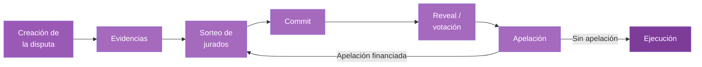
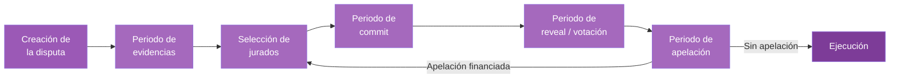
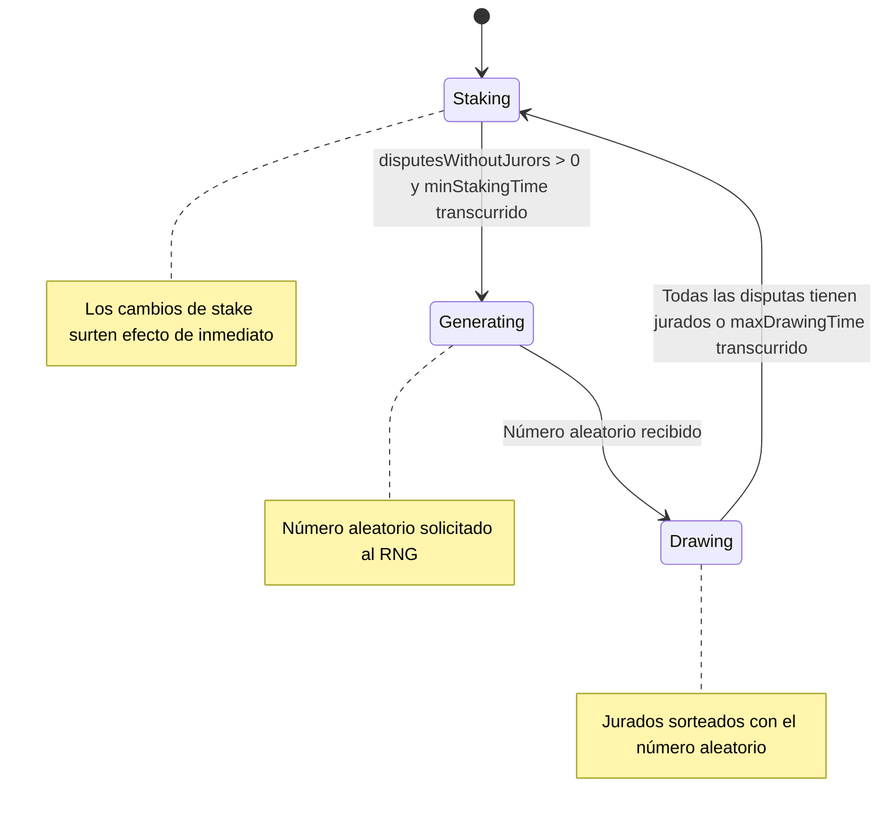

# Cómo funciona Kleros Court {#how-kleros-court-works}

Kleros Court resuelve disputas mediante un proceso estructurado que garantiza la equidad, la transparencia y la alineación económica. Esta página recorre cada etapa, desde la creación de la disputa hasta la ejecución final.

El mismo modelo criptoeconómico impulsa ambas versiones del protocolo. V1 funciona en Ethereum con el contrato KlerosLiquid; V2 funciona en Arbitrum con una arquitectura modular. Primero se resume el proceso de V1 y, a continuación, se detalla el proceso de V2.

---

## V1: protocolo en producción {#v1-production-protocol}

En Court V1, todo el proceso de disputa lo gestiona un único contrato, **KlerosLiquid**, en la red principal de Ethereum (también desplegado en Gnosis Chain).




<Steps>
  <Step title="Creación de la disputa">
    Una aplicación arbitrable crea una disputa a través de la interfaz de árbitro ERC-792 y paga las tasas de arbitraje. El subtribunal de destino y el número de jurados se establecen en el parámetro `extraData`.
  </Step>
  <Step title="Evidencias">
    Las partes presentan evidencias siguiendo el estándar ERC-1497. Las evidencias y las apelaciones las gestiona el propio contrato arbitrable, no el tribunal.
  </Step>
  <Step title="Selección de jurados">
    Los jurados se sortean al azar entre quienes han hecho staking de PNK en el subtribunal, ponderados por su stake. El PNK permanece en la billetera del jurado mientras está en staking. La aleatoriedad proviene de un RNG basado en blockhash.
  </Step>
  <Step title="Votación commit-reveal">
    Los jurados confirman (commit) un voto cifrado mediante hash y después lo revelan (reveal) junto con una justificación. El resultado se decide por pluralidad: gana la opción con más votos.
  </Step>
  <Step title="Apelación y ejecución">
    Las partes pueden financiar una apelación para iniciar una nueva ronda con más jurados. Una vez agotadas las apelaciones, se ejecuta el fallo. Los jurados coherentes reciben recompensas; los incoherentes pierden parte de su stake.
  </Step>
</Steps>

En V1, los tribunales se organizan como un árbol jerárquico de **subtribunales** con el General Court como raíz. Hacer staking en un subtribunal hijo incluye automáticamente al jurado en sus subtribunales padre.

---

## V2: actualización de nueva generación {#v2-next-gen-upgrade}

Las secciones siguientes describen el proceso de disputa de V2 en Arbitrum. V2 mantiene el mismo ciclo de vida, pero divide la lógica entre **KlerosCore**, el **SortitionModule** y los **DisputeKits** intercambiables.

---

## El ciclo de vida de una disputa {#the-dispute-lifecycle}



<Steps>
  <Step title="Creación de la disputa">
    Una aplicación arbitrable se encuentra ante una situación conflictiva y necesita una resolución.

    - La aplicación llama a `createDispute()` en KlerosCore y proporciona los detalles del caso
    - Se pagan las tasas de arbitraje para incentivar a los jurados (el protocolo no cobra comisión)
    - La selección del tribunal y el número de jurados se especifican mediante el parámetro `extraData`
    - Una plantilla de disputa define la pregunta y las opciones que se presentan a los jurados
    - La disputa entra en el **periodo de evidencias**
  </Step>

  <Step title="Periodo de evidencias">
    Ambas partes presentan evidencias para respaldar su caso.

    - Las evidencias pueden incluir explicaciones de texto, documentos, imágenes u otros materiales
    - Los metadatos de las evidencias (nombre, descripción, URI del archivo) se emiten en la cadena como un **evento `Evidence`**, y los archivos reales se almacenan en **IPFS** a través del proveedor Atlas
    - Cualquiera puede presentar evidencias durante este periodo, no solo las partes en disputa
    - La plantilla de disputa define qué información deben ver los jurados

    <Note>Las URI de las evidencias se registran en la cadena mediante eventos para mayor transparencia, pero los archivos se almacenan fuera de la cadena en IPFS. Así los costes de gas se mantienen razonables y se conserva un registro permanente y verificable.</Note>
  </Step>

  <Step title="Selección de jurados">
    Los jurados se sortean al azar entre quienes han hecho staking de PNK en el tribunal correspondiente.

    - La probabilidad de selección es proporcional a la cantidad de PNK en staking
    - El Sortition Module utiliza un **sistema de tres fases** para evitar la manipulación (ver más abajo)
    - Una parte del stake de cada jurado sorteado se bloquea como garantía (`pnkAtStakePerJuror`)
    - Todos los jurados necesarios deben estar sorteados antes de continuar
    - Un jurado puede ser sorteado varias veces para la misma disputa (su peso aumenta en consecuencia)
  </Step>

  <Step title="Periodo de votación">
    Los jurados revisan las evidencias y emiten sus votos.

    **Cuando `hiddenVotes = true` (commit-reveal):**

    - **Fase de commit**: los jurados envían un hash de su voto más una sal (salt) secreta. Los votos permanecen ocultos.
    - **Fase de reveal**: los jurados vuelven para revelar su voto real junto con una justificación. No revelar el voto implica perder el PNK bloqueado.

    **Cuando `hiddenVotes = false`:**

    - Los jurados votan directamente en una sola transacción. Los votos son visibles de inmediato.

    La opción ganadora se determina por **pluralidad**: gana la opción con más votos.
  </Step>

  <Step title="Periodo de apelación">
    Las partes pueden impugnar el resultado si no están conformes.

    - Cualquiera puede financiar una apelación para apoyar a una de las partes
    - La parte contraria puede financiar en sentido opuesto para defender el resultado original
    - Las apelaciones aumentan el número de jurados (el doble más uno: `n×2 + 1`)
    - Los casos grandes o controvertidos pueden saltar a un tribunal padre cuando el número de jurados supera el umbral `jurorsForCourtJump`

    Consulta [Apelaciones](/es/court/appeals) para conocer el mecanismo completo.
  </Step>

  <Step title="Ejecución">
    Una vez agotadas las apelaciones, el fallo es definitivo.

    - KlerosCore llama a `rule()` en la aplicación arbitrable original
    - Los jurados coherentes (que votaron con la pluralidad ganadora) reciben recompensas
    - Los jurados incoherentes pierden una parte de su PNK en staking
    - El contrato inteligente ejecuta el fallo automáticamente
  </Step>
</Steps>

---

## El sistema de fases {#the-phase-system}

El Sortition Module utiliza un ciclo de tres fases para evitar la manipulación de la selección de jurados. Un bot activa las transiciones de fase llamando a `passPhase()`.



<Tabs>
  <Tab title="Fase de staking">
    **El mejor momento para ajustar tus stakes**

    - Los cambios de stake surten efecto de inmediato y actualizan el árbol de sumas de sorteo (sortition sum tree)
    - Los jurados pueden añadir, retirar o redistribuir sus stakes entre tribunales
    - La duración varía según la actividad de disputas (mínimo: `minStakingTime`)
    - La fase pasa a Generating cuando hay disputas esperando jurados
  </Tab>
  <Tab title="Fase de generación">
    **Se está generando un número aleatorio**

    - Se solicita un número aleatorio al proveedor de RNG
    - El número aleatorio está disponible después de `rngLookahead` bloques
    - Los cambios de stake realizados durante esta fase se **aplazan**: no se aplicarán hasta la siguiente fase de staking
  </Tab>
  <Tab title="Fase de sorteo">
    **Se están seleccionando los jurados**

    - Los jurados se sortean usando el número aleatorio y la distribución de stakes actual
    - Los cambios de stake siguen aplazados
    - Continúa hasta que todas las disputas tienen jurados o transcurre `maxDrawingTime`
    - Cada sorteo selecciona a un jurado en proporción a su peso de stake en el árbol de sumas de sorteo
  </Tab>
</Tabs>

<Warning>Si haces staking durante las fases de generación o de sorteo, tus cambios no afectarán a tus probabilidades de selección actuales. La interfaz de Court muestra si tus stakes están "Current" (vigentes) o "Delayed" (aplazados).</Warning>

---

## Dispute Kits {#dispute-kits}

Kleros V2 introduce la resolución de disputas modular mediante Dispute Kits intercambiables. Cada tribunal especifica qué kits admite, y todos los tribunales deben admitir el **Classic Dispute Kit** como respaldo universal.

| ID del kit | Nombre | Descripción | Estado |
| --- | --- | --- | --- |
| 1 | **Classic** | Votación por pluralidad en la que gana la opción con más votos. | Activo |
| 2 | **Shutter** | Votación en una sola transacción con cifrado de umbral y descifrado automático al final del periodo. | En pruebas |
| 3 | **Gated** | Votación clásica restringida a jurados que poseen un token de elegibilidad específico (SBT). Se usa en tribunales que requieren credenciales verificadas. | Activo |
| 4 | **GatedShutter** | Elegibilidad Gated combinada con el cifrado de Shutter. | Activo |
 
<Note>Los cuatro kits están desplegados y registrados en el General Court de Arbitrum One. Los tribunales especializados (por ejemplo, los tribunales 29 y 32 de Protección al Consumidor de Argentina) utilizan DisputeKitGated y requieren SBT específicos: consulta [Direcciones de despliegue V2](/es/reference/contracts/deployment-addresses). La arquitectura de dispute kits es extensible; se pueden añadir nuevos kits mediante la gobernanza.</Note>

---

## Mecánica de votación {#voting-mechanics}

### Actual: commit-reveal {#current-commit-reveal}

Los tribunales con `hiddenVotes = true` utilizan el patrón commit-reveal para evitar que los jurados copien los votos de otros:

<Steps>
  <Step title="Fase de commit">
    Elige tu voto, genera una sal aleatoria y envía `keccak256(choiceID, salt, justification)` como tu compromiso. Guarda bien tu sal: la necesitarás para revelar el voto.
  </Step>
  <Step title="Fase de reveal">
    Vuelve y envía tu voto real, la sal y la justificación. El contrato verifica que el hash coincide con tu compromiso. No revelar el voto implica perder tu PNK bloqueado.
  </Step>
</Steps>

### Futuro: votación cifrada con Shutter {#future-shutter-encrypted-voting}

La integración con Shutter Network sustituirá el commit-reveal de dos transacciones por un flujo de votación cifrada en una sola transacción:

- Los jurados envían votos cifrados en una sola transacción
- Los votos se cifran mediante **criptografía de umbral**: ninguna parte puede descifrarlos antes de tiempo
- El descifrado automático se produce cuando termina el periodo de votación
- No es necesario revelar manualmente, lo que elimina el riesgo de olvidar revelar el voto
- Evita la copia de votos y el efecto arrastre de forma más sólida que el commit-reveal

<Info>La integración con Shutter se ha probado en testnet. Consulta el [blog de Kleros](https://blog.kleros.io) para conocer el estado más reciente del despliegue en producción.</Info>

---

## Recompensas y penalizaciones {#rewards-and-penalties}

### Para jurados coherentes (que votaron con la pluralidad ganadora) {#for-coherent-jurors-voted-with-the-winning-plurality}

Recibes recompensas de dos fuentes:

1. **Tasas de arbitraje**: ETH (o tokens ERC-20 incluidos en la lista blanca) pagados por quienes crean las disputas y repartidos entre los jurados coherentes
2. **Redistribución de PNK**: las penalizaciones en PNK de los jurados incoherentes, repartidas entre los jurados coherentes

**Fórmula de recompensa:**

```
jurorReward = (totalFees / numberOfCoherentVotes) × degreeOfCoherence
pnkReward  = (totalPenalties / numberOfCoherentVotes) × degreeOfCoherence
```

El `degreeOfCoherence` lo calcula el dispute kit y va de 0 a `ALPHA_DIVISOR` (10.000). En el Classic Dispute Kit, los jurados que votaron con la pluralidad reciben coherencia total.

### Para jurados incoherentes (que votaron en contra de la pluralidad ganadora) {#for-incoherent-jurors-voted-against-the-winning-plurality}

- Pierden una parte del PNK en staking (determinada por el parámetro `alpha` del tribunal)
- Renuncian a las recompensas de tasas de arbitraje de esa ronda

<Accordion title="Ejemplo de recompensa">
**Escenario:** un caso tiene 3 jurados con una tasa de 0,005 ETH por jurado (total: 0,015 ETH). 2 jurados votan de forma coherente y 1 de forma incoherente.

**Cada jurado coherente recibe:**
- ETH: 0,015 ÷ 2 = 0,0075 ETH
- PNK: (1 × cantidad de PNK bloqueada) ÷ 2

**El jurado incoherente pierde:**
- Su PNK bloqueado (determinado por `alpha` × `minStake` / 10000)
- Su parte de las tasas de arbitraje
</Accordion>

---

## Recompensas de staking (KIP-66) {#staking-rewards-kip-66}

[KIP-66](https://forum.kleros.io) es una propuesta de gobernanza aprobada por la comunidad que introduce recompensas de staking adicionales a las tasas de arbitraje tradicionales. El mecanismo está implementado en los contratos inteligentes.

<Info>Consulta el [blog de Kleros](https://blog.kleros.io) o [Snapshot](https://snapshot.box/#/s:kleros.eth) para conocer el estado más reciente sobre si las recompensas de staking de KIP-66 están activas actualmente.</Info>

---

## Funciones de seguridad {#security-features}

### Sistema RNG {#rng-system}

El Sortition Module utiliza una interfaz genérica `RNG` para generar números aleatorios, con un parámetro configurable `rngLookahead` que establece la distancia mínima en bloques entre la solicitud y la recepción de un número aleatorio. Esto ayuda a evitar la manipulación al garantizar que la semilla aleatoria no se pueda predecir en el momento de la solicitud.

El sistema incluye un comportamiento de respaldo: si la fase de sorteo supera `maxDrawingTime` sin completarse, la fase vuelve automáticamente a Staking para evitar que el sistema se bloquee.

### Protecciones de la integridad de los jurados {#juror-integrity-protections}

- **Protección previa al reveal**: en los tribunales commit-reveal, si un jurado revela su voto antes de la fase de reveal, cualquiera puede denunciarlo. Quien lo denuncia puede reclamar una parte del stake bloqueado del jurado como recompensa.
- **Desincentivos a la coordinación**: el commit-reveal y los futuros mecanismos de votación basados en Shutter están diseñados específicamente para impedir que los jurados vean los votos de los demás, lo que dificulta la coordinación. Las pruebas de coordinación pueden denunciarse a través del proceso de gobernanza.

<Warning>Nunca compartas tu voto antes de la fase de reveal y nunca te coordines con otros jurados. Hacerlo socava el mecanismo del punto de Schelling y pone en riesgo tu PNK en staking.</Warning>

---

## ¿Qué sigue? {#what’s-next}

<CardGroup cols={3}>
  <Card title="Jerarquía de tribunales" icon="sitemap" href="/es/court/court-hierarchy">
    Comprende la estructura y la especialización de los tribunales
  </Card>
  <Card title="Apelaciones" icon="arrow-up-right-from-square" href="/es/court/appeals">
    Aprende cómo funcionan las apelaciones y la escalada
  </Card>
  <Card title="Hazte jurado" icon="user-plus" href="/es/tutorials/juror-tutorial-v1">
    Tutorial paso a paso de staking y votación
  </Card>
</CardGroup>
