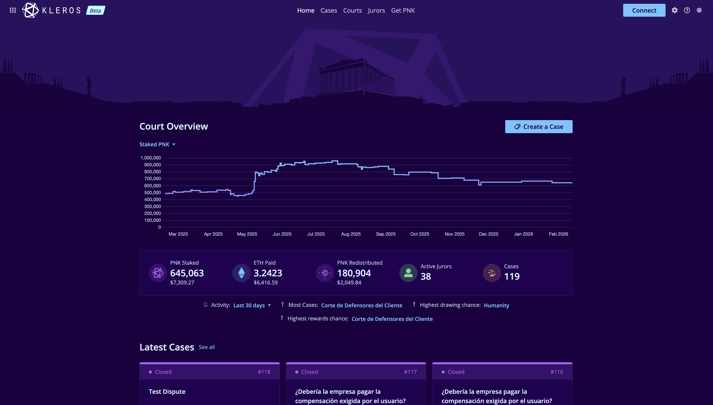
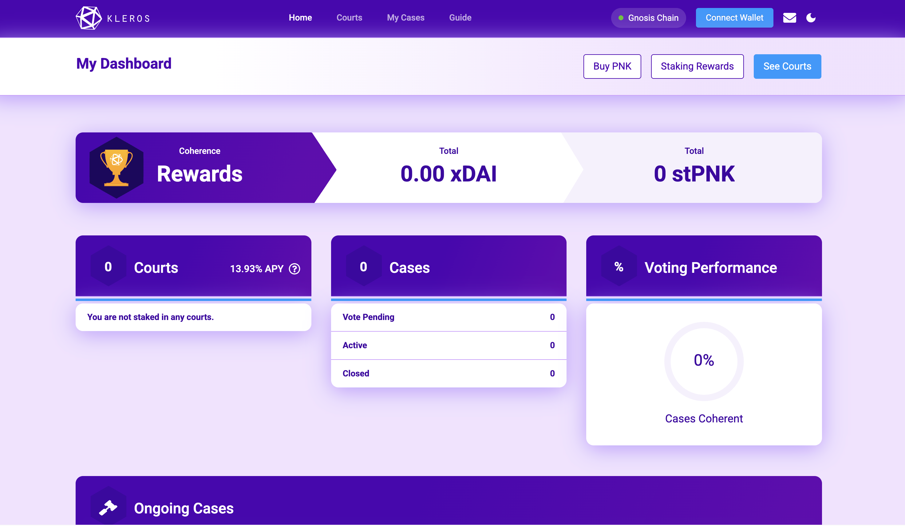

<Frame>
  
</Frame>

# Kleros Court {#kleros-court}

**Kleros Court** es un protocolo descentralizado de resolución de disputas que ofrece servicios de arbitraje para contratos inteligentes y aplicaciones descentralizadas. Funciona seleccionando al azar jurados de un grupo, que tienen incentivos para resolver las disputas con honestidad gracias a un mecanismo criptoeconómico basado en la teoría de juegos.

Piensa en él como un poder judicial descentralizado para la Web3. Cuando surge una disputa, se sortean jurados al azar, que revisan las evidencias y votan sobre el resultado, y la decisión de la mayoría se ejecuta, todo ello sin intermediarios centralizados.

Kleros Court tiene dos versiones. **V1** es el protocolo probado en producción que funciona en Ethereum desde 2018. **V2** es la actualización de nueva generación en Arbitrum con una arquitectura modular.

---

## V1: protocolo en producción {#v1-production-protocol}

Court V1 se lanzó en la red principal de Ethereum en 2018 y ha resuelto más de 1.500 disputas. Su contrato inteligente principal es **KlerosLiquid**, un único contrato (monolítico) que combina el staking de jurados, la selección aleatoria, la votación y la gestión de disputas.

<Frame >
  
</Frame>

| Aspecto | Court V1 |
| --- | --- |
| **Red** | Ethereum L1 (también Gnosis Chain) |
| **Contrato principal** | KlerosLiquid (monolítico) |
| **Estándares** | ERC-792 (arbitraje), ERC-1497 (evidencias) |
| **Staking** | El PNK permanece en la billetera del jurado |
| **Votación** | Commit-reveal con agregación por pluralidad |
| **RNG** | Basado en blockhash |
| **Tribunales** | Árbol jerárquico de subtribunales con el General Court como raíz |

Los jurados hacen staking de PNK directamente desde su billetera en un subtribunal, se sortean al azar con una probabilidad proporcional a su stake y, a continuación, confirman (commit) y revelan (reveal) sus votos sobre las evidencias presentadas. Los jurados coherentes reciben recompensas; los incoherentes pierden parte de su stake.

---

## V2: actualización de nueva generación {#v2-next-gen-upgrade}

Court V2 funciona en Arbitrum L2 y sustituye el contrato monolítico por un diseño modular: **KlerosCore** coordina las disputas, el **SortitionModule** se encarga de la selección de jurados y los **DisputeKits** intercambiables proporcionan el mecanismo de resolución. Las disputas entre cadenas se transmiten a través del **puente VEA**.

---

## Capacidades clave {#key-capabilities}

<CardGroup cols={2}>

<Card title="Selección aleatoria de jurados" icon="shuffle">
  Los jurados se sortean al azar entre quienes hacen staking, ponderados por su stake de PNK
</Card>

<Card title="Incentivos criptoeconómicos" icon="coins">
  El voto honesto se recompensa; los votos incoherentes provocan un recorte del stake
</Card>

<Card title="Tribunales jerárquicos" icon="sitemap">
  Tribunales especializados para distintos tipos de disputas, con apelaciones ante los tribunales superiores
</Card>

<Card title="Dispute Kits modulares" icon="puzzle-piece">
  Mecanismos de resolución intercambiables: Classic, Shutter (cifrado), Gated (elegibilidad por SBT) y GatedShutter
</Card>

<Card title="Soporte entre cadenas" icon="link">
  Disputas de cualquier cadena EVM resueltas en Arbitrum mediante el puente Vea
</Card>

<Card title="Ejecución sin confianza" icon="shield-check">
  Los contratos inteligentes ejecutan los fallos automáticamente
</Card>

</CardGroup>

---

## Cómo funciona {#how-it-works}

En esencia, Kleros funciona mediante un proceso sencillo pero potente:

<Steps>

<Step title="Creación de la disputa">
  Una aplicación se encuentra ante una situación conflictiva y crea una disputa en Kleros, pagando las tasas de arbitraje.
</Step>

<Step title="Selección de jurados">
  Los jurados se sortean al azar entre quienes han hecho staking de PNK en el tribunal correspondiente. La probabilidad de selección es proporcional al stake.
</Step>

<Step title="Evidencias y votación">
  Los jurados revisan las evidencias presentadas por ambas partes y emiten sus votos durante el periodo de votación.
</Step>

<Step title="Resolución">
  Se ejecuta la decisión de la mayoría. Los jurados coherentes reciben recompensas; los incoherentes pierden una parte de su stake.
</Step>

</Steps>

### La estructura de incentivos {#the-incentive-structure}

El sistema está diseñado para que **no tengas que confiar en nadie**:

- Los **jurados** tienen incentivos para votar con honestidad (o perder su PNK en staking)
- Las **partes en disputa** solo pagan tasas por la resolución, sin comisión del protocolo
- Los **apelantes** pueden impugnar los fallos financiando rondas adicionales

Esto crea un sistema autorregulado en el que el comportamiento deshonesto se castiga económicamente.

---

## Componentes principales {#core-components}

| Componente | Propósito |
| --- | --- |
| **KlerosCore** | El contrato árbitro principal que coordina las disputas y ejecuta los fallos |
| **Sortition Module** | Gestiona la selección de jurados mediante un sistema de tres fases para evitar la manipulación |
| **Dispute Kits** | Mecanismos de resolución modulares (Classic, Shutter, Ranked Choice, etc.) |
| **Vea Bridge** | Permite la resolución de disputas entre cadenas desde cadenas externas |

---

## ¿Quién usa Kleros Court? {#who-uses-kleros-court}

- Los **protocolos DeFi** resuelven disputas de oráculos, impugnaciones de liquidaciones y conflictos de gobernanza
- Los **mercados de predicción** liquidan los resultados de los mercados con arbitraje descentralizado
- Los **servicios de escrow** liberan fondos según fallos imparciales de terceros
- Las **DAO** gestionan disputas con colaboradores e impugnaciones de propuestas
- Los **protocolos de seguros** resuelven reclamaciones sin una autoridad centralizada
- Los **marketplaces de NFT** resuelven disputas de autenticidad y propiedad

---

## Qué cambió en V2 {#what-changed-in-v2}

V2 mantiene el mismo modelo criptoeconómico que V1 y cambia cómo se implementa y dónde funciona:

| Componente | V1 | V2 |
| --- | --- | --- |
| **Red** | Ethereum L1 y Gnosis Chain | Arbitrum L2 |
| **Contrato principal** | KlerosLiquid (monolítico) | KlerosCore (modular) |
| **Selección de jurados** | Integrada en KlerosLiquid | SortitionModule (separado) |
| **Resolución de disputas** | Mecanismo único | DisputeKits intercambiables (Classic, Shutter, Gated, GatedShutter) |
| **Entre cadenas** | Despliegues separados en Ethereum y Gnosis, sin transmisión entre cadenas | Multicadena mediante el puente VEA |
| **Staking** | El PNK permanece en la billetera | El PNK se transfiere al contrato |
| **RNG** | Fuente única | Mejorado con mecanismos de respaldo |

<Note>
Kleros V2 se encuentra actualmente en beta, con más de 100 disputas procesadas con éxito. El sistema está en proceso de revisión interna y auditorías externas.
</Note>

---

## Estado actual {#current-status}

Según la actualización de desarrollo de mayo de 2026:

- **Court V2**: se fusionó el dispute kit de coherencia parcial, así como la simplificación de los contratos de todos los dispute kits (junio de 2026).
- **Court V1**: las recompensas de staking de abril se incluyeron en el exportador de recompensas. Desde agosto de 2026, las recompensas de staking se muestran en [rewards.kleros.io](https://rewards.kleros.io), que sustituyó a la página de recompensas de la aplicación.

Sigue el desarrollo en el [blog de Kleros: actualizaciones para desarrolladores](https://blog.kleros.io/tag/developer/).

---

## ¿Qué sigue? {#what’s-next}

<CardGroup cols={3}>

<Card title="Cómo funciona" icon="cogs" href="/es/court/how-it-works">
  Profundiza en el proceso de resolución de disputas
</Card>

<Card title="Jerarquía de tribunales" icon="sitemap" href="/es/court/court-hierarchy">
  Comprende la estructura y la especialización de los tribunales
</Card>

<Card title="Apelaciones" icon="scale-balanced" href="/es/court/appeals">
  Aprende cómo funcionan las apelaciones y la escalada
</Card>

<Card title="Arquitectura de V2" icon="layer-group" href="/es/court/architecture">
  Principios de diseño, visión multicadena y modelo de seguridad
</Card>

</CardGroup>

---

## Enlaces rápidos {#quick-links}

<CardGroup cols={2}>

<Card title="Abrir Court" icon="rocket" href="https://v2.kleros.builders">
  Abre la aplicación Kleros Court
</Card>

<Card title="Hazte jurado" icon="user-plus" href="/es/tutorials/juror-tutorial-v1">
  Tutorial paso a paso de staking y votación
</Card>

<Card title="Direcciones de contratos" icon="file-contract" href="/reference/contracts/deployment-addresses">
  Direcciones de despliegue de Court V2
</Card>

<Card title="Kleros SDK" icon="code" href="/reference/sdk/kleros-sdk">
  Integra Kleros en tu aplicación
</Card>

</CardGroup>
