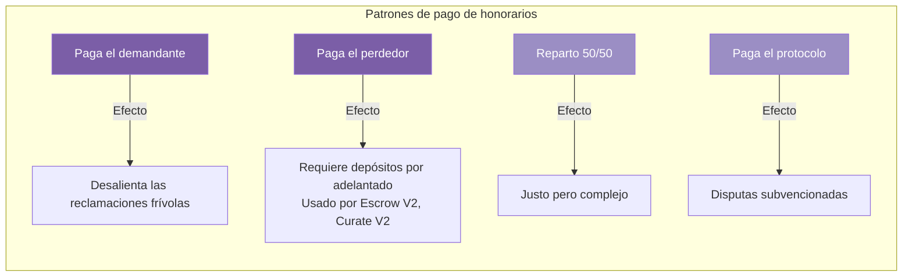
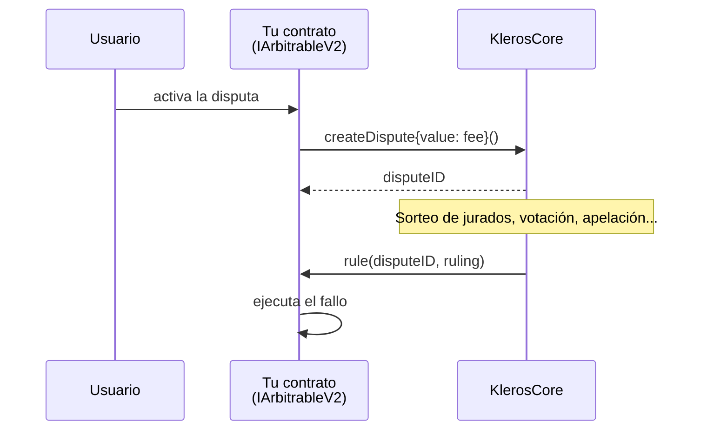
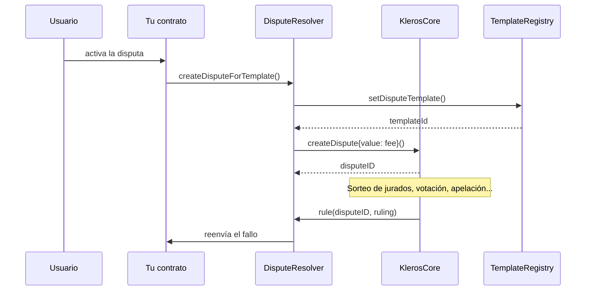
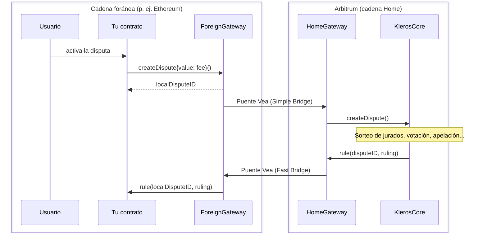

## ¿Qué es un contrato arbitrable?

Un contrato arbitrable es cualquier smart contract que puede crear disputas y ejecutar fallos de Kleros. Tu contrato implementa una interfaz arbitrable (`IArbitrableV2` en Kleros V2, ERC-792 en V1), que define dos cosas:

1. **Cómo se crean las disputas**: tu contrato decide cuándo surgen los conflictos
2. **Cómo se ejecutan los fallos**: tu contrato ejecuta el resultado

Kleros se encarga de todo lo demás: la selección de jurados, la votación, las apelaciones y la determinación del fallo final.

<Note>
Esta sección incluye tanto las guías de contratos arbitrables de V2 (`IArbitrableV2`) como los estándares del protocolo V1 - [ERC-792](/es/developers/arbitrable-apps/erc-792) y [ERC-1497](/es/developers/arbitrable-apps/erc-1497) -, junto con sus referencias de integración ([Aplicaciones arbitrables V1](/es/developers/arbitrable-apps/v1-arbitrable-apps), [Árbitro centralizado](/es/developers/arbitrable-apps/centralized-arbitrator), [Arbitrable Proxy](/es/developers/arbitrable-apps/arbitrable-proxy)).
</Note>

## Cuándo usar el arbitraje de Kleros

<CardGroup cols={2}>
  <Card title="Buen encaje" icon="check">
    - Disputas subjetivas que las personas pueden juzgar
    - Transacciones de alto valor que justifican el coste
    - Casos en los que la confianza es imposible
    - Desacuerdos entre múltiples partes
  </Card>
  <Card title="Mal encaje" icon="xmark">
    - Resultados totalmente objetivos y verificables on-chain
    - Microtransacciones (honorarios > valor)
    - Decisiones urgentes (< 1 semana)
    - Disputas que requieren ejecución en el mundo real
  </Card>
</CardGroup>

## Decisiones de diseño clave

Antes de escribir código, decide lo siguiente:

### 1. Opciones de fallo

Define qué pueden decidir los jurados. Patrones habituales:

| Patrón | Opciones | Ejemplo |
|---------|---------|---------|
| Binario | 2 | Liberar fondos: Sí / No |
| Múltiples partes | 3+ | Ganador: Alice / Bob / Reparto |
| Graduado | N | Porcentaje de reembolso: 0% / 25% / 50% / 75% / 100% |

<Note>
La opción `0` está reservada para "Negarse a arbitrar": los jurados la seleccionan cuando la disputa es inválida o no tiene respuesta posible.
</Note>

### 2. ¿Quién paga los honorarios?

El arbitraje cuesta ETH. Tu contrato decide quién paga:



<Note>
La mayoría de los productos de Kleros usan el modelo **paga el perdedor**: ambas partes depositan el honorario de arbitraje por adelantado y al ganador se le reembolsa. Este es el patrón que usan Escrow V2 y Curate V2.
</Note>

### 3. Desencadenantes de disputas

¿Cuándo comienza una disputa? Desencadenantes habituales:

- **Solicitud explícita**: una parte llama a `raiseDispute()`
- **Tiempo agotado**: no hay respuesta dentro del plazo
- **Impugnación**: alguien disputa una acción pendiente
- **Automático**: se detectan reclamaciones contradictorias

### 4. Presentación de evidencia

Decide cómo llega la evidencia a los jurados:

- **Eventos on-chain**: emite eventos `Evidence` desde tu contrato
- **Módulo independiente**: usa el contrato `EvidenceModule`
- **Multicadena**: evidencia desde una cadena foránea a través de un gateway

## Requisitos de la interfaz (V2)

<Note>
Esta sección es específica de Kleros V2. En V1, los contratos implementan en su lugar [ERC-792](/es/developers/arbitrable-apps/erc-792) y [ERC-1497](/es/developers/arbitrable-apps/erc-1497), y deben emitir un evento `MetaEvidence` para que la interfaz de la Court pueda mostrar la disputa.
</Note>

Para integrarse con Kleros V2, tu contrato debe implementar:

```solidity
interface IArbitrableV2 {
    /// @dev Emitted when a dispute is created
    event DisputeRequest(
        IArbitratorV2 indexed _arbitrator,
        uint256 indexed _arbitratorDisputeID,
        uint256 _externalDisputeID,
        uint256 _templateId,
        string _templateUri
    );
    
    /// @dev Emitted when a ruling is executed
    event Ruling(
        IArbitratorV2 indexed _arbitrator,
        uint256 indexed _disputeID,
        uint256 _ruling
    );
    
    /// @dev Called by arbitrator to deliver ruling
    function rule(uint256 _disputeID, uint256 _ruling) external;
}
```

## Patrones de arquitectura

### Patrón A: integración directa

Tu contrato es el arbitrable. Es el enfoque más sencillo.



### Patrón B: proxy/resolver

Usa `DisputeResolver` como intermediario. Adecuado para la actualizabilidad.


### Patrón C: multicadena

Arbitrable en mainnet, resolución en Arbitrum.



## Consideraciones de coste

| Factor | Impacto |
|--------|--------|
| Número de jurados | Más jurados = honorarios más altos, más seguridad |
| Selección de la corte | Las cortes especializadas pueden costar más |
| Apelaciones | Cada ronda aproximadamente duplica el coste |
| Almacenamiento de evidencia | Los costes de IPFS/Arweave son aparte |

<Tip>
Empieza con **3 jurados** en la **General Court** para la mayoría de las disputas. Auméntalos para los casos de alto valor.
</Tip>

## Mentalidad de seguridad

Tu contrato debe gestionar:

- **Reentrada**: `rule()` es una llamada externa
- **Validación del fallo**: comprueba que el fallo esté dentro del rango esperado
- **Fallos duplicados**: evita que `rule()` se llame dos veces
- **Cambios en los honorarios**: el coste de arbitraje puede cambiar entre llamadas
- **Confianza en el árbitro**: acepta solo fallos de tu árbitro

## Próximos pasos

<Card title="Guía de implementación" icon="code" href="/es/developers/arbitrable-apps/arbitrable-guide">
  Recorrido paso a paso con ejemplos de código completos
</Card>
