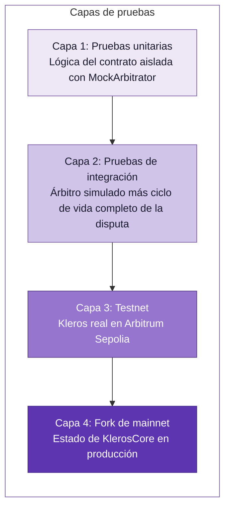

## Estrategia de pruebas

Probar contratos arbitrables requiere simular el ciclo de vida completo de una disputa. No basta con pruebas unitarias: necesitas interactuar con los contratos de Kleros.



## Pruebas unitarias con un árbitro simulado

Crea un mock mínimo para probar la lógica de tu contrato:

```solidity
// test/mocks/MockArbitrator.sol
// SPDX-License-Identifier: MIT
pragma solidity ^0.8.18;

import "@kleros/kleros-v2-contracts/arbitration/interfaces/IArbitratorV2.sol";

contract MockArbitrator is IArbitratorV2 {
    uint256 public disputeCount;
    uint256 public fixedCost = 0.01 ether;
    
    mapping(uint256 => address) public disputeArbitrable;
    mapping(uint256 => uint256) public disputeChoices;
    
    function arbitrationCost(bytes calldata) external view override returns (uint256) {
        return fixedCost;
    }
    
    function createDispute(
        uint256 _choices,
        bytes calldata
    ) external payable override returns (uint256 disputeID) {
        require(msg.value >= fixedCost, "Insufficient fee");
        
        disputeID = disputeCount++;
        disputeArbitrable[disputeID] = msg.sender;
        disputeChoices[disputeID] = _choices;
        
        emit DisputeCreation(disputeID, IArbitrableV2(msg.sender));
    }
    
    // Test helper: manually deliver ruling
    function giveRuling(uint256 _disputeID, uint256 _ruling) external {
        IArbitrableV2(disputeArbitrable[_disputeID]).rule(_disputeID, _ruling);
    }
    
    function currentRuling(uint256) external pure override returns (uint256, bool, bool) {
        return (0, false, false);
    }
}
```

### Ejemplo de prueba con Foundry

```solidity
// test/Escrow.t.sol
// SPDX-License-Identifier: MIT
pragma solidity ^0.8.18;

import "forge-std/Test.sol";
import "../src/Escrow.sol";
import "./mocks/MockArbitrator.sol";

contract EscrowTest is Test {
    Escrow escrow;
    MockArbitrator arbitrator;
    
    address buyer = address(0x1);
    address seller = address(0x2);
    
    function setUp() public {
        arbitrator = new MockArbitrator();
        escrow = new Escrow(
            IArbitratorV2(address(arbitrator)),
            abi.encodePacked(uint96(1), uint256(3)), // court 1, 3 jurors
            "/ipfs/QmTemplate"
        );
        
        vm.deal(buyer, 10 ether);
        vm.deal(seller, 10 ether);
    }
    
    function testCreateTransaction() public {
        vm.prank(buyer);
        uint256 txID = escrow.createTransaction{value: 1 ether}(seller);
        
        (address _buyer, address _seller, uint256 amount,,) = escrow.transactions(txID);
        assertEq(_buyer, buyer);
        assertEq(_seller, seller);
        assertEq(amount, 1 ether);
    }
    
    function testRaiseDispute() public {
        vm.prank(buyer);
        uint256 txID = escrow.createTransaction{value: 1 ether}(seller);
        
        uint256 cost = escrow.getArbitrationCost();
        
        vm.prank(buyer);
        escrow.raiseDispute{value: cost}(txID);
        
        (,,,Escrow.Status status,) = escrow.transactions(txID);
        assertEq(uint256(status), uint256(Escrow.Status.Disputed));
    }
    
    function testRulingPaysSeller() public {
        // Setup
        vm.prank(buyer);
        uint256 txID = escrow.createTransaction{value: 1 ether}(seller);
        
        vm.prank(buyer);
        escrow.raiseDispute{value: 0.01 ether}(txID);
        
        // Get dispute ID
        (,,,,uint256 disputeID) = escrow.transactions(txID);
        
        uint256 sellerBalanceBefore = seller.balance;
        
        // Arbitrator delivers ruling: 1 = PaySeller
        arbitrator.giveRuling(disputeID, 1);
        
        assertEq(seller.balance, sellerBalanceBefore + 1 ether);
    }
    
    function testRulingRefundsBuyer() public {
        vm.prank(buyer);
        uint256 txID = escrow.createTransaction{value: 1 ether}(seller);
        
        vm.prank(buyer);
        escrow.raiseDispute{value: 0.01 ether}(txID);
        
        (,,,,uint256 disputeID) = escrow.transactions(txID);
        
        uint256 buyerBalanceBefore = buyer.balance;
        
        // Ruling: 2 = RefundBuyer
        arbitrator.giveRuling(disputeID, 2);
        
        assertEq(buyer.balance, buyerBalanceBefore + 1 ether);
    }
    
    function testOnlyArbitratorCanRule() public {
        vm.prank(buyer);
        uint256 txID = escrow.createTransaction{value: 1 ether}(seller);
        
        vm.prank(buyer);
        escrow.raiseDispute{value: 0.01 ether}(txID);
        
        (,,,,uint256 disputeID) = escrow.transactions(txID);
        
        vm.prank(address(0xBAD));
        vm.expectRevert("Only arbitrator");
        escrow.rule(disputeID, 1);
    }
    
    function testCannotRuleTwice() public {
        vm.prank(buyer);
        uint256 txID = escrow.createTransaction{value: 1 ether}(seller);
        
        vm.prank(buyer);
        escrow.raiseDispute{value: 0.01 ether}(txID);
        
        (,,,,uint256 disputeID) = escrow.transactions(txID);
        
        arbitrator.giveRuling(disputeID, 1);
        
        vm.expectRevert("Not disputed");
        arbitrator.giveRuling(disputeID, 2);
    }
}
```

Ejecuta con:
```bash
forge test -vvv
```

## Pruebas en testnet (Arbitrum Sepolia)

### Configuración

1. **Obtén ETH de testnet**
   ```bash
   # Arbitrum Sepolia faucet
   https://faucet.quicknode.com/arbitrum/sepolia
   ```

2. **Despliega tu contrato**
   ```bash
   forge script script/Deploy.s.sol --rpc-url arbitrum_sepolia --broadcast
   ```

3. **Verifica las direcciones de los contratos**
   
   Consulta los [despliegues de kleros-v2](https://github.com/kleros/kleros-v2/tree/dev/contracts/deployments) para obtener las direcciones de testnet.

### Crear una disputa de prueba

```javascript
// scripts/createTestDispute.js
const { ethers } = require("hardhat");

async function main() {
    const escrow = await ethers.getContractAt("Escrow", ESCROW_ADDRESS);
    
    // 1. Create transaction
    const tx = await escrow.createTransaction(SELLER_ADDRESS, {
        value: ethers.parseEther("0.001")
    });
    await tx.wait();
    console.log("Transaction created");
    
    // 2. Get arbitration cost
    const cost = await escrow.getArbitrationCost();
    console.log("Arbitration cost:", ethers.formatEther(cost), "ETH");
    
    // 3. Raise dispute
    const disputeTx = await escrow.raiseDispute(0, { value: cost });
    const receipt = await disputeTx.wait();
    
    // 4. Find dispute ID from events
    const event = receipt.logs.find(log => 
        log.topics[0] === ethers.id("DisputeRequest(address,uint256,uint256,uint256,string)")
    );
    console.log("Dispute created! Check Kleros Court UI");
}
```

### Monitorear el progreso de la disputa

```javascript
// Track dispute status
async function checkDispute(escrow, txID) {
    const [ruling, tied, overridden] = await escrow.getDisputeStatus(txID);
    console.log({
        ruling: ruling.toString(),
        tied,
        overridden
    });
}
```

## Lista de verificación de escenarios de prueba

### Camino feliz
- [ ] Crear una transacción
- [ ] Iniciar una disputa con la tarifa correcta
- [ ] El envío de evidencia emite un evento
- [ ] El fallo ejecuta el resultado correcto
- [ ] Los fondos se transfieren a la parte correcta

### Casos límite
- [ ] Una tarifa de arbitraje insuficiente provoca una reversión
- [ ] Quien no es parte no puede iniciar una disputa
- [ ] No se puede disputar una transacción ya disputada
- [ ] No se puede emitir un fallo sobre una disputa inexistente
- [ ] El fallo `0` (negarse a fallar) se gestiona correctamente
- [ ] El exceso de tarifa se reembolsa

### Seguridad
- [ ] Solo el árbitro puede llamar a `rule()`
- [ ] No se puede llamar a `rule()` dos veces
- [ ] Un valor de fallo no válido provoca una reversión
- [ ] La protección contra reentrada funciona

### Optimización de gas
- [ ] Medir el gas de `createDispute()`
- [ ] Medir el gas de `rule()` con transferencia
- [ ] Comparar con y sin envío de evidencia

## Consejos de depuración

### Problemas comunes

<AccordionGroup>
  <Accordion title="'Insufficient fee' en createDispute">
    El costo de arbitraje cambia. Obtenlo siempre actualizado:
    ```solidity
    uint256 cost = arbitrator.arbitrationCost(extraData);
    ```
  </Accordion>
  
  <Accordion title="El fallo nunca llega">
    - Es posible que la disputa siga en el período de votación/apelación
    - Comprueba el estado de la disputa en la interfaz de Kleros Court
    - Las disputas en testnet pueden tardar días si no hay jurados
  </Accordion>
  
  <Accordion title="Dirección de árbitro incorrecta">
    Verifica que estés usando la dirección de KlerosCore de la red correcta. Testnet ≠ mainnet.
  </Accordion>
  
  <Accordion title="La evidencia no aparece en la interfaz">
    - Comprueba que el evento `Evidence` se haya emitido con el `_evidenceGroupID` correcto
    - Verifica que el JSON sea válido
    - El contenido de IPFS puede tardar en propagarse
  </Accordion>
</AccordionGroup>

### Depuración de eventos

```javascript
// Listen for all relevant events
escrow.on("DisputeRequest", (arbitrator, disputeID, externalID, templateId, templateUri) => {
    console.log("Dispute created:", { disputeID, externalID });
});

escrow.on("Ruling", (arbitrator, disputeID, ruling) => {
    console.log("Ruling received:", { disputeID, ruling });
});

escrow.on("Evidence", (arbitrator, evidenceGroupID, party, evidence) => {
    console.log("Evidence submitted:", { evidenceGroupID, party });
});
```

## Pruebas con fork de mainnet

Prueba contra el estado de producción sin gastar ETH real:

```bash
# Foundry
forge test --fork-url https://arb1.arbitrum.io/rpc -vvv

# Hardhat
npx hardhat test --network hardhat --fork https://arb1.arbitrum.io/rpc
```

```solidity
function testWithRealKleros() public {
    // Use actual mainnet KlerosCore address
    IArbitratorV2 realArbitrator = IArbitratorV2(0x991d2df165670b9cac3B022f4B68D65b664222ea);
    
    uint256 cost = realArbitrator.arbitrationCost(extraData);
    // Verify cost is reasonable
    assertGt(cost, 0);
    assertLt(cost, 1 ether);
}
```

## Próximos pasos

<Card title="Lista de verificación para producción" icon="clipboard-check" href="/es/developers/arbitrable-apps/arbitrable-production">
  Lista de verificación de seguridad y operaciones previa al despliegue
</Card>