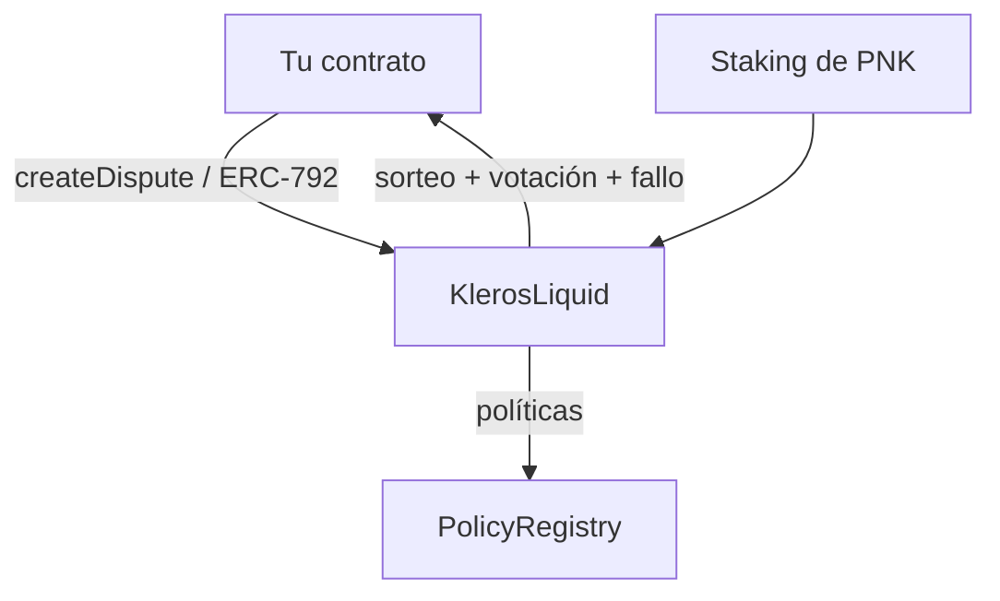
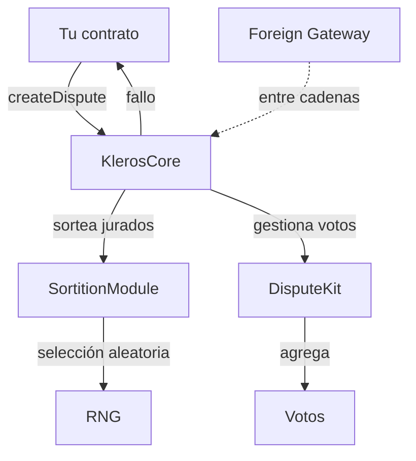
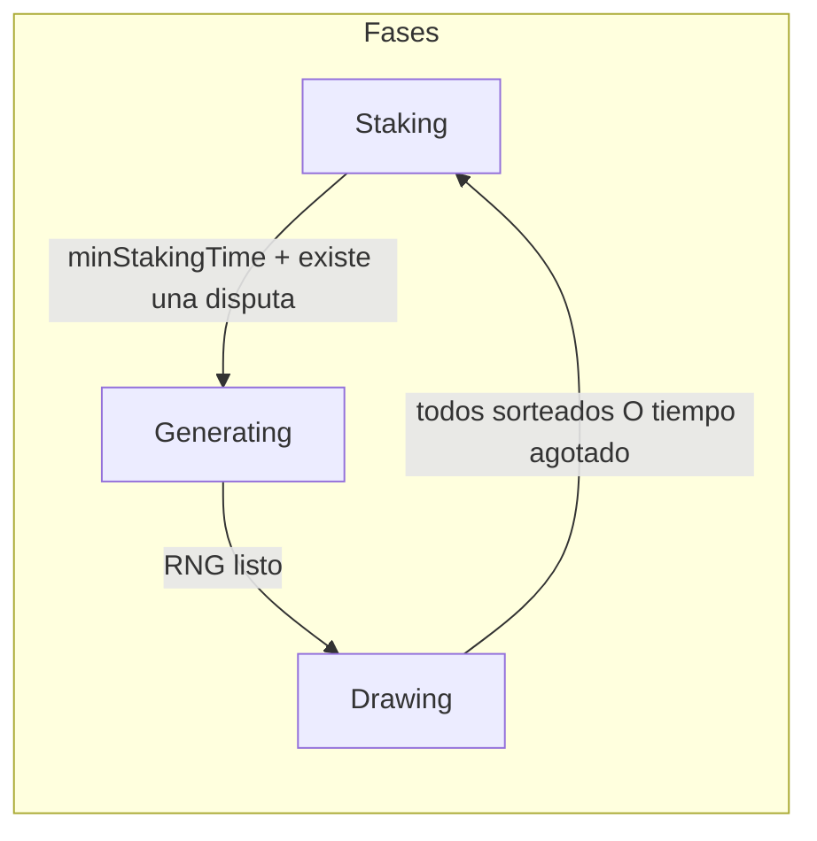
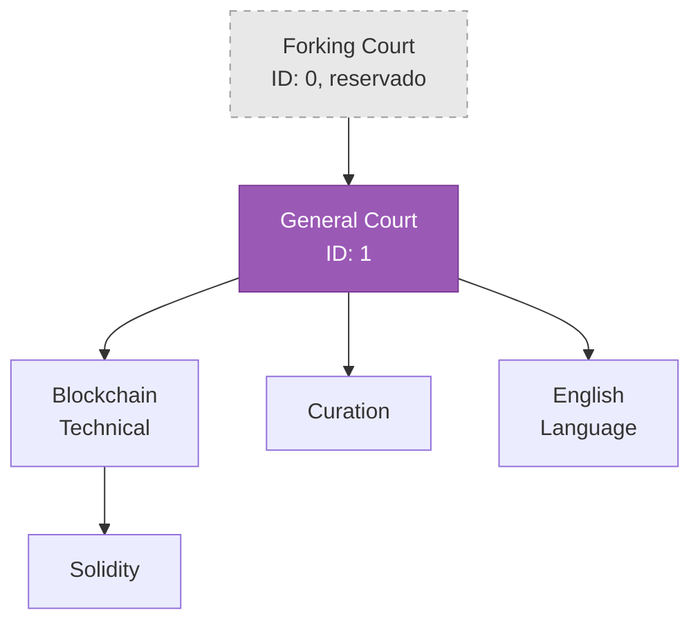
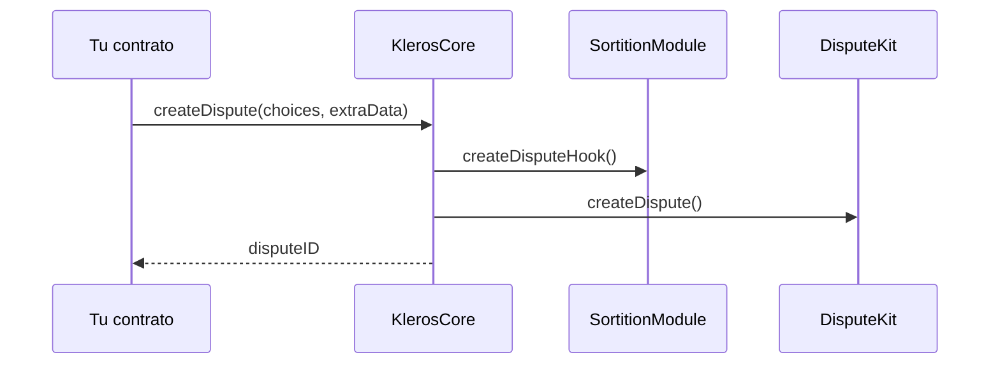
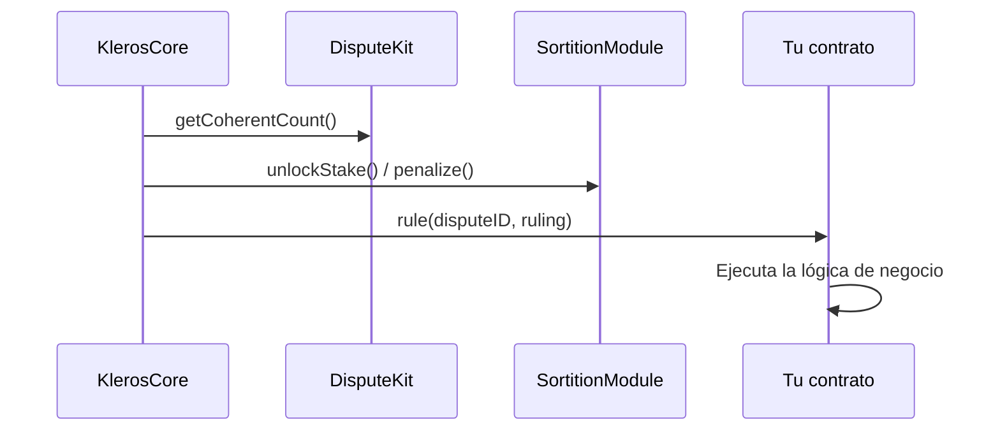

Kleros funciona sobre dos versiones del protocolo. Esta página cubre ambas: primero V1 y después, en detalle, la arquitectura de componentes de V2.

## Arquitectura de V1 {#v1-architecture}

Court V1 se construye en torno a un único contrato, **KlerosLiquid**, en la red principal de Ethereum y en Gnosis Chain. Es monolítico: el staking, el sorteo de jurados, la votación, las apelaciones y la ejecución de los fallos residen en un mismo contrato.



| Componente | Función |
| --- | --- |
| **KlerosLiquid** | Staking, sorteo de jurados, votación, apelaciones y ejecución de fallos |
| **PNK** | Token de staking |
| **PolicyRegistry** | Almacenamiento de las políticas de los tribunales |
| **Contratos arbitrables** | Implementan ERC-792 para crear disputas y recibir fallos, y ERC-1497 para aportar el contexto de la disputa |

V1 utiliza los estándares ERC-792 (arbitraje) y ERC-1497 (evidencias), aleatoriedad basada en blockhash, votación por pluralidad con commit-reveal y un árbol jerárquico de subtribunales. Para ver las direcciones de los contratos de V1, consulta [Direcciones de despliegue](/reference/contracts/deployment-addresses-v1).

<Warning>
Un contrato arbitrable de V1 debe implementar [ERC-1497](/developers/arbitrable-apps/erc-1497) además de ERC-792. En concreto, debe emitir un evento `MetaEvidence` y vincular las disputas a él con un evento `Dispute`. La interfaz de Court se basa en `MetaEvidence` para mostrar a los jurados la disputa y sus opciones de fallo. Un contrato arbitrable que nunca emite `MetaEvidence` produce disputas que no se pueden resolver correctamente.
</Warning>

## Visión general del sistema V2 {#v2-system-overview}

Kleros V2 utiliza una arquitectura modular en la que contratos especializados se encargan de responsabilidades concretas:



## Componentes principales {#core-components}

### KlerosCore {#kleroscore}

El orquestador. Gestiona el ciclo de vida de las disputas y coordina los módulos.

| Responsabilidad | Descripción |
|----------------|-------------|
| Creación de disputas | Acepta disputas de los contratos arbitrables |
| Gestión de periodos | Hace avanzar las disputas por evidencias → votación → apelación → ejecución |
| Cobro de tasas | Cobra y reparte las tasas de arbitraje |
| Configuración de los tribunales | Almacena los parámetros de los tribunales (plazos, tasas, stakes) |

```solidity
interface IArbitratorV2 {
    function createDispute(uint256 _choices, bytes calldata _extraData) 
        external payable returns (uint256 disputeID);
    
    function arbitrationCost(bytes calldata _extraData) 
        external view returns (uint256 cost);
    
    function currentRuling(uint256 _disputeID) 
        external view returns (uint256 ruling, bool tied, bool overridden);
}
```

### Sortition Module {#sortition-module}

Se encarga de la selección de jurados mediante aleatoriedad ponderada.

**Conceptos clave:**
- **Árbol de sorteo**: estructura de datos que asigna el PNK en staking a una probabilidad de selección
- **Fases**: Staking → Generating → Drawing (evita la manipulación del RNG)
- **Stakes aplazados**: los cambios de stake quedan en cola hasta que termina la fase de sorteo

La simplificación del árbol de sorteo está en cola como la siguiente parte del trabajo de simplificación de los contratos (mayo de 2026), y se está planificando un mecanismo de staking de recompensas rediseñado (mayo de 2026).



### Dispute Kits {#dispute-kits}

Mecanismos de votación modulares. El protocolo incluye **DisputeKitClassic**, pero admite implementaciones personalizadas.

| Kit | Mecanismo | Caso de uso |
|-----|-----------|----------|
| Classic | Votación por pluralidad, proporcional al stake | Predeterminado en todos los tribunales |
| Sybil Resistant | Requiere Proof of Humanity | Disputas de una persona, un voto |
| Gated | Requiere poseer tokens | Disputas de comunidades especializadas |

**Funciones del Classic Dispute Kit:**
- Votación commit-reveal (opcional, por tribunal)
- Recompensas basadas en la coherencia (votar con la mayoría = conservar el stake)
- Financiación colectiva de las apelaciones

**Estado del desarrollo:** los contratos de Court V2 pasaron por cuatro rondas de revisión interna (rondas 1–4, de septiembre a noviembre de 2025) y después por una auditoría externa de Certora (de diciembre de 2025 a enero de 2026), con las respuestas a la auditoría enviadas en enero de 2026. La revisión interna terminó en abril de 2026, con los hallazgos clasificados. Se fusionó la simplificación de los contratos de todos los dispute kits (junio de 2026) y un dispute kit de coherencia parcial (mayo de 2026). La especificación del forking court pasó de borrador a debate a nivel de gobernanza (mayo–junio de 2026), y el forking dispute kit pasó de en curso a borrador (junio de 2026).

<Note>
Como la simplificación de los contratos continuó después de la auditoría de Certora (de diciembre de 2025 a enero de 2026), la auditoría no cubre la versión final de los contratos.
</Note>

Entre los **dispute kits especializados** están el DK de Protección al Consumidor de Argentina (restringido, basado en SBT), un DK universitario y un DK de Shutter (commit/reveal con cifrado de umbral mediante Shutter Network).

### Gateways (entre cadenas) {#gateways-cross-chain}

Permiten que las disputas de otras cadenas se resuelvan en Arbitrum.

```
[Ethereum Mainnet]          [Arbitrum One]
       │                          │
  Foreign Gateway ──bridge──► Home Gateway ──► KlerosCore
       │                          │
  Your Contract                Jurors Vote
```

**Flujo:**
1. El contrato arbitrable en mainnet llama al Foreign Gateway
2. El mensaje pasa por el puente al Home Gateway en Arbitrum
3. La disputa se resuelve en Arbitrum
4. El fallo vuelve por el puente a mainnet

Desarrollo reciente entre cadenas (consulta [Vea Bridge](/developers/crosschain/vea-bridge) para más detalles): se creó el paquete VeaShi para empaquetar los contratos de Hashi y Vea para su uso en Kleros V2 (marzo de 2026); se añadió deBridge como segundo protocolo de puente junto a LayerZero (febrero de 2026); el ejecutor de Hashi pasó a ser independiente de la cadena (enero de 2026); `veashi-sdk` se publicó en npm como `@kleros/veashi-sdk` v0.0.2 (mayo de 2026); se añadieron nuevas rutas Base ↔ Ethereum y Base ↔ Arbitrum (junio de 2026); se adoptó un enfoque de tres oráculos para VeaShi, con LayerZero y Chainlink CCIP como los dos oráculos principales y deBridge o Wormhole como tercera opción (junio de 2026); el indexador Envio HyperIndex se integró en el escáner de VeaShi (junio de 2026); y un segundo validador entró en funcionamiento (febrero de 2026).

### Atlas (backend interno) {#atlas-internal-backend}

<Note>
Atlas es una biblioteca de backend interna solo para los equipos de desarrollo de Kleros. No está pensada para su uso o integración por parte de la comunidad.
</Note>

Atlas es la capa de notificaciones y servicios de backend. Se encarga de las notificaciones por correo electrónico, las subidas a IPFS (autenticadas con SIWE), los bots keeper y la transmisión de datos. Llegó a la v1.6.0 en mayo de 2026. Entre sus capacidades clave están el registro por producto (Court V1, Court V2, Foresight), los recordatorios de votación configurables, el seguimiento de entregas de SendGrid y las notificaciones por correo electrónico de PoH V2.

### Biblioteca de componentes (kleros-app) {#components-library-kleros-app}

Todos los frontends de V2 utilizan una biblioteca compartida de componentes de interfaz. `kleros-app` v3.0.1 se publicó en junio de 2026 con diferenciación por producto en el registro y en IPFS y compatibilidad con la baja de suscripciones, y el visor de archivos se extrajo como componente compartido (junio de 2026).

## Ciclo de vida de una disputa {#dispute-lifecycle}

<Steps>
  <Step title="Periodo de evidencias">
    Las partes presentan evidencias. Los jurados se sortean mediante el Sortition Module.
  </Step>
  <Step title="Periodo de commit (si está habilitado)">
    Los jurados envían compromisos de voto ocultos (hash del voto + sal).
  </Step>
  <Step title="Periodo de votación">
    Los jurados revelan sus votos. Deben coincidir con el compromiso si se usó la fase de commit.
  </Step>
  <Step title="Periodo de apelación">
    La parte perdedora puede financiar una apelación. Se sortean más jurados para la siguiente ronda.
  </Step>
  <Step title="Ejecución">
    Se redistribuyen los stakes. Los jurados coherentes reciben recompensas y los incoherentes, penalizaciones. El fallo se envía al contrato arbitrable.
  </Step>
</Steps>

## Jerarquía de tribunales {#court-hierarchy}

Los tribunales forman un árbol. Las apelaciones pueden "saltar" a los tribunales padre cuando el número de jurados supera un umbral.



**Parámetros de los tribunales:**
- `minStake`: PNK mínimo para hacer staking
- `feeForJuror`: tasa en ETH por jurado y ronda
- `jurorsForCourtJump`: umbral para apelar al tribunal padre
- `timesPerPeriod`: duración de cada periodo de la disputa

## Flujo de datos {#data-flow}

### Crear una disputa {#creating-a-dispute}



### Ejecutar un fallo {#executing-a-ruling}



## Modelo de seguridad {#security-model}

| Mecanismo | Propósito |
|-----------|---------|
| **Selección ponderada por stake** | Resistencia Sybil: se necesita PNK para participar |
| **Incentivos a la coherencia** | Votar con la mayoría para conservar el stake; se pierde stake si se es incoherente |
| **Apelaciones** | Varias rondas detectan los errores y aumentan el coste de los ataques |
| **Sistema de fases** | Evita la manipulación del RNG |
| **Guardian/Governor** | Capacidad de pausa de emergencia |

### Auditorías y trabajo de seguridad {#audits-and-security-work}

- Los contratos de Court V2 pasaron por cuatro rondas de revisión interna más una auditoría externa de Certora (consulta Dispute Kits más arriba para ver el calendario y la nota sobre la cobertura de la auditoría).
- Se realizaron auditorías de seguridad de todos los frontends de V1, V2 y PoH, con una revisión de los vectores de ataque XSS (junio de 2026).
- Se corrigieron vulnerabilidades de React (CVE-55183, CVE-55184, CVE-67779) en varias aplicaciones en un esfuerzo coordinado (diciembre de 2025).
- El programa de recompensas por errores está migrando de Hats Finance (cerrado) a plataformas alternativas.
- Kleros Skills se lanzó en [skills.kleros.io](https://skills.kleros.io): paquetes de conocimiento legibles por agentes para el protocolo (mayo de 2026). Paquetes disponibles: IPFS Upload y operaciones de Curate. Hoja de ruta: CLI, verificación de agentes ERC-8004, Escrow v1/v2 y un Arbitrable App Builder.

## Direcciones clave (Arbitrum One) {#key-addresses-arbitrum-one}

| Contrato | Propósito |
|----------|---------|
| KlerosCore | Árbitro principal |
| SortitionModule | Selección de jurados |
| DisputeKitClassic | Votación predeterminada |
| DisputeTemplateRegistry | Almacenamiento de plantillas |
| EvidenceModule | Seguimiento de evidencias |

<Note>
Para ver las direcciones actuales, consulta los [archivos de despliegue de kleros-v2](https://github.com/kleros/kleros-v2/tree/dev/contracts/deployments).
</Note>
