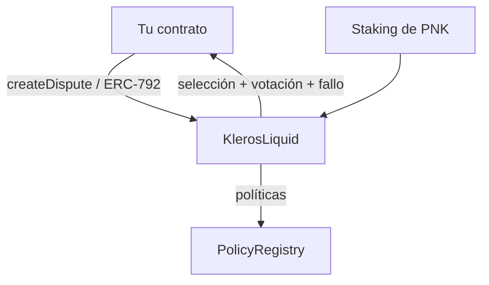
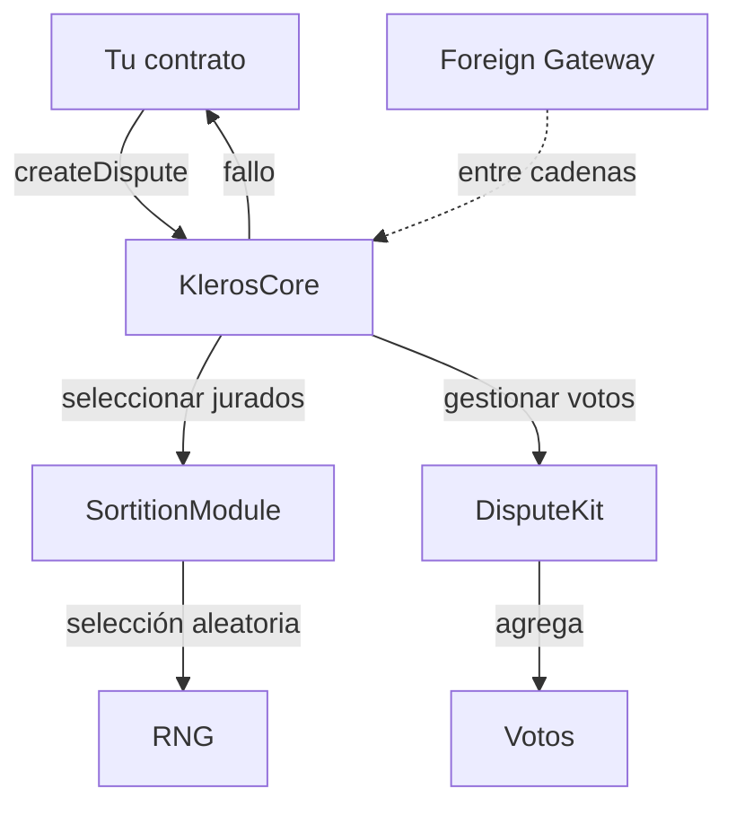
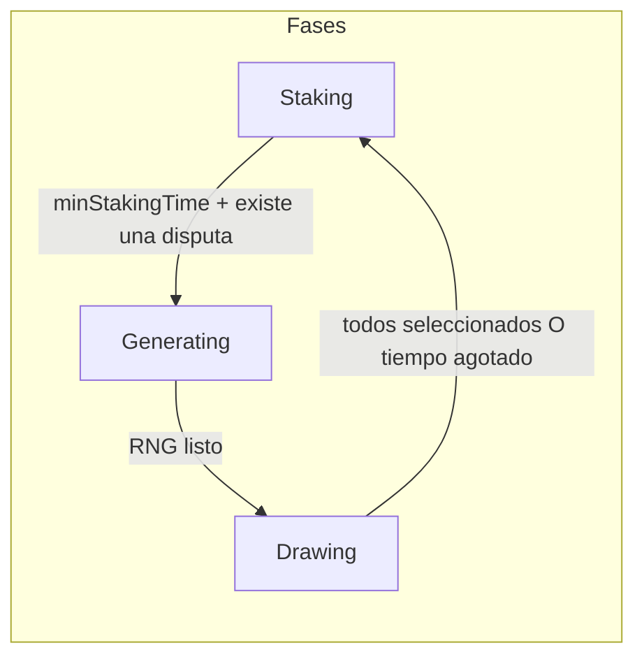
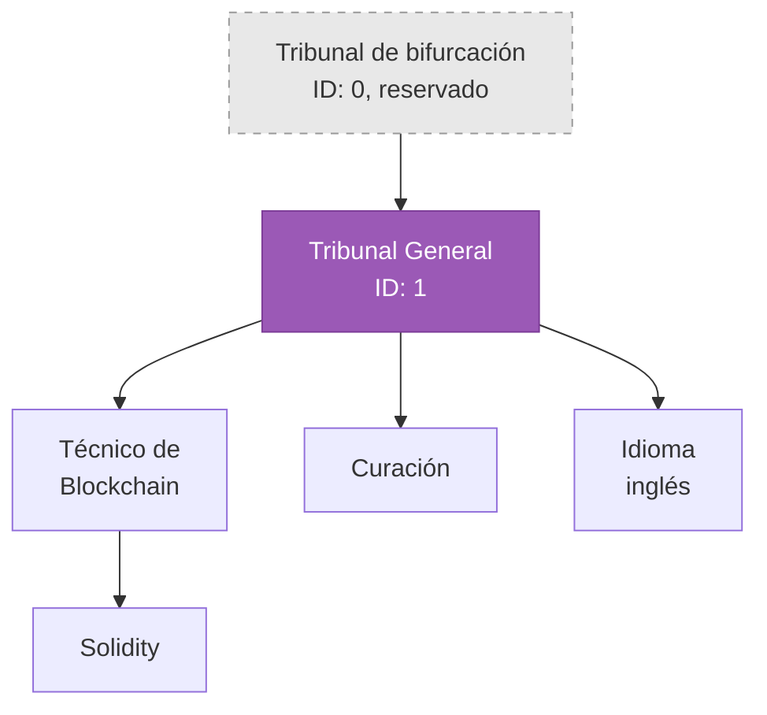
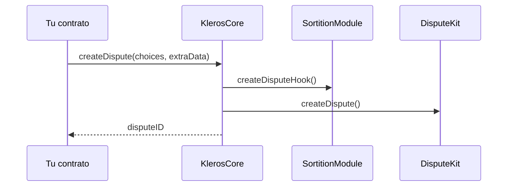
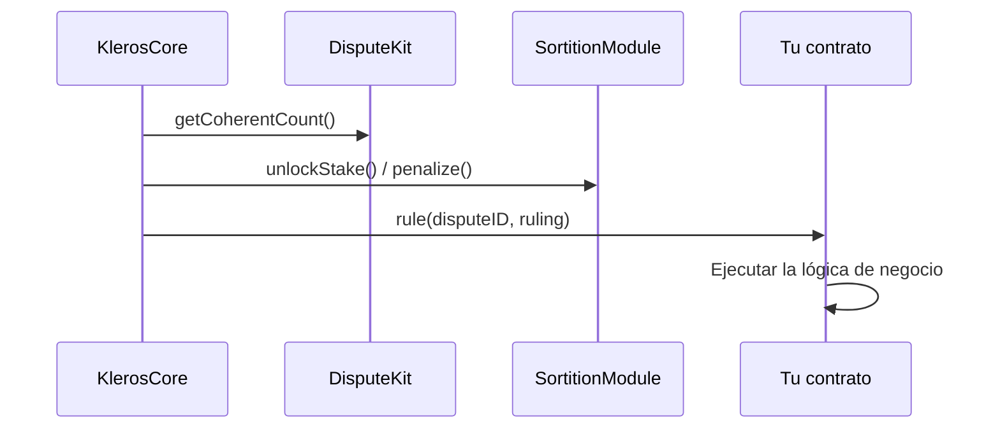

Kleros funciona con dos versiones del protocolo. Esta página cubre ambas: primero V1 y después la arquitectura de componentes de V2 en detalle.

## Arquitectura de V1

Court V1 se construye en torno a un único contrato, **KlerosLiquid**, en Ethereum Mainnet y Gnosis Chain. Es monolítico: el staking, la selección de jurados, la votación, las apelaciones y la ejecución de fallos residen en un solo contrato.



| Componente | Función |
| --- | --- |
| **KlerosLiquid** | Staking, selección de jurados, votación, apelaciones, ejecución de fallos |
| **PNK** | Token de staking |
| **PolicyRegistry** | Almacenamiento de las políticas de los tribunales |
| **Contratos arbitrables** | Implementan ERC-792 para crear disputas y recibir fallos, y ERC-1497 para proporcionar el contexto de la disputa |

V1 utiliza los estándares ERC-792 (arbitraje) y ERC-1497 (evidencia), aleatoriedad basada en blockhash, votación por pluralidad con commit-reveal y un árbol jerárquico de subtribunales. Para las direcciones de los contratos de V1, consulta [Direcciones de despliegue](/es/reference/contracts/deployment-addresses-v1).

<Warning>
Un contrato arbitrable de V1 debe implementar [ERC-1497](/es/developers/arbitrable-apps/erc-1497) además de ERC-792. En particular, debe emitir un evento `MetaEvidence` y vincular las disputas a él con un evento `Dispute`. La interfaz de Court depende de `MetaEvidence` para mostrar la disputa y sus opciones de fallo a los jurados. Un contrato arbitrable que nunca emite `MetaEvidence` produce disputas que no pueden juzgarse correctamente.
</Warning>

## Descripción general del sistema V2

Kleros V2 utiliza una arquitectura modular en la que contratos especializados se encargan de responsabilidades específicas:



## Componentes principales

### KlerosCore

El orquestador. Gestiona el ciclo de vida de las disputas y coordina los módulos.

| Responsabilidad | Descripción |
|----------------|-------------|
| Creación de disputas | Acepta disputas de los contratos arbitrables |
| Gestión de periodos | Hace avanzar las disputas por evidencia → votación → apelación → ejecución |
| Cobro de tarifas | Cobra y distribuye las tarifas de arbitraje |
| Configuración de tribunales | Almacena los parámetros de los tribunales (plazos, tarifas, stakes) |

```solidity
interface IArbitratorV2 {
    function createDispute(uint256 _choices, bytes calldata _extraData) 
        external payable returns (uint256 disputeID);
    
    function arbitrationCost(bytes calldata _extraData) 
        external view returns (uint256 cost);
    
    function currentRuling(uint256 _disputeID) 
        external view returns (uint256 ruling, bool tied, bool overridden);
}
```

### Sortition Module

Gestiona la selección de jurados mediante aleatoriedad ponderada.

**Conceptos clave:**
- **Sortition Tree**: estructura de datos que asigna el PNK en stake a una probabilidad de selección
- **Fases**: Staking → Generating → Drawing (evita la manipulación del RNG)
- **Stakes diferidos**: los cambios de stake quedan en cola hasta que se completa la fase de selección

La simplificación del sortition tree está en cola como el siguiente trabajo de simplificación de contratos (mayo de 2026), y se está planificando un mecanismo de staking de recompensas rediseñado (mayo de 2026).



### Dispute Kits

Mecanismos de votación modulares. El protocolo incluye **DisputeKitClassic**, pero admite implementaciones personalizadas.

| Kit | Mecanismo | Caso de uso |
|-----|-----------|----------|
| Classic | Votación por pluralidad, proporcional al stake | Predeterminado para todos los tribunales |
| Sybil Resistant | Requiere Proof of Humanity | Disputas de una persona, un voto |
| Gated | Requiere tenencia de tokens | Disputas de comunidades especializadas |

**Características del Classic Dispute Kit:**
- Votación commit-reveal (opcional, por tribunal)
- Recompensas basadas en la coherencia (votar con la mayoría = conservar el stake)
- Financiación colectiva de apelaciones

**Estado de desarrollo:** los contratos de Court V2 pasaron por cuatro rondas de revisión interna (Rondas 1–4, septiembre–noviembre de 2025) y luego por una auditoría externa de Certora (diciembre de 2025–enero de 2026), con las respuestas a la auditoría presentadas en enero de 2026. La revisión interna se completó en abril de 2026, con los hallazgos clasificados. La simplificación de contratos en los dispute kits se fusionó (junio de 2026), y se fusionó un dispute kit de coherencia parcial (mayo de 2026). La especificación del tribunal de bifurcación (forking court) avanzó de borrador a discusión a nivel de gobernanza (mayo–junio de 2026), y el dispute kit de bifurcación pasó de en progreso a borrador (junio de 2026).

<Note>
Dado que la simplificación de contratos continuó después de la auditoría de Certora (diciembre de 2025–enero de 2026), la auditoría no cubre la versión final de los contratos.
</Note>

**Los dispute kits especializados** incluyen el Argentina Consumer Protection DK (restringido, basado en SBT), un University DK y un Shutter DK (commit/reveal con cifrado de umbral mediante Shutter Network).

### Gateways (entre cadenas)

Permiten que las disputas de otras cadenas se resuelvan en Arbitrum.

```
[Ethereum Mainnet]          [Arbitrum One]
       │                          │
  Foreign Gateway ──bridge──► Home Gateway ──► KlerosCore
       │                          │
  Your Contract                Jurors Vote
```

**Flujo:**
1. El contrato arbitrable en mainnet llama al Foreign Gateway
2. El mensaje se transmite por el puente al Home Gateway en Arbitrum
3. La disputa se resuelve en Arbitrum
4. El fallo se transmite de vuelta por el puente a mainnet

Desarrollo reciente entre cadenas (consulta [Vea Bridge](/es/developers/crosschain/vea-bridge) para más detalles): se creó el paquete VeaShi para empaquetar los contratos de Hashi y Vea para su uso por Kleros V2 (marzo de 2026); se añadió deBridge como segundo protocolo de puente junto a LayerZero (febrero de 2026); el ejecutor de Hashi se hizo independiente de la cadena (enero de 2026); `veashi-sdk` se publicó en npm como `@kleros/veashi-sdk` v0.0.2 (mayo de 2026); se añadieron nuevas rutas Base ↔ Ethereum y Base ↔ Arbitrum (junio de 2026); se adoptó un enfoque de tres oráculos para VeaShi, con LayerZero y Chainlink CCIP como los dos oráculos principales y deBridge o Wormhole como tercera opción (junio de 2026); el indexador Envio HyperIndex se integró en el escáner de VeaShi (junio de 2026); y un segundo validador entró en funcionamiento (febrero de 2026).

### Atlas (backend interno)

<Note>
Atlas es una biblioteca de backend interna exclusiva para los equipos de desarrollo de Kleros. No está pensada para el uso ni la integración por parte de la comunidad.
</Note>

Atlas es la capa de notificaciones y servicios de backend. Gestiona notificaciones por correo electrónico, cargas a IPFS (autenticadas con SIWE), bots keeper y transmisión de datos. Alcanzó la v1.6.0 en mayo de 2026. Entre sus capacidades clave se incluyen el registro por producto (Court V1, Court V2, Foresight), recordatorios de votación configurables, seguimiento de entregas de SendGrid y notificaciones por correo electrónico de PoH V2.

### Biblioteca de componentes (kleros-app)

Todos los frontends de V2 utilizan una biblioteca compartida de componentes de interfaz. `kleros-app` v3.0.1 se lanzó en junio de 2026 con diferenciación de productos entre el registro e IPFS y soporte para cancelar la suscripción, y el visor de archivos se extrajo como componente compartido (junio de 2026).

## Ciclo de vida de una disputa

<Steps>
  <Step title="Periodo de evidencia">
    Las partes presentan evidencia. Los jurados se seleccionan mediante el Sortition Module.
  </Step>
  <Step title="Periodo de commit (si está habilitado)">
    Los jurados envían compromisos de voto ocultos (hash del voto + salt).
  </Step>
  <Step title="Periodo de votación">
    Los jurados revelan sus votos. Deben coincidir con el compromiso si se usó la fase de commit.
  </Step>
  <Step title="Periodo de apelación">
    La parte perdedora puede financiar una apelación. Se seleccionan más jurados para la siguiente ronda.
  </Step>
  <Step title="Ejecución">
    Se redistribuyen los stakes. Los jurados coherentes son recompensados y los incoherentes, penalizados. El fallo se envía al contrato arbitrable.
  </Step>
</Steps>

## Jerarquía de tribunales

Los tribunales forman un árbol. Las apelaciones pueden "saltar" a los tribunales superiores cuando el número de jurados supera un umbral.



**Parámetros de los tribunales:**
- `minStake`: PNK mínimo para hacer stake
- `feeForJuror`: tarifa en ETH por jurado y por ronda
- `jurorsForCourtJump`: umbral para apelar al tribunal superior
- `timesPerPeriod`: duración de cada periodo de la disputa

## Flujo de datos

### Crear una disputa



### Ejecutar un fallo



## Modelo de seguridad

| Mecanismo | Propósito |
|-----------|---------|
| **Selección ponderada por stake** | Resistencia Sybil: se necesita PNK para participar |
| **Incentivos de coherencia** | Votar con la mayoría para conservar el stake; se pierde stake si se es incoherente |
| **Apelaciones** | Varias rondas detectan errores y aumentan el costo de los ataques |
| **Sistema de fases** | Evita la manipulación del RNG |
| **Guardian/Governor** | Capacidad de pausa de emergencia |

### Auditorías y trabajo de seguridad

- Los contratos de Court V2 pasaron por cuatro rondas de revisión interna más una auditoría externa de Certora (consulta Dispute Kits más arriba para ver la cronología y la nota sobre la cobertura de la auditoría).
- Se realizaron auditorías de seguridad de frontend en todos los frontends de V1, V2 y PoH, con una revisión de vectores de ataque XSS (junio de 2026).
- Se parchearon vulnerabilidades de React (CVE-55183, CVE-55184, CVE-67779) en varias aplicaciones en un esfuerzo coordinado (diciembre de 2025).
- El programa de bug bounty está migrando de Hats Finance (cerrado) a plataformas alternativas.
- Kleros Skills se lanzó en [skills.kleros.io](https://skills.kleros.io): paquetes de conocimiento legibles por agentes para el protocolo (mayo de 2026). Paquetes disponibles: IPFS Upload y operaciones de Curate. Hoja de ruta: CLI, verificación de agentes ERC-8004, Escrow v1/v2 y un Arbitrable App Builder.

## Direcciones clave (Arbitrum One)

| Contrato | Propósito |
|----------|---------|
| KlerosCore | Árbitro principal |
| SortitionModule | Selección de jurados |
| DisputeKitClassic | Votación predeterminada |
| DisputeTemplateRegistry | Almacenamiento de plantillas |
| EvidenceModule | Seguimiento de evidencia |

<Note>
Para las direcciones actuales, consulta los [archivos de despliegue de kleros-v2](https://github.com/kleros/kleros-v2/tree/dev/contracts/deployments).
</Note>

