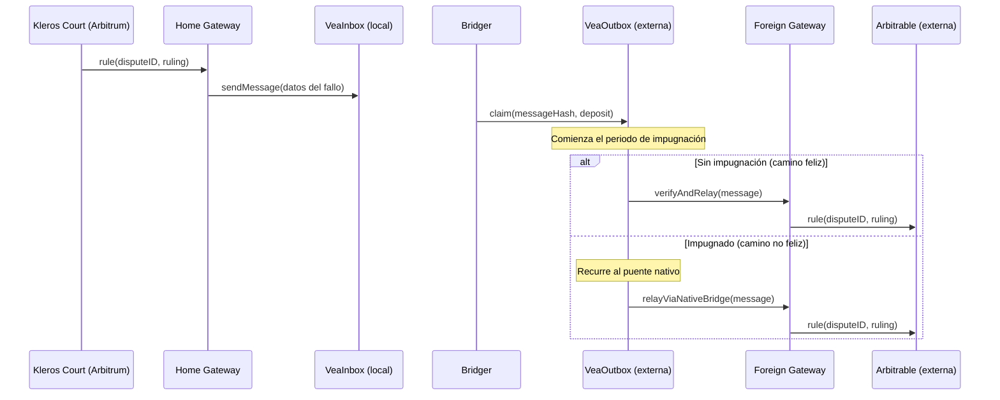

## Descripción general

Vea es un puente de mensajes entre cadenas creado por Kleros para lograr una interoperabilidad rápida y segura con los optimistic rollups. Resuelve un problema específico: transmitir **datos autenticados** entre cadenas, donde ningún tercero puede "aportar liquidez" como lo hacen los puentes de tokens.

En el protocolo Kleros, Vea gestiona dos tipos de mensajes:

- **Creación de disputas** desde cadenas externas hacia Kleros Court en Arbitrum (de externa a local)
- **Transmisión de fallos** desde Kleros Court de vuelta a los contratos arbitrables en cadenas externas (de local a externa)

Vea conecta los contratos [Foreign Gateway](/es/reference/contracts/gateways) y Home Gateway.

<Info>
Para la documentación completa del protocolo Vea, incluido el análisis técnico en profundidad, la referencia del SDK y la guía para validadores, consulta [docs.vea.ninja](https://docs.vea.ninja/).
</Info>

---

## Propiedades de seguridad

Vea se diferencia de la mayoría de los puentes entre cadenas en varios aspectos:

- **Seguridad 1-de-N**: solo se necesita un participante honesto para forzar la ejecución correcta del puente. El protocolo no requiere permisos, por lo que cualquiera puede ser ese participante.
- **Contratos inmutables**: sin gobernanza, sin multisig, sin riesgo de actualizaciones.
- **Sin tokens, sin tarifas, sin búsqueda de rentas**: Vea es una primitiva de bien público.
- **Recurre a los puentes nativos**: en el camino no feliz, el puente nativo del rollup (operado por el proveedor del rollup) sirve como fuente de verdad.

---

## Tipos de puente

Vea utiliza diferentes primitivas de puente según la dirección del mensaje y los requisitos de seguridad:

| Tipo de puente | Dirección | Mecanismo |
| --- | --- | --- |
| **Simple Bridge** | De externa a local (creación de disputas) | Transmisión directa mediante los gateways. No se necesita un juego de pruebas de fraude porque una disputa maliciosa solo desperdicia el gas del atacante. |
| **Fast Bridge** | De local a externa (transmisión de fallos) | Puente con confianza minimizada, con afirmaciones respaldadas por depósitos y un periodo de impugnación. Recurre al puente nativo solo cuando se impugna. |
| **Safe Bridge** | Respaldo | Envoltorio ligero alrededor del puente nativo del rollup (p. ej., de Arbitrum a Ethereum). Se usa cuando se impugnan afirmaciones del Fast Bridge. |

---

## Flujo del Fast Bridge



### Camino feliz

Los mensajes se verifican de forma optimista. La transmisión tarda desde horas hasta un par de días según la cadena de origen y de destino. No interviene ningún puente nativo. El gas se paga solo en la cadena de destino.

### Camino no feliz

Si se impugna una afirmación, el mensaje se envía por el puente canónico. Esto puede tardar entre 7 y 8 días cuando se envía desde optimistic rollups. La parte deshonesta (ya sea el Bridger o el Challenger) pierde su depósito. La mitad se quema y la otra mitad va a la parte ganadora. La quema obligatoria evita un ataque de retraso sin costo en el que el Bridger y el Challenger son la misma entidad.

---

## Participantes

| Rol | Descripción |
| --- | --- |
| **Bridger** | Realiza afirmaciones respaldadas por depósitos en la cadena receptora sobre el estado de los mensajes en la cadena emisora. Compite por ser el primero en afirmar cada mensaje. |
| **Challenger** | Supervisa las afirmaciones. Presenta un depósito de impugnación cuando observa una afirmación deshonesta. No propone una respuesta correcta; el puente nativo proporciona la verdad de referencia. |
| **Relayer** | Espera a que pase el periodo de impugnación y luego llama a `verifyAndRelay()` para entregar el mensaje a su destinatario. |

---

## Rutas admitidas

| Ruta | Dirección | Tipo de puente |
| --- | --- | --- |
| De Arbitrum a Ethereum | De local a externa | Fast Bridge |
| De Ethereum a Arbitrum | De externa a local | Simple Bridge |
| De Arbitrum a Gnosis Chain | De local a externa | Fast Bridge (multisalto a través de Ethereum en el camino no feliz) |
| Base ↔ Ethereum | Ambas | Añadida en junio de 2026 |
| Base ↔ Arbitrum | Ambas | Añadida en junio de 2026 |
| Arbitrum ↔ Story | Ambas | Desplegada y probada en enero de 2026 |

Las dependencias de los puentes se actualizaron a las últimas versiones de LayerZero y Chainlink CCIP (marzo de 2026).

<Note>
Vea no depende de un puente nativo directo entre Arbitrum y Gnosis Chain. En el camino no feliz, las afirmaciones impugnadas se resuelven usando dos Safe Bridges: de Arbitrum a Ethereum Mainnet y, después, de Ethereum Mainnet a Gnosis Chain.
</Note>

---

## Componentes de los contratos

Para cada par de cadenas emisora-receptora existe un conjunto independiente de despliegues de contratos de Vea, con exactamente un contrato por cadena.

### VeaInbox (cadena emisora)

Gestiona el estado de todos los mensajes enviados a través de Vea. Los mensajes se insertan en un árbol de Merkle de solo anexado (merkle mountain range). Se despliega en la cadena local (Arbitrum).

```solidity
function sendMessage(address _to, bytes4 _fnSelector, bytes memory _data) external;
```

### Router (cadena intermediaria, si corresponde)

Enruta los mensajes de los puentes nativos entre cadenas que no tienen un puente nativo directo.

### VeaOutbox (cadena receptora)

Gestiona el juego optimista sobre el estado del inbox en la cadena receptora. Recibe las afirmaciones de los bridgers y gestiona el periodo de impugnación.

```solidity
function claim(bytes32 _messageHash) external payable;
function challenge(bytes32 _messageHash) external payable;
function verifyAndRelay(bytes memory _message) external;
```

---

## Sistema de épocas

El tiempo se divide en épocas definidas por un `epochPeriod`. Las épocas marcan el periodo entre posibles eventos de transmisión y definen la frecuencia máxima de operación del puente. Tras una instantánea se introduce un retraso de afirmación de aproximadamente un `epochPeriod` para garantizar que los challengers conozcan el estado de la L2 antes de que puedan realizarse afirmaciones.

---

## Protocolos de puente

Vea admite varios protocolos de puente subyacentes:

- deBridge se añadió como segundo protocolo de puente junto a LayerZero (febrero de 2026). El contrato `DeBridgeReporter` se desplegó y probó, con un mensaje completo de extremo a extremo probado en la ruta de Story a Arbitrum (febrero de 2026).
- Se aprobó un enfoque de tres oráculos para VeaShi (junio de 2026): LayerZero y Chainlink CCIP como los dos oráculos principales, con deBridge o Wormhole como tercera opción.
- Se completaron los despliegues en mainnet en Base y Ethereum con tres DVN en LayerZero (junio de 2026).

## VeaShi

- El paquete VeaShi empaqueta los contratos de Hashi y Vea para su uso por Kleros V2 (marzo de 2026).
- Nuevas rutas de VeaShi conectan Ethereum y Arbitrum con Robinhood (chain ID 4217), Tempo (chain ID 4663, además de una ruta en la testnet Sepolia) y ARC (chain ID 5042). Las direcciones de las rutas se incluyen en `@kleros/veashi-sdk` v0.1.0 (septiembre de 2026).
- `veashi-sdk` se publicó en npm como `@kleros/veashi-sdk` v0.0.2 (mayo de 2026).
- Los contratos de LayerZero se trasladaron a una estructura de adaptadores por coherencia (mayo de 2026).
- El ejecutor de Hashi se desacopló del relayer: se separó la indexación de mensajes de la ejecución y se introdujo lógica de archivo de estado para los mensajes pendientes que aún no alcanzan el umbral de Hashi (mayo de 2026).
- El ejecutor de Hashi se hizo independiente de la cadena (enero de 2026).

## Infraestructura de validadores

- Un segundo validador entró en funcionamiento (febrero de 2026).
- Se lanzó un respaldo de RPC para el validador: un RPC principal degradado ya no detiene al validador (junio de 2026).
- Se refactorizó la gestión de errores del relayer: la configuración de los listeners se sacó del bucle por red, con registro de errores por cadena (mayo de 2026).
- Un envoltorio del proveedor de RPC gestiona los errores y las URL de respaldo tanto en el validador como en el relayer (mayo de 2026).

## Indexación

- El indexador Envio HyperIndex se integró en el escáner de VeaShi, manteniendo el subgraph existente como respaldo (junio de 2026).
- El escáner de VeaShi se trasladó al monorepo de Vea (junio de 2026).
- Los indexadores de Envio separados se fusionaron en uno solo, y los subgraphs del inbox y el outbox de Vea se migraron a él (agosto de 2026).

## VeaScan

[VeaScan](https://veascan.io) es el explorador de bloques para las transacciones del puente Vea. Muestra las afirmaciones pendientes, el estado de las impugnaciones y el historial de transmisiones. Desde agosto de 2026, VeaScan y el escáner de VeaShi son una sola aplicación, por lo que las transacciones de los puentes Vea y VeaShi se consultan en un solo lugar, con hashes de transacción que enlazan a los exploradores de bloques correspondientes.

---

## Recursos

<CardGroup cols={2}>
  <Card title="Documentación completa de Vea" icon="book" href="https://docs.vea.ninja">
    Documentación completa del protocolo: análisis técnico en profundidad, SDK, guía para validadores
  </Card>
  <Card title="Vea en GitHub" icon="github" href="https://github.com/kleros/vea">
    Código fuente de los contratos del puente
  </Card>
  <Card title="Explorador VeaScan" icon="magnifying-glass" href="https://veascan.io">
    Explorador para las transacciones de los puentes Vea y VeaShi
  </Card>
  <Card title="Guía de integración con L2" icon="link" href="/es/developers/crosschain/l2-integration">
    Intégrate desde una cadena externa
  </Card>
</CardGroup>
