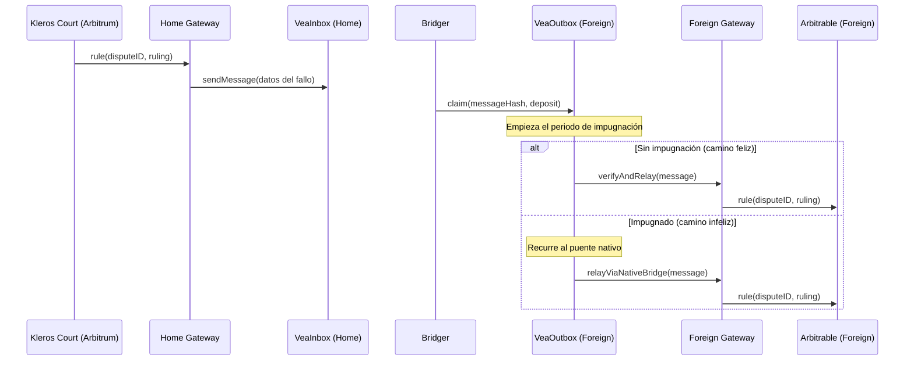

## Descripción general {#overview}

Vea es un puente de mensajes entre cadenas creado por Kleros para una interoperabilidad rápida y segura con los rollups optimistas. Resuelve un problema concreto: transmitir **datos autenticados** entre cadenas, donde ningún tercero puede "aportar liquidez" como hacen los puentes de tokens.

En el protocolo Kleros, Vea gestiona dos tipos de mensajes:

- **Creación de disputas** desde cadenas externas hacia Kleros Court en Arbitrum (de Foreign a Home)
- **Transmisión de fallos** desde Kleros Court de vuelta a los contratos arbitrables de las cadenas externas (de Home a Foreign)

Vea conecta los contratos [Foreign Gateway](/es/reference/contracts/gateways) y Home Gateway.

<Info>
Para consultar la documentación completa del protocolo Vea, incluido el análisis técnico en profundidad, la referencia del SDK y la guía para validadores, visita [docs.vea.ninja](https://docs.vea.ninja/).
</Info>

---

## Propiedades de seguridad {#security-properties}

Vea se diferencia de la mayoría de los puentes entre cadenas en varios aspectos:

- **Seguridad 1 de N**: basta con un participante honesto para forzar la ejecución correcta del puente. El protocolo no requiere permisos, así que cualquiera puede ser ese participante.
- **Contratos inmutables**: sin gobernanza, sin multifirma, sin riesgo de actualización.
- **Sin tokens, sin comisiones, sin búsqueda de rentas**: Vea es un primitivo de bien público.
- **Recurre a los puentes nativos**: en el camino infeliz, el puente nativo del rollup (operado por su proveedor) actúa como fuente de verdad.

---

## Tipos de puente {#bridge-types}

Vea usa distintos primitivos de puente según la dirección del mensaje y los requisitos de seguridad:

| Tipo de puente | Dirección | Mecanismo |
| --- | --- | --- |
| **Simple Bridge** | De Foreign a Home (creación de disputas) | Transmisión directa mediante los gateways. No necesita un juego de pruebas de fraude porque una disputa maliciosa solo hace perder gas al atacante. |
| **Fast Bridge** | De Home a Foreign (transmisión de fallos) | Puente de confianza minimizada con afirmaciones respaldadas por depósitos y un periodo de impugnación. Solo recurre al puente nativo cuando hay una impugnación. |
| **Safe Bridge** | Respaldo | Envoltorio ligero sobre el puente nativo del rollup (por ejemplo, de Arbitrum a Ethereum). Se usa cuando se impugnan las afirmaciones del Fast Bridge. |

---

## Flujo del Fast Bridge {#fast-bridge-flow}



### Camino feliz {#happy-path}

Los mensajes se verifican de forma optimista. La transmisión tarda desde unas horas hasta un par de días, según las cadenas de origen y destino. No interviene ningún puente nativo. El gas solo se paga en la cadena de destino.

### Camino infeliz {#unhappy-path}

Si se impugna una afirmación, el mensaje se envía por el puente canónico. Esto puede tardar entre 7 y 8 días cuando se envía desde rollups optimistas. La parte deshonesta (Bridger o Challenger) pierde su depósito: la mitad se quema y la otra mitad va a la parte ganadora. La quema obligatoria evita un ataque de retraso sin coste en el que Bridger y Challenger son la misma entidad.

---

## Participantes {#participants}

| Rol | Descripción |
| --- | --- |
| **Bridger** | Hace afirmaciones respaldadas por depósitos en la cadena de recepción sobre el estado de los mensajes en la cadena de envío. Compite por hacer la primera afirmación de cada mensaje. |
| **Challenger** | Supervisa las afirmaciones. Envía un depósito de impugnación cuando observa una afirmación deshonesta. No propone una respuesta correcta; el puente nativo aporta la verdad. |
| **Relayer** | Espera a que termine el periodo de impugnación y, después, llama a `verifyAndRelay()` para entregar el mensaje a su destinatario. |

---

## Rutas admitidas {#supported-routes}

| Ruta | Dirección | Tipo de puente |
| --- | --- | --- |
| Arbitrum a Ethereum | De Home a Foreign | Fast Bridge |
| Ethereum a Arbitrum | De Foreign a Home | Simple Bridge |
| Arbitrum a Gnosis Chain | De Home a Foreign | Fast Bridge (varios saltos mediante Ethereum en el camino infeliz) |
| Base ↔ Ethereum | Ambas | Añadida en junio de 2026 |
| Base ↔ Arbitrum | Ambas | Añadida en junio de 2026 |
| Arbitrum ↔ Story | Ambas | Desplegada y probada en enero de 2026 |

Las dependencias de los puentes se actualizaron a las últimas versiones de LayerZero y Chainlink CCIP (marzo de 2026).

<Note>
Vea no depende de un puente nativo directo entre Arbitrum y Gnosis Chain. En el camino infeliz, las afirmaciones impugnadas se resuelven con dos Safe Bridges: de Arbitrum a la red principal de Ethereum y, después, de la red principal de Ethereum a Gnosis Chain.
</Note>

---

## Componentes de los contratos {#contract-components}

Para cada par de cadenas de envío y recepción hay un conjunto separado de despliegues de contratos de Vea, con exactamente un contrato por cadena.

### VeaInbox (cadena de envío) {#veainbox-sending-chain}

Gestiona el estado de todos los mensajes enviados a través de Vea. Los mensajes se insertan en un árbol de Merkle de solo anexión (merkle mountain range). Se despliega en la cadena principal (Arbitrum).

```solidity
function sendMessage(address _to, bytes4 _fnSelector, bytes memory _data) external;
```

### Router (cadena intermedia, si procede) {#router-intermediary-chain-if-applicable}

Enruta los mensajes de los puentes nativos entre cadenas que no tienen un puente nativo directo.

### VeaOutbox (cadena de recepción) {#veaoutbox-receiving-chain}

Gestiona el juego optimista sobre el estado del inbox en la cadena de recepción. Recibe las afirmaciones de los bridgers y gestiona el periodo de impugnación.

```solidity
function claim(bytes32 _messageHash) external payable;
function challenge(bytes32 _messageHash) external payable;
function verifyAndRelay(bytes memory _message) external;
```

---

## Sistema de épocas {#epoch-system}

El tiempo se divide en épocas definidas por un `epochPeriod`. Las épocas marcan el periodo entre posibles eventos de transmisión y definen la frecuencia máxima de funcionamiento del puente. Tras una instantánea se introduce un retraso de afirmación de aproximadamente un `epochPeriod` para garantizar que quienes impugnan conozcan el estado de la L2 antes de que puedan hacerse afirmaciones.

---

## Protocolos de puente {#bridge-protocols}

Vea admite varios protocolos de puente subyacentes:

- Se añadió deBridge como segundo protocolo de puente junto a LayerZero (febrero de 2026). Se desplegó y probó el contrato `DeBridgeReporter`, con un mensaje completo de extremo a extremo probado en la ruta de Story a Arbitrum (febrero de 2026).
- Se aprobó un enfoque de tres oráculos para VeaShi (junio de 2026): LayerZero y Chainlink CCIP como los dos oráculos principales, con deBridge o Wormhole como tercera opción.
- Se completaron los despliegues en mainnet en Base y Ethereum con tres DVN en LayerZero (junio de 2026).

## VeaShi {#veashi}

- El paquete VeaShi empaqueta los contratos de Hashi y Vea para su uso en Kleros V2 (marzo de 2026).
- Las nuevas rutas de VeaShi conectan Ethereum y Arbitrum con Robinhood (ID de cadena 4217), Tempo (ID de cadena 4663, además de una ruta en la testnet Sepolia) y ARC (ID de cadena 5042). Las direcciones de las rutas se incluyen en `@kleros/veashi-sdk` v0.1.0 (septiembre de 2026).
- `veashi-sdk` se publicó en npm como `@kleros/veashi-sdk` v0.0.2 (mayo de 2026).
- Los contratos de LayerZero se reorganizaron con una estructura de adaptadores por coherencia (mayo de 2026).
- El ejecutor de Hashi se desacopló del relayer: se separó la indexación de los mensajes de su ejecución y se introdujo una lógica de archivo de estado para los mensajes pendientes que aún no alcanzan el umbral de Hashi (mayo de 2026).
- El ejecutor de Hashi pasó a ser independiente de la cadena (enero de 2026).

## Infraestructura de validadores {#validator-infrastructure}

- Un segundo validador entró en funcionamiento (febrero de 2026).
- Se incorporó un RPC de respaldo para el validador: un RPC principal degradado ya no detiene al validador (junio de 2026).
- Se refactorizó la gestión de errores del relayer: la configuración de los listeners salió del bucle por red, con registro de errores por cadena (mayo de 2026).
- Un envoltorio del proveedor de RPC gestiona los errores y las URL de respaldo tanto en el validador como en el relayer (mayo de 2026).

## Indexación {#indexing}

- El indexador Envio HyperIndex se integró en el escáner de VeaShi, con el subgraph existente como respaldo (junio de 2026).
- El escáner de VeaShi se trasladó al monorepo de Vea (junio de 2026).
- Los indexadores de Envio separados se fusionaron en uno solo, y los subgraphs del inbox y el outbox de Vea migraron a él (agosto de 2026).

## VeaScan {#veascan}

[VeaScan](https://veascan.io) es el explorador de bloques de las transacciones del puente Vea. Muestra las afirmaciones pendientes, el estado de las impugnaciones y el historial de transmisiones. Desde agosto de 2026, VeaScan y el escáner de VeaShi son una sola aplicación, de modo que las transacciones de los puentes Vea y VeaShi se consultan en un mismo lugar, con los hashes de las transacciones enlazados a los exploradores de bloques correspondientes.

---

## Recursos {#resources}

<CardGroup cols={2}>
  <Card title="Documentación completa de Vea" icon="book" href="https://docs.vea.ninja">
    Documentación completa del protocolo: análisis técnico, SDK y guía para validadores
  </Card>
  <Card title="GitHub de Vea" icon="github" href="https://github.com/kleros/vea">
    Código fuente de los contratos del puente
  </Card>
  <Card title="Explorador VeaScan" icon="magnifying-glass" href="https://veascan.io">
    Explorador de las transacciones de los puentes Vea y VeaShi
  </Card>
  <Card title="Guía de integración en L2" icon="link" href="/es/developers/crosschain/l2-integration">
    Intégrate desde una cadena externa
  </Card>
</CardGroup>
