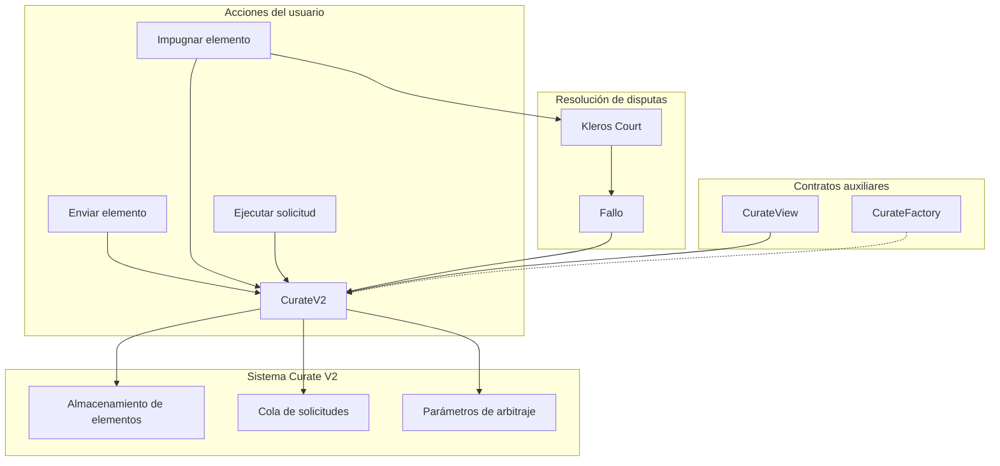
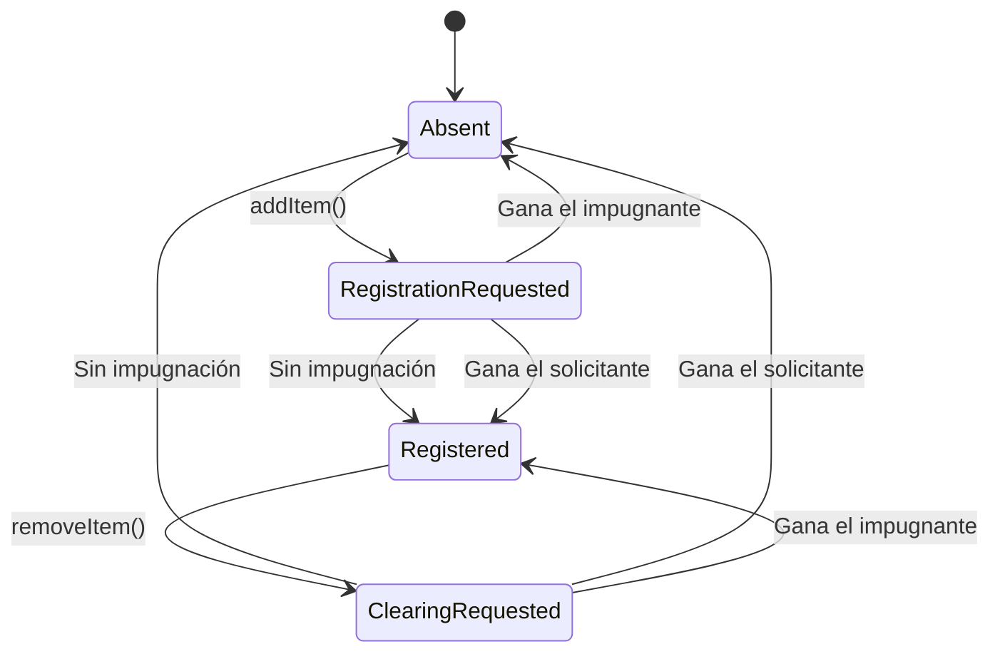

## Introducción {#introduction}

Curate es un sistema descentralizado para crear listas curadas por la comunidad en la blockchain. Cualquiera puede enviar elementos, impugnar entradas y participar mediante incentivos económicos. Cuando surgen disputas, se resuelven mediante Kleros Court. Esta página cubre tanto V1 (Classic y Light Curate en Ethereum / Gnosis Chain) como V2 (Arbitrum).

<CardGroup cols={2}>
  <Card title="Contratos inteligentes" icon="file-contract" href="/developers/products/curate/smart-contracts">
    Interfaces de los contratos principales y estructuras de datos
  </Card>
  <Card title="Curate Classic (V1)" icon="list" href="/developers/products/curate/curate-classic">
    Guía de integración de V1: TCR completo
  </Card>
  <Card title="Light Curate (V1)" icon="list-check" href="/developers/products/curate/light-curate">
    Guía de integración de V1: TCR simplificado
  </Card>
  <Card title="Registros" icon="database" href="/developers/products/curate/registries">
    Referencia de los registros
  </Card>
</CardGroup>

---

## V1: Curate Classic y Light Curate (Ethereum / Gnosis Chain) {#v1-curate-classic-and-light-curate-ethereum-/-gnosis-chain}

<Warning>
**Classic Curate está en proceso de retirada.** Los contratos de Classic Curate siguen desplegados y sin cambios, por lo que las listas Classic existentes siguen funcionando: todavía se pueden enviar, impugnar y consultar elementos. Kleros no lanzará nuevos registros en Classic Curate, y se está desactivando la creación de listas Classic desde los frontends de Kleros. **Light Curate y Stake Curate no se ven afectados** y siguen siendo totalmente compatibles; las nuevas listas, incluidos los registros Kleros Verified que aparecen en la página de inicio de la [aplicación Curate](https://curate.kleros.io), se crean en Light Curate.
</Warning>

Curate Classic es el Token-Curated Registry completo, y Light Curate es la variante simplificada para un mayor volumen. Ambos están en Ethereum y Gnosis Chain, y los registros existentes siguen disponibles para que los integren directamente desarrolladores externos.

**Hay guías de integración de V1 completas:** consulta las subpáginas de [Curate Classic](/developers/products/curate/curate-classic) y [Light Curate](/developers/products/curate/light-curate). Para las direcciones de los contratos V1, consulta [Direcciones de despliegue](/reference/contracts/deployment-addresses-v1).

---

## V2: Curate V2 (Arbitrum) {#v2-curate-v2-arbitrum}

Las secciones siguientes documentan los detalles técnicos de Curate V2.

Notas técnicas para integradores:

- **Gestión de las evidencias**: Curate V2 no usa un Evidence Module separado; los contratos `CurateV2` y `CurateFactory` gestionan directamente el envío de evidencias
- **Subgraph**: el esquema incluye campos específicos para las evidencias del solicitante y del impugnante
- **Stack del frontend**: la interfaz usa Tailwind CSS y la biblioteca de componentes compartida, incluido el visor de archivos compartido
- **Documentación para desarrolladores**: hay documentación básica para desarrolladores en el [repositorio de Curate V2 en GitHub](https://github.com/kleros/curate-v2)

---

## Despliegue {#deployment}

<Tabs>
  <Tab title="Arbitrum One (producción)">
    | Componente | Propósito |
    |-----------|---------|
    | CurateV2 | Contrato de implementación |
    | CurateFactory | Despliega nuevos registros mediante proxies ERC-1167 |
    | CurateView | Auxiliar para consultas por lotes |
  </Tab>
  <Tab title="Arbitrum Sepolia (testnet)">
    | Componente | Propósito |
    |-----------|---------|
    | CurateV2 | Contrato de implementación |
    | CurateFactory | Despliega nuevos registros mediante proxies ERC-1167 |
    | CurateView | Auxiliar para consultas por lotes |
  </Tab>
</Tabs>

<Note>
Despliega tu propio registro mediante el contrato CurateFactory. Cada registro es un proxy mínimo ERC-1167 independiente.
</Note>

---

## Mejoras clave respecto a V1 {#key-improvements-from-v1}

| Función | V1 | V2 |
|---------|-----|-----|
| **Despliegue** | Un contrato completo por registro | Patrón de proxy mínimo ERC-1167 |
| **Gobernanza** | Un único rol de governor | Roles separados de governor y relayer |
| **Arbitraje** | Los parámetros pueden cambiar durante la disputa | Se conservan versiones de los parámetros de arbitraje |
| **Consultas** | Llamadas individuales | Consultas por lotes mejoradas mediante el contrato View |

---

## Arquitectura del sistema {#system-architecture}



---

## Ciclo de vida de los elementos {#item-lifecycle}

Los elementos de Curate V2 siguen una máquina de estados con cuatro estados posibles:



### Definición de los estados {#status-definitions}

| Estado | Descripción |
|--------|-------------|
| **Absent** | El elemento no existe en el registro |
| **RegistrationRequested** | Envío del elemento pendiente; puede impugnarse |
| **Registered** | El elemento está activo en el registro |
| **ClearingRequested** | Retirada pendiente; puede impugnarse |

---

## Mecanismo de impugnación {#challenge-mechanism}

<Steps>
  <Step title="Solicitud enviada">
    El usuario envía un elemento (registro) o una solicitud de retirada con el depósito exigido.
  </Step>
  <Step title="Periodo de impugnación">
    Cualquiera puede impugnar durante el periodo de impugnación pagando el depósito de impugnación.
  </Step>
  <Step title="Disputa creada">
    Si se impugna, se crea una disputa en Kleros Court.
  </Step>
  <Step title="Resolución">
    Quien gana recibe ambos depósitos. Quien pierde pierde su depósito.
  </Step>
</Steps>

---

## Modelo económico {#economic-model}

### Depósitos exigidos {#deposits-required}

| Acción | Tipo de depósito |
|--------|--------------|
| Enviar un elemento | Depósito de envío + coste del arbitraje |
| Retirar un elemento | Depósito de retirada + coste del arbitraje |
| Impugnar un envío | Depósito de impugnación del envío + coste del arbitraje |
| Impugnar una retirada | Depósito de impugnación de la retirada + coste del arbitraje |

### Flujo de ejemplo {#example-flow}

```
User submits item:
  Pays: submissionDeposit + arbitrationCost

Someone challenges:
  Pays: challengeDeposit + arbitrationCost

Contract holds: submissionDeposit + challengeDeposit
Arbitrator gets: 2 × arbitrationCost

Winner receives: all held deposits
```

---

## Permisos de los roles {#role-permissions}

<AccordionGroup>
  <Accordion title="Governor">
    - Cambiar el árbitro y los parámetros de arbitraje
    - Actualizar los depósitos base
    - Modificar la duración del periodo de impugnación
    - Establecer las listas conectadas
    - Actualizar los metadatos de la lista
    - Añadir o retirar elementos directamente (sin periodo de impugnación)
  </Accordion>
  
  <Accordion title="Relayer">
    - Añadir elementos directamente (sin periodo de impugnación)
    - Retirar elementos directamente (sin periodo de impugnación)
    - Útil para las integraciones automatizadas
  </Accordion>
  
  <Accordion title="Público">
    - Enviar solicitudes de elementos
    - Enviar solicitudes de retirada
    - Impugnar solicitudes
    - Ejecutar las solicitudes no impugnadas
    - Enviar evidencias
  </Accordion>
</AccordionGroup>

---

## Versionado de los parámetros de arbitraje {#arbitration-parameter-versioning}

<Info>
**Idea clave:** `arbitrationParamsIndex` garantiza que las disputas usen la configuración de arbitraje que estaba activa cuando se creó la solicitud, aunque la gobernanza la cambie después.
</Info>

```solidity
struct ArbitrationParams {
    IArbitratorV2 arbitrator;
    bytes arbitratorExtraData;
    EvidenceModule evidenceModule;
}
```

Esto impide que la gobernanza afecte a las disputas en curso cambiando la configuración del árbitro a mitad de una disputa.

---

## Casos de uso {#use-cases}

<CardGroup cols={2}>
  <Card title="Listas de tokens" icon="coins">
    Listas de tokens legítimos curadas por la comunidad, que filtran las estafas
  </Card>
  <Card title="Colecciones de NFT" icon="image">
    Colecciones verificadas y registros de autenticidad
  </Card>
  <Card title="Etiquetas de direcciones" icon="tag">
    Etiqueta direcciones con advertencias, categorías o metadatos
  </Card>
  <Card title="Moderación de contenidos" icon="shield">
    Curación y filtrado descentralizados de contenidos
  </Card>
</CardGroup>

---

## Stake Curate {#stake-curate}

Stake Curate forma parte de la familia de productos Curate. Usa Kleros Court V1 en Gnosis Chain para resolver las disputas. A diferencia del Curate tradicional, en el que los depósitos se devuelven tras el listado, Stake Curate mantiene los depósitos bloqueados: cualquiera puede impugnar en cualquier momento, y quienes impugnan ganan recompensas. Se lanzó en enero de 2026, y su primer caso de uso fueron los Battle-Tested DeFi Vaults.

---

## Scout {#scout}

Scout es el frontend principal de los registros de etiquetas de direcciones basados en Curate. Alcanzó su versión definitiva en mayo de 2026, con más de 2,6 millones de direcciones en la cadena curadas. Para conocer los detalles técnicos, las cadenas compatibles, los socios y el GTCR Indexer, consulta la [página de Scout](/developers/products/scout/overview).

El esquema del GTCR Indexer se amplió con los hashes de las transacciones de impugnación, las fechas de impugnación y los hashes de las transacciones de apelación (v0.1.7, abril de 2026), con una rama de Envio mantenida junto a la rama principal.

---

## Recursos {#resources}

<CardGroup cols={2}>
  <Card title="Repositorio de GitHub" icon="github" href="https://github.com/kleros/curate-v2">
    Contratos inteligentes y scripts de despliegue
  </Card>
  <Card title="Aplicación en vivo" icon="rocket" href="https://curate-v2.netlify.app">
    Interfaz de Curate en producción
  </Card>
  <Card title="Comunidad de Discord" icon="discord" href="https://discord.gg/MhXQGCyHd9">
    Obtén ayuda de la comunidad
  </Card>
</CardGroup>
