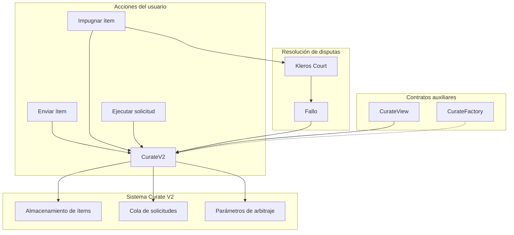
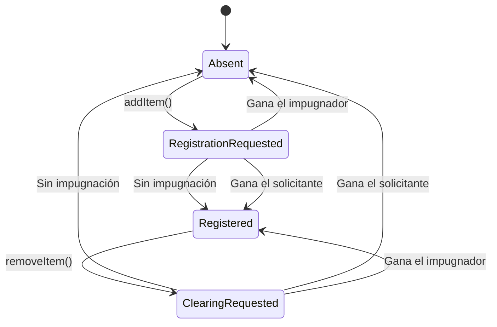

## Introducción

Curate es un sistema descentralizado para crear listas curadas por la comunidad en la blockchain. Cualquiera puede enviar ítems, impugnar entradas y participar mediante incentivos económicos. Cuando surgen disputas, se resuelven a través de Kleros Court. Esta página cubre tanto V1 (Classic y Light Curate en Ethereum / Gnosis Chain) como V2 (Arbitrum).

<CardGroup cols={2}>
  <Card title="Contratos inteligentes" icon="file-contract" href="/es/developers/products/curate/smart-contracts">
    Interfaces de los contratos principales y estructuras de datos
  </Card>
  <Card title="Curate Classic (V1)" icon="list" href="/es/developers/products/curate/curate-classic">
    Guía de integración de V1 - TCR completo
  </Card>
  <Card title="Light Curate (V1)" icon="list-check" href="/es/developers/products/curate/light-curate">
    Guía de integración de V1 - TCR simplificado
  </Card>
  <Card title="Registros" icon="database" href="/es/developers/products/curate/registries">
    Referencia de registros
  </Card>
</CardGroup>

---

## V1 - Curate Classic y Light Curate (Ethereum / Gnosis Chain)

<Warning>
**Classic Curate está en proceso de descontinuación.** Los contratos de Classic Curate siguen desplegados y sin cambios, por lo que las listas Classic existentes siguen funcionando: todavía se pueden enviar, impugnar y consultar ítems. Kleros no lanzará nuevos registros en Classic Curate, y se está deshabilitando la creación de listas Classic desde los frontends de Kleros. **Light Curate y Stake Curate no se ven afectados** y siguen teniendo soporte completo; las nuevas listas, incluidos los registros Kleros Verified que se muestran en la página de inicio de la [aplicación Curate](https://curate.kleros.io), se crean en Light Curate.
</Warning>

Curate Classic es el Token-Curated Registry completo, y Light Curate es la variante simplificada y de mayor volumen. Ambos están en Ethereum y Gnosis Chain, y los registros existentes siguen disponibles para la integración directa por parte de desarrolladores externos.

**Hay guías completas de integración con V1 disponibles:** consulta las subpáginas de [Curate Classic](/es/developers/products/curate/curate-classic) y [Light Curate](/es/developers/products/curate/light-curate). Para las direcciones de los contratos de V1, consulta [Direcciones de despliegue](/es/reference/contracts/deployment-addresses-v1).

---

## V2 - Curate V2 (Arbitrum)

Las secciones siguientes documentan los detalles técnicos de Curate V2.

Notas técnicas para integradores:

- **Gestión de evidencia**: Curate V2 no usa un Evidence Module separado; la presentación de evidencia la gestionan directamente los contratos `CurateV2` y `CurateFactory`
- **Subgraph**: el esquema incluye campos dedicados para la evidencia del solicitante y del impugnador
- **Stack del frontend**: la interfaz usa Tailwind CSS y la biblioteca de componentes compartidos, incluido el visor de archivos compartido
- **Documentación para desarrolladores**: hay documentación básica para desarrolladores disponible en el [repositorio de GitHub de Curate V2](https://github.com/kleros/curate-v2)

---

## Despliegue

<Tabs>
  <Tab title="Arbitrum One (producción)">
    | Componente | Propósito |
    |-----------|---------|
    | CurateV2 | Contrato de implementación |
    | CurateFactory | Despliega nuevos registros mediante proxies ERC-1167 |
    | CurateView | Asistente de consultas por lotes |
  </Tab>
  <Tab title="Arbitrum Sepolia (testnet)">
    | Componente | Propósito |
    |-----------|---------|
    | CurateV2 | Contrato de implementación |
    | CurateFactory | Despliega nuevos registros mediante proxies ERC-1167 |
    | CurateView | Asistente de consultas por lotes |
  </Tab>
</Tabs>

<Note>
Despliega tu propio registro a través del contrato CurateFactory. Cada registro es un proxy mínimo ERC-1167 independiente.
</Note>

---

## Mejoras clave respecto a V1

| Característica | V1 | V2 |
|---------|-----|-----|
| **Despliegue** | Contrato completo por registro | Patrón de proxy mínimo ERC-1167 |
| **Gobernanza** | Un único rol de governor | Roles separados de governor y relayer |
| **Arbitraje** | Los parámetros pueden cambiar durante la disputa | Se conservan parámetros de arbitraje versionados |
| **Consultas** | Llamadas individuales | Consultas por lotes mejoradas mediante el contrato View |

---

## Arquitectura del sistema



---

## Ciclo de vida de los ítems

Los ítems en Curate V2 siguen una máquina de estados con cuatro estados posibles:



### Definiciones de estado

| Estado | Descripción |
|--------|-------------|
| **Absent** | El ítem no existe en el registro |
| **RegistrationRequested** | Envío del ítem pendiente; puede impugnarse |
| **Registered** | El ítem está activo en el registro |
| **ClearingRequested** | Eliminación pendiente; puede impugnarse |

---

## Mecanismo de impugnación

<Steps>
  <Step title="Solicitud enviada">
    El usuario envía un ítem (registro) o una solicitud de eliminación con el depósito requerido.
  </Step>
  <Step title="Periodo de impugnación">
    Cualquiera puede impugnar durante el periodo de impugnación pagando el depósito de impugnación.
  </Step>
  <Step title="Disputa creada">
    Si hay impugnación, se crea una disputa en Kleros Court.
  </Step>
  <Step title="Resolución">
    El ganador recibe ambos depósitos. El perdedor pierde su depósito.
  </Step>
</Steps>

---

## Modelo económico

### Depósitos requeridos

| Acción | Tipo de depósito |
|--------|--------------|
| Enviar ítem | Depósito de envío + costo de arbitraje |
| Eliminar ítem | Depósito de eliminación + costo de arbitraje |
| Impugnar envío | Depósito de impugnación de envío + costo de arbitraje |
| Impugnar eliminación | Depósito de impugnación de eliminación + costo de arbitraje |

### Flujo de ejemplo

```
User submits item:
  Pays: submissionDeposit + arbitrationCost

Someone challenges:
  Pays: challengeDeposit + arbitrationCost

Contract holds: submissionDeposit + challengeDeposit
Arbitrator gets: 2 × arbitrationCost

Winner receives: all held deposits
```

---

## Permisos de los roles

<AccordionGroup>
  <Accordion title="Governor">
    - Cambiar el árbitro y los parámetros de arbitraje
    - Actualizar los depósitos base
    - Modificar la duración del periodo de impugnación
    - Configurar listas conectadas
    - Actualizar los metadatos de la lista
    - Añadir/eliminar ítems directamente (omitiendo el periodo de impugnación)
  </Accordion>
  
  <Accordion title="Relayer">
    - Añadir ítems directamente (omitiendo el periodo de impugnación)
    - Eliminar ítems directamente (omitiendo el periodo de impugnación)
    - Útil para integraciones automatizadas
  </Accordion>
  
  <Accordion title="Público">
    - Enviar solicitudes de ítems
    - Enviar solicitudes de eliminación
    - Impugnar solicitudes
    - Ejecutar solicitudes no impugnadas
    - Presentar evidencia
  </Accordion>
</AccordionGroup>

---

## Versionado de parámetros de arbitraje

<Info>
**Idea clave:** `arbitrationParamsIndex` garantiza que las disputas usen la configuración de arbitraje que estaba activa cuando se creó la solicitud, aunque la gobernanza la cambie más adelante.
</Info>

```solidity
struct ArbitrationParams {
    IArbitratorV2 arbitrator;
    bytes arbitratorExtraData;
    EvidenceModule evidenceModule;
}
```

Esto impide que la gobernanza afecte a las disputas en curso cambiando la configuración del árbitro a mitad de una disputa.

---

## Casos de uso

<CardGroup cols={2}>
  <Card title="Listas de tokens" icon="coins">
    Listas de tokens legítimos curadas por la comunidad, que filtran las estafas
  </Card>
  <Card title="Colecciones NFT" icon="image">
    Colecciones verificadas y registros de autenticidad
  </Card>
  <Card title="Etiquetas de direcciones" icon="tag">
    Etiqueta direcciones con advertencias, categorías o metadatos
  </Card>
  <Card title="Moderación de contenido" icon="shield">
    Curación y filtrado de contenido descentralizados
  </Card>
</CardGroup>

---

## Stake Curate

Stake Curate forma parte de la familia de productos Curate. Usa Kleros Court V1 en Gnosis Chain para la resolución de disputas. A diferencia del Curate tradicional, donde los depósitos se devuelven tras la inclusión en la lista, Stake Curate mantiene los depósitos bloqueados: cualquiera puede impugnar en cualquier momento y los impugnadores obtienen recompensas. Se lanzó en enero de 2026 y su primer caso de uso son los Battle-Tested DeFi Vaults.

---

## Scout

Scout es el frontend principal de los registros de etiquetas de direcciones basados en Curate. Alcanzó su versión definitiva en mayo de 2026 con más de 2,6 millones de direcciones on-chain curadas. Para conocer los detalles técnicos, las cadenas admitidas, los socios y el GTCR Indexer, consulta la [página de Scout](/es/developers/products/scout/overview).

El esquema del GTCR Indexer se amplió con los hashes de las transacciones de impugnación, las fechas de impugnación y los hashes de las transacciones de apelación (v0.1.7, abril de 2026), con una rama de Envio mantenida junto a la rama principal.

---

## Recursos

<CardGroup cols={2}>
  <Card title="Repositorio de GitHub" icon="github" href="https://github.com/kleros/curate-v2">
    Contratos inteligentes y scripts de despliegue
  </Card>
  <Card title="Aplicación en vivo" icon="rocket" href="https://curate-v2.netlify.app">
    Interfaz de Curate en producción
  </Card>
  <Card title="Comunidad de Discord" icon="discord" href="https://discord.gg/MhXQGCyHd9">
    Obtén ayuda de la comunidad
  </Card>
</CardGroup>
