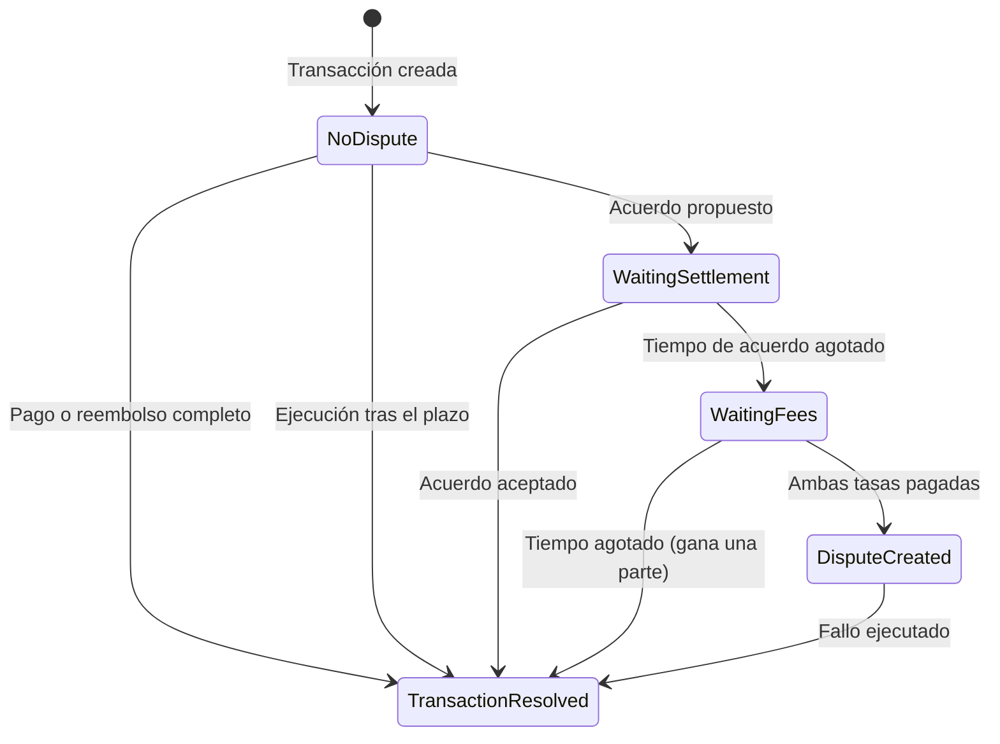

## Introducción {#introduction}

Kleros Escrow permite realizar transacciones seguras con resolución de disputas integrada mediante Kleros Court. Esta página cubre tanto V1 (red principal de Ethereum) como V2 (Arbitrum).

<Card title="Contratos inteligentes" icon="file-contract" href="/developers/products/escrow/smart-contracts">
  Interfaces de los contratos principales y estructuras de datos
</Card>

---

## V1 (Ethereum Mainnet) {#v1-ethereum-mainnet}

Escrow V1 es un escrow entre dos partes en la red principal de Ethereum, con Kleros Court disponible para resolver disputas. **La integración con V1 es totalmente compatible.**

La interfaz de V1 controla la compatibilidad de los tokens: los tokens no compatibles están en una lista negra con avisos emergentes, y el modal de selección de tokens advierte sobre los tokens ERC20 no estándar (como USDT) que V1 no admite. La aplicación en `escrow.kleros.io` está en la lista blanca de Reown para las sesiones de WalletConnect.

Para las direcciones de los contratos V1, consulta [Direcciones de despliegue V1](/reference/contracts/deployment-addresses-v1).

---

## V2 (Arbitrum) {#v2-arbitrum}

Kleros Escrow V2 está en producción y admite tanto ETH nativo como tokens ERC20, con negociaciones de acuerdos, pagos parciales y ejecución automática basada en plazos. Las secciones siguientes documentan los detalles técnicos de V2.

Notas técnicas para integradores:

- **Decimales de los tokens**: el contrato gestiona correctamente los tokens que no tienen 18 decimales (USDC y USDT son compatibles; ambos están en la lista blanca, y USDT es una incorporación exclusiva de V2, ya que V1 no lo admite)
- **Política de disputa**: el documento de la política de disputa General Escrow está finalizado y almacenado en IPFS
- **Subgraph**: la versión 2.2.1 funciona en Goldsky y expone los campos `transactionHash`, que generan los enlaces al explorador de bloques en la cronología de las transacciones
- **Almacenamiento de archivos**: las subidas pasan por el flujo SIWE de Atlas hasta IPFS
- **Stack del frontend**: la interfaz usa kleros-app 3.0.1 (incluida la opción de baja de las notificaciones) y la biblioteca compartida de componentes de interfaz, incluido el visor de archivos compartido

---

## Direcciones de los contratos {#contract-addresses}

<Tabs>
  <Tab title="Arbitrum One (producción)">
    | Contrato | Dirección |
    |----------|---------|
    | EscrowUniversal | `0x5D64Cb92c351e46615ce427015A2F1E0823A2402` |
    | EscrowView | `0xAf36da891c03b8A3a675f08f59355c8ff877330d` |
  </Tab>
  <Tab title="Arbitrum Sepolia (testnet)">
    | Contrato | Dirección |
    |----------|---------|
    | EscrowUniversal | `0xEc3984f38C3535aB272C94Eecf76CA67820a55a7` |
    | EscrowView | `0xBbdec240fd37c2C8e440c733CE2277FCC9949F52` |
  </Tab>
</Tabs>

---

## Arquitectura {#architecture}

Escrow V2 consta de tres componentes principales:

<Steps>
  <Step title="Contratos inteligentes">
    Lógica de escrow principal compatible con ETH y tokens ERC20, con negociaciones de acuerdos e integración de disputas.
  </Step>
  <Step title="Aplicación web">
    Frontend basado en React para crear y gestionar transacciones en [escrow-v2.kleros.builders](https://escrow-v2.kleros.builders).
  </Step>
  <Step title="Resolución de disputas">
    Integración con Kleros Court para el arbitraje descentralizado cuando las partes no llegan a un acuerdo.
  </Step>
</Steps>

### Componentes de los contratos {#contract-components}

| Contrato | Propósito |
|----------|---------|
| **EscrowUniversal.sol** | Contrato principal que gestiona la creación de transacciones, los pagos, los acuerdos y el arbitraje de las disputas |
| **EscrowView.sol** | Contrato de solo lectura que ofrece las opciones de fallo formateadas y los cálculos de los pagos |

---

## Ciclo de vida de una transacción {#transaction-lifecycle}

---

## Funciones clave {#key-features}

<AccordionGroup>
  <Accordion title="Compatibilidad con ETH nativo y ERC20">
    Crea transacciones de escrow con cualquier token ERC20 o con ETH nativo. La gobernanza puede establecer límites de importe por token para gestionar el riesgo.
  </Accordion>
  
  <Accordion title="Pagos y reembolsos parciales">
    Los compradores pueden liberar pagos parciales y los vendedores pueden emitir reembolsos parciales, lo que permite una resolución flexible sin disputas.
  </Accordion>
  
  <Accordion title="Negociación de acuerdos">
    Cualquiera de las partes puede proponer acuerdos. El sistema de propuestas alternas evita que se acuda al arbitraje de forma precipitada e injusta.
  </Accordion>
  
  <Accordion title="Ejecución basada en plazos">
    Las transacciones pueden ejecutarse automáticamente una vez vencido su plazo, liberando los fondos al vendedor.
  </Accordion>
  
  <Accordion title="Integración con Kleros Court">
    Resolución de disputas completa mediante Kleros Court, con compatibilidad con apelaciones y presentación de evidencias.
  </Accordion>
</AccordionGroup>

---

## Recursos {#resources}

<CardGroup cols={2}>
  <Card title="Repositorio de GitHub" icon="github" href="https://github.com/kleros/escrow-v2">
    Código fuente de los contratos inteligentes y de la aplicación web
  </Card>
  <Card title="Aplicación en vivo" icon="rocket" href="https://escrow-v2.kleros.builders">
    Interfaz de Escrow V2
  </Card>
  
  <Card title="Comunidad de Discord" icon="discord" href="https://discord.gg/MhXQGCyHd9">
    Obtén ayuda de la comunidad
  </Card>
</CardGroup>
