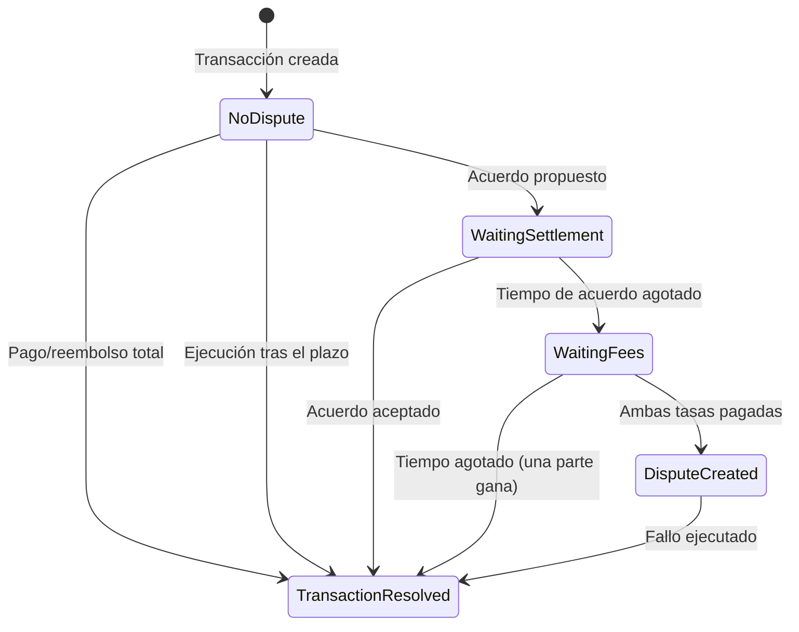

## Introducción

Kleros Escrow permite realizar transacciones seguras con resolución de disputas integrada a través de Kleros Court. Esta página cubre tanto V1 (Ethereum Mainnet) como V2 (Arbitrum).

<Card title="Contratos inteligentes" icon="file-contract" href="/es/developers/products/escrow/smart-contracts">
  Interfaces de contratos principales y estructuras de datos
</Card>

---

## V1 (Ethereum Mainnet)

Escrow V1 es un escrow entre dos partes en Ethereum Mainnet, con Kleros Court disponible para la resolución de disputas. **La integración con V1 es totalmente compatible.**

La interfaz de V1 aplica la compatibilidad de tokens: los tokens no compatibles se incluyen en una lista negra con notificaciones emergentes, y el modal de selección de tokens advierte sobre tokens ERC20 no estándar (como USDT) que V1 no admite. La aplicación en `escrow.kleros.io` está en la lista blanca de Reown para sesiones de WalletConnect.

Para las direcciones de contratos de V1, consulta [Direcciones de despliegue V1](/es/reference/contracts/deployment-addresses-v1).

---

## V2 (Arbitrum)

Kleros Escrow V2 está en producción y admite tanto ETH nativo como tokens ERC20, con negociaciones de acuerdo, pagos parciales y ejecución automática basada en plazos. Las secciones siguientes documentan los detalles técnicos de V2.

Notas técnicas para integradores:

- **Decimales de tokens**: el contrato gestiona correctamente los tokens con decimales distintos de 18 (USDC y USDT son compatibles; ambos están en la lista blanca, siendo USDT una incorporación exclusiva de V2, ya que V1 no lo admite)
- **Política de disputas**: el documento de política de disputas de General Escrow está finalizado y almacenado en IPFS
- **Subgraph**: la versión 2.2.1 se ejecuta en Goldsky y expone campos `transactionHash`, que alimentan los enlaces al explorador de bloques en la línea de tiempo de la transacción
- **Almacenamiento de archivos**: las cargas pasan por el flujo SIWE de Atlas hacia IPFS
- **Stack de frontend**: la interfaz usa kleros-app 3.0.1 (incluida la posibilidad de darse de baja de las notificaciones) y la biblioteca compartida UI Components Library, incluido el visor de archivos compartido

---

## Direcciones de contratos

<Tabs>
  <Tab title="Arbitrum One (Producción)">
    | Contrato | Dirección |
    |----------|---------|
    | EscrowUniversal | `0x5D64Cb92c351e46615ce427015A2F1E0823A2402` |
    | EscrowView | `0xAf36da891c03b8A3a675f08f59355c8ff877330d` |
  </Tab>
  <Tab title="Arbitrum Sepolia (Testnet)">
    | Contrato | Dirección |
    |----------|---------|
    | EscrowUniversal | `0xEc3984f38C3535aB272C94Eecf76CA67820a55a7` |
    | EscrowView | `0xBbdec240fd37c2C8e440c733CE2277FCC9949F52` |
  </Tab>
</Tabs>

---

## Arquitectura

Escrow V2 consta de tres componentes principales:

<Steps>
  <Step title="Contratos inteligentes">
    Lógica principal de escrow compatible con ETH y tokens ERC20, con negociaciones de acuerdo e integración de disputas.
  </Step>
  <Step title="Aplicación web">
    Frontend basado en React para crear y gestionar transacciones en [escrow-v2.kleros.builders](https://escrow-v2.kleros.builders).
  </Step>
  <Step title="Resolución de disputas">
    Integración con Kleros Court para el arbitraje descentralizado cuando las partes no llegan a un acuerdo.
  </Step>
</Steps>

### Componentes de los contratos

| Contrato | Propósito |
|----------|---------|
| **EscrowUniversal.sol** | Contrato principal que gestiona la creación de transacciones, los pagos, los acuerdos y el arbitraje de disputas |
| **EscrowView.sol** | Contrato de solo lectura que proporciona opciones de fallo formateadas y cálculos de pagos |

---

## Ciclo de vida de la transacción

---

## Características principales

<AccordionGroup>
  <Accordion title="Compatibilidad con ETH nativo y ERC20">
    Crea transacciones de escrow con cualquier token ERC20 o ETH nativo. La gobernanza puede establecer límites de importe por token para gestionar el riesgo.
  </Accordion>
  
  <Accordion title="Pagos y reembolsos parciales">
    Los compradores pueden liberar pagos parciales y los vendedores pueden emitir reembolsos parciales, lo que permite una resolución flexible sin disputas.
  </Accordion>
  
  <Accordion title="Negociaciones de acuerdo">
    Cualquiera de las partes puede proponer acuerdos. El sistema de propuestas alternas evita precipitarse injustamente al arbitraje.
  </Accordion>
  
  <Accordion title="Ejecución basada en plazos">
    Las transacciones pueden ejecutarse automáticamente después de su plazo, liberando los fondos al vendedor.
  </Accordion>
  
  <Accordion title="Integración con Kleros Court">
    Resolución completa de disputas a través de Kleros Court con soporte para apelaciones y envío de pruebas.
  </Accordion>
</AccordionGroup>

---

## Recursos

<CardGroup cols={2}>
  <Card title="Repositorio de GitHub" icon="github" href="https://github.com/kleros/escrow-v2">
    Código fuente de los contratos inteligentes y de la aplicación web
  </Card>
  <Card title="Aplicación en vivo" icon="rocket" href="https://escrow-v2.kleros.builders">
    Interfaz de Escrow V2
  </Card>
  
  <Card title="Comunidad de Discord" icon="discord" href="https://discord.gg/MhXQGCyHd9">
    Obtén ayuda de la comunidad
  </Card>
</CardGroup>
