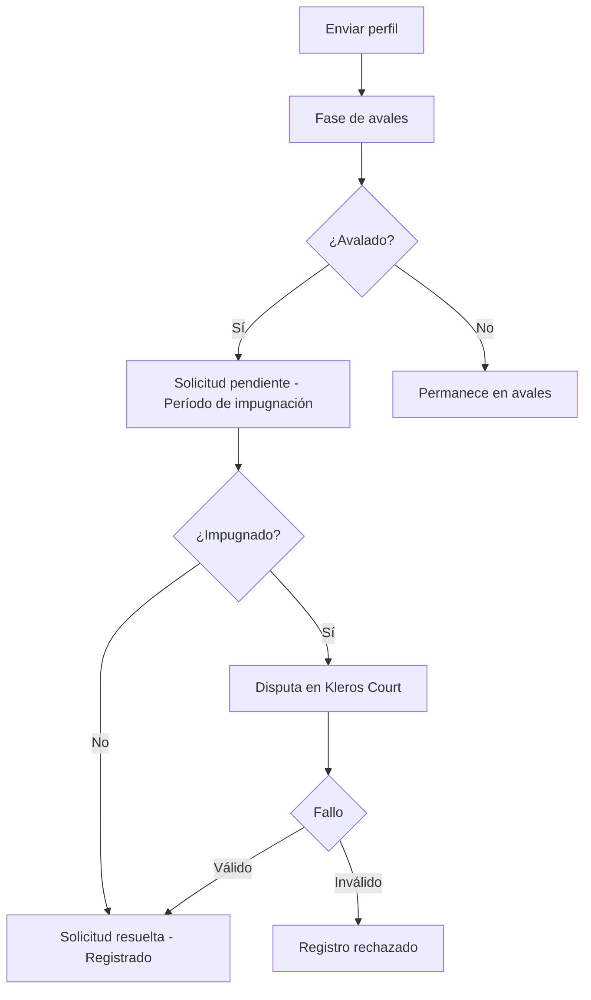

## Introducción

Proof of Humanity (PoH) es un registro de identidades humanas únicas resistente a ataques Sybil. Esta página cubre tanto V1 (Ethereum Mainnet) como V2 (Gnosis Chain).

Cada humano verificado recibe un ID de humanidad soulbound (`humanityId`) que persiste aunque cambie de billetera. PoH V2 usa Kleros Court para la resolución de disputas cuando se impugnan perfiles. A diferencia de V1, donde cada registro estaba vinculado a una dirección de billetera específica, V2 desacopla la identidad de la dirección. Un humano corresponde a un ID de humanidad, que corresponde a una dirección de billetera en cada momento. Si un usuario pierde el acceso a su billetera, puede eliminar la dirección perdida y volver a registrarse con una nueva usando el mismo `humanityId`.

<Card title="Contratos inteligentes" icon="file-contract" href="/es/developers/products/poh/smart-contracts">
  Interfaces principales, estructuras de datos y direcciones de contratos
</Card>

---

## V1 (Ethereum Mainnet)

PoH V1 se ejecuta en Ethereum Mainnet y **la integración con V1 sigue disponible**. Un Fork Module permite que V2 reconozca los registros de V1. La integración con EPNS/Push Protocol que estaba activa en V1 se ha discontinuado y en V2 se sustituye por Atlas + SendGrid.

Para las direcciones de contratos de V1, consulta [Direcciones de despliegue](/es/reference/contracts/deployment-addresses-v1).

---

## V2 (Gnosis Chain)

Las secciones siguientes documentan los detalles técnicos de PoH V2.

Notas técnicas para integradores:

- **Airdrop de PNK**: los primeros 10.000 humanos verificados pueden reclamar 1.200 PNK, que se duplican al hacer staking en la Humanity Court. Un panel hace seguimiento de los registros y de las reclamaciones del airdrop.
- **Limitación de Ledger**: las billeteras de hardware actualmente no admiten EIP-7702 en Gnosis Chain, que es necesario para el flujo estándar de reclamación del airdrop. Hay disponible una guía de reclamación manual.
- **Notificaciones por correo electrónico**: cada paso del flujo del perfil activa notificaciones procesadas de extremo a extremo por Atlas, incluidas revocaciones pendientes, actividad de avales, flujos en disputa y resultados de impugnaciones.
- **Claves de pruebas**: la interfaz escribe los archivos de pruebas con la clave de prueba correcta. Court V1 y el Dispute Resolver incluyen una solución de normalización para envíos antiguos que usaban la clave incorrecta.
- **Pipeline de ejecución**: el avance de perfiles usa un pipeline de ejecución de avance automático reescrito.
- **Seguridad**: las revisiones de seguridad del frontend cubren vectores de ataque XSS, y la app se ejecuta sobre una versión parcheada de NextJS 15.
- **En curso**: un contrato distribuidor de recompensas para avaladores y un sistema de referidos (especificaciones técnicas en revisión).

<Note>
Atlas es una biblioteca de backend interna exclusiva para los equipos de desarrollo de Kleros. No está pensada para uso ni integración por parte de la comunidad.
</Note>

---

## Direcciones de contratos

<Tabs>
  <Tab title="Gnosis Chain (Producción)">
    | Contrato | Dirección |
    | --- | --- |
    | ProofOfHumanity | `0xA7Fd7A97bF12E112B2263957e115e0c46cE6A38C` |
    | CrossChainProofOfHumanity | Desplegado en cada cadena externa |
  </Tab>
  <Tab title="Ethereum Mainnet (Fork Module de V1)">
    | Contrato | Dirección |
    | --- | --- |
    | ProofOfHumanity (V1) | `0xC5E9dDebb09Cd64DfaCab4011A0D5cEDaf7c9BDb` |
  </Tab>
</Tabs>

<Note>
  PoH V2 opera en Gnosis Chain como cadena principal. El estado cross-chain se sincroniza con otras cadenas mediante contratos puente. Los registros de V1 siguen siendo accesibles a través de un Fork Module.
</Note>

---

## Arquitectura

PoH V2 consta de tres capas:

<Steps>
  <Step title="Registro de identidad">
    Contrato principal que gestiona los IDs de humanidad, las solicitudes de registro, los avales y los períodos de impugnación. Cada ID de humanidad es un valor `bytes20` que identifica de forma única a un humano verificado.
  </Step>
  <Step title="Sincronización cross-chain">
    Los contratos puente propagan el estado de humanidad entre cadenas, lo que permite comprobaciones `isHuman()` en cualquier red compatible.
  </Step>
  <Step title="Resolución de disputas">
    Los registros impugnados crean disputas en Kleros Court. Los jurados evalúan las pruebas en video y la validez de los avales según la política de registro.
  </Step>
</Steps>

### Modelo de identidad

```
1 human → 1 humanityId (bytes20) → 1 wallet address

// Wallet recovery flow:
humanity.owner == lostAddress      // Lost access
humanity.owner == address(0)       // Removal requested
humanity.owner == newAddress       // Re-registered with new wallet
```

Los usuarios de V1 tienen un `humanityId` igual a su dirección de registro original (`bytes20(address)`). Los usuarios de V2 reciben un nuevo `humanityId` único al registrarse.

---

## Ciclo de vida del registro



---

## Características principales

<AccordionGroup>
  <Accordion title="IDs de humanidad soulbound">
    Los IDs de humanidad persisten aunque se cambie de billetera. Las aplicaciones que almacenan datos por `humanityId` en lugar de por dirección conservan la reputación y los activos del usuario incluso cuando cambia la billetera subyacente.
  </Accordion>
  <Accordion title="Verificación cross-chain">
    La función `isHuman()` está disponible en varias cadenas a través de los contratos `CrossChainProofOfHumanity`. La sincronización usa infraestructura de puentes para propagar el estado de registro.
  </Accordion>
  <Accordion title="Compatibilidad con V1">
    Un Fork Module permite que V2 reconozca los registros de V1. La llamada `isHuman()` comprueba automáticamente tanto los registros nativos de V2 como los registros de V1.
  </Accordion>
  <Accordion title="Sistema de avales">
    Los nuevos solicitantes necesitan el aval de un humano verificado existente. El bot keeper procesa automáticamente los avales y los retiros de recompensas, lo que reduce la intervención manual.
  </Accordion>
</AccordionGroup>

---

## Recursos

<CardGroup cols={2}>
  <Card title="Repositorio de GitHub" icon="github" href="https://github.com/kleros/proof-of-humanity-v2-contracts">
    Código fuente de los contratos inteligentes
  </Card>
  <Card title="Aplicación en vivo" icon="globe" href="https://proofofhumanity.id">
    Interfaz de PoH en producción
  </Card>

  <Card title="Discord" icon="discord" href="https://discord.gg/MhXQGCyHd9">
    Soporte para desarrolladores
  </Card>
</CardGroup>
