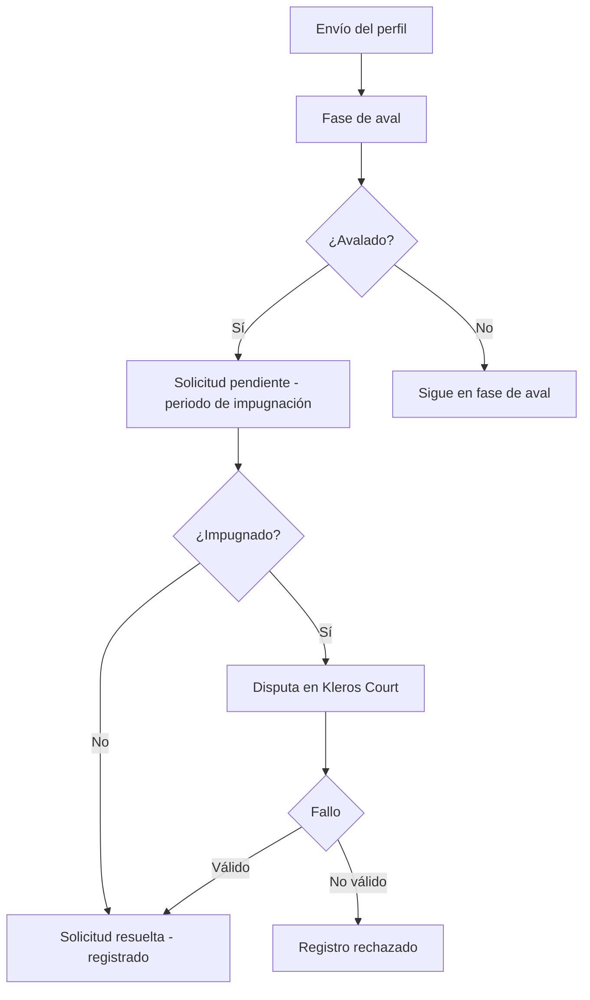

## Introducción {#introduction}

Proof of Humanity (PoH) es un registro de identidades humanas únicas resistente a ataques Sybil. Esta página cubre tanto V1 (red principal de Ethereum) como V2 (Gnosis Chain).

Cada humano verificado recibe un ID de humanidad soulbound (`humanityId`) que persiste aunque cambie de billetera. PoH V2 usa Kleros Court para resolver las disputas cuando se impugnan los perfiles. A diferencia de V1, en la que cada registro estaba vinculado a una dirección de billetera concreta, V2 separa la identidad de la dirección. Un humano corresponde a un ID de humanidad, que corresponde a una dirección de billetera en cada momento. Si un usuario pierde el acceso a su billetera, puede eliminar la dirección perdida y volver a registrarse con una nueva usando el mismo `humanityId`.

<Card title="Contratos inteligentes" icon="file-contract" href="/es/developers/products/poh/smart-contracts">
  Interfaces principales, estructuras de datos y direcciones de los contratos
</Card>

---

## V1 (Ethereum Mainnet) {#v1-ethereum-mainnet}

PoH V1 funciona en la red principal de Ethereum y **la integración con V1 sigue disponible**. Un Fork Module permite que V2 reconozca los registros de V1. La integración con EPNS/Push Protocol que estaba activa en V1 se ha interrumpido, y en V2 la sustituyen Atlas + SendGrid.

Para las direcciones de los contratos V1, consulta [Direcciones de despliegue](/es/reference/contracts/deployment-addresses-v1).

---

## V2 (Gnosis Chain) {#v2-gnosis-chain}

Las secciones siguientes documentan los detalles técnicos de PoH V2.

Notas técnicas para integradores:

- **Airdrop de PNK**: los primeros 10.000 humanos verificados pueden reclamar 1.200 PNK, que se duplican haciendo staking en el Humanity Court. Un panel hace seguimiento de los registros y de las reclamaciones del airdrop.
- **Limitación de Ledger**: las billeteras de hardware no admiten actualmente EIP-7702 en Gnosis Chain, que es necesario para el flujo estándar de reclamación del airdrop. Hay disponible una guía de reclamación manual.
- **Notificaciones por correo electrónico**: cada paso del flujo del perfil activa notificaciones que Atlas procesa de principio a fin, incluidas las revocaciones pendientes, la actividad de avales, los flujos disputados y los resultados de las impugnaciones.
- **Claves de evidencia**: la interfaz escribe los archivos de evidencias con la clave de evidencia correcta. Court V1 y Dispute Resolver incluyen una solución de normalización para los envíos antiguos que usaban una clave incorrecta.
- **Flujo de ejecución**: el avance de los perfiles usa un flujo de ejecución de avance automático reescrito.
- **Seguridad**: las revisiones de seguridad del frontend cubren los vectores de ataque XSS, y la aplicación funciona con una versión parcheada de NextJS 15.
- **En curso**: un contrato distribuidor de recompensas por avales y un sistema de referidos (especificaciones técnicas en revisión).

<Note>
Atlas es una biblioteca de backend interna solo para los equipos de desarrollo de Kleros. No está pensada para su uso o integración por parte de la comunidad.
</Note>

---

## Direcciones de los contratos {#contract-addresses}

<Tabs>
  <Tab title="Gnosis Chain (producción)">
    | Contrato | Dirección |
    | --- | --- |
    | ProofOfHumanity | `0xA7Fd7A97bF12E112B2263957e115e0c46cE6A38C` |
    | CrossChainProofOfHumanity | Desplegado en cada cadena externa |
  </Tab>
  <Tab title="Ethereum Mainnet (Fork Module de V1)">
    | Contrato | Dirección |
    | --- | --- |
    | ProofOfHumanity (V1) | `0xC5E9dDebb09Cd64DfaCab4011A0D5cEDaf7c9BDb` |
  </Tab>
</Tabs>

<Note>
  PoH V2 funciona en Gnosis Chain como cadena principal. El estado entre cadenas se sincroniza con otras cadenas mediante contratos puente. Los registros de V1 siguen siendo accesibles mediante un Fork Module.
</Note>

---

## Arquitectura {#architecture}

PoH V2 consta de tres capas:

<Steps>
  <Step title="Registro de identidades">
    Contrato principal que gestiona los ID de humanidad, las solicitudes de registro, los avales y los periodos de impugnación. Cada ID de humanidad es un valor `bytes20` que identifica de forma única a un humano verificado.
  </Step>
  <Step title="Sincronización entre cadenas">
    Los contratos puente propagan el estado de humanidad entre cadenas, lo que permite comprobar `isHuman()` en cualquier red compatible.
  </Step>
  <Step title="Resolución de disputas">
    Los registros impugnados crean disputas en Kleros Court. Los jurados evalúan las evidencias en vídeo y la validez de los avales conforme a la política de registro.
  </Step>
</Steps>

### Modelo de identidad {#identity-model}

```
1 human → 1 humanityId (bytes20) → 1 wallet address

// Wallet recovery flow:
humanity.owner == lostAddress      // Lost access
humanity.owner == address(0)       // Removal requested
humanity.owner == newAddress       // Re-registered with new wallet
```

Los usuarios de V1 tienen un `humanityId` igual a su dirección de registro original (`bytes20(address)`). Los usuarios de V2 reciben un nuevo `humanityId` único al registrarse.

---

## Ciclo de vida del registro {#registration-lifecycle}



---

## Funciones clave {#key-features}

<AccordionGroup>
  <Accordion title="ID de humanidad soulbound">
    Los ID de humanidad persisten aunque cambie la billetera. Las aplicaciones que almacenan los datos por `humanityId` en lugar de por dirección conservan la reputación y los activos de los usuarios aunque cambie la billetera subyacente.
  </Accordion>
  <Accordion title="Verificación entre cadenas">
    La función `isHuman()` está disponible en varias cadenas mediante los contratos `CrossChainProofOfHumanity`. La sincronización usa infraestructura de puentes para propagar el estado de los registros.
  </Accordion>
  <Accordion title="Compatibilidad con V1">
    Un Fork Module permite que V2 reconozca los registros de V1. La llamada a `isHuman()` comprueba automáticamente tanto los registros nativos de V2 como los de V1.
  </Accordion>
  <Accordion title="Sistema de avales">
    Quienes se registran necesitan el aval de un humano verificado existente. El bot keeper procesa automáticamente los avales y las retiradas de recompensas, lo que reduce la intervención manual.
  </Accordion>
</AccordionGroup>

---

## Recursos {#resources}

<CardGroup cols={2}>
  <Card title="Repositorio de GitHub" icon="github" href="https://github.com/kleros/proof-of-humanity-v2-contracts">
    Código fuente de los contratos inteligentes
  </Card>
  <Card title="Aplicación en vivo" icon="globe" href="https://proofofhumanity.id">
    Interfaz de PoH en producción
  </Card>

  <Card title="Discord" icon="discord" href="https://discord.gg/MhXQGCyHd9">
    Soporte para desarrolladores
  </Card>
</CardGroup>
