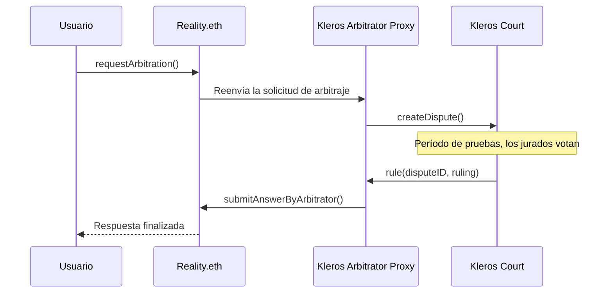

## Direcciones de los proxies de árbitro de Kleros

El proxy de árbitro se sitúa entre Reality.eth y Kleros Court. Al formular una pregunta en Reality.eth, pasas la dirección del proxy como parámetro `arbitrator`.

### Ethereum Mainnet

| Proxy           | Corte                  | Dirección                                    |
| --------------- | ---------------------- | -------------------------------------------- |
| Corte General   | General                | `0x728cba71a3723caab33ea416cb46e2cc9215a596` |
| Corte Técnica   | Blockchain > Technical | `0xf72cfd1b34a91a64f9a98537fe63fbab7530adca` |

### Testnet Sepolia

| Proxy         | Corte   | Dirección                                    |
| ------------- | ------- | -------------------------------------------- |
| Corte General | General | `0x05b942faecfb3924970e3a28e0f230910cedff45` |


### Proxies cross-chain

Para despliegues en los que la pregunta se encuentra en una cadena y el arbitraje se ejecuta en otra (p. ej., pregunta en Polygon y arbitraje en Ethereum), consulta los [despliegues de cross-chain-realitio-proxy](https://github.com/kleros/cross-chain-realitio-proxy/tree/master/contracts#deployments).

<Note>
  Cada proxy se configura con una subcorte específica, un número inicial de votos de jurados y una tarifa de arbitraje. Contacta a `integrations@kleros.io` para desplegar un proxy personalizado para tu caso de uso.
</Note>

***

## Interfaz de Reality.eth

Tu contrato interactúa con Reality.eth a través de estas funciones principales.

### Formular preguntas

```solidity theme={null}
/// @dev Ask a question on Reality.eth with a Kleros arbitrator.
/// @param templateID The question template (0=bool, 1=uint, 2=single-select, etc.)
/// @param question The question string with parameters separated by ␟ delimiter
/// @param arbitrator The Kleros arbitrator proxy address
/// @param timeout Seconds before an unchallenged answer finalizes (max 365 days)
/// @param openingTimestamp When the question becomes answerable (0 for immediately)
/// @param nonce Unique nonce for question deduplication
/// @return questionID The unique identifier for the question
function askQuestion(
    uint256 templateID,
    string calldata question,
    address arbitrator,
    uint32 timeout,
    uint32 openingTimestamp,
    uint256 nonce
) external payable returns (bytes32 questionID);
```

Cualquier ETH enviado con esta llamada se convierte en la recompensa de la pregunta, que se paga a quien proporciona la respuesta final aceptada (menos cualquier descuento por la tarifa del árbitro).

Para tokens ERC20 como recompensa, usa `askQuestionERC20()`.

### Leer respuestas

```solidity theme={null}
/// @dev Returns the finalized answer for a question.
/// Reverts if the question has not been finalized.
function resultFor(bytes32 _questionID) external view returns (bytes32);

/// @dev Returns the best current answer (may not be finalized).
function getBestAnswer(bytes32 _questionID) external view returns (bytes32);

/// @dev Returns true if the question has been finalized.
function isFinalized(bytes32 _questionID) external view returns (bool);

/// @dev Returns the timestamp when the current answer will finalize.
function getFinalizeTS(bytes32 _questionID) external view returns (uint32);
```

<Warning>
  `resultFor()` revierte cuando la pregunta aún no está finalizada. Comprueba siempre `isFinalized()` primero, usa un envoltorio try/catch o usa el patrón de callback que se muestra en la [Guía de integración](/es/developers/products/reality/integration#paso-3-gestionar-el-callback-opcional).
</Warning>

### Enviar respuestas

```solidity theme={null}
/// @dev Submit an answer. Bond must be at least 2x the current bond.
/// @param _maxPrevious Caller's expected current bond, for safety against front-running.
function submitAnswer(
    bytes32 _questionID,
    bytes32 _answer,
    uint256 _maxPrevious
) external payable;
```

### Solicitar arbitraje

```solidity theme={null}
/// @dev Request arbitration from the specified arbitrator.
/// Requires payment of the arbitration fee.
function notifyOfArbitrationRequest(
    bytes32 _questionID,
    address _requester,
    uint256 _maxPrevious
) external;
```

Para consultar la tarifa de arbitraje actual:

```solidity theme={null}
uint256 fee = realityETH.getArbitrator(_questionID).getDisputeFee(_questionID);
```

***

## Formato de las preguntas

Las preguntas usan el delimitador Unicode `␟` (U+241F) para separar los campos. El formato exacto depende de la plantilla.

```
// Template 0 (bool):
"Did event X happen?␟category␟en"

// Template 1 (uint):
"What was the price of ETH on April 16, 2025?␟crypto␟en"

// Template 2 (single-select):
"Which team won?␟\"Option A\",\"Option B\",\"Option C\"␟category␟en"

// Template 3 (multiple-select):
"Which proposals passed?␟\"Prop A\",\"Prop B\",\"Prop C\"␟governance␟en"

// Template 4 (datetime):
"When did event X occur?␟history␟en"

// Template 5 (hash) - added in v3.2:
"Does this hash correspond to the document?␟verification␟en"
```

Las definiciones de plantillas estándar:

```
0: {"title": "%s", "type": "bool", "category": "%s", "lang": "%s"}
1: {"title": "%s", "type": "uint", "decimals": 18, "category": "%s", "lang": "%s"}
2: {"title": "%s", "type": "single-select", "outcomes": [%s], "category": "%s", "lang": "%s"}
3: {"title": "%s", "type": "multiple-select", "outcomes": [%s], "category": "%s", "lang": "%s"}
4: {"title": "%s", "type": "datetime", "category": "%s", "lang": "%s"}
```

***

## Interpretación de resultados

Las respuestas se devuelven como `bytes32`. La forma de decodificarlas depende de la plantilla.

| Plantilla         | Codificación                                                                                   |
| ----------------- | ---------------------------------------------------------------------------------------------- |
| `bool`            | `0x00...01` = Sí, `0x00...00` = No                                                             |
| `uint`            | El número, en bytes32. Divide entre `10**decimals` si la plantilla especifica decimales.       |
| `single-select`   | Selección con índice desde cero (`0` = primera opción, `1` = segunda, etc.)                    |
| `multiple-select` | Selección a nivel de bits (`1` = primera, `2` = segunda, `4` = tercera; `3` = primera + segunda, etc.) |
| `datetime`        | Marca de tiempo Unix (segundos desde 1970), como bytes32                                       |
| `hash`            | El hash enviado                                                                                |

### Valores especiales

Dos valores bytes32 reservados aparecen en las respuestas:

- `0xff...ff` (todo `f`) - **Inválida**. La pregunta no tiene respuesta, es ambigua o infringe la política de preguntas. Gestiona siempre este caso en tu contrato.
- `0xff...fe` (todo `f` excepto el último dígito) - **Respondida demasiado pronto**. La pregunta se formuló antes de que el evento subyacente pudiera resolverse. La pregunta puede volver a formularse una vez que el evento haya ocurrido.

```solidity theme={null}
bytes32 constant ANSWERED_INVALID = bytes32(type(uint256).max);
bytes32 constant ANSWERED_TOO_EARLY = bytes32(type(uint256).max - 1);

function isInvalid(bytes32 _answer) public pure returns (bool) {
    return _answer == ANSWERED_INVALID;
}
```

Ejemplos de decodificación:

```solidity theme={null}
// Bool: convert bytes32 to bool
function toBool(bytes32 _answer) public pure returns (bool) {
    return _answer == bytes32(uint256(1));
}

// Uint with 18 decimals (e.g. ETH price)
function toUint(bytes32 _answer) public pure returns (uint256) {
    return uint256(_answer) / 1e18;
}

// Single-select option index
function toIndex(bytes32 _answer) public pure returns (uint256) {
    return uint256(_answer);
}

// Multiple-select: check if option N is selected (zero-indexed)
function isSelected(bytes32 _answer, uint8 _optionIndex) public pure returns (bool) {
    return uint256(_answer) & (1 << _optionIndex) != 0;
}

// Datetime
function toTimestamp(bytes32 _answer) public pure returns (uint256) {
    return uint256(_answer);
}
```

***

## Flujo de arbitraje

Cuando se solicita arbitraje:

1. El solicitante paga la tarifa de arbitraje al Kleros Arbitrator Proxy
2. El proxy crea una disputa en Kleros Court con la subcorte y el número de jurados configurados
3. Se abre el período de pruebas; las partes envían pruebas a través del contrato del proxy
4. Los jurados votan en función de la pregunta y las pruebas enviadas
5. Una vez que el fallo es definitivo, el proxy llama a `submitAnswerByArbitrator()` en Reality.eth
6. Reality.eth finaliza la respuesta según el fallo del árbitro



***

## Envío de pruebas

Las pruebas se envían a través del contrato Kleros Arbitrator Proxy, no a través de Reality.eth.

```solidity theme={null}
/// @dev Submit evidence for an ongoing arbitration.
/// @param _questionID The Reality.eth question identifier
/// @param _evidenceURI IPFS URI pointing to the evidence JSON
function submitEvidence(bytes32 _questionID, string calldata _evidenceURI) external;
```

El JSON de las pruebas sigue el formato estándar [ERC-1497](https://github.com/ethereum/EIPs/issues/1497):

```json theme={null}
{
  "name": "Price data from CoinGecko",
  "description": "Screenshot showing ETH price on the specified date",
  "fileURI": "/ipfs/QmExample...",
  "fileHash": "QmExample...",
  "fileTypeExtension": "png"
}
```

Cualquiera puede enviar pruebas durante el período de pruebas, y se permiten varios envíos. Para el flujo completo de envío de pruebas, las pautas de formato y los patrones de monitoreo de eventos, consulta la [Guía de integración → Envío de pruebas](/es/developers/products/reality/integration#envío-de-pruebas).

***

## Tarifas y pagos

El sistema Reality.eth + Kleros incluye varios tipos de tarifas, cada una con una función específica en la estructura de incentivos.

| Tipo de tarifa            | Fijada por       | Pagada por               | Pagada a                                               |
| ------------------------- | ---------------- | ------------------------ | ------------------------------------------------------ |
| Recompensa de la pregunta | Quien pregunta   | Quien pregunta           | Quien respondió correctamente con la fianza más alta\* |
| Fianza de respuesta       | Quien responde   | Quien responde           | Se devuelve si es correcta; si no, va a la siguiente respuesta correcta |
| Tarifa de relevo          | Fianza anterior  | Quien responde después   | Quien respondió antes (se descuenta de las recompensas) |
| Tarifa de arbitraje       | Árbitro          | Cualquiera que la solicite | Árbitro                                              |
| Tarifa de reclamo (2.5%)  | Sistema          | Quien reclama            | Se quema (se descuenta del monto reclamado)            |

\*Cuando se resuelve mediante arbitraje, el árbitro especifica quién recibe la recompensa.

Para conocer todos los detalles de cada tarifa, incluido cómo la tarifa de relevo equivale a la fianza de quien respondió antes y cuándo se aplica la quema de la tarifa de reclamo del 2.5% (Reality.eth v2.1+), consulta la [Guía de integración → Tarifas y pagos](/es/developers/products/reality/integration#tarifas-y-pagos).
