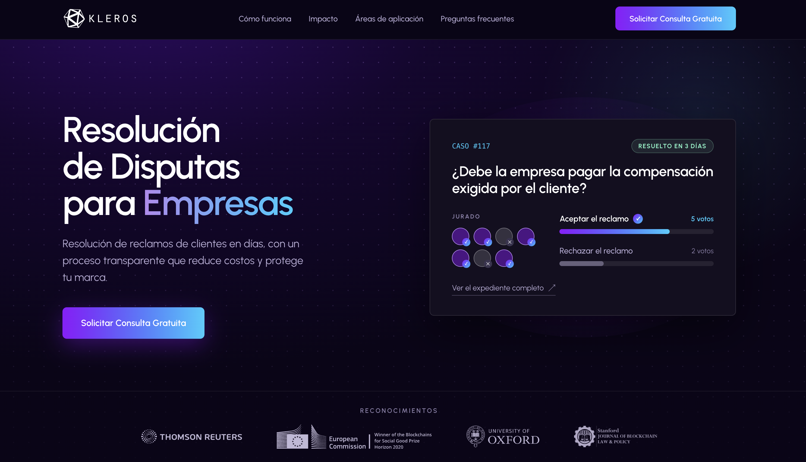
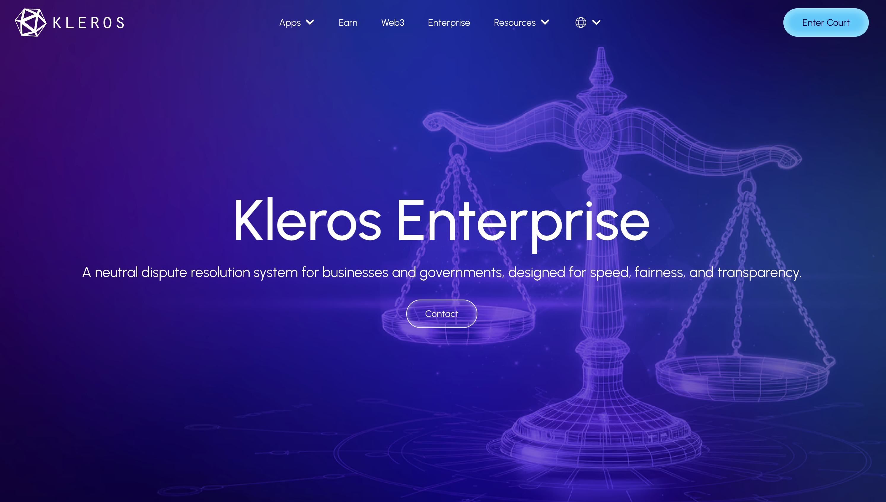

# Kleros Enterprise {#kleros-enterprise}

<Frame caption="Kleros Enterprise: [empresas.kleros.io](https://empresas.kleros.io/)">
  
</Frame>

<Frame caption="Kleros Enterprise: [kleros.io/enterprise](https://kleros.io/enterprise)">
  
</Frame>

**Kleros Enterprise es la resolución de disputas en línea para empresas, gobiernos e instituciones financieras.** Las organizaciones la utilizan para resolver las reclamaciones de clientes o ciudadanos de forma rápida, a bajo coste y mediante un proceso demostrablemente imparcial.

Cuando se presenta una disputa, un panel de evaluadores independientes revisa las evidencias de ambas partes y aplica un conjunto de reglas acordado de antemano, la [Política de Disputas](/es/enterprise/how-it-works#the-dispute-policy), para llegar a una decisión. El proceso se desarrolla íntegramente en línea y suele concluir en días. Ni la organización ni sus usuarios necesitan manejar criptomonedas ni interactuar con contratos inteligentes.

<Note>
Kleros está diseñado para disputas de valor bajo y medio en las que la rapidez, el coste y la percepción de equidad son lo más importante. **No** sustituye a los tribunales, a los sistemas jurídicos formales ni al asesoramiento legal. Añade una opción rápida y en línea que funciona antes de esos canales o junto a ellos.
</Note>

---

## Cifras clave {#key-numbers}

| Métrica | Valor |
| --- | --- |
| Casos resueltos | **Más de 2.500** |
| Casos escalados posteriormente a tribunales o reguladores | **0%** |
| Tasa de cumplimiento | **100%**: en todos los casos resueltos hasta la fecha mediante Kleros Enterprise, la organización ha cumplido el fallo |
| Tiempo de resolución habitual | **Días** |

---

## Qué es y qué no es Kleros {#what-kleros-is-and-is-not}

| Kleros es | Kleros no es |
| --- | --- |
| Una plataforma en línea para resolver disputas de valor bajo y medio | Un sustituto de los tribunales o de los sistemas jurídicos formales |
| Una capa neutral e independiente que se añade al proceso de reclamaciones existente de una organización | Un proveedor de servicios jurídicos |
| Un mecanismo que actúa antes de que intervengan los tribunales o los reguladores | Un equipo interno de gestión de reclamaciones |
| Adaptable a las reglas y a la jurisdicción de cada organización | Una plataforma para disputas de alta complejidad o asuntos penales |

---

## Explora Kleros Enterprise {#explore-kleros-enterprise}

<CardGroup cols={2}>
  <Card title="Cómo funciona" href="/es/enterprise/how-it-works">
    El proceso de disputa, la Política de Disputas, quién evalúa los casos y las garantías del debido proceso
  </Card>
  <Card title="Comparativa de Kleros" href="/es/enterprise/comparison">
    Comparación directa con los procesos tradicionales en los sectores privado y público
  </Card>
  <Card title="Marco legal" href="/es/enterprise/legal">
    Fundamentos jurídicos, marcos específicos por país y precedentes de ejecución judicial
  </Card>
  <Card title="Casos de uso" href="/es/enterprise/use-cases">
    Fintech, seguros, aerolíneas, sector público, arbitraje y propiedad intelectual
  </Card>
  <Card title="Casos de estudio" href="/es/enterprise/case-studies">
    Lemon Cash, MetLife México, el Poder Judicial de Mendoza y la Municipalidad de Junín
  </Card>
  <Card title="Primeros pasos" href="/es/enterprise/getting-started">
    El piloto de 3 meses, la integración continua y el modelo de costes
  </Card>
</CardGroup>

---

## Reconocimiento institucional {#institutional-recognition}

| Institución | Referencia |
| --- | --- |
| Naciones Unidas (UNCTAD, CNUDMI) | [Kleros and Decentralized Justice: presentación ante la UNCTAD](https://unctad.org/system/files/non-official-document/ccpb_webinar_digital_age_presentation_kleros.pdf) · [Presentación ante la CNUDMI](https://uncitral.un.org/sites/default/files/media-documents/uncitral/en/3-5_federico_ast_-_uncitral.pdf) |
| Comisión Europea | [Premio EU Horizon 2020 Blockchains for Social Good](https://blog.kleros.io/kleros-community-update-july-2020/) |
| BPI France | [Subvención a la innovación de BPI France](https://blog.kleros.io/french-bank-grants-subsidy-to-kleros/) |
| Organización Mundial de la Propiedad Intelectual (OMPI) | [Presentación de Federico Ast en la OMPI](https://www.wipo.int/meetings/en/doc_details.jsp?doc_id=571095) |
| Thomson Reuters | [The Kleros Vision (Thomson Reuters Incubator)](https://blog.kleros.io/the-kleros-vision/) |
| Universidad de Oxford | [Kleros Doctoral Research Support Grant](https://blog.kleros.io/conduct-research-on-decentralized-justice-at-the-university-of-oxford/) |
| Stanford Blockchain | [Stanford Blockchain Governance Summit](https://blog.kleros.io/kleros-project-update-2024/) |
| World Governments Summit | [Kleros en la World Governments Summit, Dubái](https://blog.kleros.io/kleros-project-update-2024/) |

---

## Integración con Web3 y DAO {#web3-and-dao-integration}

Kleros también funciona de forma nativa con los ecosistemas Web3 y DAO. Las disputas en comunidades descentralizadas se resuelven sin intermediarios centralizados, con fallos que los contratos inteligentes ejecutan automáticamente: disputas de gobernanza de protocolos, moderación en la cadena, disputas de oráculos y aplicación de reglas en plataformas descentralizadas. Consulta la [página del ecosistema](/es/enterprise/ecosystem) para ver los proyectos que construyen sobre Kleros.

---

## Contacta con el equipo de Kleros Enterprise {#contact-the-kleros-enterprise-team}

Para empezar, basta con una breve conversación con el equipo de Kleros Enterprise para definir los tipos de disputa, las reglas aplicables y los criterios de los evaluadores de tu organización.

- **Correo electrónico:** [soporte@kleros.io](mailto:soporte@kleros.io), para preguntas sobre la configuración del piloto y la integración
- **Sitio web:** [kleros.io/enterprise](https://kleros.io/enterprise), o [empresas.kleros.io](https://empresas.kleros.io/) en español
- **LinkedIn:** [Kleros Enterprise](https://www.linkedin.com/showcase/kleros-enterprise/posts/?feedView=all)
- **X:** [@kleros_es](https://x.com/kleros_es)
