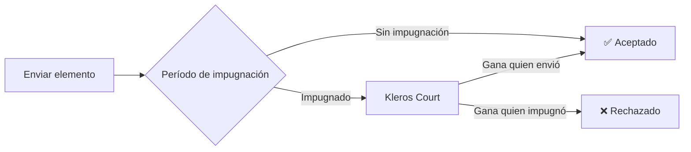

<Frame>
  
</Frame>

# Curate

<Warning>
**Classic Curate está siendo descontinuado.** Los contratos de Classic Curate siguen desplegados y sin cambios, por lo que las listas Classic existentes siguen funcionando: todavía se pueden enviar, impugnar y consultar elementos. Kleros no lanzará nuevos registros en Classic Curate, y se está deshabilitando la creación de listas Classic a través de los frontends de Kleros. **Light Curate y Stake Curate no se ven afectados** y siguen teniendo soporte completo; las nuevas listas, incluidos los registros Kleros Verified que se muestran en la página de inicio de la [aplicación Curate](https://curate.kleros.io), se crean en Light Curate.
</Warning>

**Curate** es una aplicación descentralizada para crear y mantener registros curados por la comunidad. Cualquiera puede enviar elementos a una lista y cualquiera puede impugnar envíos incorrectos o maliciosos, con disputas resueltas por Kleros Court.

Piensa en ello como una Wikipedia para datos estructurados, pero con incentivos económicos en juego. Quienes envían elementos depositan una fianza que pierden si su envío es impugnado con éxito. Quienes impugnan arriesgan su propio depósito si el envío resulta ser válido. Esto crea un sistema autosostenible en el que los participantes tienen incentivos económicos para mantener registros precisos.

Curate impulsa infraestructura crítica en todo Web3: listas de tokens que las billeteras usan para mostrar activos, etiquetas de direcciones que los exploradores de bloques usan para identificar contratos y registros de seguridad que ayudan a los usuarios a evitar estafas.

---

## Variantes de Curate

Curate es una familia de tres variantes. Las tres utilizan Kleros Court V1 para la resolución de disputas.

- **Classic Curate** (V1) - un Token-Curated Registry (TCR) completo que admite esquemas complejos. Ideal para registros de alto valor con campos personalizados. Migrado a Gnosis Chain.
- **Light Curate** (V1) - un TCR simplificado, diseñado para mayor volumen y menores costos de gas. En Gnosis Chain.
- **Stake Curate** (infraestructura V1) - verificación continua con depósitos permanentes, en Gnosis Chain. Desplegado a mediados de agosto de 2025; primera implementación con DAMM Capital (septiembre de 2025). Consulta [Stake Curate](/es/products/stake-curate).

---

## Capacidades clave

<CardGroup cols={2}>
  <Card title="Envíos sin permisos" icon="plus">
    Cualquiera puede añadir elementos a un registro depositando una fianza
  </Card>
  <Card title="Curación comunitaria" icon="users">
    Cualquiera puede impugnar envíos incorrectos
  </Card>
  <Card title="Resolución de disputas" icon="scale-balanced">
    Los elementos impugnados los deciden los jurados de Kleros Court
  </Card>
  <Card title="Esquemas flexibles" icon="table">
    Crea registros para cualquier tipo de datos estructurados
  </Card>
  <Card title="Datos on-chain" icon="link">
    Los datos de los registros están totalmente on-chain y se pueden consultar
  </Card>
  <Card title="Gana recompensas" icon="coins">
    Quienes impugnan con éxito ganan el depósito de quien envió el elemento
  </Card>
</CardGroup>

---

## Cómo funciona

Curate utiliza un mecanismo llamado **Token Curated Registry (TCR)**. Este es el flujo:

<Steps>
  <Step title="Envío">
    Un usuario envía un elemento (p. ej., la dirección de un token con sus metadatos) y deposita una fianza. El envío pasa al estado **pendiente**.
  </Step>
  <Step title="Período de impugnación">
    Durante el período de impugnación, cualquiera puede impugnar el envío depositando su propia fianza. Si nadie lo impugna, el elemento es **aceptado** en el registro.
  </Step>
  <Step title="Disputa (si se impugna)">
    Si se impugna, se crea una disputa en Kleros Court. Los jurados revisan las evidencias y votan si el envío cumple los criterios de aceptación del registro.
  </Step>
  <Step title="Resolución">
    La parte ganadora recibe ambos depósitos (menos las tarifas de arbitraje). El elemento es **aceptado** o **rechazado** según el fallo.
  </Step>
</Steps>

### La estructura de incentivos

Lo mejor de los TCR es que **no necesitas confiar en nadie**:

- **Quienes envían** tienen incentivos para enviar solo elementos válidos (o pierden su depósito)
- **Quienes impugnan** tienen incentivos para impugnar solo elementos no válidos (o pierden su depósito)
- **Los jurados** tienen incentivos para votar con honestidad (mediante el mecanismo de punto de Schelling de Kleros)

Esto crea un sistema autorregulado en el que los actores malintencionados son castigados económicamente.

---

## Casos de uso

<Tabs>
  <Tab title="Listas de tokens">
    **Problema:** Las billeteras y los exchanges necesitan saber qué tokens son legítimos.
    
    **Solución:** Registros de tokens curados por la comunidad en los que cualquiera puede enviar tokens y cualquiera puede impugnar estafas o duplicados.
    
    **Ejemplo:** Las billeteras usan el Kleros Token Registry para mostrar información de tokens y advertir a los usuarios sobre activos no verificados.
  </Tab>
  
  <Tab title="Etiquetas de direcciones">
    **Problema:** Los exploradores de bloques muestran direcciones sin procesar, sin contexto sobre lo que son.
    
    **Solución:** Registros que asocian direcciones con etiquetas legibles (p. ej., "Uniswap V3 Router", "Vitalik.eth").
    
    **Ejemplo:** Los registros de etiquetas de direcciones impulsan las etiquetas que ves en Etherscan y otros exploradores.
  </Tab>
  
  <Tab title="Seguridad de contratos">
    **Problema:** Los usuarios no pueden verificar fácilmente si es seguro interactuar con un contrato inteligente.
    
    **Solución:** Registros de seguridad en los que auditores y miembros de la comunidad señalan contratos riesgosos o verificados.
    
    **Ejemplo:** [Kleros Scout](/es/products/scout) muestra información de seguridad procedente de los registros de Curate.
  </Tab>
  
  <Tab title="Contract-Domain Names">
    **Problema:** Los usuarios y las dApps no pueden saber fácilmente a qué sitio web pertenece oficialmente un contrato.
    
    **Solución:** El registro Contract-Domain Name (CDN) verifica los emparejamientos entre contratos y dominios, junto con metadatos del proyecto como logotipos y descripciones.
    
    **Ejemplo:** Información verificada de proyectos y logotipos que se sirven a billeteras y dApps en todo el ecosistema.
  </Tab>
</Tabs>

### ¿Quién usa Curate?

- **Las billeteras** consultan los registros de tokens para mostrar información de los activos
- **Los exploradores de bloques** usan etiquetas de direcciones para mostrar nombres legibles
- **Los protocolos DeFi** consultan los registros antes de listar nuevos activos
- **Las herramientas de seguridad** agregan información de riesgos a partir de listas curadas
- **Las DAOs** mantienen registros de miembros o colaboradores

---

## Tipos de registro

Curate ofrece tres variantes en las dos versiones del protocolo:

| Variante | Versión | Ideal para | Costos de gas | Flexibilidad |
|---------|---------|----------|-----------|-------------|
| **Classic Curate** (completo) | V1 | Registros de alto valor con esquemas complejos | Más altos | Máxima |
| **Light Curate** | V1 | Registros sencillos, mayor volumen | Más bajos | Esquemas estándar |
| **Stake Curate** | Infraestructura V1 | Verificación continua con depósitos permanentes | - | Consulta [Stake Curate](/es/products/stake-curate) |

Entre las variantes V1, la mayoría de los registros usan **Light Curate** por su eficiencia en costos. Classic Curate se utiliza cuando se necesitan campos personalizados o criterios de aceptación complejos.

---

## Estado actual

**Descontinuación de Classic Curate:** solo se está descontinuando Classic Curate. Sus contratos siguen desplegados y las listas Classic existentes siguen funcionando, pero Kleros no lanzará nuevos registros Classic y la creación de listas Classic se está eliminando de los frontends de Kleros. Light Curate y Stake Curate no se ven afectados. Los registros Kleros Verified de la página de inicio de Curate se trasladaron a Light Curate en agosto de 2026, y las nuevas listas se crean en Light Curate.

Tras la **KIP-87**, una **Curation Court con votación oculta** dedicada entró en funcionamiento en Gnosis Chain a mediados de 2026. La votación oculta divide la votación de los jurados en fases de commit y reveal para que los jurados no puedan ver otros votos antes de decidir, lo que reduce el efecto manada en las disputas de curación. Los registros de Scout migraron a esta corte el **13 de julio de 2026**. El desarrollo de Curate V2 también alineó su consulta de evidencias con la migración del esquema de kleros-core.

Sigue el desarrollo en el [blog de Kleros - actualizaciones para desarrolladores](https://blog.kleros.io/tag/developer/).

---

## ¿Qué sigue?

<CardGroup cols={3}>

  <Card title="Usar Curate" icon="rocket" href="/es/tutorials/curate-tutorial">
    **Guías paso a paso**
    
    Aprende a enviar elementos, impugnar envíos y ganar recompensas.
   
  </Card>

  <Card title="Construir sobre Curate" icon="code" href="/es/developers/products/curate">
    **Guía de integración**
    
    Consulta datos de registros, crea interfaces personalizadas o crea tu propio registro.
    
    → Documentación para desarrolladores
  </Card>

  <Card title="Entender los TCR" icon="lightbulb" href="/es/concepts/game-theory">
    **Análisis profundo de teoría de juegos**
    
    Conoce la economía y los incentivos detrás de los Token Curated Registries.
    
    → Conceptos
  </Card>

</CardGroup>

---

## Enlaces rápidos

<CardGroup cols={2}>
  <Card title="Abrir Curate (V1)" icon="arrow-up-right-from-square" href="https://curate.kleros.io/">
    Explora, envía e impugna elementos en las listas V1 existentes
  </Card>
  <Card title="Curate V2" icon="flask" href="https://curate-v2.netlify.app/">
    Prueba la interfaz de Curate de nueva generación
  </Card>
  <Card title="Subgraph de Curate" icon="database" href="/es/developers/subgraph/overview">
    Consulta datos de los registros mediante GraphQL
  </Card>
  <Card title="Direcciones de contratos" icon="file-contract" href="/es/reference/contracts/deployment-addresses">
    Direcciones de despliegue de Curate V2
  </Card>
</CardGroup>
