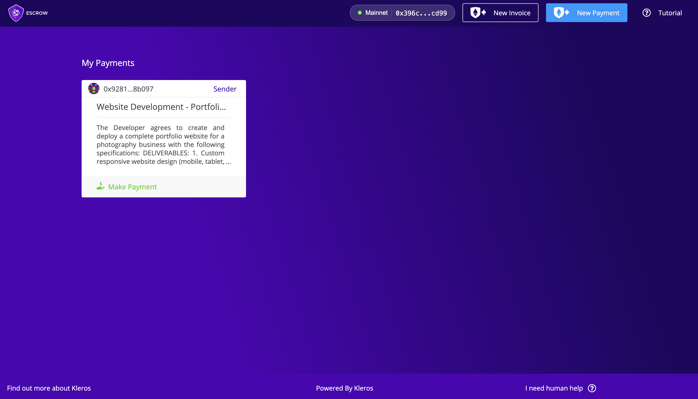
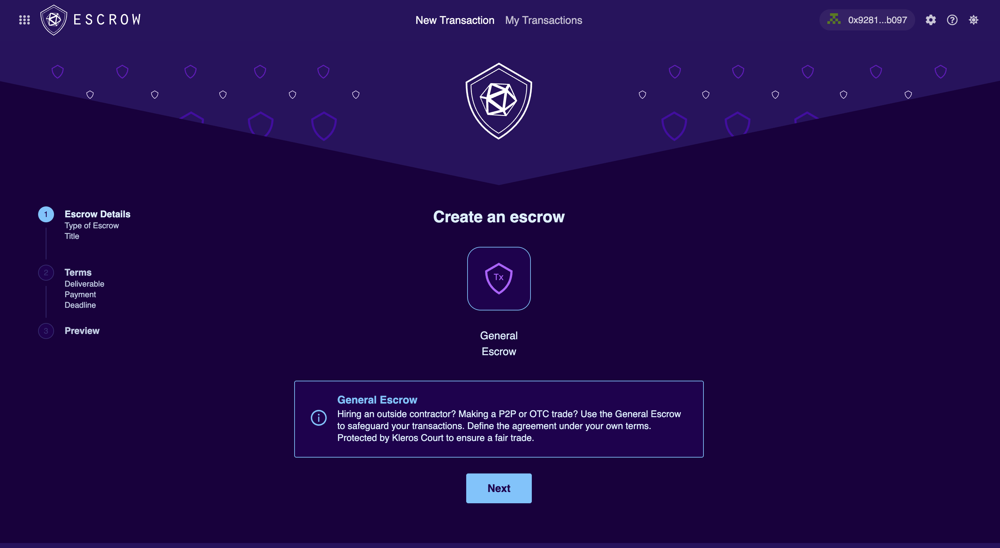

# Escrow {#escrow}

**Kleros Escrow** es una plataforma de depósito en garantía (escrow) descentralizada que protege las transacciones en blockchain entre partes que no confían entre sí. Combina la automatización de los contratos inteligentes con el sistema de arbitraje descentralizado de Kleros para ofrecer seguridad en las transacciones de comercio digital sin necesidad de confianza.

Las transacciones en línea tradicionales requieren confianza entre desconocidos, lo que abre la puerta al fraude y a las disputas. Kleros Escrow elimina este requisito de confianza al proteger los fondos en contratos inteligentes y ofrecer arbitraje descentralizado a través de Kleros Court cuando fallan los acuerdos.

---

## V1: protocolo en producción {#v1-production-protocol}

Escrow V1 funciona en la red principal de Ethereum. Dos partes bloquean fondos en un contrato inteligente, con Kleros Court disponible como mecanismo de resolución de disputas si no están de acuerdo.

- **Red**: red principal de Ethereum
- **Modelo**: escrow entre dos partes con liquidación básica
- **Tokens**: ETH y tokens ERC-20 estándar (los tokens no estándar como USDT no son compatibles)
- **Evidencias y apelaciones**: las gestiona el contrato de escrow

---

## V2: actualización de nueva generación {#v2-next-gen-upgrade}

Escrow V2 funciona en Arbitrum y añade una negociación estructurada de acuerdos, compatibilidad con varios tokens (ETH, USDC, USDT, DAI o cualquier ERC-20 mediante `SafeERC20`) y traslada la gestión de las evidencias y las apelaciones al tribunal.
<Frame>
  
</Frame>

---

## Qué cambió en V2 {#what-changed-in-v2}

| Función | V1 | V2 |
|---------|----|----|
| Red | Red principal de Ethereum | Arbitrum One |
| Compatibilidad de tokens | ETH + ERC-20 estándar | ETH + cualquier ERC-20 (mediante SafeERC20) |
| Acuerdo | Básico | Propuesta / contrapropuesta estructurada |
| Evidencias y apelaciones | Las gestiona el contrato de escrow | Las gestiona el tribunal |
| Comisiones de la plataforma | Ninguna | Ninguna |

---

## Capacidades clave {#key-capabilities}

<CardGroup cols={2}>

<Card title="Seguridad de contratos inteligentes" icon="lock">
  Los fondos se protegen en contratos inteligentes antes de la prestación del servicio
</Card>

<Card title="Negociación de acuerdos" icon="comments-dollar">
  Proceso de negociación estructurado para disputas parciales
</Card>

<Card title="Compatibilidad con varios tokens" icon="coins">
  Paga con ETH, USDC, USDT, DAI o cualquier token ERC20
</Card>

<Card title="Arbitraje descentralizado" icon="gavel">
  Kleros Court resuelve las disputas cuando fallan los acuerdos
</Card>

<Card title="Sin comisiones de plataforma" icon="badge-percent">
  Uso completamente gratuito: solo pagas las tasas de gas de la red
</Card>

<Card title="Ejecución automática" icon="robot">
  Los contratos inteligentes ejecutan los fallos automáticamente
</Card>

</CardGroup>

---

## Cómo funciona {#how-it-works}

<Steps>

<Step title="Creación">
  El comprador crea la transacción de escrow especificando el vendedor, el importe, el plazo y las condiciones.
</Step>

<Step title="Bloqueo de fondos">
  El pago se protege en el contrato inteligente usando ETH o el token elegido.
</Step>

<Step title="Periodo de entrega">
  El vendedor presta el servicio o entrega el producto acordado antes del plazo especificado.
</Step>

<Step title="Resolución">
  La transacción concluye mediante el pago, un acuerdo, la ejecución manual tras el plazo o el arbitraje.
</Step>

</Steps>

---

## Mecanismos de resolución {#resolution-mechanisms}

Kleros Escrow V2 ofrece varias formas de resolver las transacciones:

<Tabs>
  <Tab title="Pago directo">
    **Cuando las partes están totalmente de acuerdo**

    - **Pago completo**: el comprador libera el importe total al vendedor cuando está satisfecho
    - **Reembolso completo**: el vendedor devuelve el importe total al comprador si no puede cumplir
    - **Transacciones parciales**: cualquiera de las partes puede procesar importes parciales por las partes completadas
  </Tab>

  <Tab title="Acuerdo">
    **Cuando las partes no están de acuerdo en parte**

    El proceso de negociación estructurado:

    1. **Propuesta**: cualquiera de las partes propone un importe de acuerdo
    2. **Contrapropuesta**: la otra parte puede proponer un importe diferente
    3. **Acuerdo**: cuando una de las partes acepta, los fondos se reparten automáticamente
    4. **Escalada**: si no hay acuerdo tras el tiempo límite, cualquiera de las partes puede abrir una disputa

    <Warning>
    Proponer un acuerdo NO transfiere fondos. El dinero solo se mueve cuando una de las partes acepta expresamente la propuesta de la otra.
    </Warning>
  </Tab>

  <Tab title="Ejecución tras el plazo">
    **Cuando vence el plazo**

    Una vez vencido el plazo, cualquiera puede activar la ejecución para transferir los fondos restantes al vendedor si:
    - No hay disputas activas
    - No hay negociaciones de acuerdo pendientes
    - El plazo ha vencido

    <Info>
    Esto requiere una llamada manual a una transacción: NO es automático. Cualquier dirección puede activarlo una vez que se cumplen las condiciones.
    </Info>
  </Tab>

  <Tab title="Resolución de disputas">
    **Cuando el acuerdo fracasa**

    1. **Pago de tasas**: ambas partes pagan las tasas de arbitraje dentro del tiempo límite
    2. **Presentación de evidencias**: las partes presentan evidencias que las respalden
    3. **Selección del jurado**: Kleros selecciona al azar jurados imparciales
    4. **Fallo**: el jurado decide el resultado según las evidencias
    5. **Ejecución**: el contrato inteligente ejecuta el fallo automáticamente

    Las tasas de arbitraje se reembolsan a la parte ganadora. Si una de las partes no paga las tasas dentro del tiempo límite, la parte que pagó gana automáticamente.
  </Tab>
</Tabs>

---

## Mejoras de V2 {#v2-improvements}

| Función | Descripción |
| --- | --- |
| **Compatibilidad universal de tokens** | ETH, tokens populares (USDC, USDT, DAI) o cualquier token ERC20 |
| **Comprobaciones de seguridad automáticas** | El sistema valida la compatibilidad del token |
| **Acuerdo estructurado** | Propuesta y aceptación formales con reglas de transferencia claras |
| **Protección del acuerdo** | Un periodo de espera evita un arbitraje precipitado |
| **Disputas simplificadas** | Reembolsos automáticos de pagos en exceso, lógica de tiempo límite clara |

### Selección del token {#token-selection}

<Steps>
<Step title="Elige el tipo de pago">
  Selecciona ETH, elige entre los tokens populares o introduce la dirección de un token personalizado
</Step>
<Step title="Verificación">
  El sistema verifica que el token funciona con Escrow
</Step>
<Step title="Establece el importe">
  Introduce tu importe y continúa con la transacción
</Step>
</Steps>

<Note>
Las transacciones con tokens pueden tener límites de importe máximo establecidos por la gobernanza para la gestión de riesgos.
</Note>

---

## Casos de uso {#use-cases}

<AccordionGroup>

<Accordion title="Contratación de servicios" icon="briefcase">
Una agencia de marketing y su cliente usan escrow para una campaña en redes sociales. Si el cliente está satisfecho en parte, puede proponer un importe de acuerdo. La agencia puede aceptar, hacer una contrapropuesta o pasar a la resolución de disputas.
</Accordion>

<Accordion title="Comercio de criptomonedas" icon="bitcoin">
Quienes intercambian ETH por activos de otras blockchains usan escrow por seguridad. Una parte bloquea ETH mientras la otra transfiere los activos externos. Si surgen problemas, las partes pueden negociar o recurrir a la resolución de disputas.
</Accordion>

<Accordion title="Proyectos freelance" icon="laptop-code">
Una empresa contrata a un desarrollador para una aplicación web. El desarrollador trabaja sabiendo que el pago está garantizado, mientras que la empresa puede probar el entregable y liberar el pago, negociar o abrir una disputa si es necesario.
</Accordion>

<Accordion title="Venta de productos físicos" icon="box">
Un artista vende una obra personalizada a un coleccionista mediante escrow. El comprador tiene hasta el plazo para inspeccionarla. Si hay dudas sobre la calidad, el comprador puede proponer un pago parcial o abrir una disputa.
</Accordion>

</AccordionGroup>

---

## Estructura de costes {#cost-structure}

| Tipo de coste | Importe |
| --- | --- |
| **Comisiones de la plataforma** | **Gratis**: Kleros Escrow V2 no tiene comisiones de plataforma |
| **Tasas de red** | Tasas de gas estándar de la blockchain para las transacciones |
| **Costes de disputa** | Tasas de arbitraje solo si abres una disputa (se reembolsan si ganas) |

<Tip>
La función de negociación de acuerdos suele evitar por completo las disputas, ya que permite a las partes llegar a acuerdos parciales y ahorrar posibles costes de arbitraje.
</Tip>

---

## Ventajas {#benefits}

<Tabs>
  <Tab title="Para compradores">
    - **Protección del pago**: los fondos permanecen seguros hasta que se confirma la entrega
    - **Garantía de calidad**: un recurso claro en caso de falta de entrega o trabajo deficiente
    - **Resolución flexible**: negociación de acuerdos para trabajos completados en parte
    - **Arbitraje justo**: acceso al imparcial Kleros Court
    - **Pagos parciales**: libera fondos de forma gradual a medida que avanza el trabajo
  </Tab>

  <Tab title="Para vendedores">
    - **Garantía de pago**: disponibilidad de fondos verificada antes de empezar a trabajar
    - **Ejecución tras el plazo**: activa la liberación del pago una vez vencido el plazo
    - **Disputas justas**: igualdad de condiciones con decisiones basadas en evidencias
    - **Derecho a proponer acuerdos**: la misma capacidad para proponer importes de acuerdo
    - **Pagos parciales**: negocia la compensación por las partes completadas
  </Tab>

  <Tab title="Para el ecosistema">
    - **Infraestructura de confianza**: permite el comercio entre partes desconocidas en todo el mundo
    - **Reducción del fraude**: la seguridad de los contratos inteligentes disuade a los estafadores
    - **Arbitraje descentralizado**: reduce la dependencia de servicios centralizados
    - **Eficiencia del mercado**: menos barreras para el comercio digital
    - **Transparencia**: contratos de código abierto y registros públicos de las disputas
  </Tab>
</Tabs>

---

## Buenas prácticas {#best-practices}

<CardGroup cols={2}>

<Card title="Para compradores" icon="user">
  - Establece plazos realistas (la ejecución requiere activación manual)
  - Define entregables claros
  - Conserva los registros de comunicación para posibles disputas
  - Considera pagos por hitos en proyectos grandes
</Card>

<Card title="Para vendedores" icon="user-tie">
  - Verifica que el escrow está financiado antes de empezar a trabajar
  - Documenta el progreso y las comunicaciones
  - Comunica los retrasos de forma proactiva
  - Comprende las implicaciones del plazo
</Card>

</CardGroup>

**Para ambas partes:**
- Usa descripciones detalladas con condiciones y criterios de éxito claros
- Conserva todos los registros de comunicación como evidencia
- Ten en cuenta que las propuestas de acuerdo no transfieren fondos hasta que se aceptan
- Considera un acuerdo antes de escalar a una disputa

---

## Primeros pasos {#getting-started}

<Steps>

<Step title="Conecta tu billetera">
  Usa MetaMask, Rabby o cualquier billetera Web3 compatible
</Step>

<Step title="Elige el pago">
  Selecciona ETH o tu token preferido
</Step>

<Step title="Crea la transacción">
  Especifica la contraparte, el importe, las condiciones y un plazo realista
</Step>

<Step title="Financia el escrow">
  Transfiere el pago al contrato inteligente seguro
</Step>

<Step title="Sigue y resuelve">
  Supervisa el estado y, después, libera el pago, negocia un acuerdo o abre una disputa
</Step>

</Steps>

---

## ¿Qué sigue? {#what’s-next}

<CardGroup cols={3}>

<Card title="Crea un escrow" icon="plus" href="https://escrow-v2.kleros.builders/#/new-transaction">
  Inicia una nueva transacción de escrow
</Card>

<Card title="Guía de integración" icon="code" href="/developers/products/escrow">
  Integra escrow en tu aplicación
</Card>

<Card title="Resolución de disputas" icon="gavel" href="/es/concepts/dispute-resolution">
  Aprende cómo funciona Kleros Court
</Card>

</CardGroup>

---

## Enlaces rápidos {#quick-links}

<CardGroup cols={2}>

<Card title="Abrir Escrow" icon="rocket" href="https://escrow.kleros.io">
  Abre la aplicación Escrow
</Card>

<Card title="Direcciones de contratos" icon="file-contract" href="/reference/contracts/deployment-addresses">
  Direcciones de despliegue de Escrow V2
</Card>

</CardGroup>
