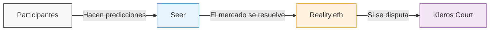

# Foresight

 

<Note>**Experimental** Kleros Foresight está llevando a cabo sus primeros experimentos públicos. La plataforma se encuentra en desarrollo activo y sus funcionalidades pueden cambiar.</Note>

**Kleros Foresight** es una plataforma de mercados de predicción donde las personas apuestan valor real en los resultados que esperan. Ayuda a comunidades y organizaciones a tomar mejores decisiones al convertir el juicio colectivo de la multitud en estimaciones fiables. Está construida sobre [Seer](https://seer.pm) para los mercados y utiliza Kleros Court para resolver los resultados cuando son impugnados.

Foresight aplica la **futarquía**, una idea propuesta por el economista Robin Hanson: en lugar de votar directamente sobre una decisión, los participantes apuestan por la opción que conducirá a un mejor resultado, y los precios del mercado revelan la mejor estimación de la multitud. Foresight lleva esto a la cadena, con Kleros como respaldo para los resultados disputados.

---

## Capacidades clave

<CardGroup cols={3}>
  <Card title="Mercados de predicción" icon="chart-line">
    Los participantes respaldan sus predicciones con valor real, creando estimaciones colectivas fiables
  </Card>
  <Card title="Resolución de disputas" icon="gavel">
    Cuando los resultados del mercado son impugnados, los jurados de Kleros Court toman la decisión final
  </Card>
  <Card title="Sesiones de futarquía" icon="puzzle-piece">
    Orquesta sesiones completas de mercados de predicción basados en futarquía para la toma de decisiones colectiva
  </Card>
</CardGroup>

---

## Cómo funciona

Kleros Foresight combina tres capas de infraestructura descentralizada:

**[Seer](https://seer.pm)** proporciona la infraestructura de mercados de predicción. Utiliza el marco de tokens condicionales de Gnosis Chain para crear mercados donde los participantes compran y venden tokens de resultado que representan sus predicciones.

**[Reality.eth](/es/products/reality)** gestiona la capa de oráculo. Cuando un mercado cierra, cualquiera puede enviar una respuesta depositando una fianza. Otros pueden impugnarla duplicando esa fianza, lo que genera una escalada económica que filtra las respuestas de baja confianza.

**[Kleros Court](/es/court/overview)** es la capa final de arbitraje. Si una respuesta de Reality.eth se disputa más allá del umbral de escalada de fianzas, jurados de Kleros seleccionados al azar evalúan las pruebas y emiten un fallo. La mayoría de los mercados se resuelven sin disputa, en cuyo caso Kleros Court no interviene en absoluto.

<Steps>
  <Step title="Período de negociación">
    Una sesión se abre con un conjunto de elementos sobre los que predecir (p. ej., películas que calificar, activos que evaluar). Los participantes depositan colateral (sDAI o xDAI) y hacen predicciones moviendo las estimaciones del mercado hacia lo que creen. La duración de este período es específica de cada sesión.
  </Step>
  <Step title="Selección">
    Cuando termina el período de negociación, se selecciona un subconjunto de elementos para su evaluación. Solo se resuelven los elementos seleccionados; los elementos no seleccionados no se canjean en el mercado principal. Los resultados se informan a través de Reality.eth, donde cualquiera puede responder e impugnar, en lugar de hacerlo una parte central.
  </Step>
  <Step title="Evaluación">
    Los elementos seleccionados se evalúan (p. ej., un juez ve y califica las películas). Los resultados se envían a Reality.eth como respuestas del oráculo.
  </Step>
  <Step title="Resolución y canje">
    Si las respuestas del oráculo no son impugnadas, los mercados se resuelven y los participantes pueden canjear sus tokens. Si las respuestas se disputan, Kleros Court emite el fallo final. Los participantes que predijeron con mayor precisión que el mercado obtienen ganancias; los que fueron menos precisos sufren pérdidas.
  </Step>
</Steps>

---

## Mecánica de tokens de un vistazo

Cuando depositas colateral en una sesión de Foresight, recibes **Item Tokens** por cada elemento de la sesión. Cuando haces una predicción, tus Item Tokens se convierten en tokens **UP** o **DOWN** según predigas un valor mayor o menor que la estimación actual del mercado.

En la resolución, los tokens UP y DOWN no se canjean directamente por una stablecoin. Se canjean por el token del elemento, que a su vez se canjea en el mercado categórico principal. La división entre UP y DOWN sigue el canje de mercados escalares de Seer. Consulta la [documentación de Seer](https://seer-3.gitbook.io/seer-documentation) para conocer la mecánica exacta de canje.

---

## Experimentos actuales

### Predicciones de puntuación de películas

Los experimentos con películas de Kleros Foresight piden a los participantes que predigan la puntuación percentil que un juez otorgará a un conjunto de películas nominadas después de verlas. Al final del período de negociación, solo se selecciona para evaluación un subconjunto de las películas nominadas: las que tienen las estimaciones de mercado más altas, una elegida al azar y una que elige el juez. Esta es una implementación directa del Juicio Humano Destilado (Distilled Human Judgment), donde la multitud evalúa cada elemento a través de los precios del mercado, pero solo un pequeño subconjunto requiere una evaluación humana real.

La Ronda 3 es la sesión activa actual. Los participantes necesitan una billetera Web3 en Gnosis Chain con xDAI o sDAI para participar. Los humanos verificados en [Proof of Humanity](/es/products/proof-of-humanity) o los miembros de la comunidad de Seer también pueden usar créditos mensuales de Seer para participar.

Consulta [foresight.kleros.io](https://foresight.kleros.io) para ver la sesión actual y sus películas nominadas.

---

## Foresight en la gobernanza de Kleros

Kleros utiliza sus propias herramientas de futarquía para la gobernanza del protocolo. [**KIP-76**](https://forum.kleros.io/t/kip-76-futarchy-based-governance-rule-for-pnk-minting/1347/1) introdujo una regla que exige una evaluación mediante futarquía para cualquier propuesta que aumente el suministro del token PNK. Esto significa que, antes de que se pueda emitir PNK, un mercado de predicción debe indicar que la emisión no perjudicaría el valor de PNK. [**KIP-84**](https://forum.kleros.io/c/votes/5) refinó aún más los parámetros de evaluación.

Esto convierte a Kleros en uno de los primeros protocolos en utilizar mercados de predicción como salvaguarda constitucional en su propia gobernanza.

---

## Primeros pasos

Para participar en una sesión de Foresight, necesitarás:

- Una billetera Web3 (Rabby, MetaMask o similar) conectada a **Gnosis Chain**
- **xDAI** para las comisiones de gas (las transacciones en Gnosis son baratas, pero no gratuitas)
- **sDAI** o **xDAI** como colateral para las predicciones
- Si haces un puente desde Ethereum, usa el [Gnosis Bridge](https://bridge.gnosischain.com) para convertir DAI en xDAI

<Tip>
Reserva una pequeña cantidad de xDAI específicamente para el gas. Si conviertes todo a sDAI, no podrás pagar las transacciones.
</Tip>

---

## Más información

<CardGroup cols={2}>
  <Card title="Guía para principiantes" icon="book-open" href="https://docs.google.com/document/d/1ZuOspW3Yu5dtmWw1tFTJS9cImJfhY2oS1qKdrNNrRbA/edit?tab=t.0">
    Guía paso a paso: conectar tu billetera, hacer predicciones y leer tus posiciones
  </Card>
  <Card title="Guía avanzada" icon="graduation-cap" href="https://docs.google.com/document/d/1S9qU5EgcbNlTM5us39snNasle_sE4Z3n2RLzZPtH7Cc/edit?tab=t.0">
    Mecánica de tokens, billeteras de negociación, llenado hasta el precio límite, matemáticas de cartera y escenarios de resolución
  </Card>
</CardGroup>

---

## ¿Qué sigue?

<CardGroup cols={3}>
  <Card title="Abrir Kleros Foresight" icon="arrow-right" href="https://foresight.kleros.io/">
    Empieza a hacer predicciones en la sesión actual
  </Card>
  <Card title="Documentación de Seer" icon="book" href="https://seer-3.gitbook.io/seer-documentation">
    Conoce la infraestructura de mercados de predicción subyacente
  </Card>
  <Card title="Reality (Oráculo)" icon="database" href="/es/products/reality">
    Comprende la capa de oráculo que resuelve los resultados del mercado
  </Card>
</CardGroup>
