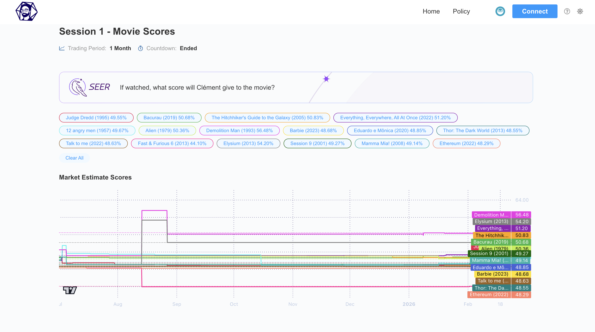
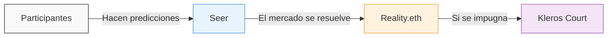

# Foresight {#foresight}

 

<Note>**Experimental** Kleros Foresight está llevando a cabo sus primeros experimentos públicos. La plataforma está en desarrollo activo y sus funciones pueden cambiar.</Note>

**Kleros Foresight** es una plataforma de mercados de predicción en la que las personas apuestan valor real por los resultados que esperan. Ayuda a comunidades y organizaciones a tomar mejores decisiones al convertir el juicio colectivo en estimaciones fiables. Se construye sobre [Seer](https://seer.pm) para los mercados y utiliza Kleros Court para resolver los resultados cuando se impugnan.

Foresight aplica la **futarquía**, una idea propuesta por el economista Robin Hanson: en lugar de votar directamente una decisión, los participantes apuestan por qué opción dará un mejor resultado, y los precios del mercado revelan la mejor estimación colectiva. Foresight lleva esto a la cadena, con Kleros como respaldo para los resultados impugnados.

---

## Capacidades clave {#key-capabilities}

<CardGroup cols={3}>
  <Card title="Mercados de predicción" icon="chart-line">
    Los participantes respaldan sus predicciones con valor real, lo que genera estimaciones colectivas fiables
  </Card>
  <Card title="Resolución de disputas" icon="gavel">
    Cuando se impugnan los resultados de un mercado, los jurados de Kleros Court toman la decisión final
  </Card>
  <Card title="Sesiones de futarquía" icon="puzzle-piece">
    Organiza de principio a fin sesiones de mercados de predicción con futarquía para la toma de decisiones colectiva
  </Card>
</CardGroup>

---

## Cómo funciona {#how-it-works}

Kleros Foresight combina tres capas de infraestructura descentralizada:

**[Seer](https://seer.pm)** proporciona la infraestructura de mercados de predicción. Utiliza el marco de tokens condicionales de Gnosis Chain para crear mercados en los que los participantes compran y venden tokens de resultado que representan sus predicciones.

**[Reality.eth](/es/products/reality)** se encarga de la capa de oráculo. Cuando un mercado cierra, cualquiera puede enviar una respuesta depositando una fianza. Otras personas pueden impugnarla duplicando esa fianza, lo que crea una escalada económica que filtra las respuestas poco fiables.

**[Kleros Court](/es/court/overview)** es la capa de arbitraje final. Si una respuesta de Reality.eth se impugna más allá del umbral de escalada de fianzas, jurados de Kleros seleccionados al azar evalúan las evidencias y emiten un fallo. La mayoría de los mercados se resuelven sin disputa, en cuyo caso Kleros Court no interviene en absoluto.

<Steps>
  <Step title="Periodo de negociación">
    Una sesión se abre con un conjunto de elementos sobre los que predecir (por ejemplo, películas que puntuar o activos que evaluar). Los participantes depositan colateral (sDAI o xDAI) y hacen predicciones moviendo las estimaciones del mercado hacia lo que creen. La duración de este periodo es específica de cada sesión.
  </Step>
  <Step title="Selección">
    Cuando termina el periodo de negociación, se selecciona un subconjunto de elementos para su evaluación. Solo se resuelven los elementos seleccionados; los no seleccionados no se canjean en el mercado principal. Los resultados se comunican a través de Reality.eth, que cualquiera puede responder e impugnar, en lugar de hacerlo una parte central.
  </Step>
  <Step title="Evaluación">
    Se evalúan los elementos seleccionados (por ejemplo, un juez ve y puntúa las películas). Los resultados se envían a Reality.eth como respuestas del oráculo.
  </Step>
  <Step title="Resolución y canje">
    Si nadie impugna las respuestas del oráculo, los mercados se resuelven y los participantes pueden canjear sus tokens. Si se impugnan las respuestas, Kleros Court emite el fallo final. Los participantes que predijeron con más precisión que el mercado obtienen beneficios; los que fueron menos precisos sufren pérdidas.
  </Step>
</Steps>

---

## Mecánica de los tokens de un vistazo {#token-mechanics-at-a-glance}

Cuando depositas colateral en una sesión de Foresight, recibes **Item Tokens** por cada elemento de la sesión. Cuando haces una predicción, tus Item Tokens se convierten en tokens **UP** o **DOWN** según predigas un valor superior o inferior a la estimación actual del mercado.

En la resolución, los tokens UP y DOWN no se canjean directamente por una stablecoin. Se canjean por el token del elemento, que a su vez se canjea en el mercado categórico principal. El reparto entre UP y DOWN sigue el canje de los mercados escalares de Seer. Consulta la [documentación de Seer](https://seer-3.gitbook.io/seer-documentation) para conocer la mecánica exacta del canje.

---

## Experimentos actuales {#current-experiments}

### Predicciones de puntuaciones de películas {#movie-score-predictions}

Los experimentos con películas de Kleros Foresight piden a los participantes que predigan el percentil de puntuación que un juez dará a un conjunto de películas nominadas después de verlas. Al final del periodo de negociación, solo se selecciona para su evaluación un subconjunto de las películas nominadas: las que tienen las estimaciones de mercado más altas, una elegida al azar y una que elige el juez. Es una implementación directa del juicio humano destilado (Distilled Human Judgment), en el que el colectivo evalúa cada elemento mediante los precios del mercado, pero solo un pequeño subconjunto necesita una valoración humana real.

La ronda 3 es la sesión en vivo actual. Para participar, necesitas una billetera Web3 en Gnosis Chain con xDAI o sDAI. Los humanos verificados en [Proof of Humanity](/es/products/proof-of-humanity) o los miembros de la comunidad de Seer también pueden usar los créditos mensuales de Seer para participar.

Consulta [foresight.kleros.io](https://foresight.kleros.io) para ver la sesión actual y sus películas nominadas.

---

## Foresight en la gobernanza de Kleros {#foresight-in-kleros-governance}

Kleros utiliza sus propias herramientas de futarquía para la gobernanza del protocolo. La [**KIP-76**](https://forum.kleros.io/t/kip-76-futarchy-based-governance-rule-for-pnk-minting/1347/1) introdujo una regla que exige una evaluación por futarquía para cualquier propuesta que aumente el suministro del token PNK. Esto significa que, antes de poder emitir PNK, un mercado de predicción debe indicar que la emisión no perjudicaría el valor del PNK. La [**KIP-84**](https://forum.kleros.io/c/votes/5) ajustó después los parámetros de evaluación.

Esto convierte a Kleros en uno de los primeros protocolos en utilizar los mercados de predicción como salvaguarda constitucional de su propia gobernanza.

---

## Primeros pasos {#getting-started}

Para participar en una sesión de Foresight, necesitarás:

- Una billetera Web3 (Rabby, MetaMask o similar) conectada a **Gnosis Chain**
- **xDAI** para las tasas de gas (las transacciones en Gnosis son baratas, pero no gratuitas)
- **sDAI** o **xDAI** como colateral para las predicciones
- Si haces el puente desde Ethereum, usa el [Gnosis Bridge](https://bridge.gnosischain.com) para convertir DAI en xDAI

<Tip>
Reserva una pequeña cantidad de xDAI específicamente para el gas. Si conviertes todo en sDAI, no podrás pagar las transacciones.
</Tip>

---

## Más información {#learn-more}

<CardGroup cols={2}>
  <Card title="Guía para principiantes" icon="book-open" href="https://docs.google.com/document/d/1ZuOspW3Yu5dtmWw1tFTJS9cImJfhY2oS1qKdrNNrRbA/edit?tab=t.0">
    Recorrido paso a paso: conectar tu billetera, hacer predicciones y leer tus posiciones
  </Card>
  <Card title="Guía avanzada" icon="graduation-cap" href="https://docs.google.com/document/d/1S9qU5EgcbNlTM5us39snNasle_sE4Z3n2RLzZPtH7Cc/edit?tab=t.0">
    Mecánica de los tokens, billeteras de negociación, llenado hasta el precio límite, cálculos de cartera y escenarios de resolución
  </Card>
</CardGroup>

---

## ¿Qué sigue? {#what’s-next}

<CardGroup cols={3}>
  <Card title="Abrir Kleros Foresight" icon="arrow-right" href="https://foresight.kleros.io/">
    Empieza a hacer predicciones en la sesión actual
  </Card>
  <Card title="Documentación de Seer" icon="book" href="https://seer-3.gitbook.io/seer-documentation">
    Conoce la infraestructura de mercados de predicción subyacente
  </Card>
  <Card title="Reality (oráculo)" icon="database" href="/es/products/reality">
    Comprende la capa de oráculo que resuelve los resultados de los mercados
  </Card>
</CardGroup>
