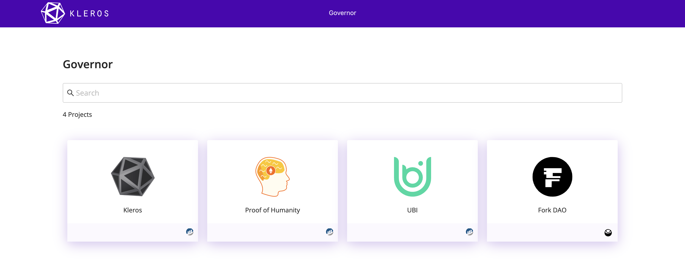

# Governor {#governor}

**Kleros Governor** permite a las DAO y a las organizaciones en la cadena ejecutar decisiones de gobernanza con un respaldo de resolución de disputas integrado. Utiliza un modelo de ejecución optimista: cualquiera puede enviar una lista de transacciones para ejecutar y, si nadie la impugna, las transacciones se ejecutan. Si se envían varias listas en competencia, Kleros Court resuelve el conflicto.

Governor es el mecanismo que utiliza la propia Kleros para gestionar los parámetros del protocolo, las configuraciones de los tribunales y las actualizaciones de los contratos.

---

## V1: protocolo en producción {#v1-production-protocol}

Governor V1 funciona en la red principal de Ethereum. Se desplegó como parte de la transición a una gobernanza totalmente descentralizada con votación en Snapshot y ejecución en la cadena (consulta [KIP-30](https://forum.kleros.io/t/kip-30-migrate-governance-to-snapshot/469)). Utiliza el mismo modelo de ejecución optimista que V2, con una implementación más sencilla:

1. Una votación de gobernanza se aprueba en Snapshot
2. Cualquiera envía a Governor una lista de transacciones que implementa los cambios aprobados
3. Durante el periodo de envío, otras personas pueden enviar listas en competencia
4. Si solo se envía una lista, se ejecuta automáticamente
5. Si se envían varias listas, una disputa en Kleros Court determina cuál es la correcta
6. Tras la resolución, las transacciones de la lista ganadora se ejecutan en la cadena

---

## V2: actualización de nueva generación {#v2-next-gen-upgrade}

Governor V2 funciona en Arbitrum y mantiene el mismo modelo de ejecución optimista. Las secciones siguientes describen la implementación de V2.

---

## Capacidades clave {#key-capabilities}

<CardGroup cols={3}>
  <Card title="Ejecución optimista" icon="forward">
    Las transacciones se ejecutan automáticamente si nadie las impugna durante el periodo de envío
  </Card>
  <Card title="Resolución de disputas" icon="gavel">
    Los jurados de Kleros Court resuelven las listas de transacciones en competencia
  </Card>
  <Card title="Envío sin permisos" icon="plus">
    Cualquiera puede enviar una lista de transacciones aportando un depósito
  </Card>
</CardGroup>

---

## Cómo funciona {#how-it-works}

Governor funciona por sesiones. Cada sesión sigue este flujo:

<Steps>
  <Step title="Periodo de envío">
    Cualquiera puede enviar una lista de transacciones que quiere que Governor ejecute. Cada envío requiere un depósito y debe realizarse dentro de la primera mitad del plazo de envío (las retiradas también solo son posibles durante esta primera mitad).
  </Step>
  <Step title="Aprobación / disputa">
    Cuando termina el periodo de envío, ocurre una de estas tres cosas:

    - **Ningún envío:** la sesión se cierra y comienza una nueva.
    - **Un envío:** la lista de transacciones se aprueba y se ejecuta. Se devuelve el depósito de quien la envió.
    - **Varios envíos:** se crea una disputa en Kleros Court. Los jurados deciden qué lista debe ejecutarse. El número de opciones es igual al número de listas enviadas.
  </Step>
  <Step title="Ejecución">
    La lista de transacciones aprobada se ejecuta en la cadena. Las transacciones de la lista se procesan de forma secuencial.
  </Step>
</Steps>

### Retirar un envío {#withdrawing-a-submission}

Quienes envían pueden retirar su lista de transacciones durante la primera mitad del periodo de envío, siempre que sea dentro del `withdrawTimeout` posterior al envío. Así recuperan su depósito y la lista deja de tenerse en cuenta.

---

## Casos de uso {#use-cases}

**Gobernanza del protocolo**: Kleros utiliza Governor para gestionar los parámetros de sus propios contratos: actualizar las configuraciones de los tribunales, incluir tokens de pago de tasas en la lista blanca, ajustar los parámetros de staking y actualizar contratos.

**Ejecución de DAO**: cualquier DAO puede usar Governor para ejecutar operaciones de tesorería, cambios de parámetros o llamadas a contratos con una red de seguridad de resolución de disputas.

**Alternativa a la multifirma**: Governor ofrece una alternativa descentralizada a las billeteras multifirma para las organizaciones que quieren una ejecución de la gobernanza transparente y sin permisos.

---

## En qué se diferencia Governor de la gobernanza tradicional {#how-governor-differs-from-traditional-governance}

| Tradicional | Kleros Governor |
|-------------|----------------|
| Las propuestas se votan antes de ejecutarse | Las transacciones se envían de forma optimista y solo se impugnan si hay controversia |
| Conjunto fijo de votantes (poseedores de tokens, firmantes de la multifirma) | Cualquiera puede enviar; los jurados de Kleros resuelven las disputas |
| A menudo lenta (periodos de votación de varios días) | Rápida si no hay impugnación; la resolución de disputas solo añade tiempo cuando es necesaria |
| Requiere quórum | No se necesita quórum para envíos únicos |

---

## ¿Qué sigue? {#what’s-next}

<CardGroup cols={2}>
  <Card title="Usa Governor" icon="arrow-right" href="https://governor.kleros.io">
    Abre la aplicación Governor
  </Card>
  <Card title="Descripción general de la gobernanza" icon="landmark" href="/es/governance/overview">
    Conoce la gobernanza de Kleros y las KIP
  </Card>
</CardGroup>
