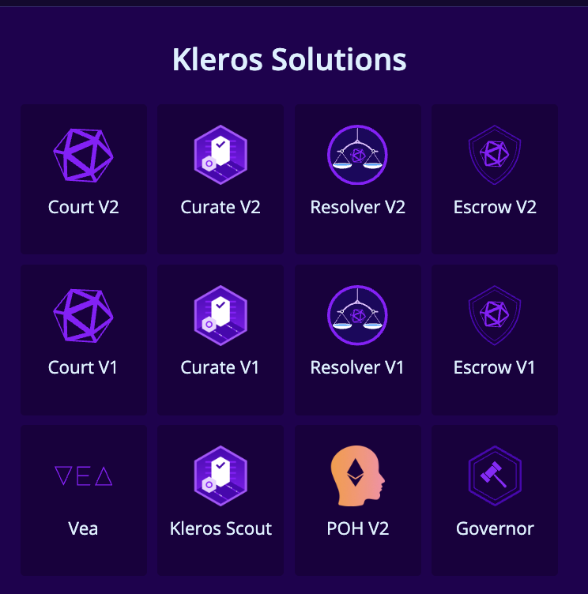

# Productos de Kleros {#kleros-products}

Kleros ofrece un conjunto de aplicaciones descentralizadas que utilizan Kleros Court para resolver disputas. Esta página ofrece una descripción general de cada producto y de su versión actual del protocolo.

---

## Guía de versiones del protocolo {#protocol-version-guide}

Los productos de Kleros funcionan sobre dos versiones del protocolo. **V1** es el protocolo probado en producción en Ethereum L1; **V2** es la actualización de nueva generación en Arbitrum L2. La siguiente tabla muestra la situación actual de cada producto.

| Producto | Disponible en | Notas |
|---------|--------------|-------|
| [Court](/es/court/overview) | V1 • V2 | V1 en Ethereum, V2 en Arbitrum |
| [Curate](/es/products/curate) | V1 • V2 | Classic (V1), Light (V1), Stake Curate (infraestructura V1) |
| [Escrow](/es/products/escrow) | V1 • V2 | V2 añade la negociación de acuerdos y la compatibilidad con varios tokens |
| [Governor](/es/products/governor) | V1 • V2 | Ejecución optimista en ambas versiones |
| [Scout](/es/products/scout) | V1 | Frontend que lee de los registros de Curate V1 |
| [Reality (oráculo)](/es/products/reality) | V1 | Respaldo de arbitraje de Kleros para Reality.eth |
| [SafeSnap](/es/products/safesnap) | V1 | 🔄 V2 próximamente |
| [Proof of Humanity](/es/products/proof-of-humanity) | V1 | Consulta la nota a continuación |
| [Foresight](/es/products/foresight) | V2 | Plataforma experimental de mercados de predicción |

<Warning>
  **Nota sobre Proof of Humanity:** PoH tiene su propia actualización de producto "V2" (compatibilidad entre cadenas, experiencia de usuario mejorada), pero sigue utilizando el **protocolo Kleros V1** para resolver disputas. No confundas "PoH 2.0" (el producto) con "Kleros V2" (el protocolo).
</Warning>

---

## Productos en producción {#production-products}

<CardGroup cols={2}>

  <Card title="Court" icon="scale-balanced" href="/es/court/overview">
    **El corazón de Kleros**
    
    Resolución descentralizada de disputas mediante jurados colectivos, incentivos criptoeconómicos y teoría de juegos.
    
    - Haz staking de PNK para convertirte en jurado
    - Vota en disputas y gana recompensas
    - Crea disputas mediante el Resolver integrado
  </Card>

  <Card title="Curate" icon="list-check" href="/es/products/curate">
    **Registros descentralizados**
    
    Crea y mantén listas curadas por la comunidad con incentivos económicos y resolución de disputas.
    
    - Classic Curate (V1), Light Curate (V1), Stake Curate (infraestructura V1)
    - Listas de tokens, etiquetas de direcciones, registros de contratos
    - Consulta los datos de los registros mediante el subgraph
  </Card>

  <Card title="Escrow" icon="handshake" href="/es/products/escrow">
    **Transacciones seguras**
    
    Mantén fondos en depósito con resolución de disputas integrada si las partes no están de acuerdo.
    
    - Pagos sin necesidad de confianza entre las partes
    - Liberación automática o disputa
    - Pagos por hitos
  </Card>

  <Card title="Governor" icon="landmark" href="/es/products/governor">
    **Ejecución de la gobernanza de DAO**
    
    Ejecuta las decisiones de gobernanza con un respaldo de resolución de disputas para las acciones impugnadas.
    
    - Ejecución optimista
    - Periodo de impugnación para las propuestas
    - Integración con Snapshot
  </Card>

  <Card title="Scout" icon="shield-check" href="/es/products/scout">
    **Verificación de contratos y tokens**
    
    Información de seguridad curada por la comunidad sobre contratos inteligentes, tokens y dApps. Se integra con MetaMask Snaps.
    
    Scout es un frontend que lee de los registros de Curate.
  </Card>

  <Card title="Reality (oráculo)" icon="database" href="/es/products/reality">
    **Reality.eth + Kleros**
    
    Sistema de oráculo colectivo en el que Kleros actúa como capa de arbitraje final para las respuestas impugnadas.
    
    - Impulsa el Zodiac Reality Module
    - Kleros como respaldo de arbitraje
  </Card>

  <Card title="SafeSnap" icon="vault" href="/es/products/safesnap">
    **Ejecución de DAO sin confianza**
    
    Ejecuta los resultados de las votaciones de Snapshot sobre una tesorería de Gnosis Safe, con Kleros Court como árbitro final.
    
    - Votación en Snapshot → ejecución en Safe
    - Impugnación sin permisos con fianzas
    - Kleros como respaldo de arbitraje
  </Card>

  <Card title="Proof of Humanity" icon="fingerprint" href="/es/products/proof-of-humanity">
    **Registro de identidad resistente a ataques Sybil**
    
    Un registro de humanos verificados que combina la verificación por vídeo, el aval social y la resolución de disputas.
    
    Utiliza el protocolo Kleros V1 para resolver disputas.
  </Card>

  <Card title="Foresight" icon="chart-line" href="/es/products/foresight">
    **Toma de decisiones mediante mercados de predicción**
    
    Plataforma de mercados de predicción construida sobre Seer, con Kleros Court como respaldo para los resultados impugnados.
    
    <Badge>Experimental</Badge>
  </Card>

</CardGroup>

---

## Variantes de Curate {#curate-variants}

Curate es una familia de tres variantes:

- **Classic Curate** (V1): Token-Curated Registry completo con esquemas complejos
- **Light Curate** (V1): TCR simplificado para un mayor volumen
- **Stake Curate** (infraestructura V1): verificación continua con depósitos permanentes

Consulta [Curate](/es/products/curate) para más detalles.

---

## Versiones V1 de los productos {#v1-product-versions}

Las versiones V1 de estos productos siguen en producción. Cada página de producto anterior trata primero los detalles de V1 y después lo que cambió en V2.

| Producto | Versión V2 |
|---------|-----------|
| [Court V1](/legacy/court-v1) | [Court V2](/es/court/overview) disponible |
| [Resolver V1](/legacy/resolver-v1) | Integrado en la interfaz de Court V2 |
| [Curate V1](/legacy/curate-v1) | [Curate V2](/es/products/curate) disponible. Classic Curate está en proceso de retirada (las listas existentes siguen funcionando, pero no se crean nuevas listas Classic). Light Curate y Stake Curate siguen siendo compatibles |
| [Escrow V1](/legacy/escrow-v1) | [Escrow V2](/es/products/escrow) disponible |
| [Governor V1](/legacy/governor-v1) | [Governor V2](/es/products/governor) disponible |

---

## Productos retirados {#retired-products}

Estos productos ya no se mantienen activamente. Aparecen en **Productos retirados** en la barra lateral.

| Producto | Descripción | Estado |
|---------|-------------|--------|
| [Moderate](/es/legacy/retired/moderate) | Bot de moderación para Telegram | Retirado |
| [Linguo](/es/legacy/retired/linguo) | Mercado de traducciones | Retirado |
| [Tokens](/es/legacy/retired/tokens) | Interfaz de envío de tokens | Sustituido por el registro de tokens de Curate |

---

## Próximos pasos {#next-steps}

<CardGroup cols={3}>
  <Card title="Construye sobre Kleros" icon="code" href="/es/developers/overview">
    Guías de integración para desarrolladores
  </Card>
  <Card title="Aprende los conceptos" icon="lightbulb" href="/es/concepts/dispute-resolution">
    Comprende cómo funciona Kleros
  </Card>
</CardGroup>
