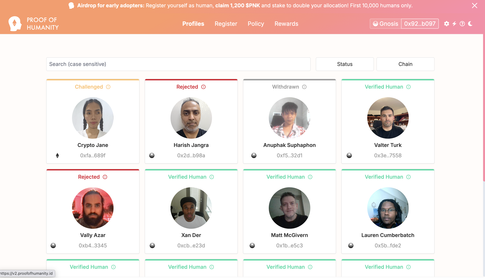

# Proof of Humanity {#proof-of-humanity}

<Warning>
Proof of Humanity utiliza el **protocolo Kleros V1** para resolver disputas, incluso en la versión de producto "PoH 2.0". El "2.0" se refiere a mejoras del producto (compatibilidad entre cadenas, experiencia de usuario mejorada), no a la versión del protocolo de arbitraje de Kleros subyacente.
</Warning>

**Proof of Humanity (PoH)** es un registro descentralizado y resistente a ataques Sybil de humanos verificados. Combina la verificación por vídeo, el aval de la comunidad y la resolución de disputas de Kleros para crear un sistema fiable de prueba de personalidad (proof of personhood), en el que cada persona verificada está vinculada a una identidad digital única e intransferible.

PoH actúa como la capa de verificación humana de la Web3: permite a las aplicaciones distinguir a los humanos reales de los bots y las cuentas duplicadas para lograr una gobernanza justa, sistemas de reputación, recompensas, experiencias restringidas por identidad, renta básica universal (UBI) y muchos otros casos de uso centrados en las personas.

---

## Cómo funciona {#how-it-works}

<Steps>
  <Step title="Envía un perfil">
    Regístrate enviando un vídeo en el que sostienes la dirección de tu billetera, junto con una foto de perfil, un nombre visible y un depósito reembolsable.
  </Step>
  <Step title="Consigue un aval">
    Un usuario registrado de Proof of Humanity debe avalar tu envío y confirmar que eres un humano único.
  </Step>
  <Step title="Periodo de impugnación (en revisión)">
    Tu envío entra en un periodo de impugnación durante el cual cualquiera puede disputarlo. Kleros Court resuelve las impugnaciones.
  </Step>
  <Step title="Conviértete en un humano verificado">
    Si nadie impugna tu envío, o si ganas la disputa, te conviertes en un humano verificado y recibes un PoH Soulbound ID único. Tu registro caduca periódicamente y debe renovarse para seguir activo.
  </Step>
</Steps>

---

## PoH 2.0 (actualización del producto) {#poh-2-0-product-update}

La actualización de producto PoH 2.0 introdujo varias mejoras para que el registro sea más accesible, seguro e interoperable:

**Menor coste de registro**: PoH 2.0 se desplegó en Gnosis Chain, lo que redujo considerablemente las tasas de registro y lo hizo más accesible para usuarios de todo el mundo.

**PoH Soulbound IDs**: cada humano verificado recibe un PoH Soulbound ID único e intransferible, que proporciona una identidad digital persistente que puede recuperarse aunque se pierda la billetera original.

**Perfiles entre cadenas**: los perfiles pueden existir en varias cadenas (Ethereum, Gnosis Chain), lo que mejora la accesibilidad y la interoperabilidad. Los usuarios pueden mantener y transferir su identidad verificada entre distintas cadenas.

**Experiencia de usuario mejorada**: se simplificó el proceso de registro con una interfaz más sencilla, mejores indicaciones y un seguimiento del estado más claro.

<Note>
Son mejoras a nivel de producto. La resolución de disputas subyacente sigue utilizando el protocolo de arbitraje Kleros V1.
</Note>

---

## Casos de uso {#use-cases}

Proof of Humanity permite a las aplicaciones distinguir a los humanos reales de los bots, las cuentas duplicadas y los agentes autónomos. A continuación se presentan algunas de las muchas formas en que los proyectos pueden integrar PoH.

**Verificación humana para la era de la IA**: a medida que los agentes de IA son más capaces de interactuar en línea y en la cadena, PoH permite a las aplicaciones distinguir de forma fiable a los humanos reales de los bots y los agentes autónomos, lo que preserva la confianza en los sistemas digitales.

**Gobernanza y DAO**: PoH permite una gobernanza de una persona, un voto al verificar que cada participante es un humano único, lo que ayuda a las DAO y las comunidades a evitar los ataques Sybil y la manipulación de la gobernanza.

**Fairdrops (recompensas y airdrops justos)**: PoH ayuda a garantizar que las recompensas, subvenciones, incentivos y airdrops se repartan de forma justa al limitar la participación a un humano verificado por identidad.

**Renta básica universal**: PoH proporciona un registro fiable de humanos verificados, lo que permite a los programas de UBI repartir los fondos de forma justa y evitar las reclamaciones duplicadas.

**Mercados de predicción**: los mercados de predicción pueden usar PoH para crear mercados solo para humanos, limitar la participación a personas verificadas o recompensar a contribuyentes humanos únicos.

Proof of Humanity también da soporte a la recuperación social, las credenciales digitales, las redes sociales descentralizadas y muchas otras innovaciones centradas en las personas.

---

## Empieza a construir {#start-building}

Proof of Humanity es un proyecto de código abierto. Puedes empezar a integrarlo en tu proyecto o construir sobre él libremente.

Si necesitas ayuda, contacta con Coopérative Kleros en contact@kleros.io, [Discord](https://discord.gg/MhXQGCyHd9) o [Telegram](https://t.me/kleros).

---

## ¿Qué sigue? {#what’s-next}

<CardGroup cols={2}>
  <Card title="Regístrate en PoH" icon="user-check" href="https://v2.proofofhumanity.id/">
    Inicia tu registro en Proof of Humanity
  </Card>
  <Card title="Guía de integración de PoH" icon="code" href="/es/developers/products/poh/integration">
    Verifica usuarios humanos en tu aplicación
  </Card>
</CardGroup>
