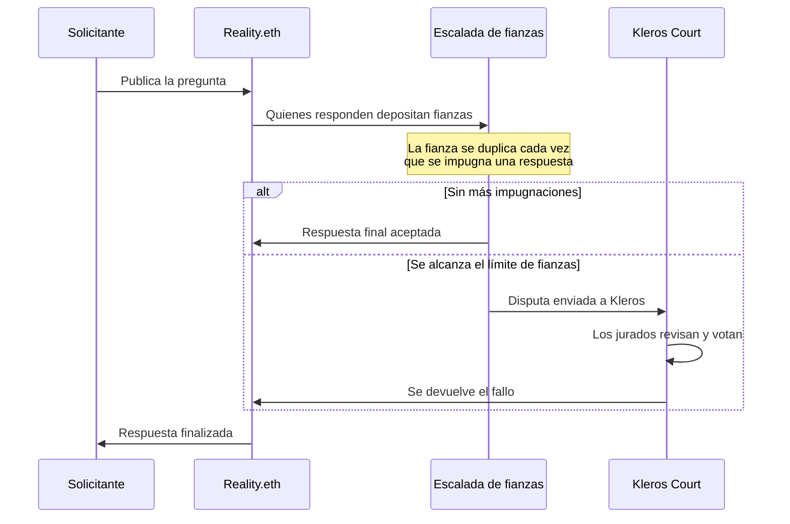

# Reality (Oráculo)

<Note>Reality Module utiliza actualmente **Kleros V1** para el arbitraje. La integración con V2 está prevista.</Note>

**Reality.eth** es un sistema de oráculo colectivo en el que cualquiera puede publicar preguntas y respuestas respaldadas por fianzas económicas. Kleros actúa como la **capa final de arbitraje**: cuando una respuesta en Reality.eth se disputa y la escalada de fianzas alcanza su límite, la disputa se envía a Kleros Court para su resolución.

Esta combinación impulsa **[SafeSnap](/es/products/safesnap)**: gobernanza de DAO sin necesidad de confianza en la que el Zodiac Reality Module ejecuta transacciones en cadena basadas en los resultados de las votaciones de Snapshot, con Kleros como árbitro final.

---

## Cómo funcionan Kleros + Reality.eth

<Steps>
  <Step title="Se publica la pregunta">
    Se publica una pregunta en Reality.eth con una recompensa y con Kleros configurado como árbitro.
  </Step>
  <Step title="Escalada de fianzas">
    Quienes responden depositan fianzas cada vez mayores para afirmar su respuesta. Cada impugnador debe al menos duplicar la fianza anterior. Esta escalada económica filtra las respuestas de baja confianza.
  </Step>
  <Step title="Arbitraje de Kleros (si es necesario)">
    Si la escalada de fianzas alcanza el umbral de arbitraje, la disputa se envía a Kleros Court. Los jurados evalúan la pregunta y las respuestas aportadas y luego votan por el resultado correcto. Court construye las opciones de respuesta a partir de la pregunta y la plantilla en cadena. Si la página del caso muestra un aviso de que otras interfaces muestran opciones diferentes, vota según las opciones mostradas en Court. Si no se pudieron verificar las opciones, lee la pregunta con atención y, en caso de duda, niégate a arbitrar.
  </Step>
  <Step title="Respuesta finalizada">
    La respuesta ganadora, ya sea determinada por la escalada de fianzas o por el fallo de Kleros, se convierte en el resultado final del oráculo.
  </Step>
</Steps>

---

## SafeSnap (gobernanza de DAO)

El uso más destacado de Reality.eth + Kleros es **SafeSnap**: permite a las DAO ejecutar los resultados de las votaciones de Snapshot directamente sobre una tesorería Gnosis Safe, con Reality.eth verificando el resultado y Kleros Court como respaldo de arbitraje, sin ninguna multifirma de confianza en el proceso.

Consulta la **[página del producto SafeSnap](/es/products/safesnap)** para conocer sus componentes, el flujo completo y la configuración.

---

## Casos de uso

**Ejecución de la gobernanza de DAO**: Ejecuta en cadena los resultados de las propuestas de Snapshot con una red de seguridad de resolución de disputas.

**Resolución de mercados de predicción**: Liquida los resultados de los mercados mediante respuestas colectivas con Kleros como respaldo final.

**Oráculos entre protocolos**: Proporciona datos verificados a contratos inteligentes con garantías económicas y resolución descentralizada de disputas.

---

## ¿Qué sigue?

<CardGroup cols={2}>
  <Card title="SafeSnap" icon="vault" href="/es/products/safesnap">
    Ejecución sin necesidad de confianza de votaciones de Snapshot sobre una tesorería Safe
  </Card>
  <Card title="Reality.eth" icon="globe" href="https://reality.eth.limo">
    Explora la interfaz del oráculo Reality.eth
  </Card>
  <Card title="Wiki de Zodiac" icon="book" href="https://zodiac.wiki/index.php/Category:Reality_Module">
    Conoce el Reality Module para Gnosis Safe
  </Card>
</CardGroup>
