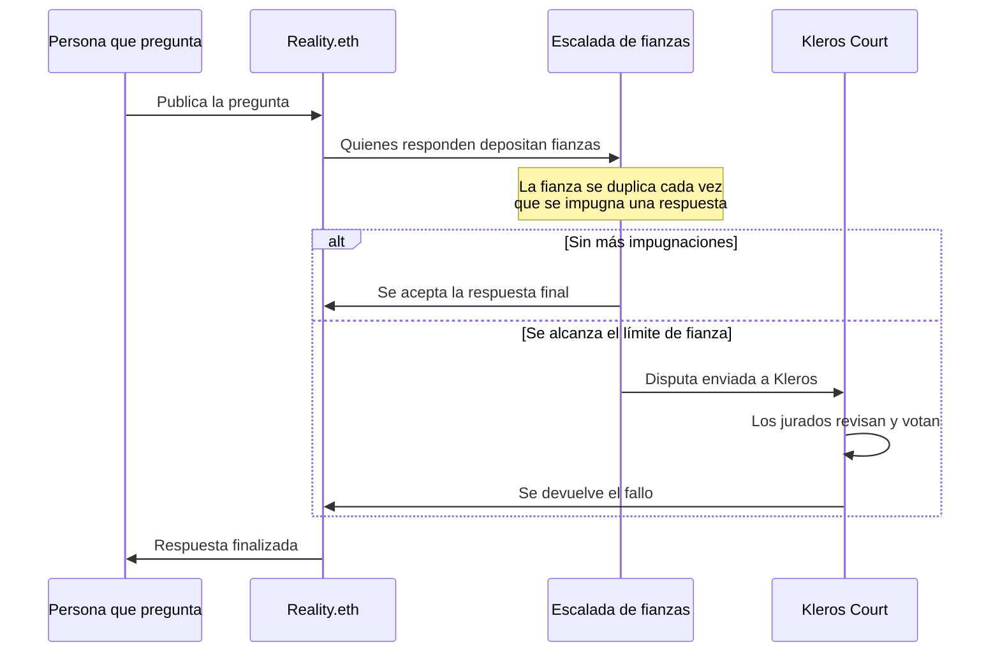

# Reality (oráculo) {#reality-oracle}

<Note>El Reality Module utiliza actualmente **Kleros V1** para el arbitraje. Está prevista la integración con V2.</Note>

**Reality.eth** es un sistema de oráculo colectivo en el que cualquiera puede publicar preguntas y respuestas respaldadas por fianzas económicas. Kleros actúa como **capa de arbitraje final**: cuando se impugna una respuesta en Reality.eth y la escalada de fianzas alcanza su límite, la disputa se envía a Kleros Court para su resolución.

Esta combinación impulsa **[SafeSnap](/es/products/safesnap)**, una gobernanza de DAO sin necesidad de confianza en la que el Zodiac Reality Module ejecuta transacciones en la cadena según los resultados de las votaciones de Snapshot, con Kleros como árbitro final.

---

## Cómo funcionan Kleros + Reality.eth {#how-kleros-+-reality-eth-works}

<Steps>
  <Step title="Se publica la pregunta">
    Se publica una pregunta en Reality.eth con una recompensa y con Kleros como árbitro.
  </Step>
  <Step title="Escalada de fianzas">
    Quienes responden depositan fianzas cada vez mayores para afirmar su respuesta. Cada impugnante debe al menos duplicar la fianza anterior. Esta escalada económica filtra las respuestas poco fiables.
  </Step>
  <Step title="Arbitraje de Kleros (si es necesario)">
    Si la escalada de fianzas alcanza el umbral de arbitraje, la disputa se envía a Kleros Court. Los jurados evalúan la pregunta y las respuestas aportadas y, después, votan el resultado correcto. Court construye las opciones de respuesta a partir de la pregunta y la plantilla en la cadena. Si la página del caso muestra un aviso de que otras interfaces muestran opciones distintas, vota según las opciones que muestra Court. Si no se pudieron verificar las opciones, lee la pregunta con atención y, en caso de duda, niégate a arbitrar.
  </Step>
  <Step title="Respuesta finalizada">
    La respuesta ganadora, ya la determine la escalada de fianzas o el fallo de Kleros, se convierte en el resultado final del oráculo.
  </Step>
</Steps>

---

## SafeSnap (gobernanza de DAO) {#safesnap-dao-governance}

El uso más destacado de Reality.eth + Kleros es **SafeSnap**: permite a las DAO ejecutar los resultados de las votaciones de Snapshot directamente sobre una tesorería de Gnosis Safe, con Reality.eth verificando el resultado y Kleros Court como respaldo de arbitraje, sin una multifirma de confianza en el proceso.

Consulta la **[página del producto SafeSnap](/es/products/safesnap)** para conocer sus componentes, el flujo completo y la configuración.

---

## Casos de uso {#use-cases}

**Ejecución de la gobernanza de DAO**: ejecuta en la cadena los resultados de las propuestas de Snapshot con una red de seguridad de resolución de disputas.

**Resolución de mercados de predicción**: liquida los resultados de los mercados con respuestas colectivas y Kleros como respaldo final.

**Oráculos entre protocolos**: proporciona datos verificados a los contratos inteligentes con garantías económicas y resolución descentralizada de disputas.

---

## ¿Qué sigue? {#what’s-next}

<CardGroup cols={2}>
  <Card title="SafeSnap" icon="vault" href="/es/products/safesnap">
    Ejecución sin confianza de las votaciones de Snapshot sobre una tesorería de Safe
  </Card>
  <Card title="Reality.eth" icon="globe" href="https://reality.eth.limo">
    Explora la interfaz del oráculo Reality.eth
  </Card>
  <Card title="Zodiac Wiki" icon="book" href="https://zodiac.wiki/index.php/Category:Reality_Module">
    Conoce el Reality Module para Gnosis Safe
  </Card>
</CardGroup>
