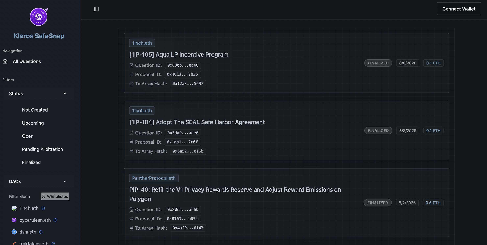
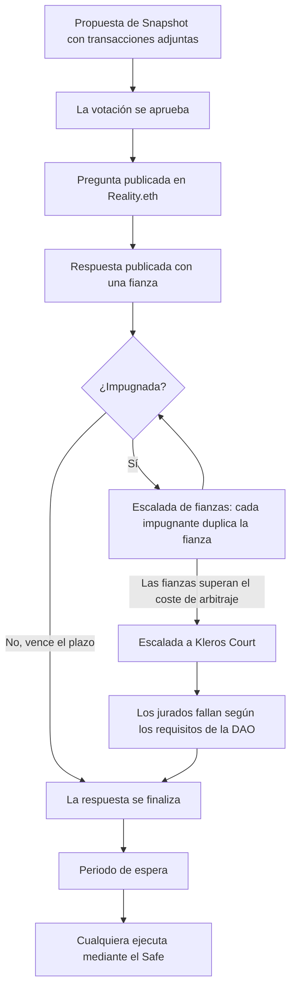

# SafeSnap {#safesnap}



<Note>SafeSnap utiliza actualmente **Kleros V1** para el arbitraje. Está prevista la integración con V2.</Note>

**SafeSnap** permite a una DAO ejecutar el resultado de una votación de Snapshot fuera de la cadena directamente sobre su tesorería de Safe, sin tener que confiar en una multifirma para pulsar el botón. Las propuestas se ejecutan de forma optimista, y Kleros Court resuelve cualquier disputa sobre si la ejecución coincide con la votación.

Kleros mantiene SafeSnap de forma activa, incluidos los proxies de árbitro que lo conectan con el tribunal y las [herramientas de supervisión](#monitoring-is-not-optional) que permiten operarlo con seguridad.

---

## El problema que resuelve {#the-problem-it-solves}

Una DAO vota en Snapshot. Los votos de Snapshot son mensajes firmados fuera de la cadena: gratuitos, sin gas e invisibles para la blockchain. Mientras tanto, la tesorería está en un Safe que solo responde a transacciones en la cadena.

Algo tiene que conectar ambos mundos. Tradicionalmente, es un pequeño grupo de firmantes de una multifirma que ejecuta manualmente lo que decidió la votación. Esto reintroduce justo el supuesto de confianza que la DAO intentaba eliminar: los firmantes pueden retrasar, negarse, ejecutar algo distinto o coludir.

SafeSnap sustituye a esos firmantes por un oráculo más un juego económico, respaldado por un tribunal.

---

## Capacidades clave {#key-capabilities}

<CardGroup cols={3}>
  <Card title="Ejecución sin confianza" icon="key">
    Los resultados de las votaciones de Snapshot se ejecutan sobre el Safe sin ningún firmante de multifirma en el proceso
  </Card>
  <Card title="Impugnación sin permisos" icon="hand">
    Cualquiera puede disputar una solicitud de ejecución incorrecta depositando una fianza
  </Card>
  <Card title="Respaldo del tribunal" icon="gavel">
    Los jurados de Kleros fallan sobre las propuestas impugnadas según el propio documento de requisitos de la DAO
  </Card>
</CardGroup>

---

## Componentes {#components}

| Componente | Dónde reside | Qué hace |
| --- | --- | --- |
| **Plugin SafeSnap** | Espacio de Snapshot | Permite a quien propone adjuntar un lote de transacciones a una propuesta |
| **Zodiac Reality Module** | Safe (como módulo) | Tiene derechos de ejecución sobre el Safe; lee el resultado del oráculo |
| **Reality.eth** | Oráculo en la cadena | Responde "¿se aprobó esta propuesta y coincide esta carga útil?" |
| **Realitio Arbitration Proxy** | En la cadena | Conecta Reality.eth con Kleros Court; añade apelaciones con financiación colectiva |
| **Kleros Court** | Ethereum (Kleros V1) | Falla sobre las respuestas impugnadas |
| **Documento de requisitos de la DAO** | IPFS, mediante un registro de texto de ENS | El reglamento con el que los jurados juzgan las propuestas |

<Info>
  Un **módulo** de Zodiac es un contrato al que se concede permiso para hacer que un Safe ejecute transacciones. A diferencia de un firmante, un módulo ejecuta en función del código, no de una firma.
</Info>

---

## Cómo funciona {#how-it-works}



<Steps>
  <Step title="Propón con una carga útil">
    Quien propone crea una propuesta en Snapshot y usa el plugin SafeSnap para adjuntar el lote exacto de transacciones que deben ejecutarse si se aprueba.
  </Step>
  <Step title="Vota fuera de la cadena">
    La votación se realiza con normalidad en Snapshot: fuera de la cadena y sin gas.
  </Step>
  <Step title="Publica la pregunta en Reality.eth">
    Una vez aprobada la votación, cualquiera puede abrir una pregunta en Reality.eth que pregunte si la propuesta vinculada se aprobó, si contiene exactamente esta carga útil y si la carga útil hace lo que describe la propuesta, según el documento de requisitos de la DAO.
  </Step>
  <Step title="Escalada de fianzas">
    Alguien responde y deposita una fianza. Para contradecir una respuesta, quien impugna debe depositar al menos el doble de la fianza anterior. La fianza de quien pierde va a quien gana, de modo que afirmar una respuesta falsa es caro e impugnar una respuesta falsa es rentable. La mayoría de las preguntas se resuelven aquí sin llegar nunca al tribunal.
  </Step>
  <Step title="Arbitraje de Kleros (solo si es necesario)">
    Cuando las fianzas crecen tanto que pagar las tasas de arbitraje resulta más barato que volver a duplicarlas, cualquiera de las partes puede escalar a Kleros Court. Los jurados leen la propuesta, la carga útil y el documento de requisitos de la DAO y, después, votan. El fallo se escribe de vuelta en Reality.eth y es vinculante.
  </Step>
  <Step title="Periodo de espera">
    Una vez finalizada la respuesta, debe transcurrir un periodo de espera antes de la ejecución. Es una ventana de seguridad deliberada durante la que todavía se puede reaccionar ante un resultado claramente no válido.
  </Step>
  <Step title="Ejecuta">
    Cuando termina el periodo de espera, cualquiera puede activar la ejecución desde el panel de SafeSnap de la propuesta de Snapshot. El Reality Module indica al Safe que ejecute las transacciones. No interviene la aprobación de ningún firmante.
  </Step>
</Steps>

---

## El documento de requisitos de la DAO {#the-dao-requirements-document}

Este es el paso de configuración más importante y el que más a menudo se omite.

Los jurados no conocen las reglas de tu DAO. Cuando se impugna una propuesta, necesitan un estándar escrito con el que juzgarla: umbrales de quórum, reglas de mayoría cualificada para determinados tipos de acciones, requisitos de formato o cualquier cosa que haga que una propuesta sea válida o no válida en tu DAO.

Ese estándar es un documento subido a IPFS y registrado como registro de texto `daorequirements` en el nombre ENS del espacio de Snapshot:

```
gnosis.eth → daorequirements → /ipfs/QmYourPolicyDoc...
```

<Warning>
  Si el registro `daorequirements` no está configurado, los jurados no tienen ninguna base para fallar y las disputas pueden resolverse de forma ambigua. Configura este registro antes de activar el módulo.
</Warning>

---

## La supervisión no es opcional {#monitoring-is-not-optional}

Cualquiera puede publicar una pregunta en Reality.eth y responderla, incluso para una propuesta que nunca se aprobó. La fianza y el tribunal solo protegen la tesorería **si alguien acude a impugnar antes de que venza el plazo**.

Por eso la supervisión es una parte esencial del modelo de seguridad, no un extra opcional.

Kleros mantiene [`zodiac-bots`](https://github.com/kleros/zodiac-bots), un servicio de código abierto que vigila los Zodiac Reality modules y envía alertas a **Slack, Telegram o correo electrónico** cuando aparecen propuestas y respuestas. Hace seguimiento de uno o varios espacios de Snapshot, identificados por su nombre ENS y un bloque inicial:

```bash
SPACES=kleros.eth:3000000,1inch.eth:6000000
```

Los destinatarios de correo electrónico pueden configurarse por espacio, de modo que las alertas de distintas DAO lleguen a bandejas de entrada diferentes.

<Tip>
  Si prefieres no alojarlo tú mismo, servicios de supervisión de terceros como OpenZeppelin Defender pueden vigilar los mismos eventos de Reality.eth.
</Tip>

---

## SafeSnap frente a Kleros Governor {#safesnap-vs-kleros-governor}

Ambos ejecutan decisiones de gobernanza con un respaldo de Kleros, pero resuelven variantes distintas del problema.

| | SafeSnap | [Governor](/es/products/governor) |
| --- | --- | --- |
| **Dónde se vota** | Snapshot (fuera de la cadena) | En cualquier lugar; Governor solo se ocupa de la ejecución |
| **Qué se disputa** | Si la carga útil coincide con la votación | Cuál de varias listas de transacciones en competencia es la correcta |
| **Custodia de la tesorería** | Safe existente | Contrato Governor |
| **Ideal para** | DAO que ya votan en Snapshot con una tesorería en Safe | Protocolos que necesitan el envío sin permisos de cambios de parámetros |
| **Versión del protocolo** | Kleros V1 | Kleros V2 |

---

## Una nota sobre los nombres {#a-note-on-naming}

Circulan tres nombres para cosas estrechamente relacionadas:

- **SafeSnap**: el nombre que Snapshot da al plugin. Una marca heredada que se quedó y sigue siendo el término que más DAO reconocen.
- **Zodiac Reality Module**: el contrato real en la cadena, parte del estándar Zodiac de Gnosis. El nombre técnicamente correcto.
- **Kleros Reality Module**: un Reality Module configurado con un proxy de árbitro de Kleros.

Esta página utiliza "SafeSnap" para el sistema completo y "Reality Module" cuando se refiere específicamente al contrato.

---

## Casos de uso {#use-cases}

**Gestión de la tesorería**: concede subvenciones, paga a colaboradores o reequilibra las tenencias según las votaciones de Snapshot, sin el cuello de botella de los firmantes.

**Descentralización progresiva**: una DAO puede empezar con firmantes y retirarlos más adelante, transfiriendo el control total al módulo una vez que la gobernanza esté probada.

**Cambios de parámetros del protocolo**: ejecuta actualizaciones y cambios de configuración votados por los poseedores de tokens.

---

## Consideraciones conocidas {#known-considerations}

**Cualquiera puede enviar**: el envío sin permisos al Reality Module es una función, pero significa que se pueden publicar preguntas maliciosas. La supervisión y una comunidad activa de impugnantes son lo que lo hace seguro.

**Agotamiento de fianzas**: un atacante con muchos fondos puede forzar rondas repetidas de escalada de fianzas. Escalar a Kleros ofrece una vía de resolución de coste fijo cuando las fianzas se vuelven prohibitivas.

**La votación en Snapshot es fuera de la cadena**: SafeSnap protege el vínculo entre la votación y la ejecución. No protege la votación en sí; eso lo rigen las estrategias y las reglas de quórum del propio Snapshot.

---

## ¿Qué sigue? {#what’s-next}

<CardGroup cols={2}>
  <Card title="Configura SafeSnap" icon="wrench" href="/developers/examples/dao-governance">
    Guía paso a paso de despliegue y configuración
  </Card>
  <Card title="Reality (oráculo)" icon="database" href="/es/products/reality">
    Cómo funcionan por debajo Reality.eth y el arbitraje de Kleros
  </Card>
  <Card title="Documentación de Zodiac" icon="book" href="https://zodiac.wiki/index.php/Category:Reality_Module">
    Referencia oficial del Zodiac Reality Module
  </Card>
  <Card title="Guía de SafeSnap de Snapshot" icon="camera" href="https://docs.snapshot.box/v1-interface/plugins/safesnap-reality">
    Documentación del plugin de Snapshot
  </Card>
</CardGroup>
