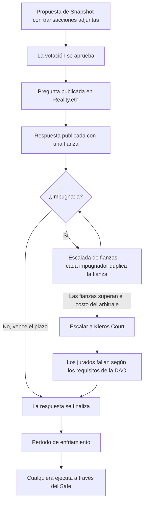

# SafeSnap


<Note>SafeSnap utiliza actualmente **Kleros V1** para el arbitraje. La integración con V2 está prevista.</Note>

**SafeSnap** permite a una DAO ejecutar el resultado de una votación de Snapshot fuera de la cadena directamente sobre su tesorería Safe, sin confiar en que una multifirma pulse el botón. Las propuestas se ejecutan de forma optimista, y cualquier disputa sobre si la ejecución coincide con la votación se resuelve en Kleros Court.

SafeSnap recibe mantenimiento activo por parte de Kleros, incluidos los proxies de árbitro que lo conectan con Court y las [herramientas de monitoreo](#el-monitoreo-no-es-opcional) que permiten operarlo con seguridad.

---

## El problema que resuelve

Una DAO vota en Snapshot. Las votaciones de Snapshot son mensajes firmados fuera de la cadena: gratuitos, sin gas e invisibles para la blockchain. La tesorería, mientras tanto, está en un Safe que solo responde a transacciones en cadena.

Algo tiene que conectar ambos mundos. Convencionalmente, se trata de un pequeño grupo de firmantes de una multifirma que ejecutan manualmente lo que decidió la votación. Esto reintroduce exactamente el supuesto de confianza que la DAO intentaba eliminar: los firmantes pueden retrasar, negarse, ejecutar algo diferente o coludir.

SafeSnap reemplaza a esos firmantes por un oráculo más un juego económico, respaldados por una corte.

---

## Capacidades clave

<CardGroup cols={3}>
  <Card title="Ejecución sin necesidad de confianza" icon="key">
    Los resultados de las votaciones de Snapshot se ejecutan sobre el Safe sin ningún firmante de multifirma en el proceso
  </Card>
  <Card title="Impugnación sin permisos" icon="hand">
    Cualquiera puede disputar una solicitud de ejecución incorrecta depositando una fianza
  </Card>
  <Card title="Respaldo de la corte" icon="gavel">
    Los jurados de Kleros fallan sobre las propuestas impugnadas conforme al documento de requisitos de la propia DAO
  </Card>
</CardGroup>

---

## Componentes

| Componente | Dónde se encuentra | Qué hace |
| --- | --- | --- |
| **Plugin SafeSnap** | Espacio de Snapshot | Permite a un proponente adjuntar un lote de transacciones a una propuesta |
| **Zodiac Reality Module** | Safe (como módulo) | Tiene derechos de ejecución sobre el Safe; lee el resultado del oráculo |
| **Reality.eth** | Oráculo en cadena | Responde "¿se aprobó esta propuesta y coincide esta carga útil?" |
| **Realitio Arbitration Proxy** | En cadena | Conecta Reality.eth con Kleros Court; añade apelaciones financiadas colectivamente |
| **Kleros Court** | Ethereum (Kleros V1) | Falla sobre las respuestas disputadas |
| **Documento de requisitos de la DAO** | IPFS, mediante registro de texto ENS | El reglamento según el cual los jurados juzgan las propuestas |

<Info>
  Un **módulo** de Zodiac es un contrato al que se le concede permiso para hacer que un Safe ejecute transacciones. A diferencia de un firmante, un módulo ejecuta en función de código, no de una firma.
</Info>

---

## Cómo funciona



<Steps>
  <Step title="Proponer con una carga útil">
    Un proponente crea una propuesta en Snapshot y utiliza el plugin SafeSnap para adjuntar el lote exacto de transacciones que debe ejecutarse si se aprueba.
  </Step>
  <Step title="Votar fuera de la cadena">
    La votación se realiza normalmente en Snapshot, fuera de la cadena y sin gas.
  </Step>
  <Step title="Publicar la pregunta en Reality.eth">
    Una vez aprobada la votación, cualquiera puede abrir una pregunta en Reality.eth que plantea si la propuesta vinculada se aprobó, si contiene exactamente esta carga útil y si la carga útil hace lo que describe la propuesta, según el documento de requisitos de la DAO.
  </Step>
  <Step title="Escalada de fianzas">
    Alguien responde y deposita una fianza. Para contradecir una respuesta, un impugnador debe depositar al menos el doble de la fianza anterior. La fianza del perdedor va al ganador, por lo que afirmar una respuesta falsa es caro e impugnar una respuesta falsa es rentable. La mayoría de las preguntas se resuelven aquí sin llegar nunca a Court.
  </Step>
  <Step title="Arbitraje de Kleros (solo si es necesario)">
    Cuando las fianzas crecen lo suficiente como para que pagar las tasas de arbitraje sea más barato que volver a duplicar, cualquiera de las partes puede escalar a Kleros Court. Los jurados leen la propuesta, la carga útil y el documento de requisitos de la DAO, y luego votan. El fallo se escribe de vuelta en Reality.eth y es vinculante.
  </Step>
  <Step title="Enfriamiento">
    Después de que la respuesta se finaliza, debe transcurrir un período de enfriamiento antes de la ejecución. Se trata de una ventana de seguridad deliberada durante la cual todavía se puede reaccionar ante un resultado claramente inválido.
  </Step>
  <Step title="Ejecutar">
    Cuando termina el enfriamiento, cualquiera puede activar la ejecución desde el panel de SafeSnap en la propuesta de Snapshot. El Reality Module indica al Safe que ejecute las transacciones. No interviene la aprobación de ningún firmante.
  </Step>
</Steps>

---

## El documento de requisitos de la DAO

Este es el paso de configuración más importante y también el que se omite con más frecuencia.

Los jurados no conocen las reglas de tu DAO. Cuando una propuesta se disputa, necesitan un estándar escrito con el que juzgarla: umbrales de quórum, reglas de mayoría cualificada para ciertos tipos de acciones, requisitos de formato, cualquier cosa que haga que una propuesta sea válida o inválida en tu DAO.

Ese estándar es un documento subido a IPFS y registrado como registro de texto `daorequirements` en el nombre ENS de tu espacio de Snapshot:

```
gnosis.eth → daorequirements → /ipfs/QmYourPolicyDoc...
```

<Warning>
  Si el registro `daorequirements` no está configurado, los jurados no tienen ninguna base sobre la que fallar y las disputas pueden resolverse de forma ambigua. Configura este registro antes de activar el módulo.
</Warning>

---

## El monitoreo no es opcional

Cualquiera puede publicar una pregunta en Reality.eth y responderla, incluso para una propuesta que nunca se aprobó. La fianza y Court solo protegen la tesorería **si alguien aparece para impugnar antes de que venza el plazo**.

Eso convierte al monitoreo en una pieza fundamental del modelo de seguridad, no en algo opcional.

Kleros mantiene [`zodiac-bots`](https://github.com/kleros/zodiac-bots), un servicio de código abierto que vigila los módulos Zodiac Reality y envía alertas a **Slack, Telegram o correo electrónico** cuando aparecen propuestas y respuestas. Hace seguimiento de uno o más espacios de Snapshot, identificados por su nombre ENS y un bloque inicial:

```bash
SPACES=kleros.eth:3000000,1inch.eth:6000000
```

Los destinatarios de correo electrónico se pueden definir por espacio, de modo que las alertas de distintas DAO se dirijan a distintas bandejas de entrada.

<Tip>
  Si prefieres no alojarlo tú mismo, herramientas de monitoreo de terceros como OpenZeppelin Defender pueden vigilar los mismos eventos de Reality.eth.
</Tip>

---

## SafeSnap frente a Kleros Governor

Ambos ejecutan decisiones de gobernanza con el respaldo de Kleros, pero resuelven problemas de forma distinta.

| | SafeSnap | [Governor](/es/products/governor) |
| --- | --- | --- |
| **Dónde se vota** | Snapshot (fuera de la cadena) | En cualquier lugar; Governor solo se encarga de la ejecución |
| **Qué se disputa** | Si la carga útil coincide con la votación | Cuál de varias listas de transacciones en competencia es la correcta |
| **Custodia de la tesorería** | Safe existente | Contrato de Governor |
| **Ideal para** | DAO que ya votan en Snapshot con una tesorería Safe | Protocolos que necesitan el envío sin permisos de cambios de parámetros |
| **Versión del protocolo** | Kleros V1 | Kleros V2 |

---

## Una nota sobre los nombres

Circulan tres nombres para cosas estrechamente relacionadas:

- **SafeSnap**: el nombre que Snapshot da al plugin. Una marca heredada que se mantuvo y sigue siendo el término que reconocen la mayoría de las DAO.
- **Zodiac Reality Module**: el contrato en cadena real, parte del estándar Zodiac de Gnosis. El nombre técnicamente correcto.
- **Kleros Reality Module**: un Reality Module configurado con un proxy de árbitro de Kleros.

Esta página usa "SafeSnap" para el sistema completo y "Reality Module" cuando se refiere específicamente al contrato.

---

## Casos de uso

**Gestión de tesorería**: Libera subvenciones, paga a colaboradores o reequilibra activos en función de las votaciones de Snapshot, sin el cuello de botella de los firmantes.

**Descentralización progresiva**: Una DAO puede empezar con firmantes y eliminarlos más adelante, transfiriendo el control total al módulo una vez que la gobernanza esté probada.

**Cambios de parámetros del protocolo**: Ejecuta actualizaciones y cambios de configuración votados por los poseedores de tokens.

---

## Consideraciones conocidas

**Cualquiera puede enviar**: El envío sin permisos al Reality Module es una característica, pero implica que se pueden publicar preguntas maliciosas. El monitoreo y una comunidad activa de impugnadores son lo que hace que esto sea seguro.

**Agotamiento de fianzas**: Un atacante con muchos fondos puede forzar rondas repetidas de escalada de fianzas. Escalar a Kleros ofrece una vía de resolución de costo fijo cuando las fianzas se vuelven prohibitivas.

**La votación de Snapshot es fuera de la cadena**: SafeSnap protege el vínculo entre la votación y la ejecución. No protege la votación en sí; eso lo rigen las estrategias y reglas de quórum propias de Snapshot.

---

## ¿Qué sigue?

<CardGroup cols={2}>
  <Card title="Configurar SafeSnap" icon="wrench" href="/es/developers/examples/dao-governance">
    Guía paso a paso de despliegue y configuración
  </Card>
  <Card title="Reality (Oráculo)" icon="database" href="/es/products/reality">
    Cómo funcionan por dentro Reality.eth y el arbitraje de Kleros
  </Card>
  <Card title="Documentación de Zodiac" icon="book" href="https://zodiac.wiki/index.php/Category:Reality_Module">
    Referencia oficial del Zodiac Reality Module
  </Card>
  <Card title="Guía de SafeSnap de Snapshot" icon="camera" href="https://docs.snapshot.box/v1-interface/plugins/safesnap-reality">
    Documentación del plugin de Snapshot
  </Card>
</CardGroup>
