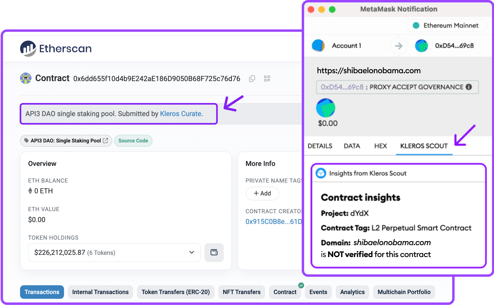

# Colaboraciones de Scout {#scout-partnerships}

Del mismo modo que cualquiera puede enviar, verificar e impugnar entradas, cualquiera puede obtener e integrar en sus plataformas los datos de los registros de Scout. Grandes plataformas Web3 ya aprovechan los datos de Kleros Scout, entre ellas **Ledger** y **Etherscan** como integradores directos, y **MetaMask** mediante un Snap específico.

---

## Por qué integrar los datos de Scout {#why-integrate-scout-data}

- **Mayor confianza de los usuarios** gracias a información verificada sobre los contratos
- **Mejores tasas de finalización de transacciones** gracias a información verificable en tiempo real
- **Datos transparentes e inalterables** procedentes de registros descentralizados en la cadena
- **Prevención del fraude** para tus usuarios
- **Menor responsabilidad legal** al demostrar la diligencia debida
- **Integración fluida** sin interrupciones operativas

---

## Métodos de integración {#integration-methods}

**Visualización directa.** Socios como Ledger y Etherscan muestran los datos de Scout directamente en sus plataformas, como las etiquetas de direcciones y la información de los tokens.

**MetaMask Snap.** Un plugin específico ofrece información en tiempo real sobre el contrato o la dirección concretos durante la transacción, directamente en la billetera MetaMask. Consulta [Scout MetaMask Snap](/es/products/scout-snap).

<Frame caption="A la izquierda, cómo se muestra la información de Kleros Curate en Etherscan. A la derecha, cómo verás la información en tiempo real directamente en tu billetera MetaMask con Scout Snap.">
  
</Frame>
---

## Ponte en contacto {#get-in-touch}

<CardGroup cols={2}>
  <Card title="Detalles técnicos" icon="code" href="/developers/products/scout/overview">
    Arquitectura de Scout e indexación de datos para desarrolladores
  </Card>
  <Card title="Consultas sobre colaboraciones" icon="paper-plane" href="https://t.me/kleros">
    Contacta con el equipo en Telegram
  </Card>
</CardGroup>
