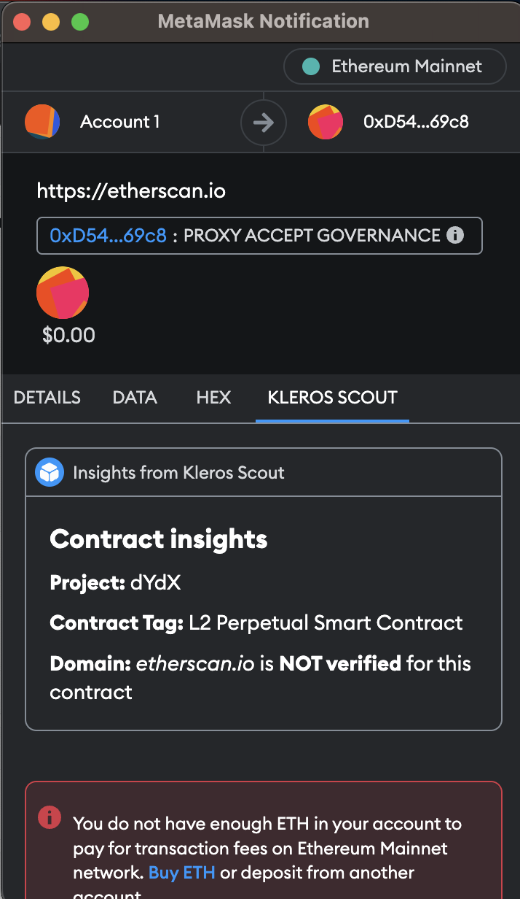

<Frame caption="¡El plugin de Scout en acción!">
  
</Frame>

# Kleros Scout MetaMask Snap {#kleros-scout-metamask-snap}

Kleros Scout está disponible como un **Snap de MetaMask** que permite interactuar con contratos de forma más segura, ya que ofrece información curada por la comunidad sobre los contratos con los que interactúas en la blockchain. En cada transacción, una pestaña muestra información sobre el contrato con el que se interactúa.

El Snap ofrece metadatos de tres registros descentralizados:

- [**Address Tags Registry**](https://curate.kleros.io/tcr/100/0x66260C69d03837016d88c9877e61e08Ef74C59F2): nombres de proyectos y etiquetas de contratos verificados
- [**Contract-Domain Name Registry**](https://curate.kleros.io/tcr/100/0x957A53A994860BE4750810131d9c876b2f52d6E1): emparejamientos verificados entre contratos y dominios
- [**Tokens Registry**](https://curate.kleros.io/tcr/100/0xeE1502e29795Ef6C2D60F8D7120596abE3baD990): información de tokens ERC-20

---

## Instalación {#installation}

<Steps>
  <Step title="Instala desde el directorio de Snaps">
    Instálalo directamente desde el [directorio oficial de Snaps de MetaMask](https://snaps.metamask.io/snap/npm/kleros/scout-snap/) o busca `@kleros/scout-snap`.
  </Step>
  <Step title="Confirma la instalación">
    Aprueba la instalación del Snap en MetaMask. A partir de entonces, la información aparece automáticamente en una pestaña de la transacción cada vez que interactúas con un contrato.
  </Step>
</Steps>

<Frame >
  
</Frame>

---
## ¿Cómo se usan las funciones del Snap? {#how-to-use-the-snap’s-features}
Una vez instalado el Snap de Kleros Scout, en cada transacción o interacción con un contrato verás una pestaña con información sobre ella. Si ves esto tras la instalación, ya estás usando información sobre contratos curada por la comunidad para interactuar de forma segura con las dApps, la función más importante del Snap de Kleros Scout.

<Frame >
  
</Frame>
---
## Limitaciones {#limitations}

El Snap explícitamente **no**:

- Respalda ninguna interacción con contratos
- Utiliza listas blancas centralizadas: todos los datos están curados por la comunidad
- Garantiza una precisión del 100% ni acepta responsabilidad por la información mostrada

---

## Base de conocimientos {#knowledge-base}

<AccordionGroup>
  <Accordion title="¿Cómo se cura la información de los contratos para el Snap de Scout?">
    Kleros Curate es una dApp descentralizada que se usa para crear registros curados abiertos. Los incentivos económicos y la resolución de disputas mantienen la calidad y el cumplimiento de la política de cada entrada.
  </Accordion>
  <Accordion title="¿Quién controla las entradas de la lista?">
    Los miembros de la comunidad envían elementos con depósitos, y cualquiera puede impugnar un envío durante un periodo de revisión. Las entradas no impugnadas se aprueban; las impugnadas pasan a los jurados de Kleros para su resolución. Ninguna parte controla el registro por sí sola.
  </Accordion>
  <Accordion title="¿Por qué se necesitan datos descentralizados sobre los contratos?">
    Las partes centralizadas tienen incentivos económicos para incluir tokens en listas blancas o gestionar etiquetas de direcciones con fines de lucro, lo que crea vulnerabilidades frente al phishing y la manipulación. Los datos descentralizados y protegidos por la comunidad eliminan ese único punto de fallo.
  </Accordion>
  <Accordion title="¿Puedo enviar información sobre contratos?">
    Sí, se fomentan los envíos de la comunidad. Consulta el [tutorial de Scout](/es/tutorials/scout-tutorial) para ver guías paso a paso sobre cómo enviar entradas a los tres registros de metadatos de seguridad.
  </Accordion>
  <Accordion title="¿Qué motiva a las personas a enviar entradas?">
    Dos cosas: los incentivos (Kleros organiza programas periódicos que recompensan a quienes envían entradas de forma activa; consulta [Gana con Scout](/es/products/scout-earn)) y el beneficio para la comunidad (el riesgo de enviar contratos que sabes que son seguros y que has usado es mínimo, y hacerlo protege a miles de usuarios).
  </Accordion>
</AccordionGroup>

---

## Soporte {#support}

- Grupo de soporte en Telegram: [t.me/KlerosCurate](http://t.me/KlerosCurate)
- Correo electrónico: support@kleros.io
- Tiempo de respuesta habitual: 24-48 horas
