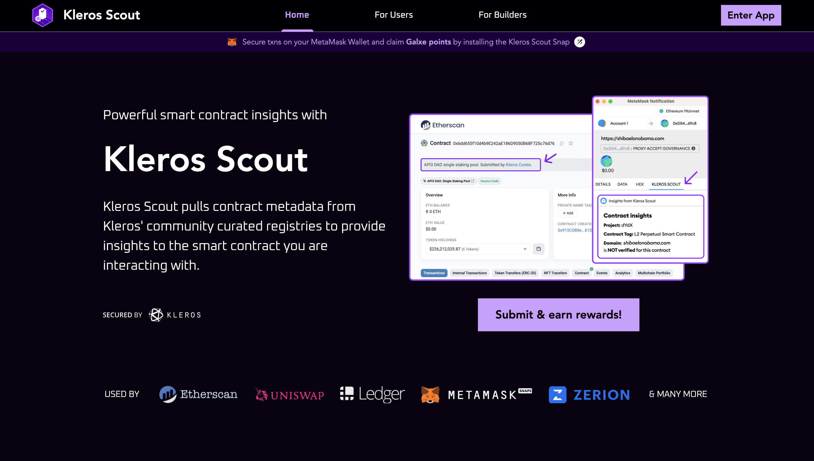

# Scout {#scout}

<Note>Scout forma parte de la familia de productos [Curate](/es/products/curate): es un frontend que lee de los registros de Curate. Sus registros funcionan en **Kleros Court V1 (Gnosis Chain)** y, desde **julio de 2026**, los arbitra el **Curation Court con votación oculta** específico (KIP-87). El rediseño del frontend de Scout V2 está terminado.</Note>

**Kleros Scout** es una aplicación frontend que muestra información de seguridad y metadatos curada por la comunidad sobre contratos inteligentes, tokens y dApps. Agrega datos de varios registros de [Curate](/es/products/curate) para ofrecer a los usuarios una vista unificada de etiquetas de direcciones, etiquetas de contratos e información de tokens.

Scout es la capa pública que se sitúa sobre los registros descentralizados de Curate: piensa en ella como un explorador de solo lectura que pone los datos de los registros al alcance de billeteras, exploradores de bloques y usuarios finales.

---

## Capacidades clave {#key-capabilities}

<CardGroup cols={3}>
  <Card title="Etiquetado de direcciones" icon="tag">
    Etiquetas curadas por la comunidad para direcciones de contratos inteligentes en varias cadenas
  </Card>
  <Card title="Verificación de tokens" icon="shield-check">
    Metadatos verificados de tokens, como nombres, logotipos y detalles del contrato
  </Card>
  <Card title="Cobertura multicadena" icon="link">
    Cubre Ethereum, Arbitrum One, OP Mainnet, Base, Polygon, Gnosis, Linea, zkSync, Avalanche, Celo y Solana, entre otras
  </Card>
</CardGroup>

---

## Cómo funciona Scout {#how-scout-works}

Scout no gestiona por sí mismo los envíos ni las disputas: eso ocurre en [Curate](/es/products/curate). Scout lee de cuatro registros principales de Curate:

**Address Tags Registry (ATR)**: asigna direcciones de contratos a etiquetas legibles (por ejemplo, "Uniswap V3 Router"). Estas etiquetas aparecen en exploradores de bloques como Blockscout y en interfaces de billeteras como MetaMask.

**Address Tag Query (ATQ)**: un metarregistro de paquetes NPM, cada uno de los cuales genera lotes de etiquetas de direcciones. Esto permite etiquetar a gran escala muchos contratos similares sin un envío individual por dirección (el ATR gestiona una etiqueta cada vez). Consulta [Registros de curación](/developers/products/curate/registries) para ver cómo se ejecutan los paquetes ATQ.

**Token Registry**: lista curada de tokens ERC-20 verificados con sus metadatos (nombre, símbolo, logotipo, decimales).

**Contract-Domain Name (CDN)**: emparejamientos verificados entre contratos y dominios, además de metadatos del proyecto como logotipos y descripciones que se sirven a las dApps.

### Integraciones {#integrations}

Los datos de Scout impulsan las etiquetas y la información de seguridad de varios productos importantes:

- **Blockscout**: etiquetas de direcciones de los registros de Scout
- **MetaMask Snaps**: datos de verificación de contratos
- **Otterscan**: etiquetas de contratos
- **Uniswap, Zerion**: metadatos de tokens

---

## Gana recompensas con la curación {#earning-rewards-through-curation}

Kleros mantiene programas de incentivos activos para quienes contribuyen a los registros de Scout. Los curadores ganan recompensas en PNK por enviar etiquetas de direcciones precisas y por impugnar con éxito las incorrectas.

Detalles actuales de los incentivos (actualizados mensualmente en publicaciones del blog):

- Los fondos de recompensas por envíos y por retiradas se reparten proporcionalmente entre los participantes con éxito
- Cada mes hay cadenas concretas que pueden optar a recompensas
- Los envíos de contratos ERC-20, ERC-721 y EIP-1167 pueden tener reglas de elegibilidad distintas

<Tip>
Consulta el [blog de Kleros](https://blog.kleros.io) para conocer los parámetros mensuales más recientes de los incentivos de Scout y las cadenas elegibles.
</Tip>

---

## Estado actual {#current-status}

Scout está en su versión definitiva y es la mayor fuente descentralizada de metadatos de contratos en la cadena, repartida entre sus cuatro registros (ATR, Token, CDN, ATQ). Novedades recientes (mediados de 2026):

- **Votación oculta en un Curation Court específico**: tras la KIP-87, los registros migraron el **13 de julio de 2026** a un nuevo Curation Court en Gnosis Chain que utiliza *votación oculta* con commit y reveal, de modo que los jurados no pueden ver los votos de los demás antes de decidir.
- **Envíos preparados para agentes de IA**: quienes contribuyen pueden delegar todo el flujo de envío (buscar candidatos, comprobar el estado de etiquetado, validar la política y los metadatos y enviar en la cadena) a un agente de IA en lugar de preparar cada entrada manualmente. Consulta [Gana con Scout](/es/products/scout-earn).
- **Cobertura de cadenas ampliada**: las cadenas que pueden optar a recompensas incluyen ahora Ethereum, Arbitrum One, OP Mainnet, Base, Polygon, Gnosis, Linea, zkSync, Avalanche C-Chain, Celo, MegaETH, Solana, Robinhood Chain e Hyperliquid / HyperEVM (elegible desde septiembre de 2026). Scroll ya no es elegible.
- **Los enlaces del explorador migraron a Blockscout**, antes de la retirada de Gnosisscan.
- A principios de 2026, Scout completó su **migración a Atlas IPFS** (los envíos y las evidencias pasan ahora por el flujo SIWE de Atlas) y añadió la detección de duplicados en ATQ.

Sigue el desarrollo en el [blog de Kleros: actualizaciones para desarrolladores](https://blog.kleros.io/tag/developer/) y en las [publicaciones mensuales sobre incentivos de Scout](https://blog.kleros.io/tag/kleros-scout/).

---

## ¿Qué sigue? {#what’s-next}

<CardGroup cols={3}>
  <Card title="Explora Scout" icon="magnifying-glass" href="https://scout.kleros.io/">
    Explora las etiquetas de direcciones y los datos de tokens curados por la comunidad
  </Card>
  <Card title="Curate" icon="list-check" href="/es/products/curate">
    Conoce el sistema de registros que impulsa Scout
  </Card>
  <Card title="Construye sobre Scout" icon="code" href="/developers/products/curate">
    Consulta los datos de los registros de Scout para tu aplicación
  </Card>
</CardGroup>
