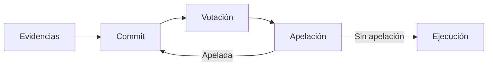

Especificación completa del contrato KlerosCore, el árbitro central de Kleros V2.

## Ciclo de vida de una disputa {#dispute-lifecycle}

### Transiciones de periodo {#period-transitions}

Las disputas avanzan por periodos. Cada periodo tiene una duración configurable que se establece por tribunal:

1. **Evidence**: las partes presentan evidencias. Todos los jurados deben estar sorteados antes de avanzar.
2. **Commit**: los jurados envían sus compromisos de voto (solo en tribunales con votos ocultos).
3. **Vote**: los jurados revelan sus votos o votan directamente.
4. **Appeal**: cualquiera puede financiar una apelación. Si se financia, comienza una nueva ronda.
5. **Execution**: el fallo se finaliza y se ejecuta.

## Mecánica de las apelaciones {#appeal-mechanics}

- Las apelaciones aumentan el número de jurados (normalmente el doble más uno)
- Cuando el número de jurados supera `jurorsForCourtJump`, la disputa pasa al tribunal padre
- Si el tribunal padre no admite el dispute kit actual, se cambia a uno compatible
- La financiación de las apelaciones usa un modelo asimétrico: los perdedores pagan 2× y disponen de la mitad del tiempo

## Reparto de recompensas {#reward-distribution}

Después de la ejecución:
- Los **jurados coherentes** (que votaron con el fallo final) reciben PNK de los jurados incoherentes y su parte de las tasas de arbitraje
- Los **jurados incoherentes** pierden una parte de su PNK en staking (proporcional a `alpha`)
- El reparto se calcula por ronda

## Controles de emergencia {#emergency-controls}

- El **Guardian** puede pausar (bloquea el staking y las recompensas)
- El **Governor** puede reanudar y modificar los parámetros
- La resolución de disputas principal (votación, apelaciones) continúa durante la pausa
