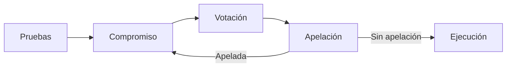

Especificación completa del contrato KlerosCore, el árbitro central de Kleros V2.

## Ciclo de vida de las disputas

### Transiciones entre períodos

Las disputas avanzan a través de períodos. Cada período tiene una duración configurable establecida por corte:

1. **Evidence (pruebas)**: Las partes presentan pruebas. Todos los jurados deben haber sido sorteados antes de avanzar.
2. **Commit (compromiso)**: Los jurados envían los compromisos de voto (solo en cortes con votación oculta).
3. **Vote (votación)**: Los jurados revelan sus votos o emiten votos directos.
4. **Appeal (apelación)**: Cualquiera puede financiar una apelación. Si se financia, comienza una nueva ronda.
5. **Execution (ejecución)**: El fallo se finaliza y se hace cumplir.

## Mecánica de las apelaciones

- Las apelaciones aumentan el número de jurados (normalmente el doble + 1)
- Cuando el número de jurados supera `jurorsForCourtJump`, la disputa pasa a la corte superior
- Si la corte superior no admite el dispute kit actual, se cambia a uno compatible
- La financiación de las apelaciones utiliza un modelo asimétrico: los perdedores pagan 2× y disponen de la mitad del tiempo

## Distribución de recompensas

Tras la ejecución:
- Los **jurados coherentes** (que votaron según el fallo final) reciben PNK de los jurados incoherentes y su parte de las tasas de arbitraje
- Los **jurados incoherentes** pierden una parte de su PNK en staking (proporcional a `alpha`)
- La distribución se calcula por ronda

## Controles de emergencia

- El **Guardian** puede pausar (bloquea el staking y las recompensas)
- El **Governor** puede reanudar y modificar parámetros
- La resolución de disputas principal (votaciones, apelaciones) continúa mientras está en pausa
