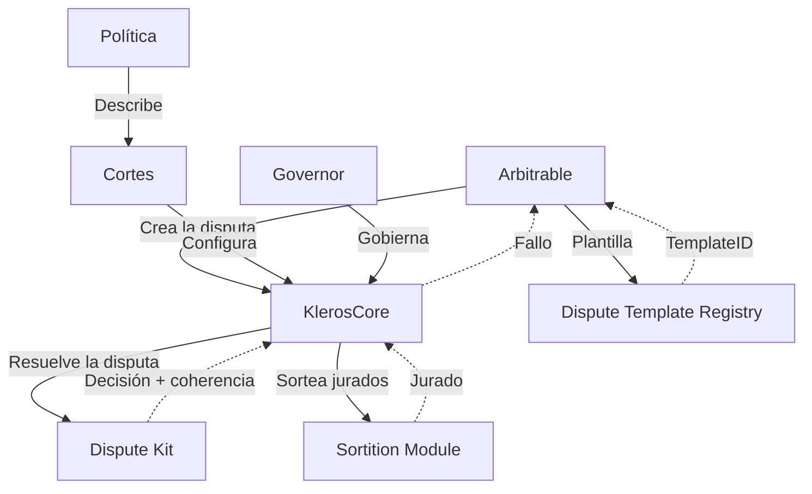

Kleros V2 es un protocolo modular de resolución de disputas desplegado en Arbitrum One con soporte entre cadenas.

## Interacción entre componentes

## Componentes principales

| Componente | Función |
| --- | --- |
| **KlerosCore** | Árbitro central: ciclo de vida de las disputas, apelaciones, fallos |
| **DisputeKitClassic** | Votación, compromiso y revelación, financiación de apelaciones, distribución de incentivos |
| **SortitionModule** | Selección aleatoria ponderada de jurados a partir del PNK en staking |
| **PolicyRegistry** | Políticas de las cortes almacenadas en IPFS |
| **DisputeTemplateRegistry** | Plantillas que definen lo que ven los jurados |
| **Governor** | Ejecución de la gobernanza en cadena |

## Arquitectura entre cadenas

Para los Arbitrables de cadenas externas, el sistema de Gateways abstrae el uso de puentes:

| Componente | Cadena | Función |
| --- | --- | --- |
| **ForeignGateway** | Cadena externa | Actúa como Arbitrator para el Arbitrable |
| **HomeGateway** | Arbitrum | Actúa como Arbitrable para KlerosCore |
| **Vea Bridge** | Ambas | Transporte de mensajes con verificación optimista |

## Modelo de seguridad

1. **Seguridad criptoeconómica**: Los jurados hacen staking de PNK como garantía
2. **Selección aleatoria**: Los sorteos aleatorios ponderados impiden la manipulación
3. **Alineación de incentivos**: Los votantes coherentes ganan, los incoherentes pierden parte de su stake
4. **Sistema de apelaciones**: Varias rondas de revisión con un número creciente de jurados
5. **Controles de emergencia**: El Guardian puede pausar y el Governor puede reanudar
