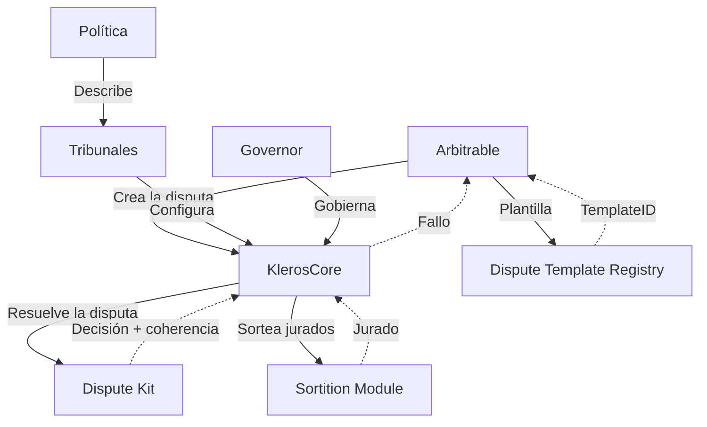

Kleros V2 es un protocolo modular de resolución de disputas desplegado en Arbitrum One con compatibilidad entre cadenas.

## Interacción entre componentes {#component-interaction}

## Componentes principales {#core-components}

| Componente | Función |
| --- | --- |
| **KlerosCore** | Árbitro central: ciclo de vida de las disputas, apelaciones y fallos |
| **DisputeKitClassic** | Votación, commit-reveal, financiación de apelaciones y reparto de incentivos |
| **SortitionModule** | Selección aleatoria ponderada de jurados a partir del PNK en staking |
| **PolicyRegistry** | Políticas de los tribunales almacenadas en IPFS |
| **DisputeTemplateRegistry** | Plantillas que definen lo que ven los jurados |
| **Governor** | Ejecución de la gobernanza en la cadena |

## Arquitectura entre cadenas {#cross-chain-architecture}

Para los contratos arbitrables de cadenas externas, el sistema de gateways abstrae el uso de los puentes:

| Componente | Cadena | Función |
| --- | --- | --- |
| **ForeignGateway** | Cadena externa | Actúa como árbitro para el contrato arbitrable |
| **HomeGateway** | Arbitrum | Actúa como contrato arbitrable para KlerosCore |
| **Vea Bridge** | Ambas | Transporte de mensajes con verificación optimista |

## Modelo de seguridad {#security-model}

1. **Seguridad criptoeconómica**: los jurados hacen staking de PNK como garantía
2. **Selección aleatoria**: los sorteos aleatorios ponderados evitan la manipulación
3. **Alineación de incentivos**: los votantes coherentes ganan y los incoherentes pierden stake
4. **Sistema de apelaciones**: varias rondas de revisión con un número creciente de jurados
5. **Controles de emergencia**: el Guardian puede pausar y el Governor puede reanudar
