# Tutorial de Escrow {#escrow-tutorial}

Este tutorial recorre una transacción de escrow completa en [Kleros Escrow V1](https://escrow.kleros.io): crear un pago, ejecutarlo o liquidarlo mediante un acuerdo y abrir una disputa si algo sale mal.

<Note>
Este tutorial trata la aplicación Escrow V1 en la red principal de Ethereum. Para conocer las diferencias entre Escrow V1 y V2, consulta la [página del producto Escrow](/es/products/escrow).
</Note>

---

## Paso 1: inicia un pago {#step-1-initiate-a-payment}

<Steps>
  <Step title="Ve al sitio web de Kleros Escrow">
    Visita [escrow.kleros.io](https://escrow.kleros.io) y conecta tu billetera (Rabby, MetaMask o WalletConnect). Asegúrate de tener ETH para las tasas de transacción y para el importe del pago. Desde la página de inicio puedes crear, buscar o revisar transacciones.
  </Step>
  <Frame >
  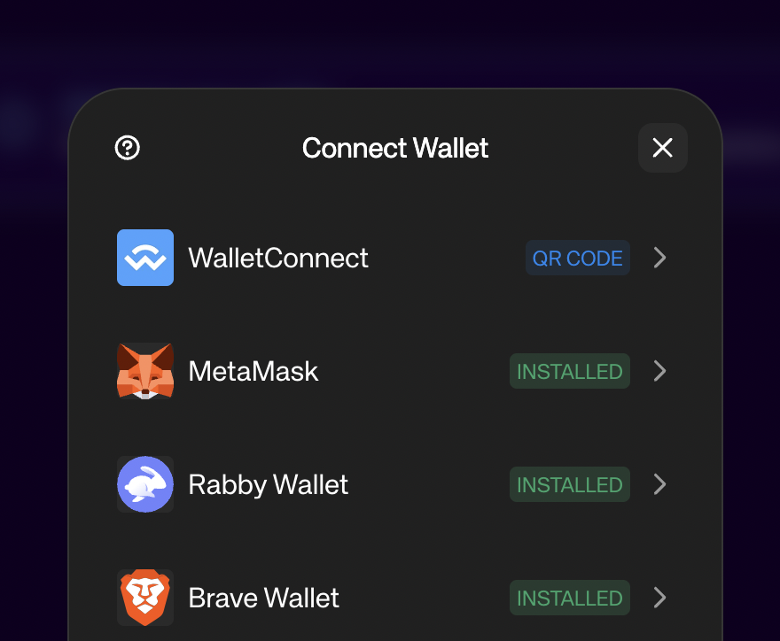
</Frame>
  <Step title="Crea un nuevo pago">
    Haz clic en el botón **Create Transaction** de la esquina superior derecha. Depositas los fondos en escrow, donde permanecen seguros hasta que ocurra una de estas cosas:

    - Los liberas manualmente
    - El receptor los reembolsa
    - Kleros Court resuelve una disputa
    - Se alcanza la fecha de vencimiento
  </Step>
  <Frame >
  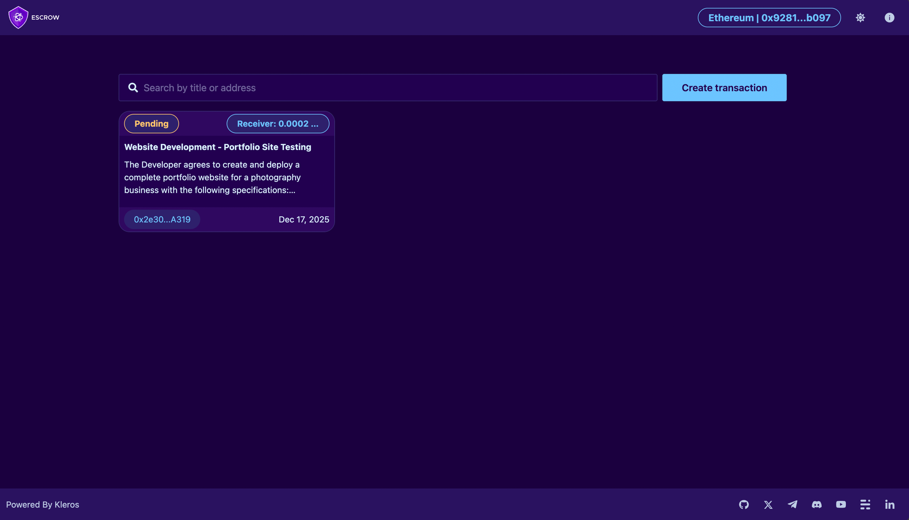
</Frame>
  <Step title="Selecciona un tipo de escrow">
    Hay dos tipos de transacción disponibles:

    - **Cryptocurrency Transaction**: negocia o intercambia criptoactivos; es útil para intercambios entre blockchains (por ejemplo, ETH en Ethereum por SOL en Solana). Las disputas van al Blockchain Non-Technical Court.
    - **General Service Transaction**: paga servicios con condiciones personalizadas y documentos adjuntos. Las disputas van al General Court.
  </Step>
</Steps>

<Frame >
  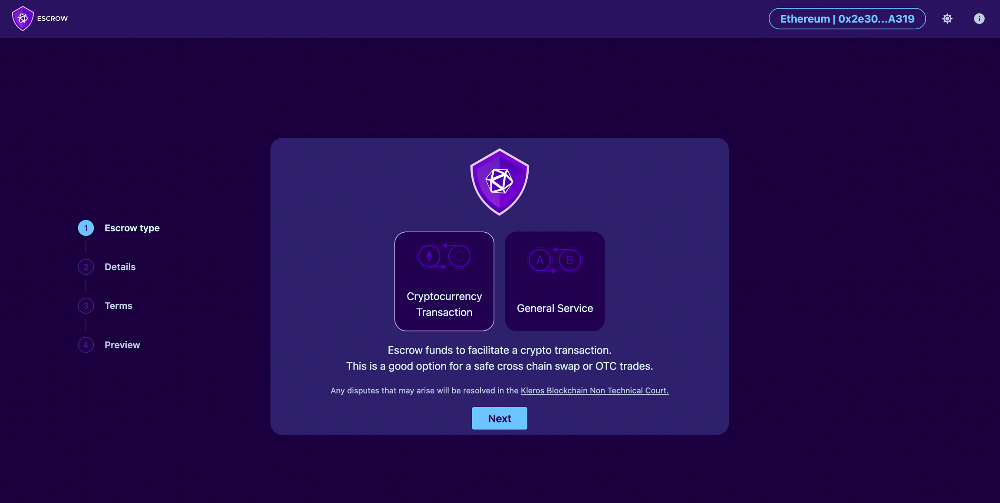
</Frame>

---

## Paso 2: envía el pago {#step-2-submit-the-payment}

<Steps>
  <Step title="Rellena los detalles de la transacción">
    - **Título**: describe la transacción (por ejemplo, "Marketing Mission with John D.")
    - **Dirección de Ethereum del receptor**: la billetera que recibe los fondos
    - **Importe y unidad**: ETH o un token ERC-20

    Las opciones de token predeterminadas son ETH y PNK. Para usar otro token, introduce la dirección de su contrato en el campo "Add custom token".

    <Warning>
    Los tokens ERC-20 no estándar, como USDT, BNB y OMG, no son compatibles con Escrow V1.
    </Warning>
     <Frame >
  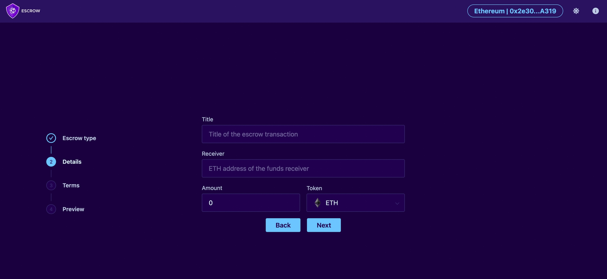
</Frame>
  </Step>
 
  <Step title="Establece el plazo de entrega">
    Proporciona una descripción detallada del servicio o producto. Esta descripción es fundamental para la resolución de disputas.

    El calendario funciona así:

    1. **Periodo del servicio**: desde la creación hasta el plazo de entrega. Cualquiera de las partes puede liberar, reembolsar o abrir una disputa en cualquier momento.
    2. **Periodo de margen**: 7 días fijos tras el plazo, que sirven como ventana de revisión y de disputa.
    3. **Vencimiento del escrow**: 7 días después del plazo, cualquiera de las partes puede ejecutar la transacción.

    Por ejemplo: una transacción creada el 17 de diciembre con un plazo de entrega del 16 de enero vence el 23 de enero.
  
   <Frame >
  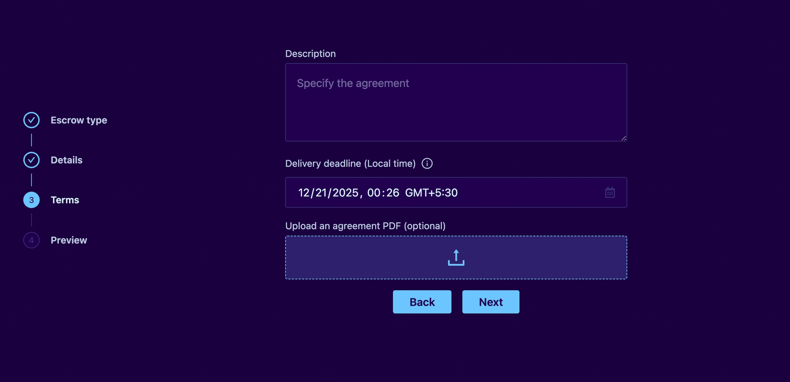
</Frame>
  </Step>
  <Step title="Adjunta un documento de acuerdo">
    Opcionalmente, sube un acuerdo en PDF o incluye las condiciones en la descripción. Los jurados se basan en este documento si surge una disputa, así que especifica con claridad:

    - Las partes implicadas
    - La naturaleza del servicio o del bien
    - Los entregables concretos
    - Los criterios de aceptación
    - Las condiciones del encargo
  </Step>
  <Step title="Envía la transacción">
    Revísalo todo en el paso Preview: dirección del receptor, importe y plazo. Haz clic en **Create Escrow**, confirma la transacción en la blockchain (depósito más tasas de gas) y se te redirigirá a la página del pago.
  </Step>
</Steps>

<Frame >
  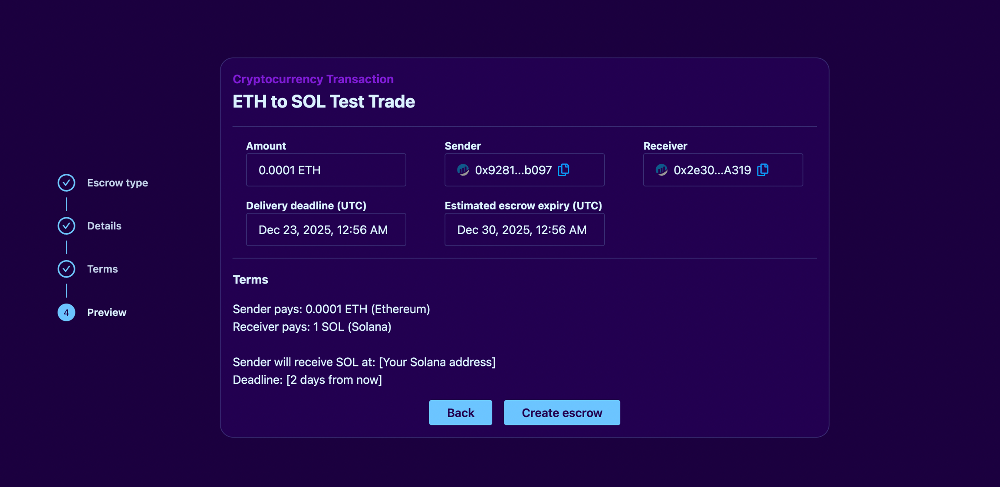
</Frame>

---

## Paso 3: ejecuta el pago {#step-3-execute-the-payment}

Tras la creación, ambas partes ven un resumen de la transacción con las acciones que tienen disponibles.

 <Frame >
  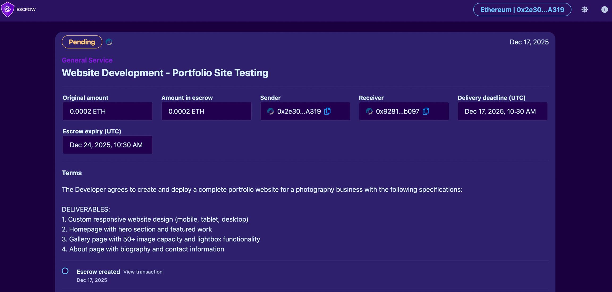
</Frame>

### Como emisor del pago {#as-the-payment-sender}

- **Make payment**: libera los fondos al receptor, total o parcialmente. Paga el importe completo cuando el servicio o producto se haya entregado según lo acordado. Paga un importe parcial para resolver un desacuerdo sin disputa; el resto permanece en escrow y todavía puede disputarse.
- **Raise dispute**: haz clic si no estás satisfecho con la entrega. Se te muestra el coste del arbitraje (por ejemplo, 0,03 ETH) y depositas la tasa para iniciarlo. La tasa se reembolsa si ganas.
 <Frame >
  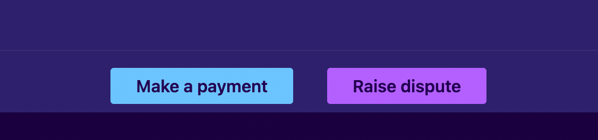
</Frame>

### Como receptor del pago {#as-the-payment-receiver}

- **Reimburse**: devuelve los fondos al emisor, total o parcialmente. Reembolsa el importe completo si no puedes completar la entrega. Reembolsa parcialmente para quedarte con el pago por el trabajo completado; el resto pasa a ti y la transacción se cierra.
- **Raise dispute**: haz clic si el emisor se niega a pagar a pesar de que cumpliste las condiciones. El coste y el proceso de arbitraje son los mismos para ambas partes.
 <Frame >
  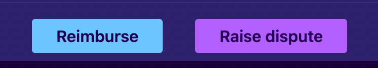
</Frame>

### Acuerdos mediante pagos parciales {#settlements-through-partial-payments}

No existe un modo de acuerdo separado. Cuando ambas partes aceptan un compromiso, una de ellas realiza un pago o un reembolso parcial:

- **Lo inicia el emisor**: el emisor paga un importe parcial (por ejemplo, 0,7 de 1 ETH). Va inmediatamente al receptor; 0,3 ETH permanecen en escrow. El receptor puede aceptarlo, disputar el resto o reembolsar una parte o la totalidad.
- **Lo inicia el receptor**: el receptor reembolsa un importe parcial (por ejemplo, 0,4 de 1 ETH). Vuelve al emisor; quedan 0,6 ETH.

<Warning>
Un pago o reembolso parcial se transfiere de forma inmediata y permanente. Ese importe no se puede recuperar, aunque más adelante surja una disputa sobre el resto.
</Warning>

Buenas prácticas para los acuerdos:

- Documenta el acuerdo por escrito
- Obtén la confirmación de la otra parte sobre las condiciones del acuerdo
- Guarda todas las comunicaciones como posibles evidencias en una disputa

---

## Paso 4: abre una disputa {#step-4-raise-a-dispute}

<Steps>
  <Step title="Abre la disputa">
    Cualquiera de las partes hace clic en **Raise Dispute** y paga la tasa de arbitraje (que se reembolsa si gana). La otra parte dispone entonces de un tiempo limitado para pagar su parte de las tasas; la interfaz muestra el tiempo restante.

    Si la otra parte no paga su parte de las tasas, la primera parte que pagó gana automáticamente.
   <Frame >
  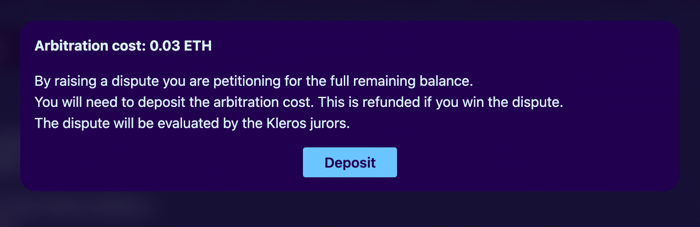
</Frame>

 <Frame >
  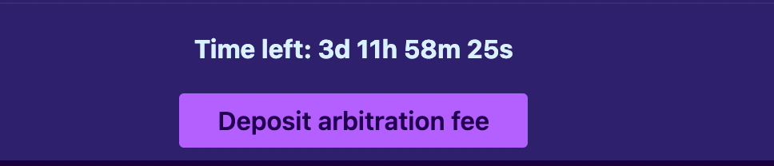
</Frame>

  <Frame >
  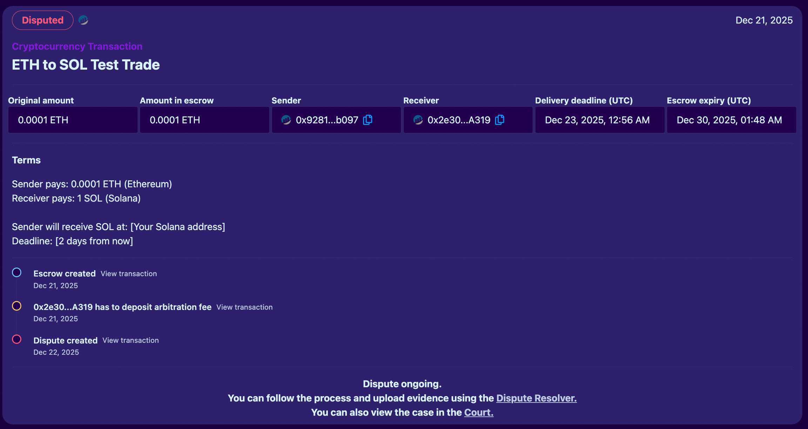
</Frame>
  
  </Step>
  <Step title="Comparte las evidencias">
    Presenta las evidencias a través de [Kleros Dispute Resolver](https://resolve.kleros.io/), no desde el frontend de Escrow:

    1. Ve a resolve.kleros.io y conecta tu billetera
    2. Busca y abre tu disputa
    3. Añade tus evidencias y argumentos

    Consejos sobre las evidencias:

    - Haz referencia al documento de acuerdo original y a sus condiciones concretas
    - Añade registros de comunicaciones, pruebas de entrega, fotos y capturas de pantalla
    - Usa archivos PDF sin datos EXIF si quieres mantener el anonimato
    - Sé claro y conciso
  </Step>
  <Step title="Sigue la disputa">
    Sigue el progreso en la página del pago de Escrow (estado actual) y en resolve.kleros.io (información detallada del caso y estado de la votación).

    - **Primer fallo**: las partes no satisfechas pueden apelar. Las apelaciones traen más jurados y rondas adicionales de evidencias, y las tasas de apelación deben pagarse dentro del periodo de apelación.
    - **Fallo definitivo**: cuando ya no quedan apelaciones, la parte ganadora retira los fondos y recupera sus tasas de arbitraje.
  </Step>
</Steps>

<Frame >
  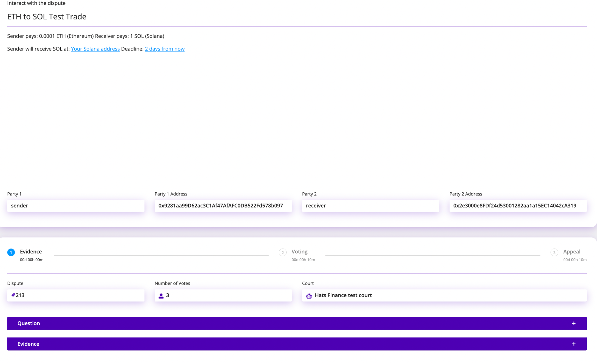
</Frame>

---

## ¿Qué sigue? {#what’s-next}

<CardGroup cols={2}>
  <Card title="Página del producto Escrow" icon="handshake" href="/es/products/escrow">
    Aprende cómo funciona Kleros Escrow, en V1 y V2
  </Card>
  <Card title="Construye con Escrow" icon="code" href="/developers/products/escrow">
    Contratos inteligentes de Escrow y documentación técnica
  </Card>
</CardGroup>
