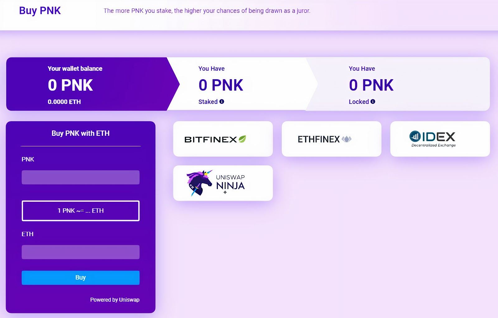
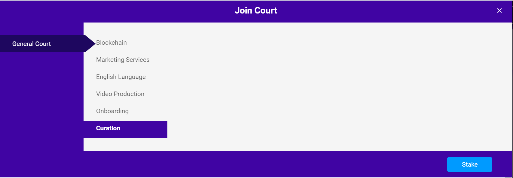
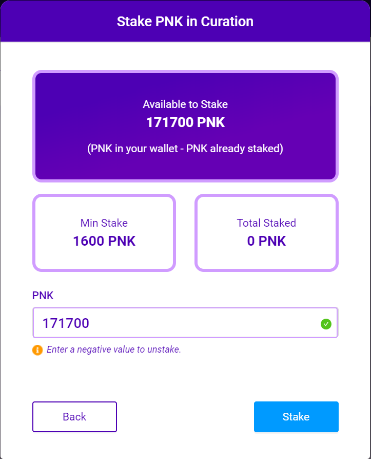
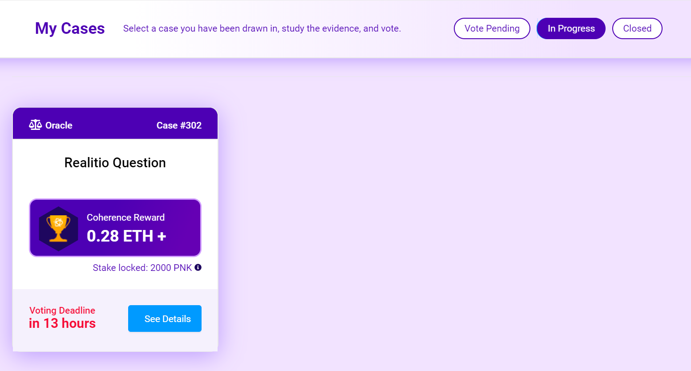
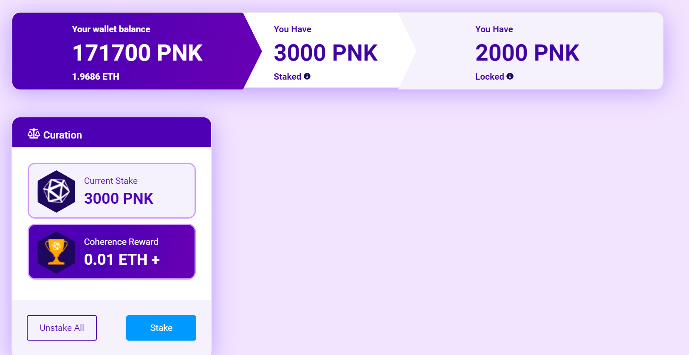
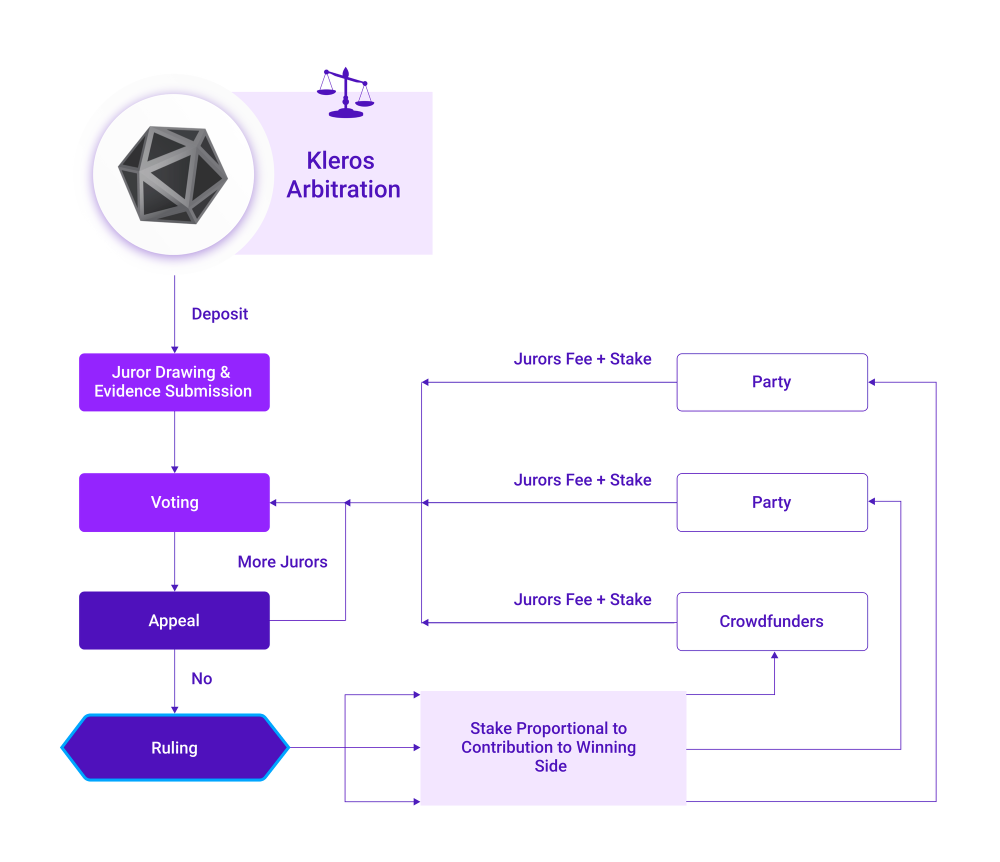

# Tutorial para jurados (V1) {#juror-tutorial-v1}

Este tutorial explica cómo convertirte en jurado de **Kleros Court V1** en [court.kleros.io](https://court.kleros.io/) (red principal de Ethereum y Gnosis Chain). Para el tribunal de nueva generación en Arbitrum, consulta el [tutorial para jurados V2](/es/tutorials/juror-tutorial-v2). No necesitas registrarte ni aportar información personal: solo necesitas las herramientas y las habilidades adecuadas.

---

## Herramientas {#tooling}

Necesitas:

- Una billetera Web3, como MetaMask
- Tokens PNK
- ETH para las tasas de gas

La forma más rápida de conseguir PNK es directamente desde la [página Buy PNK de Court](https://court.kleros.io/tokens) o en uno de los exchanges que aparecen en ella.
<Frame caption="Staking y casos, captura de pantalla pendiente">
  
</Frame>

---

## Staking y casos {#staking-and-cases}

Elige el tribunal que corresponda a tus conocimientos:

- **Onboarding Court**: para principiantes
- **Blockchain Non-Technical Court**: para conocimientos básicos de blockchain
- **English Court**: para conocimientos de idiomas

<Steps>
  <Step title="Abre Kleros Court">
    Ve a [court.kleros.io](https://court.kleros.io/).
  </Step>
  <Step title="Únete a un tribunal">
    Haz clic en **Courts** y después en **Join a Court**. Explora el árbol de tribunales para ver la descripción y los requisitos de cada tribunal.
   <Frame >
  
</Frame>
  </Step>
  <Step title="Haz staking de PNK">
    Selecciona un tribunal y haz clic en el botón azul **Stake**. Introduce la cantidad de PNK que quieres poner en staking. El mínimo varía según el tribunal: por ejemplo, 1.000 PNK para el Onboarding Court y 1.600 PNK para el Curation Court. Confirma la transacción y paga las tasas de gas.
   <Frame >
  
</Frame>
  </Step>
  <Step title="Revisa los casos y vota">
    Un stake mayor aumenta tus probabilidades de ser sorteado como jurado. Cuando te sortean, tus casos aparecen en **My Cases**, donde revisas las evidencias y votas.
   <Frame >
  
</Frame>
  </Step>
</Steps>

<Frame caption="Staking y casos">
  
</Frame>

<Note>
Cuando haces staking en un tribunal, quedas automáticamente en staking en todos los tribunales superiores hasta el General Court, a efectos de las apelaciones.
</Note>

<Warning>
Revisa con atención las políticas del tribunal antes de votar. Los jurados que votan de forma incoherente con el fallo final pierden una parte de su PNK en staking.
</Warning>

<Frame caption="Staking y casos, captura de pantalla pendiente">
  
</Frame>

---

## ¿Qué sigue? {#what’s-next}

<CardGroup cols={2}>
  <Card title="Cómo funciona Kleros Court" icon="gavel" href="/es/court/how-it-works">
    El ciclo de vida completo de una disputa, desde su creación hasta la ejecución
  </Card>
  <Card title="Jerarquía de tribunales" icon="sitemap" href="/es/court/court-hierarchy">
    Comprende la estructura y la especialización de los tribunales
  </Card>
</CardGroup>
