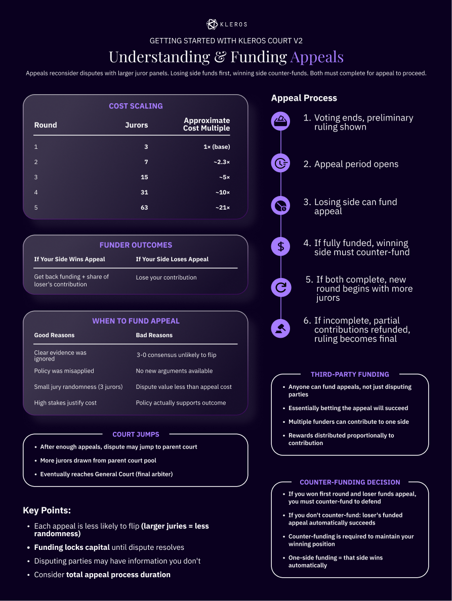

# Tutorial para jurados (V2) {#juror-tutorial-v2}

Este tutorial te guía para participar como jurado en **Kleros Court V2** en [v2.kleros.builders](https://v2.kleros.builders/), el tribunal de nueva generación en Arbitrum. No necesitas registrarte ni aportar información personal.

<Note>
¿Eres completamente nuevo en la Web3? La [guía completa para principiantes de Kleros Court V2 en Notion](https://kleros.notion.site/Complete-Beginner-s-Guide-to-Kleros-Court-V2-20e9a9db4f08803da1b2c372ed2f2c6e) lo cubre todo, desde la configuración de la billetera y la seguridad de la frase semilla hasta tu primer caso, con capturas de pantalla de cada paso.
</Note>

Para el tribunal V1 en Ethereum y Gnosis Chain, consulta el [tutorial para jurados V1](/es/tutorials/juror-tutorial-v1).

---

## Qué necesitas {#what-you-need}

- Una billetera Web3: **Rabby** (recomendada, detecta las redes automáticamente) o MetaMask
- **Tokens PNK en Arbitrum**
- **ETH en Arbitrum** para las tasas de transacción (reserva aproximadamente un 20-30% de tu presupuesto como colchón de ETH)

### Configura Arbitrum One {#set-up-arbitrum-one}

Kleros V2 funciona en Arbitrum One (Chain ID 42161), una capa 2 que mantiene la seguridad de Ethereum con tasas mucho más bajas. Rabby detecta y cambia de red automáticamente. En MetaMask, añade la red manualmente (RPC `https://arb1.arbitrum.io/rpc`, moneda ETH, explorador [arbiscan.io](https://arbiscan.io/)) o usa [chainlist.org](https://chainlist.org/).

### Consigue PNK en Arbitrum {#get-pnk-on-arbitrum}

- **Directamente en la interfaz de Court**: usa la opción "Get PNK"
- **DEX**: intercambia ETH por PNK en [Uniswap](https://app.uniswap.org/) mientras estás conectado a Arbitrum
- **Exchanges centralizados**: consulta los listados en CoinGecko y después pasa los tokens a Arbitrum por el puente
- Si tienes PNK en Ethereum, pásalo por el puente en [bridge.arbitrum.io](https://bridge.arbitrum.io/)

Una cantidad inicial de 5.000-10.000 PNK es una base razonable; cada tribunal fija su propio stake mínimo (el mínimo del General Court ronda los 2.300 PNK).

---

## Comprender los tribunales y sus parámetros {#understanding-courts-and-parameters}

Los tribunales forman una jerarquía: el **General Court** (ID 1) es la raíz, con los tribunales especializados por debajo (Blockchain, Curation, English Language y otros), y el **Forking Court** (ID 0) está reservado para las disputas del protocolo. Hacer staking en un tribunal especializado te pone automáticamente en staking en todos sus tribunales padre.

Entre los tribunales adecuados para principiantes están el **General Court** y el **English Language Court**. Los tribunales especializados, como **Blockchain Technical**, **Curation**, **Insurance** y la **Corte de Disputas de Consumo y Vecinidad** (dentro de la Corte General en Español, que atiende casos empresariales como Lemon y MetLife), esperan conocimientos específicos.

La página de cada tribunal muestra los parámetros que te interesan:

| Parámetro | Qué significa para ti |
| --- | --- |
| **Stake mínimo** | La cantidad mínima de PNK que puedes poner en staking en ese tribunal |
| **Alpha** | Fracción de tu stake que se bloquea cuando te sortean: `pnkAtStakePerJuror = (minStake × alpha) / 10000` |
| **Tasa por jurado** | Lo que ganas por cada voto coherente, en ETH o en un ERC-20 incluido en la lista blanca |
| **Votos ocultos** | Si el tribunal utiliza la votación commit-reveal |
| **Duración por periodo** | Duración de las fases de evidencias, commit, votación y apelación (los periodos pueden terminar antes si no se necesitan más interacciones) |
| **Jurados para salto de tribunal** | Número de jurados a partir del cual una disputa apelada escala al tribunal padre |

<Warning>
Lee siempre la política del tribunal antes de hacer staking o votar en él. Define los tipos de disputa, las reglas de evaluación y las habilidades requeridas, y es vinculante para tus votos.
</Warning>

<Frame caption="Resumen en una página: jerarquía y parámetros de los tribunales (infografía pendiente)">
  
</Frame>

---

## Haz staking de tu PNK {#staking-your-pnk}

<Steps>
  <Step title="Abre Court y conéctate">
    Visita [v2.kleros.builders](https://v2.kleros.builders/), haz clic en **Connect Wallet** y aprueba la conexión. Asegúrate de estar en Arbitrum One.
  </Step>
  <Step title="Elige tu tribunal">
    Haz clic en **Courts**, explora el árbol y abre un tribunal para revisar su política, su stake mínimo, la tasa por jurado y los casos recientes.
   <Frame >
  
</Frame>
  </Step>
  <Step title="Aprueba el PNK">
    El staking requiere una aprobación ERC-20 estándar para que KlerosCore pueda usar tu PNK. Apruebas cada vez que aumentas tu stake.
  </Step>
  <Step title="Establece tu stake">
    Haz clic en **Stake**, introduce una cantidad igual o superior al mínimo del tribunal y confirma en tu billetera.
  </Step>
  <Step title="Verifica">
    Comprueba que tu stake aparece correctamente en tu perfil.
  <Frame >
  
</Frame>
 
 </Step>
</Steps>

<Frame caption="Resumen en una página: flujo de staking en V2 (infografía pendiente)">
  
</Frame>

Lo que debes saber sobre el staking en V2:

- **Tu PNK se transfiere al contrato KlerosCore** mientras está en staking (en V1 permanecía en tu billetera). Puedes retirarlo en cualquier momento, salvo que esté bloqueado en un caso activo.
- **Puedes hacer staking en un máximo de 4 tribunales** (un límite por eficiencia de gas), así que planifica tu selección de tribunales.
- **El momento importa**: el tribunal pasa por las fases de staking, generación y sorteo. Los cambios de stake realizados durante las fases de generación o de sorteo se registran, pero solo surten efecto en la siguiente fase de staking. La interfaz muestra si tu stake está "Current" (vigente) o "Delayed" (aplazado).

---

## Ser seleccionado {#getting-selected}

La selección es aleatoria, pero ponderada por stake: tu probabilidad en cada sorteo es tu stake dividido entre el stake total del tribunal (5.000 PNK en un tribunal con 100.000 PNK en staking te da un 5% de probabilidad por sorteo). Puedes ser sorteado varias veces para el mismo caso; cada sorteo equivale a un voto, y todos tus votos deben ser para la misma opción.

Cuando te sortean:

- Una parte de tu stake se bloquea como garantía
- El caso aparece en **My Cases**
- Recibes una notificación en la interfaz (y por correo electrónico si activaste las notificaciones en Settings, algo muy recomendable para recibir recordatorios de los plazos)

---

## Gestiona tu primera disputa {#handling-your-first-dispute}

<Frame caption="Resumen en una página: gestiona tu primera disputa (infografía pendiente)">
  
</Frame>

<Steps>
  <Step title="Te sortean">
    Recibes una notificación y tu panel se actualiza.
  </Step>
  <Step title="Abre el caso en My Cases">
    La vista del caso tiene estas secciones: **Title & Description** (de qué trata la disputa), **Question** (la pregunta concreta que hay que responder), **Voting Options** (opciones de voto), **Policy** (reglas de evaluación), **Evidence** (presentaciones de las partes) y **Timeline** (fase actual y plazos).
  </Step>
  <Step title="Lee primero la política del tribunal">
    La política es tu guía para votar correctamente. Léela antes de mirar las evidencias.
  </Step>
  <Step title="Examina todas las evidencias presentadas">
    Léelo todo a fondo, comprueba las marcas de tiempo de los envíos, verifica las afirmaciones técnicas y toma notas de los puntos clave. Reserva tiempo real para ello (2-4 horas para un caso de peso).
  </Step>
  <Step title="Considera todas las opciones de voto">
    El patrón habitual es: **In favor of Requester** (las evidencias respaldan la reclamación del solicitante), **In favor of Respondent** (las evidencias respaldan la posición del demandado) y **Refuse to Arbitrate** (el caso no es válido, es ilegal o moralmente inaceptable).
  </Step>
  <Step title="Emite tu voto (o haz commit si los votos son ocultos)">
    Consulta los dos flujos de votación a continuación.
  </Step>
  <Step title="Escribe tu justificación">
    Explica tu razonamiento: un breve resumen del caso, las evidencias clave que revisaste, las secciones pertinentes de la política y tu conclusión. Las justificaciones admiten formato Markdown, ayudan a los jurados de las rondas de apelación y crean precedentes.
  </Step>
  <Step title="Espera al periodo de apelación">
    Cualquiera de las partes puede apelar financiando las tasas. Si solo una parte paga las tasas de apelación, esa parte gana automáticamente.
  </Step>
  <Step title="Reclama las recompensas tras la ejecución">
    Una vez que el fallo es definitivo y se ha ejecutado, las recompensas se pueden reclamar.
  </Step>
</Steps>

### Votar en tribunales con votos visibles {#voting-in-visible-courts}

1. Selecciona tu opción
2. Haz clic en **Vote**
3. Confirma la transacción
4. Tu voto es visible de inmediato

### Votar en tribunales con votos ocultos (commit-reveal) {#voting-in-hidden-courts-commit-reveal}

1. Selecciona tu opción
2. Escribe tu justificación
3. Haz clic en **Commit** (envía un hash de tu voto)
4. Espera a la fase de reveal
5. Vuelve y haz clic en **Reveal**
6. Tu voto ya es visible

<Warning>
En los tribunales con votos ocultos, mantén tu voto en secreto y recuerda volver para la fase de reveal. No revelar el voto implica perder tu PNK bloqueado. Si un jurado revela su voto antes de tiempo, cualquiera puede denunciarlo y reclamar parte de su stake bloqueado.
</Warning>

### Errores comunes {#common-mistakes}

| Error | Cómo evitarlo |
| --- | --- |
| No leer la política | Léela siempre antes de revisar las evidencias |
| Votar según tu opinión personal | Sigue la política, no tus sentimientos |
| Perder los plazos | Activa las notificaciones y revísalas con regularidad |
| Olvidar revelar el voto | Pon un recordatorio para el periodo de reveal |

Perder un plazo implica una penalización sobre el stake y ser retirado del staking de todos los tribunales.

---

## Recompensas y penalizaciones {#rewards-and-penalties}

Ganas recompensas por votar de forma **coherente** con el resultado final:

- **Tasas de arbitraje** (ETH o ERC-20 incluidos en la lista blanca) pagadas por las partes en disputa y repartidas entre los jurados coherentes: `jurorReward = (totalFees / numberOfCoherentVotes) × degreeOfCoherence`
- **Redistribución de PNK** de los jurados incoherentes: `pnkReward = (totalPenalties / numberOfCoherentVotes) × degreeOfCoherence`

En el Classic Dispute Kit, la coherencia es binaria: coherencia total si tu voto coincide con el fallo final y cero si difiere o si no revelaste tu voto. Los jurados incoherentes pierden una parte de su stake bloqueado y renuncian a las recompensas por tasas.

**Ejemplo práctico**: 5 jurados a 0,05 ETH cada uno (0,25 ETH en total), 3 coherentes y 2 incoherentes. Cada jurado coherente recibe unos 0,083 ETH más una parte del PNK de los jurados incoherentes.

**Reclamación**: un bot de Kleros reclama las recompensas automáticamente aproximadamente cada hora; también puedes reclamarlas manualmente desde la página del caso o desde el panel de recompensas. La interfaz te permite agrupar las reclamaciones para ahorrar gas.

<Frame caption="Resumen en una página: recompensas de los jurados y coherencia (infografía pendiente)">
  
</Frame>

---

## Apelaciones y saltos de tribunal {#appeals-and-court-jumps}

- La financiación de las apelaciones sigue `feeForJuror × ((nbVotes × 2) + 1)`: la parte ganadora debe financiar 1× el coste de apelación y la parte impugnante 2×. Con 3 jurados a 0,05 ETH, son 0,35 ETH para la parte ganadora y 0,70 ETH para la impugnante.
- La parte impugnante solo puede financiar durante la **primera mitad** del periodo de apelación; la parte ganadora dispone de todo el periodo.
- Cada ronda de apelación aumenta el número de jurados (`n×2 + 1`). Cuando el número alcanza el umbral `jurorsForCourtJump` del tribunal (por ejemplo, 511), la disputa escala al tribunal padre y el número de jurados se ajusta a los parámetros del nuevo tribunal. Puedes ser sorteado para casos que han saltado de tribunal; espera que sean más complejos.

<Frame caption="Resumen en una página: apelaciones y saltos de tribunal (infografía pendiente)">
  
</Frame>

---

## Disputas entre cadenas {#cross-chain-disputes}

V2 admite de forma nativa las disputas que se originan en otras cadenas EVM (Ethereum, Gnosis Chain, Polygon, Optimism y otras). Como jurado, todo ocurre en Arbitrum: las disputas llegan por el puente, las evidencias aparecen unificadas en la interfaz y los fallos vuelven por el puente a la cadena de origen. El proceso es idéntico para ti, sea cual sea el origen de la disputa.

---

## Solución de problemas {#troubleshooting}

| Problema | Qué hacer |
| --- | --- |
| Error de red incorrecta | Cambia a Arbitrum One (Rabby lo propone automáticamente) |
| El PNK no aparece en la billetera | Importa manualmente el contrato del token PNK; verifica la dirección en fuentes oficiales |
| La transacción de staking falla | Comprueba tu saldo de PNK, el ETH para el gas y el mínimo del tribunal |
| El caso no aparece en My Cases | Confirma que te sortearon, espera a la confirmación y actualiza la página |
| Ha vencido el plazo de votación | Nunca se aceptan votos tardíos; pon varios recordatorios la próxima vez |

Para obtener ayuda: [Discord](https://discord.gg/MhXQGCyHd9), [Telegram](https://t.me/kleros) o support@kleros.io.

---

## ¿Qué sigue? {#what’s-next}

<CardGroup cols={3}>
  <Card title="Guía para principiantes (Notion)" icon="book-open" href="https://kleros.notion.site/Complete-Beginner-s-Guide-to-Kleros-Court-V2-20e9a9db4f08803da1b2c372ed2f2c6e">
    El recorrido completo para principiantes con capturas de pantalla
  </Card>
  <Card title="Cómo funciona Kleros Court" icon="gavel" href="/es/court/how-it-works">
    El ciclo de vida completo de una disputa en V1 y V2
  </Card>
  <Card title="Token PNK" icon="coins" href="/es/concepts/pnk-token">
    Qué es PNK y dónde conseguirlo
  </Card>
</CardGroup>
