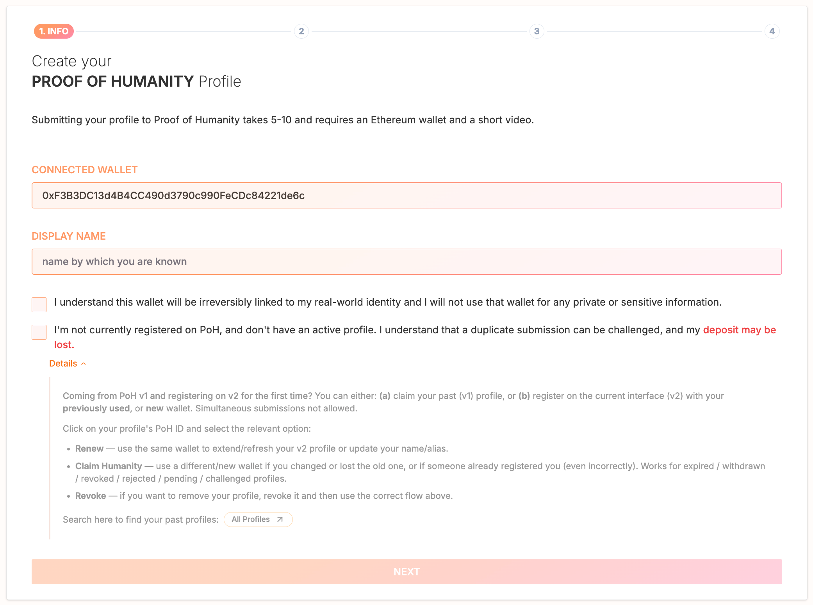
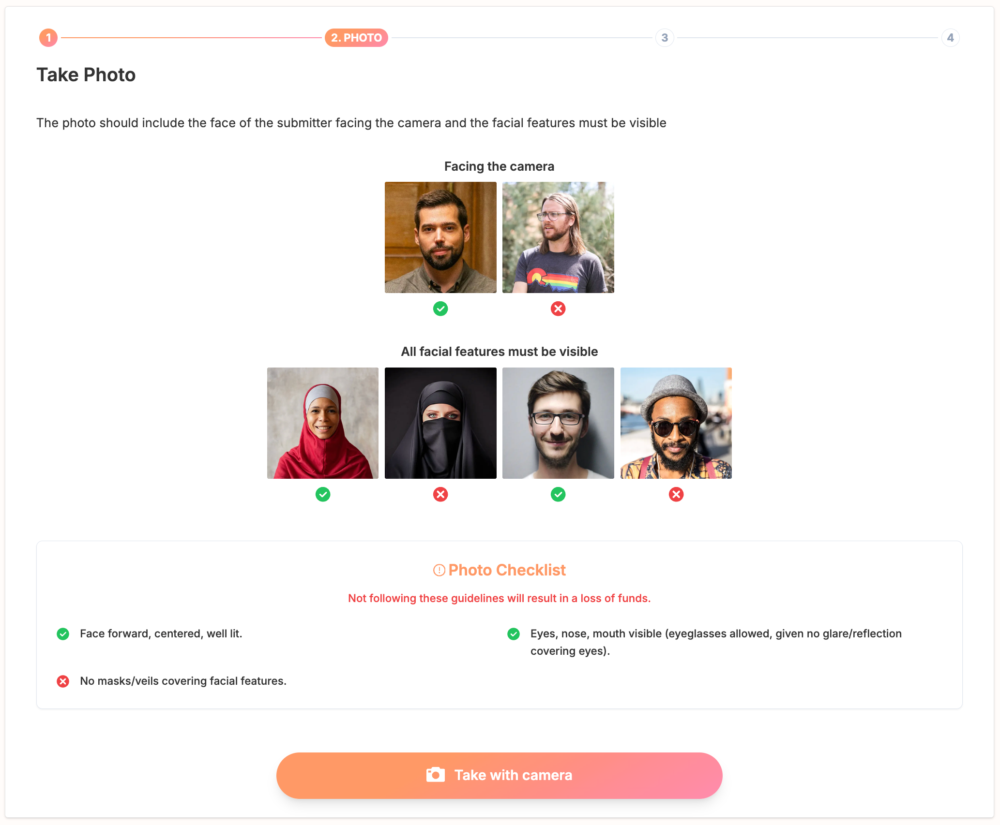
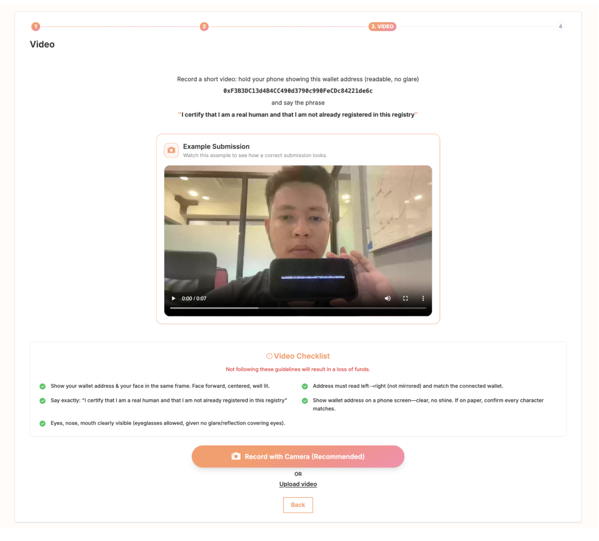
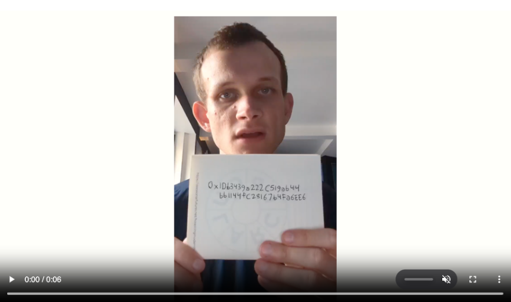
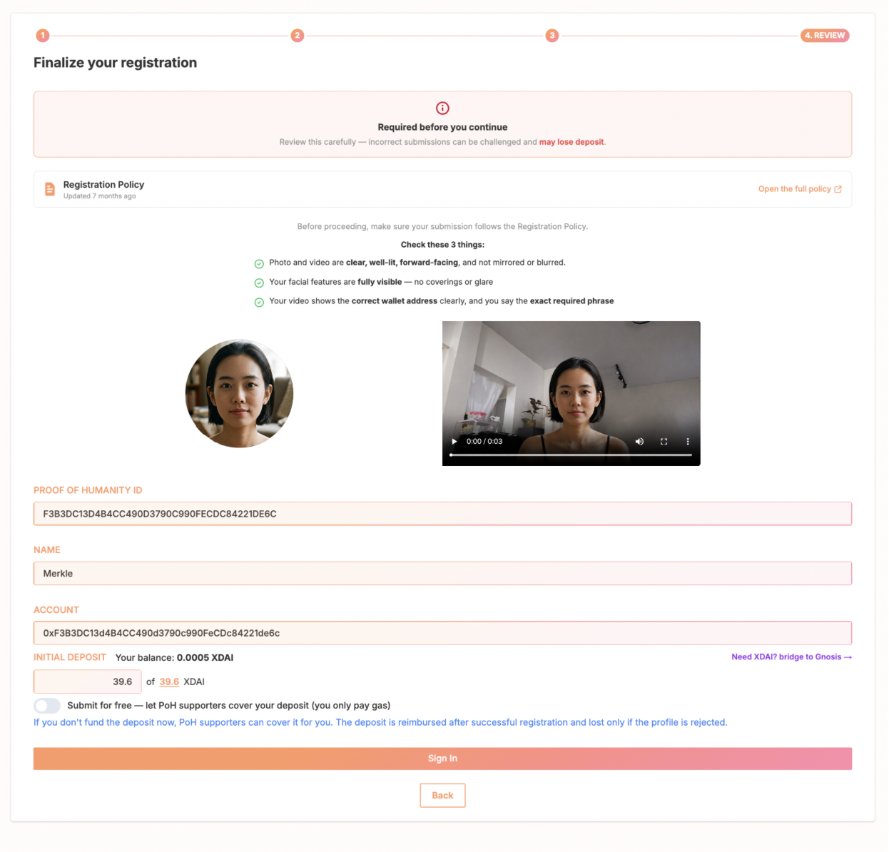
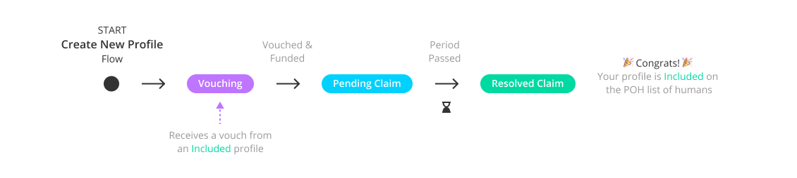
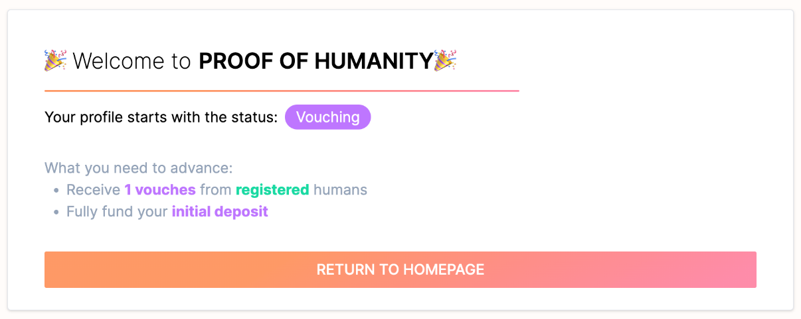
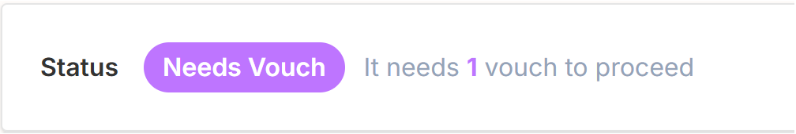
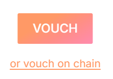

# Tutorial de Proof of Humanity: registro y aval {#proof-of-humanity-tutorial-register-&-vouch}

Este tutorial trata el proceso de registro de Proof of Humanity 2.0: registrar tu perfil, el proceso de validación y avalar a otras personas.

Para impugnar o retirar perfiles, consulta el [tutorial de retirada e impugnación](/es/tutorials/poh-remove-and-challenge).

---

## Fase 1: registra tu perfil {#phase-1-register-your-profile}

<Steps>
  <Step title="Accede a la dApp">
    Ve a la [aplicación PoH v2](https://v2.poh.id/), donde puedes ver los perfiles registrados recientemente.
  </Step>
  <Step title="Conecta tu billetera Web3">
    Haz clic en **Connect** en la esquina superior derecha y selecciona tu billetera en el menú emergente. Revisa la política del registro de Proof of Humanity mediante el botón Policy antes de continuar.

    <Warning>
    La dirección de tu billetera quedará vinculada públicamente a tu identidad. Considera usar una dirección nueva financiada desde un exchange para proteger tu historial de transacciones.
    </Warning>
  </Step>
  <Step title="Haz clic en Register">
    Una vez conectada tu billetera, aparece el botón **Register** en el menú superior.
  </Step>
</Steps>

### Información del registro {#registration-information}

Antes de empezar, ten en cuenta estos requisitos:

- Un humano = un perfil activo. Los envíos duplicados simultáneos se enfrentan a impugnaciones y a la pérdida del depósito.
- Los usuarios de V1 deben reclamar su Humanity ID anterior o registrarse correctamente en v2.
- Elige la acción adecuada: **Renew** (actualizar un perfil v2 existente), **Claim Humanity** (perfil v1 caducado) o **Revoke** (retirar un perfil).

<Steps>
  <Step title="Información">
    Confirma la dirección de billetera que quieres asociar, indica tu nombre oficial o el nombre por el que se te conoce y marca la casilla de consentimiento que reconoce el vínculo permanente entre billetera e identidad. Haz clic en **Next**.
   <Frame >
  
</Frame>
  </Step>
  <Step title="Foto">
    Revisa las directrices y la lista de comprobación de la foto, haz una foto con la cámara de la aplicación (con recorte opcional) y haz clic en **Ready** cuando estés satisfecho o en **Retake** para cambiarla.

    <Tip>Consulta los perfiles con estado "Resolved Claim" para ver ejemplos de envíos aceptados.</Tip>
   <Frame >
  
</Frame>
  </Step>
  <Step title="Vídeo">
    Graba un vídeo en el que se vea claramente tu cara y un cartel con la dirección completa de tu billetera (impresa, escrita o en una pantalla), mientras dices:

    *"I certify that I am a real human and that I am not already registered in this registry"* ("Certifico que soy un humano real y que no estoy registrado ya en este registro")

    Verifica que el vídeo cumple los requisitos de la lista de comprobación antes de continuar.
   <Frame >
  
</Frame>
 <Frame >
  
</Frame>
  </Step>
  <Step title="Finaliza el registro">
    Revisa de nuevo toda la información enviada e introduce el depósito requerido. El depósito queda bloqueado con tu envío: incentiva a quienes impugnan y cubre las tasas de arbitraje. Si el registro tiene éxito, se te devuelve; si fracasa, lo pierdes.

    Asegúrate de tener suficiente xDAI o ETH para el depósito y las tasas de transacción. Los envíos son definitivos y no se pueden editar después.

    Haz clic en **Sign In**, espera a que termine la subida de los archivos y confirma la transacción en tu billetera.

    <Frame >
  
</Frame>
  </Step>
</Steps>

---

## Fase 2: suscríbete a las notificaciones {#phase-2-subscribe-to-notifications}

El sistema de notificaciones está en desarrollo. Hasta que se lance, comprueba manualmente el estado de tu perfil.

---

## Fase 3: validación del perfil (~3-5 días) {#phase-3-profile-validation-~3-5-days}

Los perfiles avanzan por estos estados: **Needs Vouch → In Review → Verified Human**.
<Frame caption="Este diagrama de flujo simplificado ofrece una visión general de las distintas fases del registro.">
  
</Frame>

### De Needs Vouch a In Review {#from-needs-vouch-to-in-review}

Para avanzar, tu perfil necesita:

- Al menos 1 aval de una persona con estado "Resolved Claim" que te conozca
- El pago completo del depósito (100%)
- Iniciar el aval mediante **Advance**

Los avales se procesan de forma secuencial, aproximadamente 3,5 días por persona. Varios avales simultáneos de una misma persona retrasan el procesamiento de los demás. Si necesitas corregir algo, la retirada solo está disponible durante la fase de aval.

### De In Review a Verified Human {#from-in-review-to-verified-human}

Un periodo de impugnación de 3,5 días permite a la comunidad verificar el cumplimiento:

- **Si se impugna**: se abre una disputa en Kleros Court. Aporta evidencias para defender tu caso. Hay apelaciones disponibles si no estás de acuerdo con el fallo.
- **Si no se impugna**: haz clic en **Execute** pasados 3,5 días para finalizar tu registro. Cualquier dirección puede enviar esta transacción. Tu depósito se reembolsa al completarse.

Una vez verificado, puedes avalar a otras personas.
 <Frame >
  
</Frame>

---

## Fase 4: avala otro perfil {#phase-4-vouch-for-another-profile}

Debes estar conectado a la aplicación y tener el estado "Verified Human".

<Steps>
  <Step title="Busca el perfil">
    Ve al perfil de destino mediante un enlace compartido o buscando por nombre.
  <Frame >
  
</Frame>
  
  </Step>
  <Step title="Avala">
    Haz clic en el botón **Vouch** de su perfil y firma el mensaje desde tu billetera.
  <Frame >
  
</Frame>
  </Step>
</Steps>

Existen dos tipos de aval:

- **Vouch**: gratuito, sin tasas de transacción e irrevocable
- **Vouch on-chain**: requiere tasas de transacción, pero puede retirarse mientras el perfil está en la fase "Needs Vouch"

Puedes avalar a varias personas, pero cada aval cuenta de forma secuencial: cuando una persona pasa a "In Review", tu siguiente aval se activa por orden de llegada.

<Warning>
Avalar envíos Sybil o falsos supone el riesgo de que te retiren a ti del registro. Avalar perfiles con pequeños errores de información no conlleva ninguna penalización.
</Warning>

---

## ¿Qué sigue? {#what’s-next}

<CardGroup cols={2}>
  <Card title="Tutorial de retirada e impugnación" icon="flag" href="/es/tutorials/poh-remove-and-challenge">
    Impugna perfiles que no cumplen las reglas o retira el tuyo
  </Card>
  <Card title="Página del producto Proof of Humanity" icon="fingerprint" href="/es/products/proof-of-humanity">
    Aprende cómo funciona el registro
  </Card>
</CardGroup>
