# Tutorial de Proof of Humanity: retirada e impugnación {#proof-of-humanity-tutorial-remove-&-challenge}

Este tutorial trata cómo impugnar perfiles, retirar perfiles y volver a enviar perfiles en el registro de Proof of Humanity 2.0.

Para el registro y los avales, consulta el [tutorial de registro y aval](/es/tutorials/poh-register-and-vouch).

---

## Impugna una solicitud {#challenge-a-claim}

<Steps>
  <Step title="Explora y revisa los perfiles">
    Visita la [aplicación PoH](https://v2.poh.id/) y filtra los perfiles **In Review** o **Removal Proposed** con el filtro de la derecha. Haz clic en cada perfil para verificar que cumple las directrices de PoH. Busca deepfakes, contenido inapropiado o infracciones de las directrices.
<Frame >
  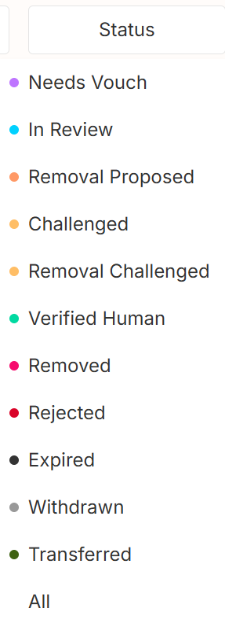
</Frame>
<Frame >
  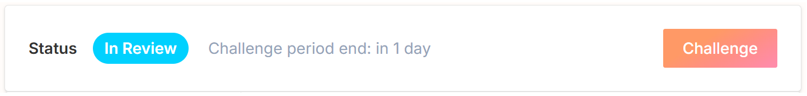
</Frame>
    Herramientas de detección que pueden ayudarte:

    - [Deepware.ai](https://deepware.ai)
    - [Sensity.ai](https://sensity.ai)
    - Software de reconocimiento de voz para detectar audio generado por ordenador
  </Step>
  <Step title="Envía una impugnación">
    1. Haz clic en el botón naranja **Challenge** de la parte superior derecha del perfil
    2. Selecciona el motivo de la infracción y aporta una justificación
    3. Haz clic en **Challenge request** y envía la transacción

    El depósito de quien impugna es una cantidad bloqueada de ETH o xDAI que disuade las impugnaciones frívolas. Una impugnación con éxito te devuelve tu depósito más el depósito de quien envió el perfil (menos las tasas de arbitraje). Una impugnación fallida hace que pierdas tu depósito.
  <Frame >
  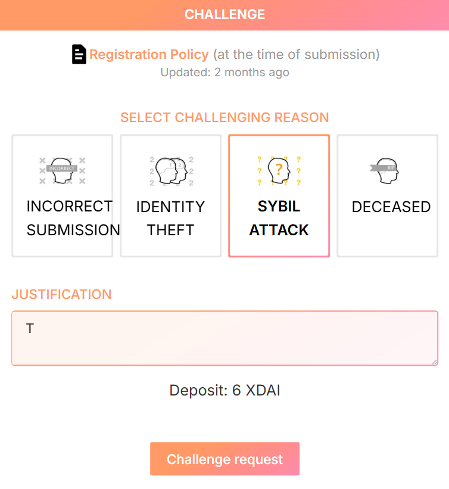
</Frame>
<Frame >
  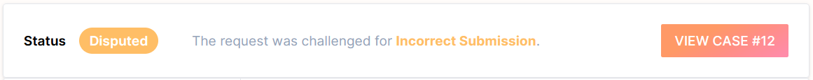
</Frame>
  </Step>
  <Step title="Sigue la disputa">
    La impugnación pasa a [Kleros Court](/es/court/overview) para la votación del jurado. Presenta evidencias desde la parte inferior de la página del perfil y sigue el progreso durante 5-7 días. Hay opciones de apelación disponibles si no estás de acuerdo con el fallo.
  <Frame >
  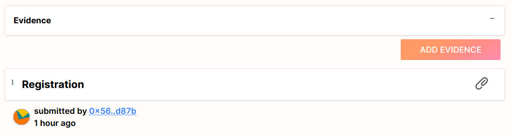
</Frame>
<Frame >
  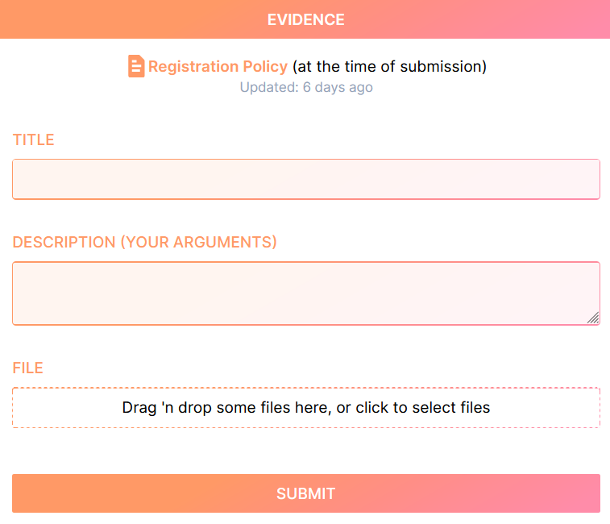
</Frame>
  </Step>
</Steps>

---

## Retira un perfil {#remove-a-profile}

### Retira tu propio perfil (estado Needs Vouch) {#remove-your-own-profile-needs-vouch-status}

Haz clic en el botón **Withdraw** de la página de tu perfil para recuperar tu depósito.
<Frame >
  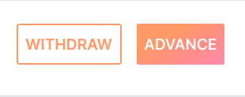
</Frame>

### Retira perfiles registrados o con estado Verified Human {#remove-registered-or-verified-human-profiles}

1. Abre el perfil y haz clic en **Revoke**
2. Bloquea un depósito (se reembolsa si la retirada tiene éxito)
3. Opcionalmente, presenta evidencias que respalden la revocación
<Frame >
  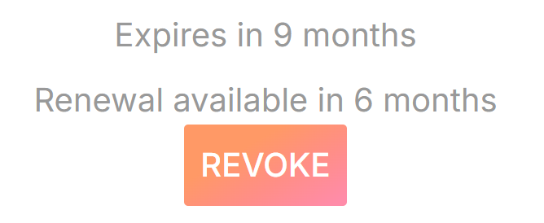
</Frame>
<Frame >
  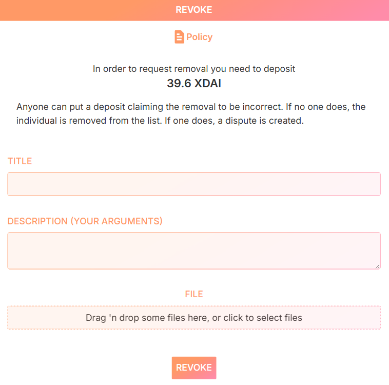
</Frame>

Ejemplos de evidencias:

- **Retirada propia desde la misma dirección**: titúlala "Self-removal of submission" y confirma tu condición de remitente mediante la dirección.
- **Retirada propia desde una dirección distinta**: titúlala "Self-removal of submission" e incluye una grabación de vídeo en la que digas: "I want to revoke my own submission from the Proof of Humanity registry" ("Quiero revocar mi propio envío del registro de Proof of Humanity").
- **Retirada de un envío malicioso**: titúlala "Removal of deepfake submission" e incluye informes de análisis de deepfakes como evidencia.

<Frame >
  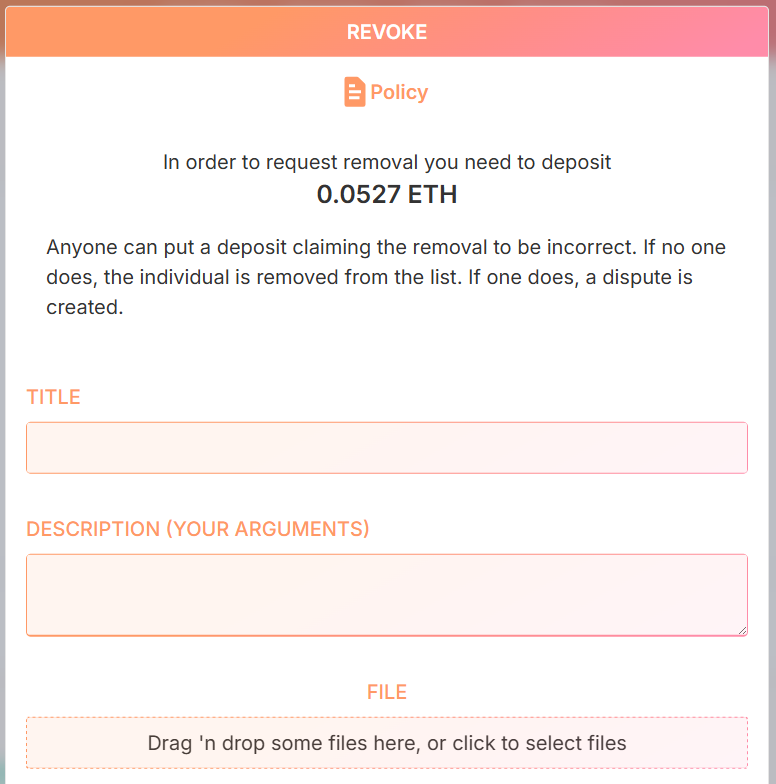
</Frame>
### Retira perfiles en revisión {#remove-in-review-profiles}

Utiliza el proceso de impugnación descrito más arriba.

---

## Vuelve a enviar un perfil {#resubmit-a-profile}

### Desde una nueva dirección {#from-a-new-address}

1. Asegúrate de que el perfil antiguo tiene el estado **Revoked** (compruébalo en `https://v2.poh.id/PoHID`)
2. Retíralo si es necesario siguiendo los pasos anteriores
3. Conecta la nueva dirección y envía un perfil nuevo
<Frame >
  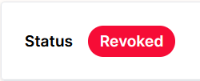
</Frame>

### Desde la misma dirección {#from-the-same-address}

1. Verifica que el perfil antiguo está **Revoked**
2. Retíralo si es necesario
3. Haz clic en el botón **Resubmit Profile** de la parte inferior izquierda del perfil

### Vuelve a solicitar un perfil caducado o a punto de caducar {#reapply-an-expired-or-expiring-profile}

Los perfiles caducan dos años después del registro. Vuelve a solicitarlo para demostrar que sigues existiendo y que controlas la dirección.
<Frame >
  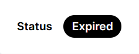
</Frame>
---

## ¿Qué sigue? {#what’s-next}

<CardGroup cols={2}>
  <Card title="Tutorial de registro y aval" icon="user-plus" href="/es/tutorials/poh-register-and-vouch">
    Registra tu propio perfil en Proof of Humanity
  </Card>
  <Card title="Página del producto Proof of Humanity" icon="fingerprint" href="/es/products/proof-of-humanity">
    Aprende cómo funciona el registro
  </Card>
</CardGroup>
