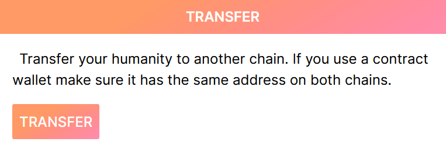
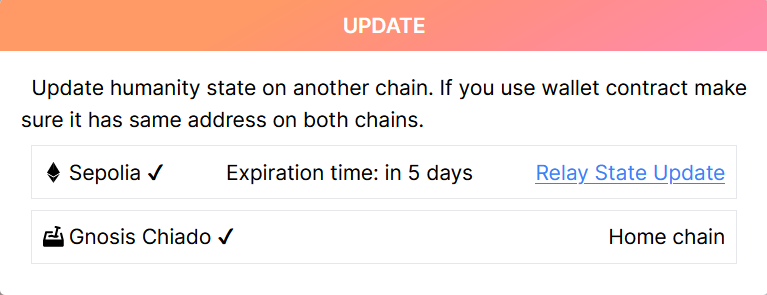
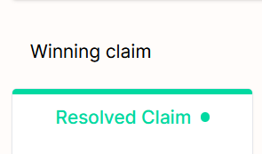
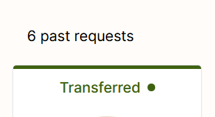

# Tutorial de Proof of Humanity: transferir un perfil {#proof-of-humanity-tutorial-transferring-a-profile}

Proof of Humanity 2.0 funciona en la red principal de Ethereum y en Gnosis Chain. Un perfil solo puede estar activo en una cadena a la vez, pero puedes transferirlo entre cadenas.

<Warning>
Asegúrate de tener fondos suficientes para operar en la nueva cadena de destino y poder actualizar o completar la transferencia del perfil.
</Warning>

---

## Pasos de la transferencia {#transfer-steps}

<Steps>
  <Step title="Inicia la transferencia">
    Ve a la página de tu perfil y selecciona el botón **Transfer**.
    <Frame >
  
</Frame>
  </Step>
  <Step title="Confirma la solicitud de transferencia">
    Aparece un aviso de confirmación que te pide verificar la acción de transferencia. Confirma la transacción.
  </Step>
  <Step title="Cambia de red">
    Una vez confirmada la transacción, el estado de tu perfil pasa a **Pending Update**. Conecta tu billetera a la cadena de destino, visita tu perfil y haz clic en **Update state**.
  <Frame >
  
</Frame>
  </Step>
  <Step title="Transmite la actualización de estado">
    Selecciona **Relay State Update** en el aviso y confirma la transacción en la nueva cadena.
  <Frame >
  
</Frame>
  </Step>
  <Step title="Finalización">
    Una vez validada, la solicitud actual de tu perfil aparece como **Resolved Claim** con el icono de la nueva red. El estado de la solicitud anterior cambia a **Transferred**.
  <Frame >
  
</Frame>
<Frame >
  
</Frame>
  </Step>
</Steps>

---

## ¿Qué sigue? {#what’s-next}

<CardGroup cols={2}>
  <Card title="Tutorial de registro y aval" icon="user-plus" href="/es/tutorials/poh-register-and-vouch">
    Registra tu perfil en Proof of Humanity
  </Card>
  <Card title="Tutorial de retirada e impugnación" icon="flag" href="/es/tutorials/poh-remove-and-challenge">
    Impugna o retira perfiles
  </Card>
</CardGroup>
