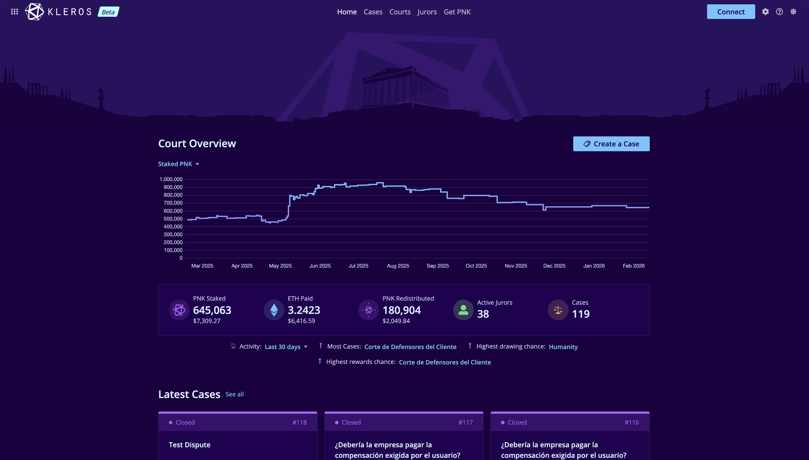
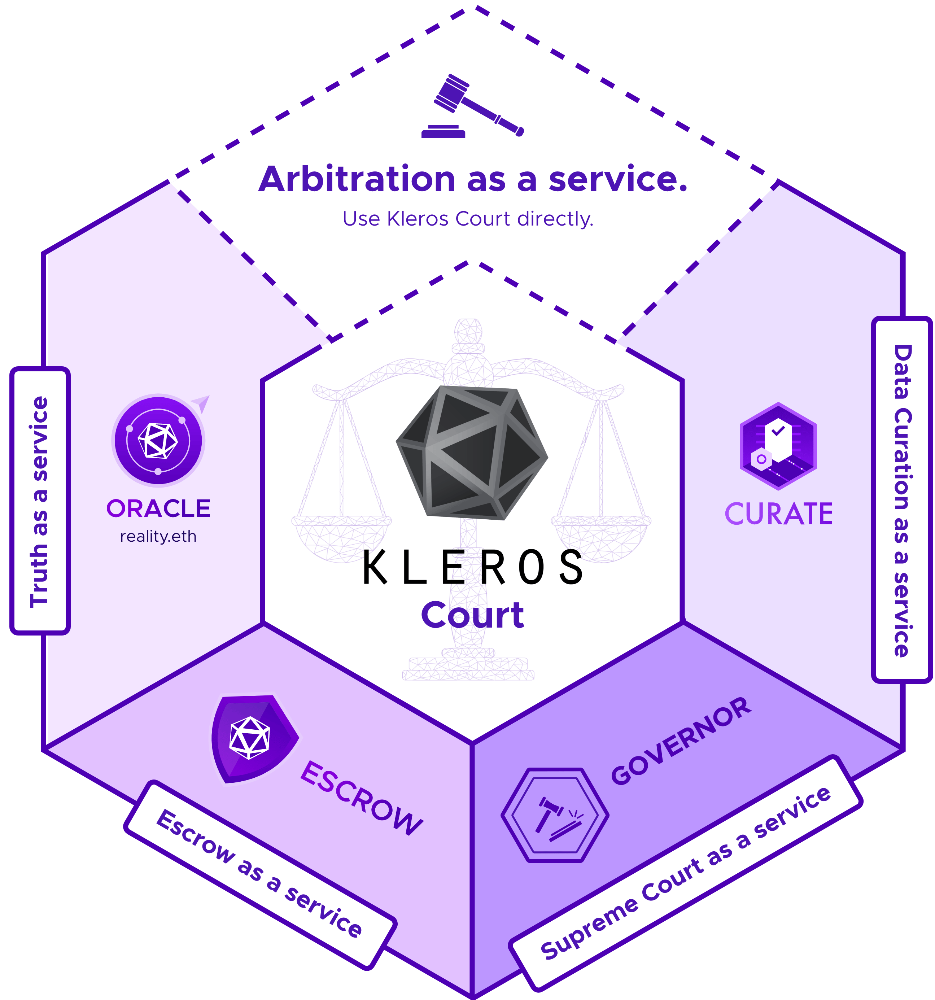

# Bienvenido a Kleros {#welcome-to-kleros}

Kleros es un protocolo descentralizado de resolución de disputas que utiliza blockchain y jurados colectivos (crowdsourcing) para resolver disputas de forma justa, transparente y asequible.

<CardGroup cols={2}>
  <Card title="Quiero ser jurado" icon="scale-balanced" href="/es/court/overview">
    Haz staking de PNK, vota en disputas y gana recompensas
  </Card>
  <Card title="Quiero usar un producto" icon="grid-2" href="/es/products/overview">
    Curate, Escrow, Proof of Humanity y más
  </Card>
  <Card title="Quiero construir con Kleros" icon="code" href="/es/developers/overview">
    Integra la resolución de disputas en tu aplicación
  </Card>
  <Card title="Quiero entender Kleros" icon="lightbulb" href="/es/concepts/dispute-resolution">
    Aprende la mecánica, la teoría de juegos y la economía
  </Card>
</CardGroup>

---

## Kleros Court {#kleros-court}

<Frame>
  
</Frame>

El corazón de Kleros. Court utiliza incentivos criptoeconómicos y teoría de juegos para obtener decisiones justas de forma colectiva sobre cualquier disputa adjudicable.

<CardGroup cols={3}>
  <Card title="Cómo funciona" icon="circle-question" href="/es/court/how-it-works">
    Comprende el proceso de resolución de disputas
  </Card>
  <Card title="Hazte jurado" icon="user-plus" href="https://kleros.notion.site/Complete-Beginner-s-Guide-to-Kleros-Court-V2-20e9a9db4f08803da1b2c372ed2f2c6e">
    Guía paso a paso para hacer staking y votar
  </Card>
  <Card title="Integra Court" icon="plug" href="/es/developers/arbitrable-apps/arbitrable-overview">
    Añade resolución de disputas a tu aplicación
  </Card>
</CardGroup>

---

## Productos {#products}

Los productos de Kleros son aplicaciones descentralizadas que utilizan Kleros Court para resolver disputas. Consulta la [descripción general de productos](/es/products/overview) para ver los detalles de cada versión.

<CardGroup cols={2}>
  <Card title="Curate" icon="list-check" href="/es/products/curate">
    **Listas y registros descentralizados**

    Crea y mantén registros curados por la comunidad de cualquier cosa: tokens, contratos, direcciones o datos personalizados.

    <Badge>V1 • V2</Badge>
  </Card>
  <Card title="Escrow" icon="handshake" href="/es/products/escrow">
    **Transacciones seguras**

    Mantén fondos en depósito (escrow) con resolución de disputas integrada por si algo sale mal.

    <Badge>V1 • V2</Badge>
  </Card>
  <Card title="Governor" icon="landmark" href="/es/products/governor">
    **Gobernanza de DAO**

    Ejecución de gobernanza descentralizada con resolución de disputas para propuestas impugnadas.

    <Badge>V1 • V2</Badge>
  </Card>
  <Card title="Scout" icon="shield-check" href="/es/products/scout">
    **Verificación de contratos y tokens**

    Información de seguridad curada por la comunidad sobre contratos inteligentes, tokens y dApps.

    <Badge>V1</Badge>
  </Card>
  <Card title="Reality (oráculo)" icon="database" href="/es/products/reality">
    **Reality.eth + Kleros**

    Oráculo colectivo con el arbitraje de Kleros como respaldo final para las respuestas impugnadas. Impulsa Zodiac/SafeSnap.

    <Badge>V1</Badge>
  </Card>
  <Card title="Proof of Humanity" icon="fingerprint" href="/es/products/proof-of-humanity">
    **Identidad resistente a ataques Sybil**

    Un registro de humanos verificados que combina el aval social con la resolución de disputas.

    <Badge variant="secondary">Protocolo V1</Badge>
  </Card>
</CardGroup>

<Frame>
  
</Frame>
---

## Para desarrolladores {#for-developers}

Construye aplicaciones sin necesidad de confianza (trustless) con resolución descentralizada de disputas.

<Tabs>
  <Tab title="¿Nuevo en Kleros?">
    Empieza aquí si estás explorando cómo integrar Kleros en tu proyecto.

    <Steps>
      <Step title="Comprende la arquitectura">
        Aprende cómo el árbitro (Court) y las aplicaciones arbitrables funcionan juntos.

        [Lee la descripción general →](/es/developers/architecture)
      </Step>
      <Step title="Prueba el inicio rápido">
        Pon en marcha una integración básica en 5 minutos.

        [Guía de inicio rápido →](/es/developers/quickstart)
      </Step>
      <Step title="Explora ejemplos">
        Descubre patrones de integración del mundo real.

        [Ver ejemplos →](/developers/examples/escrow-contract)
      </Step>
    </Steps>
  </Tab>
  <Tab title="Construye una aplicación arbitrable">
    Quieres que tu contrato inteligente utilice Kleros Court para resolver disputas.

    <CardGroup cols={2}>
      <Card title="Guía de integración" icon="book" href="/developers/arbitrable-apps/arbitrable-guide">
        Recorrido completo con ejemplos de código
      </Card>
      <Card title="Pruebas" icon="flask" href="/developers/arbitrable-apps/arbitrable-testing">
        Prueba tu integración antes de pasar a producción
      </Card>
      <Card title="Lista de verificación para producción" icon="clipboard-check" href="/developers/arbitrable-apps/arbitrable-production">
        ¿Listo para desplegar? Asegúrate de haberlo cubierto todo
      </Card>
      <Card title="Estándares V1" icon="file-contract" href="/es/developers/arbitrable-apps/erc-792">
        ERC-792 y ERC-1497 para integraciones V1
      </Card>
    </CardGroup>
  </Tab>
  <Tab title="Construye sobre un producto de Kleros">
    Quieres integrarte con un producto existente de Kleros, como Curate o PoH.

    <CardGroup cols={2}>
      <Card title="Integración con Curate" icon="list-check" href="/developers/products/curate">
        Consulta datos de registros y construye sobre TCR
      </Card>
      <Card title="Integración con PoH" icon="fingerprint" href="/developers/products/poh">
        Verifica usuarios humanos en tu aplicación
      </Card>
      <Card title="Integración con Escrow" icon="handshake" href="/developers/products/escrow">
        Añade funcionalidad de depósito en garantía
      </Card>
      <Card title="Integración con Reality" icon="database" href="/developers/products/reality">
        Usa el oráculo Reality.eth + Kleros
      </Card>
    </CardGroup>
  </Tab>
</Tabs>

<Card title="Referencia: direcciones de contratos, ABI y API" icon="book-bookmark" href="/es/reference/contracts/deployment-addresses">
  Todos los detalles técnicos que necesitas para la integración
</Card>

---

## Aprende los conceptos {#learn-the-concepts}

<CardGroup cols={3}>
  <Card title="Cómo funciona la resolución de disputas" icon="scale-balanced" href="/es/concepts/dispute-resolution">
    El ciclo de vida completo de una disputa en Kleros
  </Card>
  <Card title="Teoría de juegos e incentivos" icon="chess" href="/es/concepts/game-theory">
    Por qué los jurados tienen incentivos para votar con honestidad
  </Card>
  <Card title="Jerarquía de tribunales" icon="sitemap" href="/es/court/court-hierarchy">
    Tribunales especializados y apelaciones
  </Card>
  <Card title="Economía del token" icon="coins" href="/es/concepts/tokenomics">
    Cómo funcionan el staking de PNK y las recompensas
  </Card>
  <Card title="Neutralidad creíble" icon="balance-scale-left" href="/es/concepts/credible-neutrality">
    Por qué se puede confiar en las decisiones de Kleros
  </Card>
  <Card title="Sorteo (sortition)" icon="dice" href="/es/concepts/sortition">
    Cómo se seleccionan aleatoriamente los jurados
  </Card>
</CardGroup>

---

## Investigación y academia {#research-&-academia}

Kleros se basa en investigación revisada por pares y colabora con instituciones líderes.

<CardGroup cols={2}>
  <Card title="Artículos publicados" icon="graduation-cap" href="/es/research/papers">
    Publicaciones académicas sobre Kleros
  </Card>
  <Card title="Casos de estudio" icon="magnifying-glass-chart" href="/es/research/case-studies">
    Disputas reales y sus resultados
  </Card>
</CardGroup>

<Note>
  **¿Una colaboración de investigación?** Kleros colabora con universidades e instituciones de investigación, entre ellas Stanford. [Ponte en contacto →](/es/research/partnerships)
</Note>

---

## ¿Necesitas ayuda? {#need-help}

<CardGroup cols={3}>
  <Card title="Discord" icon="discord" href="https://discord.gg/MhXQGCyHd9">
    Chatea con la comunidad
  </Card>
  <Card title="Telegram" icon="telegram" href="https://t.me/kleros">
    Únete a la conversación
  </Card>
</CardGroup>
