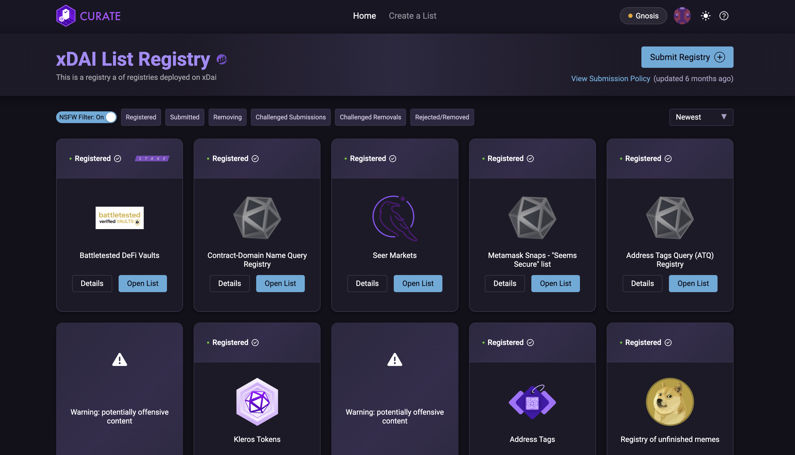
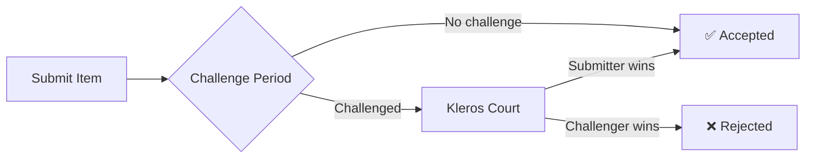

<Frame>
  
</Frame>

# Curate

<Warning>
**Classic Curate is retired in the Curate app.** You can no longer browse, submit to, or create Classic lists in the [Curate app](https://curate.kleros.io). A Classic list's address now opens a **Classic lists are retired** page that links to the contract on the block explorer. The Classic Curate contracts stay deployed on chain, with their entries and history. **Light Curate and Stake Curate are not affected.** The Curate app calls Light Curate lists **Standard lists**, and only Standard and Stake lists can be Kleros Verified.
</Warning>

**Curate** is a decentralized application for creating and maintaining community-curated registries. Anyone can submit items to a list, and anyone can challenge incorrect or malicious submissions-with disputes resolved by Kleros Court.

Think of it as Wikipedia for structured data, but with economic skin in the game. Submitters stake a deposit that they lose if their submission is successfully challenged. Challengers risk their own deposit if the submission turns out to be valid. This creates a self-sustaining system where participants are economically incentivized to maintain accurate registries.

Curate powers critical infrastructure across Web3: token lists that wallets use to display assets, address tags that block explorers use to label contracts, and security registries that help users avoid scams.

---

## Curate Variants

Curate is a family of three variants. All three use the V1 Kleros Court for dispute resolution.

- **Classic Curate** (V1) - a full Token-Curated Registry (TCR) supporting complex schemas. Retired in the Curate app: its contracts stay on chain, but you can no longer browse, submit to, or create Classic lists there.
- **Light Curate** (V1) - a simplified TCR built for higher volume and lower gas costs. On Gnosis Chain. The Curate app calls these **Standard lists**.
- **Stake Curate** (V1 infrastructure) - continuous verification with permanent deposits, on Gnosis Chain. Deployed mid-August 2025; first implementation with DAMM Capital (September 2025). See [Stake Curate](/products/stake-curate).

---

## Key Capabilities

<CardGroup cols={2}>
  <Card title="Permissionless submissions" icon="plus">
    Anyone can add items to a registry by staking a deposit
  </Card>
  <Card title="Community curation" icon="users">
    Anyone can challenge incorrect submissions
  </Card>
  <Card title="Dispute resolution" icon="scale-balanced">
    Contested items are decided by Kleros Court jurors
  </Card>
  <Card title="Flexible schemas" icon="table">
    Create registries for any type of structured data
  </Card>
  <Card title="On-chain data" icon="link">
    Registry data is fully on-chain and queryable
  </Card>
  <Card title="Earn rewards" icon="coins">
    Successful challengers earn the submitter's deposit
  </Card>
</CardGroup>

---

## How It Works

Curate uses a mechanism called a **Token Curated Registry (TCR)**. Here's the flow:

<Steps>
  <Step title="Submission">
    A user submits an item (e.g., a token address with metadata) and stakes a deposit. The submission enters a **pending** state.
  </Step>
  <Step title="Challenge period">
    During the challenge period, anyone can challenge the submission by staking their own deposit. If no one challenges, the item is **accepted** into the registry.
  </Step>
  <Step title="Dispute (if challenged)">
    If challenged, a dispute is created in Kleros Court. Jurors review the evidence and vote on whether the submission meets the registry's acceptance criteria.
  </Step>
  <Step title="Resolution">
    The winning party receives both deposits (minus arbitration fees). The item is either **accepted** or **rejected** based on the ruling.
  </Step>
</Steps>

### The Incentive Structure

The beauty of TCRs is that **you don't need to trust anyone**:

- **Submitters** are incentivized to only submit valid items (or lose their deposit)
- **Challengers** are incentivized to only challenge invalid items (or lose their deposit)
- **Jurors** are incentivized to vote honestly (via Kleros's Schelling point mechanism)

This creates a self-policing system where bad actors are economically punished.

---

## Use Cases

<Tabs>
  <Tab title="Token Lists">
    **Problem:** Wallets and exchanges need to know which tokens are legitimate.
    
    **Solution:** Community-curated token registries where anyone can submit tokens and anyone can challenge scams or duplicates.
    
    **Example:** The Kleros Token Registry is used by wallets to display token information and warn users about unverified assets.
  </Tab>
  
  <Tab title="Address Tags">
    **Problem:** Block explorers show raw addresses with no context about what they are.
    
    **Solution:** Registries that map addresses to human-readable labels (e.g., "Uniswap V3 Router", "Vitalik.eth").
    
    **Example:** Address tag registries power the labels you see on Etherscan and other explorers.
  </Tab>
  
  <Tab title="Contract Security">
    **Problem:** Users can't easily verify if a smart contract is safe to interact with.
    
    **Solution:** Security registries where auditors and community members flag risky or verified contracts.
    
    **Example:** [Kleros Scout](/products/scout) displays security information from Curate registries.
  </Tab>
  
  <Tab title="Contract-Domain Names">
    **Problem:** Users and dApps can't easily tell which website a contract officially belongs to.
    
    **Solution:** The Contract-Domain Name (CDN) registry verifies contract-to-domain pairings, along with project metadata such as logos and descriptions.
    
    **Example:** Verified project information and logos served to wallets and dApps across the ecosystem.
  </Tab>
</Tabs>

### Who Uses Curate?

- **Wallets** query token registries to display asset information
- **Block explorers** use address tags for human-readable labels
- **DeFi protocols** check registries before listing new assets
- **Security tools** aggregate risk information from curated lists
- **DAOs** maintain member or contributor registries

---

## Registry Types

Curate offers three variants across the two protocol versions:

| Variant | Version | Best For | Gas Costs | Flexibility |
|---------|---------|----------|-----------|-------------|
| **Classic Curate** (full) | V1 | Retired in the Curate app; contracts remain on chain | Higher | Maximum |
| **Light Curate** (Standard lists in the Curate app) | V1 | Simple registries, higher volume | Lower | Standard schemas |
| **Stake Curate** | V1 infra | Continuous verification with permanent deposits | - | See [Stake Curate](/products/stake-curate) |

New lists in the Curate app are Standard (Light Curate) or Stake lists. Most registries use **Light Curate** for cost efficiency.

---

## Current Status

**Classic Curate retirement:** Classic Curate is retired in the Curate app. Classic list, entry, and submit pages now show a **Classic lists are retired** page that links to the contract on the block explorer, and the contracts with their entries and history stay on chain. Light Curate and Stake Curate are not affected. The Kleros lists of lists, which grant the Kleros Verified badge, moved to Light Curate in August 2026, and only Standard (Light Curate) and Stake lists count as Kleros Verified. On November 17, 2026, Kleros replaced its Gnosis Chain list of lists with a new one at `0x5f688a4bac5e2787ef1d9de325831e537ee4cffa`, with the same settings. The former Gnosis list of lists (`0x2418d887d0d0fe03b793a6af4321fa488226a0b5`) keeps working on chain but no longer grants Kleros Verified. Kleros registered the Standard and Stake lists that were Verified there on the new one, so their status did not change.

Following **KIP-87**, a dedicated **Curation Court with hidden voting** went live on Gnosis Chain in mid-2026. Hidden voting splits juror voting into commit-and-reveal phases so jurors can't see other votes before deciding, reducing herding on curation disputes. The Scout registries migrated to this court on **July 13, 2026**. Curate V2 development also aligned its evidence query with the kleros-core schema migration.

Follow development on the [Kleros blog - developer updates](https://blog.kleros.io/tag/developer/).

---

## What's Next?

<CardGroup cols={3}>

  <Card title="Use Curate" icon="rocket" href="/tutorials/curate-tutorial">
    **Step-by-step guides**
    
    Learn how to submit items, challenge submissions, and earn rewards.
   
  </Card>

  <Card title="Build on Curate" icon="code" href="/developers/products/curate">
    **Integration guide**
    
    Query registry data, build custom UIs, or create your own registry.
    
    → Developer Docs
  </Card>

  <Card title="Understand TCRs" icon="lightbulb" href="/concepts/game-theory">
    **Game theory deep dive**
    
    Learn the economics and incentives behind Token Curated Registries.
    
    → Concepts
  </Card>

</CardGroup>

---

## Quick Links

<CardGroup cols={2}>
  <Card title="Launch Curate (V1)" icon="arrow-up-right-from-square" href="https://curate.kleros.io/">
    Browse, submit to, and challenge items on existing V1 lists
  </Card>
  <Card title="Curate V2" icon="flask" href="https://curate-v2.netlify.app/">
    Try the next-generation Curate interface
  </Card>
  <Card title="Curate Subgraph" icon="database" href="/developers/subgraph/overview">
    Query registry data via GraphQL
  </Card>
  <Card title="Contract Addresses" icon="file-contract" href="/reference/contracts/deployment-addresses">
    Curate V2 deployment addresses
  </Card>
</CardGroup>